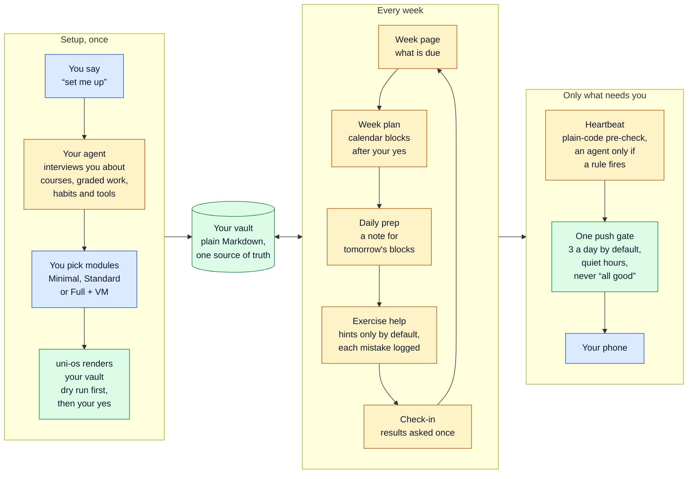
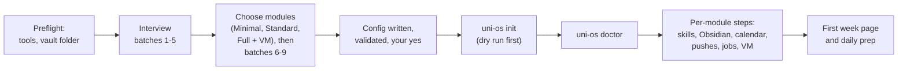
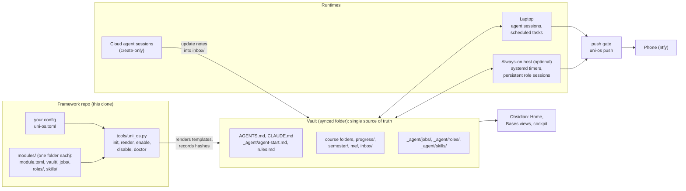

<div align="center">

# Uni OS

**A study system you build with your AI agent.**<br/>
Your agent interviews you, then builds your vault, a folder of plain Markdown that you and your agents share, plus the jobs that keep it current while you study.

<sub>I'm Qiang Luo ([ktr0a](https://github.com/ktr0a)). I built this for my own first year of BSc Computer Science at ETH Zurich (HS26, autumn 2026), then generalised it: every personal value is a config key, every time a schedule you choose, every feature a module you switch on or off.</sub>

[](CHANGELOG.md)
[](LICENSE)
[](tools/README.md)
[](#agents-other-than-claude-code)
[](docs/porting-to-other-os.md)
[](#storage-and-obsidian)

<kbd>git clone</kbd> &rarr; <kbd>open your agent</kbd> &rarr; <kbd>say "set me up"</kbd> &rarr; <kbd>answer the interview</kbd> &rarr; <kbd>your vault and its jobs</kbd>

[Quick start](#quick-start) · [How it works](#how-it-works) · [Modules](#module-catalogue) · [How it evolved](#how-it-evolved) · [For engineers](#for-engineers)

</div>

## At a glance

You set it up once with your agent. Each step that writes something waits for your yes, and a laptop alone is enough: the always-on host is optional. After that, your vault and its jobs carry the term, and only what needs you reaches your phone.



<sub>Blue: you decide or act. Amber: an agent session or agent job does the work. Green: plain files and code, no agent needed. Every schedule is a config key you choose.</sub>

<table>
  <tr>
    <td align="center"><b>25</b><br/><sub>modules</sub></td>
    <td align="center"><b>18</b><br/><sub>jobs</sub></td>
    <td align="center"><b>6</b><br/><sub>role briefs</sub></td>
    <td align="center"><b>4</b><br/><sub>skills</sub></td>
    <td align="center"><b>7 / 20 / 25</b><br/><sub>modules in Minimal,<br/>Standard, Full + VM<br/>(Windows, with Obsidian)</sub></td>
  </tr>
  <tr>
    <td align="center"><b>390</b><br/><sub>tool tests</sub></td>
    <td align="center"><b>111</b><br/><sub>module tests</sub></td>
    <td align="center"><b>199</b><br/><sub>host-script checks</sub></td>
    <td align="center"><b>80</b><br/><sub>PowerShell checks</sub></td>
    <td align="center"><b>109</b><br/><sub>plugin checks</sub></td>
  </tr>
</table>

<sub>All suites passing on Windows 11 on 7 Nov 2026 (version 0.1.0). Not tested yet: a full setup on a fresh machine, the host scripts on a real server, other agents, macOS or Linux laptops. Details: [Status](#status) and [Tests](#tests).</sub>

- **Built with:** a standard-library Python 3.11+ command line (template engine, layered config, SHA-256 manifest with region-aware re-render, `doctor` with contract checks and a secrets scan; the same config and date give byte-identical files), an Obsidian plugin in TypeScript, and bash plus systemd for the optional always-on Linux host. See [For engineers](#for-engineers).
- **Integrity built in:** every course and graded assessment has an assistance level (`solo`, `hints-only`, `coach`, `full`). The default is `hints-only`, and `solo` means no help at all.
- **Who it is for:** any student who wants to study with an AI agent. It leans towards engineering and computer science, but nothing in it is specific to one university.
- **Where it came from:** my own system. In its first two months I rebuilt it several times, from single chats to a hosted chat project, a vault in my Google Drive, a local coordinator, cloud sessions, an always-on VM and a home server, each time because of one concrete limit ([How it evolved](#how-it-evolved), [What I learned](#what-i-learned)).

## Status

| | |
|---|---|
| **Version** | 0.1.0, the first public version (7 Nov 2026). See [CHANGELOG.md](CHANGELOG.md). |
| **Agents** | **Tested only with Claude Code** (desktop app, CLI, Remote Control), and it works best with it. Other agents (Codex, Gemini CLI, Cursor, ...) should be able to follow the same agent-neutral files (`AGENTS.md`, `SKILL.md` skills, role briefs, job prompts), but nobody has tried that yet. See [Agents other than Claude Code](#agents-other-than-claude-code). |
| **Laptop scripts** | Windows only and **experimental** (PowerShell 5.1, Task Scheduler, VBS launchers): the vault watcher, the course-file pick-up and the OS-scheduler job path. On macOS or Linux your agent ports them from their behaviour specs ([docs/porting-to-other-os.md](docs/porting-to-other-os.md)). Jobs that run as scheduled tasks of the agent's desktop app need no scripts. |
| **Always-on host** | Optional add-on. Ubuntu on Google Cloud is the documented default. Other providers, any Linux box and a home server (WSL2 on a spare laptop) use the same host code. |
| **Storage** | Google Drive is the documented default. OneDrive, Dropbox, iCloud, Syncthing or git probably work too, but are untested. |
| **Obsidian** | Recommended, not required. Everything is plain Markdown. |
| **Tested** | All unit and module suites ([Tests](#tests)), and full renders of all 25 modules and of every preset with the example config, each followed by `doctor --strict`. All on Windows 11 with Python 3.14; the Python suites also pass on Python 3.11. The mechanics come from my own system, where they ran daily in autumn 2026; this generalised code has not had that kind of daily use yet. |
| **Not tested yet** | A complete setup by a new user on a fresh machine, end to end. The generalised always-on host scripts on a real, freshly built server: they were tested with fakes only, and the tests that need `flock`, `jq` or `systemd-analyze` were skipped on Windows. The experimental OS-scheduler path on the laptop. Any agent other than Claude Code. macOS or Linux laptops. Storage other than Google Drive. |

## Contents

- **Start here:** [What it does for a student](#what-it-does-for-a-student) · [Quick start](#quick-start)
- **The system:** [How it works](#how-it-works) · [Module catalogue](#module-catalogue) · [Presets](#presets) · [Runtimes: laptop, cloud sessions, always-on host](#runtimes-laptop-cloud-sessions-always-on-host) · [Agents other than Claude Code](#agents-other-than-claude-code) · [Storage and Obsidian](#storage-and-obsidian)
- **Why it looks like this:** [Design principles](#design-principles) · [How it evolved](#how-it-evolved) · [What I learned](#what-i-learned)
- **Reference:** [Repository tour](#repository-tour) · [For engineers](#for-engineers) · [Privacy, security and academic integrity](#privacy-security-and-academic-integrity) · [FAQ](#faq) · [Roadmap](#roadmap) · [Credits and licence](#credits-and-licence)

## What it does for a student

The examples below follow the fictional student used throughout this repository: **Alex Example**, first-year BSc Computer Science at the **Example Institute of Technology (EIT)**. Alex takes Algorithms and Data Structures (AD), Discrete Mathematics (DM), Linear Algebra (LA) and Introduction to Programming (PROG). Alex's complete config is [examples/alex.toml](examples/alex.toml). The schedule times below come from that file, and the study blocks from the example prep note in the [daily-prep](modules/daily-prep/README.md) module. They are only an example: during setup you choose your own, and you can change them later by asking your agent.

### A week in Alex's term (the weekend of 7-8 Nov, then week 8: Mon 9 to Sun 15 Nov 2026)

| When | What happens | Where it lands |
|---|---|---|
| Sat 7 Nov, 19:45 (`schedule.check_in`) | The `check-in` job asks Alex **once** for the week's results, one line per course ("DM graded sheet 4: 2/2"), then closes week 7, recomputes the bonus standing and appends a tracker line. | `progress/weeks/week-07.md`, `progress/current-status.md`, `progress/tracker-log.md`, course cards |
| Sun 8 Nov, 10:00 (`schedule.week_page`) | The `week-page` job creates the coming week's page with a "Due this week" table of real items (sheet numbers, the AD quiz on Wed 11 Nov, Alex's personal targets) and asks the planner for a week plan. | `progress/weeks/week-08.md` |
| Sunday, after the week page | The **Plan & progress** role weighs hours needed against free hours and proposes study blocks in a short notation (`AD_ Sheet 7`, `(PROG)`, `[DM]`). They go into the "Study blocks" calendar only after Alex's yes (`calendar.standing_approval = false`). | `semester/plans/week-08-plan.md`, the calendar |
| Every evening, 17:30 and 19:30 (`schedule.daily_prep`) | The `daily-study-prep` job writes one prep note with everything tomorrow's blocks need (sheet, script pages, study page, integrity warning) and appends a `MATERIAL` block to each calendar event. The later run only checks for changes. | `semester/prep/prep-2026-11-12.md` (written on Wed 11 Nov) |
| Every morning, 07:30 (`schedule.prep_check`) | The `study-prep-morning-check` job compares today's note with the calendar and the disk; if anything is off, it writes a new revision (`-r2`) instead of editing the note. | `semester/prep/prep-2026-11-12-r2.md` (only when needed) |
| Thu 12 Nov, 13:15, in the "AD_ Sheet 7 rest (deep)" block | In the **AD · Exercise help** session Alex gets the smallest hint first (AD sheets are `hints-only`), never a proof or code. Each mistake becomes an error-log row at once. | `AD/ad-error-log.md`, `me/weak-spots.md` |
| Before and after lectures (on request; the optional `lecture-skim` job covers the courses in `study.rundowns.skim_courses`) | The **lecture-rundown** role writes a skim before and a rundown after a lecture, citing section and page of the real sources; on request also a full interactive study page (HTML plus a Markdown twin). | `AD/notes/`, `DM/notes/` |
| 4 days before a graded quiz (`study.quiz.prep_lead_days`) | The **quiz-coach** role (or the optional `quiz-prep` job) builds a prep sheet with code-checked quick checks; after the quiz it logs each miss and records the result. | `AD/quiz-prep/`, the error log, progress files |
| Mon-Fri 07:50, 13:05, 18:05 (`schedule.heartbeat`), Sundays (`schedule.heartbeat_weekend`) | The **heartbeat**'s free, deterministic pre-check runs; an agent starts only if a rule fired (e.g. an unrecorded quiz result), then stays silent, sends one push or asks one question. | `_agent/heartbeat/`, at most one push |
| Any time (`notify.max_per_day`) | The **push gate** allows at most 3 pushes a day, 2 hours apart, none in quiet hours (21:00-07:30) or the exam session, and refuses "all good" and personal details. | Alex's phone (ntfy) |
| In Obsidian | **Home** and the **cockpit** plugin show now and next, what is due with countdowns, bonus bars and today's prep card; a **Done** tap reaches the week page through the inbox. | `Home.md`, the cockpit tab |

What Alex says to the agents is ordinary language: "plan next week", "I missed the 14:00 block", "log this error", "make a study page for dynamic programming", "from now on, only hints in DM", "move the daily prep to 18:00", "turn off the heartbeat". The agents know which file each kind of fact belongs in, because a routing table in the vault says so.

### What you get, in short

- **One vault as the single source of truth** for you and every agent: course cards, week pages, plans, error logs, study pages, your own profile, rules and logs. Plain Markdown, readable without any special app.
- **A study engine**: interactive study pages, lecture skims and rundowns from real sources, hints-only exercise help, quiz coaching, error logs that feed a weak-spots page.
- **An organisation layer**: week pages, a planner that proposes study blocks and writes them into your calendar once you agree, daily study prep, a periodic check-in, bonus and grade tracking, a proactive watcher.
- **Automation that stays quiet**: scheduled jobs that skip themselves when there is nothing to do, outcome checks that look for results instead of exit codes, and one push gate for everything that wants your attention.
- **Academic integrity built in**: an assistance level (config key `assistance`) per course and per graded assessment (`solo`, `hints-only`, `coach`, `full`; default `hints-only`). `solo` means the agent gives no help at all on that work.

## Quick start

### What you need

- **Python 3.11 or newer** (the CLI uses only the standard library), git, and an AI agent that can read and write files in a folder. Claude Code is the only agent I have tested it with.
- Recommended: [Obsidian](https://obsidian.md) for the dashboards, Google Drive for desktop (or another synced folder) so the vault is on every device, and the [ntfy](https://ntfy.sh) app for phone pushes.
- On Windows, optional: `python -m pip install tzdata`, which makes the term time zone exact. Without it the tools use the computer's own time zone and tell you so.

### Set up with your agent

```text
git clone https://github.com/ktr0a/uni-os.git
cd uni-os
```

Open your agent in that folder and say **"set me up"**. In Claude Code: run `claude` in the folder, or open the folder in the desktop app.

The agent follows [setup/PLAYBOOK.md](setup/PLAYBOOK.md). Each step that writes something waits for your yes. Below, `uni-os <command>` is short for `python tools/uni_os.py <command>`, run from the repo root (`python3` on most Linux and macOS systems):



1. **Preflight.** The agent checks Python and your tools, explains what will happen, and agrees with you on where the vault goes: usually a new folder inside your synced drive.
2. **Interview, part 1** ([setup/interview.md](setup/interview.md)): batches 1 to 5, each one message with numbered questions and a proposed default for every question. They cover you, your university and term dates; your courses and timetable; graded work, bonus schemes and the assistance level per course and per graded item; how you study and which output formats you want for study material; and your tools (Obsidian, storage, calendar, phone pushes, laptop OS, agent, where things run).
3. **Modules**: a preset ([setup/presets.md](setup/presets.md)) adjusted to what you want. Then batches 6 to 9, only for the modules you chose: schedules, calendars and block notation, phone pushes and the push gate, and the add-ons.
4. **Config**: one TOML file with all your answers, written to `<vault>/_agent/uni-os.toml` (or to a draft folder outside the repo), validated, and summarised for your yes.
5. **Render**: `uni-os init --dry-run` first, then `uni-os init`, which builds the vault from the module templates. Rendering is deterministic: the same config and date give byte-identical files. From then on the vault's `_agent/uni-os.toml` is the single source of truth.
6. **Check**: `uni-os doctor` validates the config, the files and the formats, and scans the vault for secrets.
7. **Per-module steps**, each optional and each with your yes: skills copied to where your agent reads them, the Obsidian settings and the cockpit plugin, calendar access, phone pushes, scheduled jobs (dry runs first), the coordinator, the Windows add-ons, the always-on host. Secrets such as the ntfy topic, API keys and calendar addresses are entered by you, in your own terminal or app, never typed by the agent.
8. **First week**: the current week page and the first daily prep, then a short hand-over.

Afterwards, [setup/after-setup.md](setup/after-setup.md) covers the first week and daily use. To add or remove modules later, just ask your agent ("add the VM", "turn off daily prep"); it follows [setup/changing-modules.md](setup/changing-modules.md).

### Without an agent

Possible, but **very tedious**: Uni OS is an agent-based system. You fill in a long config by hand, and most of the value (the roles, the jobs, the write-back into the vault) needs an agent anyway. The short version (bash or Git Bash) puts the config at its final place in the vault, `<vault>/_agent/uni-os.toml`:

```bash
mkdir -p "<vault>/_agent"
cp config/uni-os.example.toml "<vault>/_agent/uni-os.toml"     # then edit every value
python tools/uni_os.py config validate --vault "<vault>"
python tools/uni_os.py init --vault "<vault>" --dry-run
python tools/uni_os.py init --vault "<vault>"
python tools/uni_os.py doctor --vault "<vault>"
```

`<vault>` is a new folder, usually inside your synced drive (for example `G:/My Drive/Uni` with Google Drive for desktop on Windows). If you would rather keep the config in the clone, git ignores `config/uni-os.toml` and any `*.local.toml`; pass it with `init --config <file>`, which copies it into the vault. The long version is [setup/manual-setup.md](setup/manual-setup.md). Every key is explained in [config/uni-os.example.toml](config/uni-os.example.toml) and [config/schema.md](config/schema.md).

### Try it on the example student first

Render Alex's vault into a scratch folder and browse it. Git ignores `test-vault*` folders in the repo root:

```text
python tools/uni_os.py init --config examples/alex.toml --vault ./test-vault --date 2026-11-07
python tools/uni_os.py doctor --vault ./test-vault
```

That creates 167 files and 12 folders for Alex's 22 modules. Open `test-vault` in Obsidian, or start with its `README.md`.

## How it works



### The vault

The vault is a folder, usually inside your cloud drive, and an Obsidian vault if you use Obsidian. Everything lives there as files: course facts, plans, results, mistakes, rules, job definitions, role briefs, logs. The rule from my own system still applies: "if it isn't a file in the vault, it doesn't exist". A chat's memory, a project's settings or a scheduled task's prompt never hold the only copy of anything.

The vault has two areas. Everything outside `_agent/` is for you: short pages, tables and links. `_agent/` is for agents. Every agent enters through `AGENTS.md` (or `CLAUDE.md`, which only imports it) and `_agent/agent-start.md`, and follows the same read order:

1. the rules (`_agent/rules.md`, including the integrity policy per course);
2. the real date and the term week;
3. the current state;
4. the course it needs.

Before it finishes any task, it writes everything new into the right file. That file comes from the routing table in `_agent/CONVENTIONS.md` ("you learned X, put it in file Y, like this"). This write-back duty is what keeps the vault current without a human curator.

### Modules

A module is one feature, in `modules/<id>/`:

| Part | Becomes in the vault |
|---|---|
| `module.toml` | the manifest: id, tier, dependencies, supported OS and runtimes, config keys with defaults, jobs, roles, skills, folders, format checks |
| `vault/<path>` | `<vault>/<path>`, rendered from a template |
| `jobs/<job>/job.conf` + `prompt.md` | `<vault>/_agent/jobs/<job>/`: a scheduled unit (an agent prompt or a shell command) |
| `roles/<role>.md` | `<vault>/_agent/roles/<role>.md`: a durable job description for an agent session |
| `skills/<skill>/SKILL.md` | `<vault>/_agent/skills/<skill>/`, in the open Agent Skills format |
| `scripts/`, `host/`, `laptop/`, `plugin/` | code that stays in the framework (converters, runners, the always-on host, the Obsidian plugin) |
| `README.md` | the module's doc page: why, how, configuration, daily use, failure modes, lessons from my own system |

There are 25 modules with 18 jobs, 6 roles and 4 skills. Dependencies are resolved automatically (`requires`), and `core` is always installed.

### Config and templates

Your config file (TOML) is the single source of truth for every parameter. The values are layered, lowest priority first:

1. the built-in defaults;
2. the defaults of modules that are not enabled;
3. the defaults of enabled modules;
4. your own file.

`uni-os config keys` shows where each value comes from. Every text file in a module is a template: `{{student.name}}`, `{{#each courses}}...{{/each}}`, `{{#if modules.daily-prep}}...{{/if}}`. Paths expand per course (`vault/{{course.folder}}/{{course.slug}}.md` becomes `AD/ad.md`, `DM/dm.md`, ...). A missing key is an error, never a silent blank. A machine copy of the config, `_agent/uni-os.json`, serves readers that cannot parse TOML, such as the cockpit plugin.

### Keeping the vault current

`uni-os init` never overwrites an existing file (only `--force` does, and setup never passes it). The manifest `_agent/.uni-os-manifest.json` records every file it wrote, with a SHA-256 hash. Later, after you change the config or enable a module, `uni-os render` works file by file:

- a file nobody has edited is updated;
- a new file or folder is created;
- a file you edited is left as it is, except for its **generated regions**. These are text between `<!-- uni-os:begin NAME -->` and `<!-- uni-os:end NAME -->` marker lines, such as the vault map, the routing table or the module registry. Only the text between the markers is refreshed; every other byte stays as you wrote it;
- if a marker is broken, the file is skipped and reported, never guessed;
- deleted files are not recreated (`init` restores them).

`uni-os doctor` checks:

- the config;
- module dependencies;
- missing or edited files;
- `job.conf` files;
- the parsed formats (week pages, course cards, prep notes, the `course` property, region markers);
- secrets: it scans the vault for API keys, tokens, private calendar addresses and ntfy topics, with redacted output.

### Jobs and runtimes

A job is data in the vault (`_agent/jobs/<job>/`). `job.conf` holds the schedule, the limits and the run mode in shell-style `KEY="value"` lines. `prompt.md` holds the full unattended prompt for agent jobs. The schedule comes from your config (`SLOTS="{{schedule.daily_prep}}"`), so there is one place to change it. Three schedulers work from the same files:

- on the laptop, the agent's desktop app runs them as scheduled tasks, which the setup agent creates from each job's prompt and slots. There is no runner in this path, so each prompt does its own "already done?" check (in Claude Code: desktop scheduled tasks);
- also on the laptop, an OS scheduler starts a small Python runner, which runs the agent CLI headless (experimental);
- on an always-on host, a bash runner turns each `job.conf` into a systemd timer.

A job runs on exactly one machine at a time. Two rules keep jobs cheap and safe:

- **`PRECHECK`** is a shell test that runs before any agent starts. If there is nothing to do, the agent never runs and the run costs nothing.
- **Exit 0 is not success.** Deterministic outcome checks look for the result itself (is tomorrow's prep note there? is the inbox drained?) and report only problems.

Nothing runs until you switch it on:

- **Laptop:** a job runs only once the setup agent has created its task, and it creates tasks only for the jobs you chose.
- **Always-on host:** 11 of the 18 jobs ship with `DEFAULT_MODE="off"`. A job that can also run on the laptop (`RUNTIME="any"`) always arrives switched off there, so no job runs on two machines; only host-only jobs (`RUNTIME="vm"`) with `DEFAULT_MODE="always"`, such as the self-check, start on their own. In failover mode the host runs a job only when the laptop missed its slot.
- **Optional agent jobs** (heartbeat, `lecture-skim`, `quiz-prep`, `deadline-audit`, `waiting-on-you`) go live only after a staged rollout: a build report, dry runs checked against fixed criteria, then your yes.

### Roles and sessions

A **role** is durable: a brief, the files it may write and a row in the routing table. A **session** is a disposable agent conversation that hosts a role. With the `roles` module, one **coordinator** session is your entry point. It routes your requests to the right role, quotes your words, checks the result in the vault before it says "done", and keeps a state page so nothing is lost when its context fills up. Roles move between laptop, cloud and host through written handoffs.

Long sessions are recycled at about 300k tokens of context, because every turn re-reads the whole context. In one week I measured on my own system, the long-lived coordinator used about 19 % of the agent usage and all scheduled jobs together about 1.6 %.

Every duty in a brief names its trigger (a job, a calendar block or a message from you): in my setup, duties written as "when you notice it is due" never fired.

### Notifications

Every sender (the heartbeat, the outcome checks, the jobs, the host's health check) goes through one gate, `uni-os push`. The gate applies:

- a daily budget and a minimum gap between pushes;
- dedupe per problem id;
- quiet hours and quiet windows, during which a push is held back: the sender keeps the problem as a flag and raises it again later if it is still true;
- two hard refusals: no "all good" messages and no personal details (mail addresses, links in the text, long digit runs).

Host health alerts and job failures go through the same gate with `--direct`: outside the daily budget and quiet hours, still refused when they carry personal details, and collected into one push when a quiet window ends. The default channel is ntfy. The topic that addresses your phone is a secret and lives in a file outside the vault.

Full details: [docs/architecture.md](docs/architecture.md), [docs/file-formats.md](docs/file-formats.md) and [docs/glossary.md](docs/glossary.md).

## Module catalogue

Each module has its own page with what it does, why it exists, how it works, its configuration, daily use, failure modes and lessons from my own system. The full catalogue with dependencies and presets is [modules/README.md](modules/README.md); the groups below follow its layers. Tiers come from each `module.toml`: `core`, `standard`, `advanced`, `addon`.

### Foundation

| Module | Tier | What it does |
|---|---|---|
| [core](modules/core/README.md) | core | The vault skeleton: agent entry points, the start page and read order, standing rules with per-course integrity policies, the routing table, the component registry, tool lore, the inbox drop zone, note templates, Home and the generated vault maps. Always installed. |
| [student-model](modules/student-model/README.md) | core | Four short pages in `me/` (profile, learning style, rhythm, weak spots) that every agent reads before it gives advice or makes a plan. |
| [courses](modules/courses/README.md) | core | One folder per course: a course card as the single source of course facts, a backlog, notes and reference folders, add-only folders for official files, an overview and the `course-facts` skill. |
| [error-logs](modules/error-logs/README.md) | core | One append-only mistake table per course (and per stream), patterns that feed `me/weak-spots.md`, the `log-error` skill and an optional retest bank. |

### Study engine

| Module | Tier | What it does |
|---|---|---|
| [study-pages](modules/study-pages/README.md) | standard | Self-contained HTML teaching pages with KaTeX: navigation, demos, quizzes after each section with answers checked by code, a cheat sheet, a final self-test, dark mode and phone width. Also a Markdown twin, or Markdown only, HTML only or PDF. Skill `study-page`. |
| [exercise-help](modules/exercise-help/README.md) | standard | Role **exercise-help**: smallest hint first, checks of your own steps, hint pages and mistake maps, following each course's and assessment's assistance level. |
| [lecture-rundowns](modules/lecture-rundowns/README.md) | standard | Role **lecture-rundown**: skims, rundowns, recaps, summaries, cheat sheets and decks, only from the course's real sources with pages cited. Optional job `lecture-skim`. |
| [quiz-coaching](modules/quiz-coaching/README.md) | standard | Role **quiz-coach** for graded quizzes during the term: scope check, prep sheets, mock quizzes on request, reviews that feed the error log. Optional job `quiz-prep`. |
| [handwritten-notes](modules/handwritten-notes/README.md) | standard | A folder contract for any tablet app that exports PDFs into the course folders. Agents read and link the PDFs, never write there. Skill `read-handwritten-notes`. |
| [resources](modules/resources/README.md) | standard | A sources registry with an authority order, a review log for TA and community websites, and the course-fact verification method. |

### Organisation layer

| Module | Tier | What it does |
|---|---|---|
| [progress](modules/progress/README.md) | standard | A dashboard with bonus or grade standing per course, an append-only tracker log, and one page per term week with a parsed "Due this week" table and an end-of-week check-in. |
| [planning](modules/planning/README.md) | standard | The term calendar page, the planning system (calendars, block notation, house rules), week plans with a calendar-edit ledger, exam-phase scheduling and role **Plan & progress**. Optional job `deadline-audit`. |
| [check-in](modules/check-in/README.md) | standard | Jobs `week-page` (creates next week's page and asks for the plan) and `check-in` (asks for the period's results once, then closes the week), weekly or every two weeks. |
| [daily-prep](modules/daily-prep/README.md) | standard | Jobs `daily-study-prep` and `study-prep-morning-check`: one immutable prep note per day plus a `MATERIAL` block in each calendar event, verified every morning. |
| [heartbeat](modules/heartbeat/README.md) | standard | The proactive watcher: a deterministic pre-check decides whether an agent run is worth it. The agent then stays silent, sends one push or asks one question. Jobs `heartbeat`, `heartbeat-weekend`, `heartbeat-watch`, `heartbeat-ask`. |
| [experiments](modules/experiments/README.md) | advanced | A method for testing changes to how you study: pre-registered measures and review date, a per-block log with verdict words, a coverage list and a keep / change / try-next verdict. |

### Agents and automation

| Module | Tier | What it does |
|---|---|---|
| [roles](modules/roles/README.md) | standard | The role system: common rules, the **coordinator** and its state page, a generated routing table, messaging rules, handoffs and handovers. Optional job `waiting-on-you`; a usage map script for Claude Code. |
| [scheduler-local](modules/scheduler-local/README.md) | standard | Runs the vault's jobs on the laptop as desktop-app scheduled tasks, or (experimental) through an OS scheduler and a headless runner. Also defines the unattended-prompt anatomy and failover markers. |
| [notifications](modules/notifications/README.md) | standard | ntfy pushes through the push gate, plus the `outcome-checks` job that checks results instead of exit codes. |
| [inbox-sync](modules/inbox-sync/README.md) | advanced | Lets create-only writers (cloud sessions through a storage connector, the cockpit's Done taps) change vault files safely through update notes with exact anchors. Jobs `inbox-sync` and `inbox-poll`. |

### Obsidian

| Module | Tier | What it does |
|---|---|---|
| [obsidian](modules/obsidian/README.md) | standard | Bases views, a CSS snippet with per-course colours and callouts, graph colour groups, bookmarks and a generated vault-map canvas. |
| [cockpit](modules/cockpit/README.md) | addon | An Obsidian plugin (TypeScript): now and next, due this week with countdowns, bonus bars, the prep card, a week grid, live calendars via iCal, Done taps and an optional assistant panel on your own API key. |

### Add-ons: Windows laptop and always-on host

| Module | Tier | What it does |
|---|---|---|
| [vault-watch](modules/vault-watch/README.md) | advanced | Windows only, experimental. A Task Scheduler script that diffs the vault's file metadata a few times a day, logs changes for the agents and raises a toast only for things someone must act on. |
| [course-files-fetch](modules/course-files-fetch/README.md) | advanced | Role **course-files-fetch** reads the LMS in your own logged-in browser. An experimental, Windows-only pick-up task files the downloads with provenance checks, never overwrites, and leaves every password step to you. |
| [vm](modules/vm/README.md) | addon | An always-on Linux host (Ubuntu on Google Cloud, any Linux box, or WSL2 on a spare laptop). It runs the job runner on systemd timers, persistent role sessions, a Remote Control server for the phone, a 15-minute self-check and an hourly git history of every note. Jobs `vm-health`, `vault-history`, `vm-performance-verdict`. |

## Presets

The setup interview starts from a preset and adjusts it to you. The lists come from [`tools/uni_os/presets.py`](tools/uni_os/presets.py); [setup/presets.md](setup/presets.md) explains the choice.

| Preset | Modules | Rendered with Alex's config |
|---|---|---|
| **Minimal**: the study engine on a plain vault | `core`, `student-model`, `courses`, `error-logs`, `study-pages`, `exercise-help`, plus `obsidian` if you use Obsidian | 7 modules, 71 files |
| **Standard**: Minimal + the organisation layer and laptop automation | adds `progress`, `planning`, `check-in`, `daily-prep`, `lecture-rundowns`, `quiz-coaching`, `roles`, `scheduler-local`, `heartbeat`, `notifications`, `resources`, `handwritten-notes`, plus `cockpit` if you use Obsidian | 20 modules, 154 files |
| **Full + VM**: everything | adds `inbox-sync`, `experiments`, `vault-watch` and `course-files-fetch` (both on a Windows laptop only), `vm` | 25 modules, 183 files |

- **Without Obsidian** (`obsidian.enabled = false`) the presets leave out the Obsidian-only modules (`obsidian`, `cockpit`).
- **On macOS or Linux** Full leaves out the Windows-only `vault-watch` and `course-files-fetch` and says why: presets are resolved for your laptop's system (`runtime.laptop_os`, else this computer's). Add them anyway with `--modules` or `uni-os enable` once your agent has ported their laptop scripts ([docs/porting-to-other-os.md](docs/porting-to-other-os.md)); `doctor` then warns about both.
- **`vm`** needs an always-on host you set up yourself.

Alex runs Standard plus `inbox-sync` and `experiments` (22 modules). You can check any preset with `python tools/uni_os.py modules --preset standard` (add `--no-obsidian` to see it without Obsidian, `--os macos` to see it for another laptop system).

## Runtimes: laptop, cloud sessions, always-on host

The core works laptop-only: local agent sessions plus scheduled tasks on the laptop. The always-on host is an add-on, and the three runtimes can be mixed. In my own setup, the coordinator ran on my laptop, the recurring jobs and six role sessions on an always-on host, and some course roles as cloud sessions.

| | Laptop only | Cloud agent sessions | Always-on host (`vm` module) |
|---|---|---|---|
| Runs while the laptop sleeps | no: jobs run late, at the next wake or app launch | yes | yes |
| Unattended runs in bypass-permissions mode | yes, if you choose it | no: only accept-edits, auto or plan modes | yes (the blast radius is the vault and a replaceable box) |
| Reads files on the laptop | yes | no | no: it reads its own mount of the vault |
| Edits existing vault files | yes | needs a git repo; through a create-only storage connector it can only add files, so it sends update notes (`inbox-sync`) | yes, on its rclone mount |
| Scheduled jobs | desktop-app scheduled tasks (only while the app is open; late starts and catch-up after wake) or an OS scheduler | not used: without bypass mode, unattended runs stop at approval prompts | systemd timers, punctual to the minute |
| Persistent role sessions | while the app is open | yes, but they cannot be messaged from laptop sessions | yes, resumed after crashes and reboots; reachable from the phone through Remote Control |
| Cost | nothing extra | included in the agent subscription | in my setup: about $21 a month for an `e2-custom-small-4096` Google Cloud VM (4 GB RAM), as an example. A home server (e.g. WSL2 on an old laptop) costs electricity only. |
| Maintenance | low | low | real: logins, drive tokens, updates, memory |

Memory, not CPU, limits the host. On 4 GB my host fitted about six role sessions plus jobs, and its first weekly verdict was "tight". Details and sizing: [docs/runtimes.md](docs/runtimes.md), [modules/vm/README.md](modules/vm/README.md), [modules/vm/INSTALL.md](modules/vm/INSTALL.md) (Google Cloud and other providers) and [modules/vm/HOME-SERVER.md](modules/vm/HOME-SERVER.md).

## Agents other than Claude Code

I have only tested Uni OS with Claude Code, and it works best with it. Nothing essential lives in a Claude-only file: `AGENTS.md` is the entry point everywhere, and `CLAUDE.md` only imports it. Where a Claude Code feature is used, there is a fallback:

| Used for | In Claude Code | Other agents |
|---|---|---|
| Entry file | `CLAUDE.md` imports `AGENTS.md` | Codex, Cursor and others read `AGENTS.md`. Gemini CLI reads `GEMINI.md`: create one that says "Read AGENTS.md first." |
| Skills | linked or copied into `agent.skills_dir` (default `.claude/skills`) | read `_agent/skills/<id>/SKILL.md` when its description matches the task |
| Laptop jobs | desktop-app scheduled tasks | the experimental OS-scheduler runner with `agent.headless_command` set to the agent's non-interactive mode |
| Jobs on the always-on host | `claude -p` headless, Remote Control sessions for interactive jobs | `AGENT_HEADLESS_CMD` / `AGENT_INTERACTIVE_CMD` in the host settings; interactive jobs in tmux, reached over ssh |
| Phone access to sessions | Remote Control | ssh (or a phone ssh app) plus tmux |
| Messages between sessions | ListAgents / SendMessage, sessions addressed by title | through the vault: rows in the coordinator's state page, `## For <role>` sections in update notes (`inbox-sync`), and you carry messages between windows |
| Hooks on the always-on host (re-read nudge, first-turn detection) | `UserPromptSubmit` and `Stop` hooks | sessions re-read the rules at start and after every compaction; interactive jobs close after `KEEP_H` hours |
| Bulk reading | subagents | a separate session that writes its findings to a file |
| Logged-in course sites | the Claude in Chrome extension, driving your own logged-in browser | a browser tool that attaches to your normal browser profile; without one, the agent lists the missing files and you download them |
| Usage per session | `modules/roles/scripts/usage_map.py` reads the local transcripts | not available |

More in [docs/agents.md](docs/agents.md) and in each module's "Agents other than Claude Code" section.

## Storage and Obsidian

**Storage.** The documented default is Google Drive: desktop sync on the laptop, an rclone mount on the always-on host. Cloud storage is last-writer-wins per file, so the conventions keep one writer per file and name the files where a second writer is risky. OneDrive, Dropbox, iCloud, Syncthing or a git repository probably work the same way, but are untested. See [docs/storage.md](docs/storage.md).

**Obsidian** is recommended, not required. Every file is plain Markdown that any editor and any agent can read. Without Obsidian you lose the dashboards: the Bases views on Home, the course-coloured callouts and the cockpit plugin. Possible replacements, if you want them, are yours to build:

- a dashboard inside your AI app ("give me the status pack");
- your own HTML page over the same notes (the cockpit's parsers are plain TypeScript with no Obsidian imports);
- a small wrapper around the same files.

## Design principles

A condensed selection. [docs/design-principles.md](docs/design-principles.md) has all 27 principles, each with the rule, why it exists and where the framework implements it; the number in brackets is the principle's number there.

- **[Single source of truth: the vault](docs/design-principles.md#1-single-source-of-truth-the-vault)** (1). Every definition is a file in the vault. Runtimes are replaceable; the vault is not.
- **[Agent-neutral files, product features as extras](docs/design-principles.md#26-agent-neutral-files-product-features-as-extras)** (26). Essential instructions live in `AGENTS.md`, `SKILL.md` and plain Markdown. Claude Code features always have a stated fallback.
- **[Integrity first, in data and code](docs/design-principles.md#12-integrity-first-in-data-and-code)** (12). Every course defaults to `hints-only`; `solo` means no help at all. Rules you set in the moment never override integrity rules.
- **[Real sources only, or nothing](docs/design-principles.md#13-real-sources-only-or-nothing)** (13). Course content comes from the course's own script, slides and handouts, cited by section and page. If a source can't be opened, the agent says so instead of filling in.
- **[Every promised duty needs a trigger](docs/design-principles.md#11-every-promised-duty-needs-a-trigger)** (11): a job, a calendar block or a message from you. "When you notice it" is not a trigger.
- **[Deterministic first, agent second](docs/design-principles.md#22-deterministic-first-agent-second)** (22). Shell pre-checks, the heartbeat's rule set and the outcome checks are plain code. The agent runs only when they found something.
- **[Silence is the norm; notifications are budgeted](docs/design-principles.md#9-silence-is-the-norm-notifications-are-budgeted)** (9). One push gate for every sender, never "all good", never personal details.
- **[Generate what can drift](docs/design-principles.md#24-generate-what-can-drift)** (24). Maps, registries and routing tables are rendered from the config, and region-aware re-render keeps them current in files you edited.
- **[Nothing is deleted: archive, pause, disable](docs/design-principles.md#25-nothing-is-deleted-archive-pause-disable)** (25). Official sources are add-only; prep notes get new revisions instead of edits; `render` and `disable` never delete; destructive steps wait for a yes.
- **[Behaviour lives in data and config](docs/design-principles.md#20-behaviour-lives-in-data-and-config)** (20). Every schedule is a config key you choose; there are no fixed days or times. The times in this README and in the example config are only examples.
- **[Privacy and least privilege by design](docs/design-principles.md#18-privacy-and-least-privilege-by-design)** (18). Secrets never go into the vault, and the password step always stays with you.

## How it evolved

In its first two months I rebuilt my own system several times, and each rebuild was forced by one concrete limit. That history explains most of the architecture. The full story is in [docs/how-it-evolved.md](docs/how-it-evolved.md); the gotchas are in [docs/lessons-learned.md](docs/lessons-learned.md).

| Stage (2026) | What it was | What forced the next step |
|---|---|---|
| Prologue (September) | Single chats, then a long desktop agent session: calendar conventions, course guides, the course facts skill | The long session compacted and lost its history: state had to live in files. |
| 1. Hosted chat project (late September to October) | One project with a coordinator thread and about 25 job threads sharing a library and a memory | Thread sprawl, drifting copies of the truth, scheduled tasks that stopped at approval prompts. |
| Turning point: the vault (late October) | All knowledge in an Obsidian vault, then the Google Drive folder itself became the vault | The project's Drive connector could create files but not change them, which led to the inbox update-note protocol (now `inbox-sync`). |
| 2. Local coordinator (end of October) | A Claude Code session on my laptop in bypass mode, one local session per role, desktop scheduled tasks, a system handbook | Local sessions and tasks run only while the laptop is awake and the app is open. |
| 3. Cloud sessions for course roles (the same days) | Lecture rundowns, exercise help and quiz coaching as cloud agent sessions writing update notes | They needed a git repository, had no bypass mode, couldn't read the laptop and couldn't message laptop sessions. |
| 4. Always-on VM (end of October into November) | A 4 GB Google Cloud VM: the agent CLI, a Remote Control server, an rclone mount, every recurring job, six persistent role sessions, ntfy, a health check, then the heartbeat and the push gate | It worked, for about $21 a month, but memory was tight and a bigger machine would have broken my budget. |
| 5. Home-server variant (early November) | The same host code on WSL2 on a spare laptop at home | Still being trialled when I wrote the framework. |
| 6. The framework (November) | This repository: config keys instead of personal values, 25 modules, agent-neutral files, generated maps | |

I moved the roles between runtimes four times in about ten days, and the role briefs barely changed. What survived every move: the vault as the source of truth, the separation of role and session, the integrity rules, "real sources only", my approval for irreversible steps, and "paused, not deleted" with a dated export at every transition.

## What I learned

The gotchas that cost me the most time in my own system, each with the rule it left behind. The full list (connectors, scheduling, messaging, sync, course sites, Obsidian, host sizing, sessions) is in [docs/lessons-learned.md](docs/lessons-learned.md).

| What happened in my system | The rule in Uni OS |
|---|---|
| The Google Drive connector could create files but not change an existing file's content. | Create-only writers send update notes with exact anchors; one trusted job applies them (`inbox-sync`). A writer edits directly or sends a note, never both. |
| An evening's calendar edits were reported done but never applied. | A report is not proof: every write is read back, and the coordinator checks results in the vault before it says "done". |
| Desktop scheduled tasks started minutes late and caught up missed slots at random times after wake-up. A weekly task bound to a session that had ended never ran, and nobody noticed for weeks. | Every job prompt computes its nominal slot and checks "already done?" first. Every duty names its trigger, and the heartbeat watches for duties nothing triggers. |
| Failover between laptop and host depended on the desktop app's internal files and was brittle. | One machine per job. Moving a job means pausing one copy and switching on the other, right after a slot. |
| Health alerts, job failures and outcome checks each pushed on their own schedule; one stuck note checked on two machines reached the phone twice. | One push gate with one budget, and exactly one sender per kind of problem, with the same ids and texts everywhere. |
| The ntfy topic, which works like a password, leaked into a README and a generated report. | Secrets live in files outside the vault, the config may only point to them, and `doctor` scans the vault for leaks. |
| Cloud storage is last-writer-wins per file, and a drive that is half mounted after wake-up looks like a mass deletion. | One writer per file, a list of risky files, small edits after a fresh read; the vault watcher compares metadata only and skips a run when a folder shows under 20 % of its known files. |
| In the first week of fetching course files, about 90 files were filed and about 35 download requests ended "not found", without any error. | Course files are fetched one at a time with separate checks, and an untrusting pick-up files only downloads the browser marked as coming from an allowed host. |
| Week numbers differed between the LMS, a teaching assistant's site and the term calendar. | Every page says which numbering it uses, and `uni-os week` is the reference. |

## Repository tour

```text
uni-os/
├── README.md            this page
├── AGENTS.md            instructions for agents working in this repo: setup, changing modules, contributing
├── CLAUDE.md            imports AGENTS.md, plus Claude Code tips
├── LICENSE              MIT
├── CHANGELOG.md         release notes
├── setup/               the setup playbook, interview, presets, manual setup, after setup, changing modules
├── config/              uni-os.example.toml (every key, commented) and schema.md (type, default, used by)
├── tools/               the uni-os command line: python tools/uni_os.py <command> (README.md is its reference)
├── modules/             25 modules, each with README.md, module.toml and its templates, jobs, roles, skills, code
├── docs/                architecture, runtimes, storage, agents, porting, security, integrity, file formats, ...
├── examples/            alex.toml: the complete config of the fictional student Alex Example
└── tests/               unit tests for the tools and a test of the real module catalogue
```

Inside a module:

```text
modules/<id>/
├── README.md            the module's doc page (fixed section order)
├── module.toml          manifest: dependencies, OS, runtimes, config defaults, jobs, roles, skills, folders, checks
├── vault/               templates that mirror vault paths ({{course.folder}} in a path = once per course)
├── jobs/<job>/          job.conf + prompt.md, rendered to <vault>/_agent/jobs/<job>/
├── roles/<role>.md      role brief, rendered to <vault>/_agent/roles/
├── skills/<skill>/      SKILL.md (Agent Skills format), rendered to <vault>/_agent/skills/
├── scripts/ host/ laptop/ plugin/   code that stays in the framework
└── tests/               the module's own tests, where it has code
```

The documentation pages:

| Page | What it covers |
|---|---|
| [docs/architecture.md](docs/architecture.md) | the parts and how data flows between them, with diagrams |
| [docs/how-it-evolved.md](docs/how-it-evolved.md) | the history of my own system, stage by stage |
| [docs/design-principles.md](docs/design-principles.md) | all 27 principles: the rule, why it exists, where the framework implements it |
| [docs/lessons-learned.md](docs/lessons-learned.md) | connectors, scheduling, messaging, Drive, Obsidian, VM sizing |
| [docs/agents.md](docs/agents.md) | agent compatibility and the Claude-specific features |
| [docs/runtimes.md](docs/runtimes.md) | laptop vs cloud sessions vs always-on host |
| [docs/storage.md](docs/storage.md) | Google Drive and the alternatives |
| [docs/porting-to-other-os.md](docs/porting-to-other-os.md) | how your agent ports the Windows scripts |
| [docs/security-and-privacy.md](docs/security-and-privacy.md) | secrets, permissions, pushes, logged-in sites |
| [docs/academic-integrity.md](docs/academic-integrity.md) | assistance levels and how they are enforced |
| [docs/file-formats.md](docs/file-formats.md) | the parsed formats: week pages, prep notes, error-log rows, update notes, `job.conf`, ... |
| [docs/glossary.md](docs/glossary.md) | the vocabulary |
| [docs/faq.md](docs/faq.md) | common questions |

## For engineers

A tour of the implementation for people who read code.

**Command line.** `tools/uni_os.py` is a Python 3.11+ program that uses only the standard library (`tomllib` for the config). It is written for Windows, macOS and Linux (tested on Windows 11 only) and has no third-party packages. The package `tools/uni_os/` holds about 10,200 lines. Subcommands are discovered from `tools/uni_os/commands/*.py`, each exposing `register(subparsers)`:

| Command | Purpose |
|---|---|
| `init`, `render`, `enable`, `disable` | create, refresh and change a vault |
| `modules` | the catalogue with status, or a preset's module list |
| `doctor` | validation, contract checks and the secrets scan |
| `week`, `new-week` | term-week arithmetic; create a week page from its template |
| `config` | `get`, `show`, `keys`, `validate`, `path` |
| `jobs` | installed jobs with slots, days, runtime and default mode |
| `push` | the push gate |
| `heartbeat` | the watcher's pre-check, reports, memory and outcome checks |

Reference: [tools/README.md](tools/README.md).

**Template engine** ([`template.py`](tools/uni_os/template.py)):

- Strict, Handlebars-like syntax: `each` / `if` / `unless` / `else`, comparisons `==`, `!=` and `contains`, and `@index` / `@first` / `@last`.
- Only known roots count as template keys. Other people's syntax, such as Obsidian's `{{date}}`, passes through untouched.
- A missing key fails with file, line and a did-you-mean hint.
- A block tag alone on its line removes the whole line, so loops build clean Markdown tables.
- Paths expand per course and per error-log stream.
- The whole render plan is built in memory first: if any template fails, nothing is written.
- Output always uses LF line endings (except `.bat .cmd .vbs .ps1`), and `--date` or `SOURCE_DATE_EPOCH` pins `generated.date`, so the same config is designed to give byte-identical files on every OS (tested on Windows 11 only: `tests/test_install.py`, `test_reproducible_output`).

**Layered config** ([`config.py`](tools/uni_os/config.py)):

- The four layers described above.
- Per-course defaults from modules (`[defaults.course]`).
- Derived course fields: colour variants as RGB and integer, card path, error-log files, handwritten folder.
- Validation of types, enums, dates, times, unique and case-insensitive ids and folders, folder-name safety, and unknown keys with suggestions.
- Keys named like secrets are refused.
- A deterministic JSON export for the TypeScript plugin.

**Manifest and region-aware re-render** ([`manifest.py`](tools/uni_os/manifest.py), [`regions.py`](tools/uni_os/regions.py), [`install.py`](tools/uni_os/install.py)):

- Each written file is recorded with its module, its source template and its SHA-256. The manifest holds no absolute paths.
- A file whose hash still matches is "untouched" and may be updated.
- For an edited file, `render` parses both the current text and the fresh rendering. It merges only when both contain exactly the same set of well-formed regions, keeping region order and CRLF.
- After a merge, `sha256` stays the hash of the last full rendering, and `merged_sha256` records the merged state. The file keeps counting as edited, so the next render merges again instead of overwriting.
- Folders a module declares (`[[folders]]`, for example one per official subfolder of each course) are created only while the module is enabled. They are recorded and never deleted.

**doctor** ([`doctor.py`](tools/uni_os/doctor.py)):

- Sections: config, modules, install, jobs, contracts and secrets.
- Contracts are pluggable: Python checks registered with `@contract(...)` (week pages, course cards, the `course` property, generated regions, prep notes, unrendered placeholders), plus declarative `[[contracts]]` in any `module.toml` (headings and front-matter keys).
- The secrets scan finds API keys, tokens, private iCal addresses, ntfy topic URLs and the literal topic read from your topic file, private keys and JWTs. Output is redacted.
- The scan skips `paths.never_open`; a deliberate false positive can be silenced per line.

**Push gate and heartbeat** ([`pushgate.py`](tools/uni_os/pushgate.py), [`heartbeat_rules.py`](tools/uni_os/heartbeat_rules.py)):

- The gate has fixed exit codes: 0 sent, 1 send failed, 2 usage or setup error, 10 held, 11 over budget, 12 duplicate, 13 refused.
- Its state lives per machine outside the vault and is written under a lock with an atomic rename.
- The heartbeat's rule set is plain Python with stable finding ids. Dashboards, pushes and snoozes share those ids.
- The outcome checks, the inbox poll and the always-on host's own check use the same ids and texts.
- Exactly one sender per setup pushes outcome findings: the always-on host if there is one; else the `outcome-checks` job, when the laptop runs jobs through the OS scheduler; else the heartbeat. (In a setup with neither `notifications` nor `vm`, the inbox poll pushes stuck notes, if you add `--push` to its job.)

**Cockpit plugin** (`modules/cockpit/plugin/`):

- An Obsidian plugin in TypeScript, about 5,700 lines in `src/`, bundled with esbuild. The built files in `modules/cockpit/dist/` (and the module's vault copy) are committed, so users need no Node toolchain.
- Its own iCal reader covers the RFC 5545 subset that calendar feeds use: TZID, UTC and all-day dates, DURATION, RRULE (DAILY to YEARLY with INTERVAL, COUNT, UNTIL, BYDAY with ordinals, BYMONTHDAY, BYMONTH), RDATE, EXDATE and moved or cancelled instances (RECURRENCE-ID).
- A small bonus rule engine supports the schemes `threshold`, `points`, `best-n` and `custom`.
- The course registry is read from `_agent/uni-os.json`.
- Tests run against synthetic fixtures.

**Always-on host** (`modules/vm/host/`):

- Bash scripts and systemd user units with linger.
- One tmux server per session class, each its own unit with its own `OOMScoreAdjust`, so job sessions die before role sessions and the vault mount never dies first.
- `flock` locks per job and an agent lock (shared or exclusive) across jobs.
- An rclone mount of the vault.
- A 15-minute self-check that repairs what it can and pushes only real problems.
- Outcome checks, an hourly git history of every note, and a read-only `doctor`.
- Tests are plain bash with fakes for the agent CLI, systemctl and pushes.

**Laptop scripts** (Windows, experimental):

- PowerShell 5.1 with Task Scheduler and VBS launchers, for vault-watch, the course-file pick-up and the host's laptop helpers.
- The OS-scheduler job runner `run_job.py` is plain Python with the host runner's semantics: per-job lock, failover marker, `PRECHECK`, timeout that kills the process tree, logs outside the vault.
- Each script has a behaviour spec (purpose, inputs, outputs, triggers, state files, safety checks) in its module README, so an agent can port it.

### Tests

Run on Windows 11 (Python 3.14, Node 24, Git Bash, Windows PowerShell 5.1) on 7 Nov 2026:

| Suite | Command (from the repo root) | Result |
|---|---|---|
| Tools and catalogue | `python -m unittest discover -s tests` | 390 tests, OK |
| Python module suites (9 modules: course-files-fetch, daily-prep, error-logs, inbox-sync, obsidian, progress, roles, scheduler-local, study-pages) | `python -m unittest discover -s modules/<id>/tests` | 111 tests, OK |
| Always-on host scripts | `bash modules/vm/tests/run-tests.sh` | ALL PASSED: `bash -n` on 26 scripts, 199 checks. Three skips in Git Bash: the `run-job` suite (needs `flock`), the `systemd-analyze` check and the prep-gap checks (need `jq`). Run on Linux or WSL for the full set. |
| vault-watch | `powershell -NoProfile -ExecutionPolicy Bypass -File modules/vault-watch/tests/test-vault-watch.ps1` | 39 of 39 |
| Course-file pick-up | `powershell -NoProfile -ExecutionPolicy Bypass -File modules/course-files-fetch/tests/test-course-pickup.ps1` | 41 of 41 |
| Cockpit plugin | `npm test` and `npm run check` in `modules/cockpit/plugin` (after `npm install` once) | 109 checks in 8 test files, all passed; `tsc` clean |
| Full render | `init` with all 25 modules and `examples/alex.toml`, then `doctor --strict` | 183 files and 12 folders, 0 errors, 0 warnings |

The two Python rows also pass on Python 3.11 (390 tests with one skip where Windows Python has no time-zone database, and the same 111 module tests). The PowerShell tests create and delete a temporary folder (`-WorkDir` picks where).

`tests/test_repo.py` keeps the shared files honest. It checks that every key a module defaults appears in [config/uni-os.example.toml](config/uni-os.example.toml), [examples/alex.toml](examples/alex.toml) and [config/schema.md](config/schema.md), that the two configs hold the same keys and values (apart from the module list), and that both validate cleanly. It also checks that rendering every module leaves no placeholder behind and passes `doctor --strict`.

## Privacy, security and academic integrity

- **Secrets never go into the vault, the config or this repo.** That covers API keys, tokens, private calendar addresses and the ntfy topic. The config holds only paths to secret files outside the vault. `doctor` scans for leaks. The push gate refuses texts with personal details. The cockpit keeps its API key and calendar addresses in Obsidian's secret storage on each device.
- **The password step stays with you.** Agents may click through single sign-on but never type a password, even with permission. Logged-in course sites are read-only.
- **Bypass permissions are a deliberate trade-off,** used only where unattended jobs need them: on the always-on host, and for laptop scheduled tasks if you choose it. The mitigations:
  - destructive actions wait for your yes;
  - the vault rules forbid deletes and renames, which matters most on the host, where a delete on the mounted vault is real;
  - an hourly notes history and the drive's own versions make damage cheap to undo.
- **No personal data in the framework.** The examples use a fictional student. The only real person named in it is me.
- **Academic integrity.** Each course and each graded assessment has an assistance level: `solo` (no help at all), `hints-only` (the default), `coach` or `full`. Roles, prep notes, quiz coaching and the cockpit's assistant all read the same levels. Your university's rules come first, and you stay responsible for following them.

Details: [docs/security-and-privacy.md](docs/security-and-privacy.md) and [docs/academic-integrity.md](docs/academic-integrity.md).

## FAQ

Short answers; more in [docs/faq.md](docs/faq.md).

- **Do I need Claude Code?** No, but it is the only agent this was tested with. See [docs/agents.md](docs/agents.md).
- **Do I need a server?** No. The core works on a laptop. The always-on host is an add-on for people who want jobs to run while the laptop sleeps.
- **Do I need Obsidian?** No. It is recommended for the dashboards.
- **I'm on a Mac or Linux.** Everything except the Windows-only laptop scripts is written to work there, but no macOS or Linux laptop has run it yet. Your agent can port the Windows scripts with [docs/porting-to-other-os.md](docs/porting-to-other-os.md).
- **What does it cost?** Your agent subscription, plus optionally a VM (about $21 a month for the one I ran) and the cockpit's assistant panel on your own API key.
- **Will it do my homework?** No. The default is hints only, and `solo` work gets no help at all.
- **Can I change things later?** Yes, by asking your agent: modules, schedules, courses, assistance levels. See [setup/changing-modules.md](setup/changing-modules.md).

## Roadmap

What I would like to add next, or see contributed:

- Tested ports of the laptop scripts to macOS and Linux, made by students' agents from the behaviour specs and the porting guide, and contributed back.
- Reports from runs with other agents (Codex, Gemini CLI, Cursor) and storage other than Google Drive.
- An end-to-end setup test on a fresh machine, and the full host test suite on Linux in CI.
- I may publish my own handwriting app separately later; until then, the `handwritten-notes` module works with any app that exports PDFs.
- More example configs for other kinds of programmes.

## Credits and licence

Uni OS grew out of the system I used for my first year of BSc Computer Science at ETH Zurich. I generalised it for any student and developed it with Claude Code. Author: Qiang Luo ([ktr0a](https://github.com/ktr0a)).

Released under the [MIT licence](LICENSE). Copyright (c) 2026 Qiang Luo (ktr0a).
