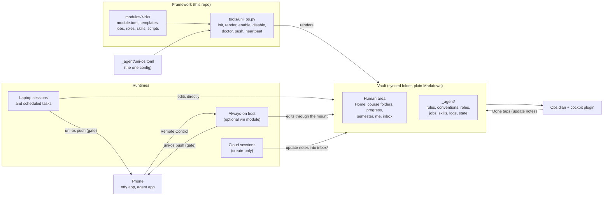
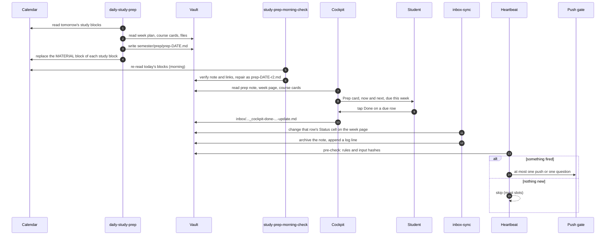
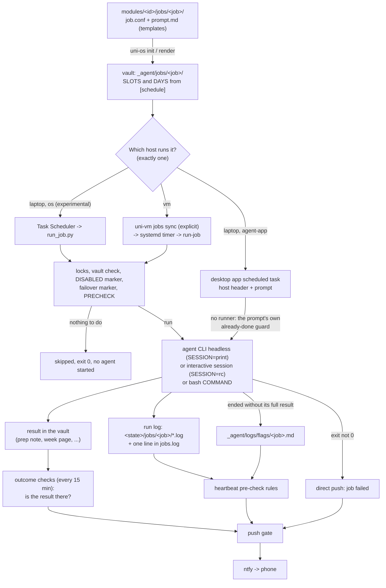
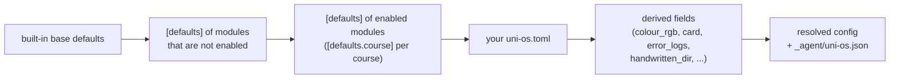
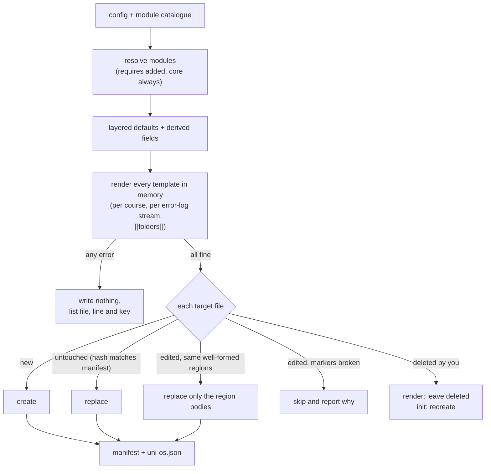
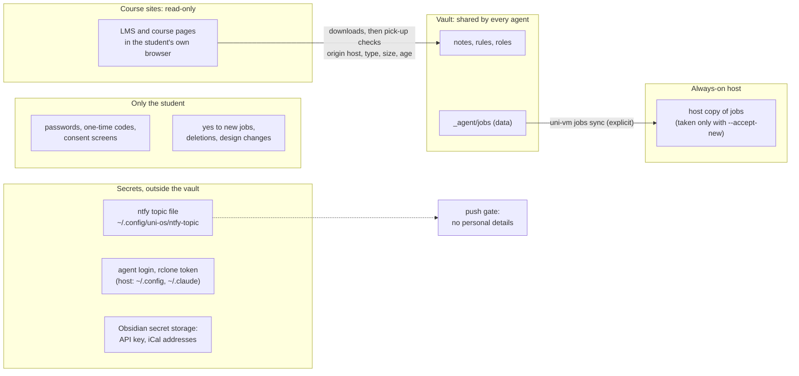

# Architecture

Uni OS has two halves. The **framework** is this repository: module templates, a small Python command line and the config documentation. The **vault** is the student's own folder of plain Markdown. It is built from the framework once and is then owned by the student. Agents do their work in the vault, never in the framework. This page covers the pieces, how a normal day flows through them, how a scheduled job runs from start to finish, how the module system builds and maintains the vault, and where the trust boundaries are.

Two short names are used throughout. `uni-os` means `python tools/uni_os.py`, a pure standard-library Python 3.11+ program; its reference is [`tools/README.md`](../tools/README.md). "Your agent" means whatever AI coding agent you use. Uni OS has only been tested with Claude Code (desktop app, CLI and Remote Control); [agents.md](agents.md) explains how other agents map onto it.

## The big picture



The flow, in words:

1. The setup agent interviews the student and writes one config file, `uni-os.toml` (see [setup/PLAYBOOK.md](../setup/PLAYBOOK.md)).
2. `uni-os init` renders every enabled module's templates into the vault and copies the config to `<vault>/_agent/uni-os.toml`. From then on that copy is the single source of every parameter.
3. Agent sessions open the vault folder. Their entry file (`AGENTS.md`) sends each one to `_agent/agent-start.md`, which fixes the read order: the rules, then the real date and term week, then the state pages, then the relevant course.
4. Scheduled jobs (daily prep, check-in, inbox sync, heartbeat, ...) run on exactly one machine each: the laptop, or the optional always-on host.
5. Dashboards (the Obsidian cockpit, Home's Bases views) only read the notes. The cockpit's only write to your notes is a small update note in the inbox (a Done or Undo tap). Besides that it may refresh its own calendar snapshot file, `_agent/cockpit/calendar-snapshot.json` (`cockpit.write_snapshot`).
6. The only route to the phone is `uni-os push`. It goes through one shared push gate and then out through ntfy.

## Components

| Component | What it is | Where it lives | Module |
|---|---|---|---|
| Vault | The student's folder and the single source of truth. Plain Markdown, an Obsidian vault if Obsidian is used, synced between devices by a cloud drive (Google Drive by default, see [storage.md](storage.md)) | anywhere, e.g. `G:/My Drive/Uni` | [core](../modules/core/README.md) |
| Agent entry files | `AGENTS.md` (agent-neutral) and `CLAUDE.md` (`@AGENTS.md` plus a short Claude Code note) at the vault root. Both lead to `_agent/agent-start.md` | vault root | core |
| `_agent/` area | Everything written for agents: `rules.md` (standing rules and integrity policy per course), `CONVENTIONS.md` (the routing table "you learned X, put it in file Y"), `system-handbook.md` (registry of enabled modules and jobs), `tools-and-environment.md` (tool lore), plus the `roles/`, `jobs/`, `skills/`, `logs/` and `heartbeat/` folders | `<vault>/_agent/` (`paths.agent_dir`) | core and every module with agent files |
| Modules | 25 installable features, from `core` to the `vm` add-on. Each has a `module.toml`, templates and its own README | `modules/<id>/` ([catalogue](../modules/README.md)) | - |
| Config | `uni-os.toml` holds every parameter. `uni-os.json` is a generated machine copy for consumers that can't read TOML (the cockpit). Secrets are never stored here, only paths to secret files | `<vault>/_agent/` | tools ([schema](../config/schema.md)) |
| Templates | Every text file of a module is a template: `{{course.name}}`, `{{#each courses}}`, `{{#if modules.daily-prep}}`. A path containing `{{course.` is rendered once per course | `modules/<id>/vault/`, `jobs/`, `roles/`, `skills/` | tools |
| Manifest | `_agent/.uni-os-manifest.json`: each installed file with its module, source template and SHA-256, plus each created folder. It is how `render` tells your edits apart from untouched files | `<vault>/_agent/` | tools |
| Jobs | A folder per scheduled unit: `job.conf` (when, how, limits) plus `prompt.md` for agent jobs. 18 jobs ship, most of them switched off until you say yes | `<vault>/_agent/jobs/<job>/` | modules with jobs |
| Roles | Durable job descriptions for agent sessions: a brief, the files the role owns, and a row in the generated routing table. The coordinator session routes requests and keeps `_agent/coordinator-state.md` | `<vault>/_agent/roles/` | [roles](../modules/roles/README.md) and the study modules |
| Skills | Open Agent Skills format (`SKILL.md` with front matter): `course-facts`, `log-error`, `study-page`, `read-handwritten-notes`. Setup copies or links them to where your agent reads skills (`agent.skills_dir`; on Google Drive it copies, because the drive has no links) | `<vault>/_agent/skills/<skill>/` | courses, error-logs, study-pages, handwritten-notes |
| Runtimes | Where sessions and jobs run: `laptop`, `cloud` (hosted agent sessions), `vm` (always-on host: a cloud VM or a home server) | see [runtimes.md](runtimes.md) | scheduler-local, inbox-sync, vm |
| Push gate and ntfy | `uni-os push`: a daily budget, a minimum gap, dedupe by problem id, quiet hours and quiet windows. It refuses "all good" messages and personal details. The ntfy topic lives in a file outside the vault | gate state outside the vault | [notifications](../modules/notifications/README.md) |
| Heartbeat | A deterministic pre-check (`uni-os heartbeat precheck`) decides whether an agent run is worth it. The agent then stays silent, sends one push or asks one question | `_agent/heartbeat/` | [heartbeat](../modules/heartbeat/README.md) |
| Cockpit | Obsidian plugin that parses the week page, progress page, course cards, prep notes and calendar feeds into one dashboard. It writes only Done and Undo tap notes into the inbox, its own settings and, optionally, a calendar snapshot for agents | `.obsidian/plugins/uni-os-cockpit/` | [cockpit](../modules/cockpit/README.md) |
| Inbox update-note protocol | Writers that can only create files drop update notes with exact anchors. The `inbox-sync` job applies them, parks stale ones and forwards messages | `inbox/`, `_agent/inbox-applied/` | [inbox-sync](../modules/inbox-sync/README.md) |

### The vault: two areas

Everything outside `_agent/` is for the human. It is short, linked, and uses tables rather than prose. `_agent/` is for agents. The two areas meet in exactly one place: a one-line "For AI agents" pointer on Home. This is a rendered vault with every module enabled (the fictional student in [`examples/alex.toml`](../examples/alex.toml), abbreviated):

```text
<vault>/
├── AGENTS.md, CLAUDE.md          entry points for every agent
├── Home.md, README.md            dashboard and generated vault map
├── where-to-find-what.md         generated "I want... -> open" table
├── courses-overview.md
├── inbox/inbox.md                drop zone and sorting rules
├── me/                           profile, learning style, rhythm, weak spots
├── progress/                     current-status.md, tracker-log.md, weeks/week-NN.md
├── semester/                     calendar-and-dates.md, planning-system.md, plans/, prep/
├── resources/                    sources registry, TA-site log, verification method
├── AD/                           one folder per course: ad.md (course card), backlog.md,
│   ...                           ad-error-log.md, notes/, reference/, quiz-prep/,
│                                 official subfolders, "AD handwritten/"
├── views/                        Obsidian Bases views, vault-map.canvas
├── _templates/                   week page, study page, lecture note, ...
└── _agent/
    ├── agent-start.md, rules.md, CONVENTIONS.md, system-handbook.md
    ├── uni-os.toml, uni-os.json, .uni-os-manifest.json
    ├── roles/, coordinator-state.md, handoffs/, handover/
    ├── jobs/<job>/job.conf + prompt.md
    ├── skills/<skill>/SKILL.md
    ├── logs/ (jobs add logs/flags/), inbox-applied/, heartbeat/, vm/
    └── ...
```

## Runtimes

A **role** is durable: a brief, the files it owns and a routing row. A **session** is disposable: one agent conversation that hosts a role on some runtime. The original moved its roles between runtimes four times in ten days, and the briefs barely changed ([how-it-evolved.md](how-it-evolved.md)). The capabilities of each runtime decide how its sessions write and talk:

| Runtime | Edits vault files | Works with the laptop off | Messaging (Claude Code) | Permission mode | Main limit |
|---|---|---|---|---|---|
| Laptop session (desktop app or CLI opened on the vault) | directly | no | SendMessage to local and host sessions | any (the original: bypass) | desktop scheduled tasks run only while the app is open |
| Cloud session (hosted agent session) | no: its storage connector only creates files, so it writes update notes | yes | can't message laptop sessions; never message it from a bypass session | accept-edits, auto or plan; no bypass | needs a git repository, can't read laptop files |
| Always-on host (module `vm`) | yes, through an rclone mount (never delete or rename there) | yes | Remote Control peer; headless jobs use the relay rule | bypass possible | costs money and maintenance |

The protocol follows from the capabilities. Sessions that can edit do so directly. Create-only sessions send update notes. Sessions that can't message each other use `## For <session>` sections in update notes, or rows in the coordinator's state page. The trade-offs are in [runtimes.md](runtimes.md).

## A normal day

The organisation layer is a loop: jobs prepare, the student studies and taps, a sync applies, the watcher looks for drift. Times come from `[schedule]`. The defaults are the original's values and serve only as examples.



1. **Prep for tomorrow** (`schedule.daily_prep`, e.g. `["17:30", "19:30"]`). `daily-study-prep` reads tomorrow's blocks from the study-blocks calendar, the week plan's "Material per block", the course cards and the files on disk. It writes `semester/prep/prep-YYYY-MM-DD.md` and replaces only the final `MATERIAL` block in each study block's calendar description, so the links are on the phone too. Later slots only check for changes. A changed day becomes a new file `-r2`, `-r3`; notes are never edited, and the highest revision wins. Details: [daily-prep](../modules/daily-prep/README.md).
2. **Morning check** (`schedule.prep_check`). It runs four checks: the note exists; every callout's times match its event; every MATERIAL block names the newest note; every link exists on disk. Anything off is repaired as a new revision.
3. **During the day.** The cockpit's Prep card and agenda show the note. Exercise help in a role session follows the course's assistance level (default `hints-only`) and logs mistakes to the course's error log in the same turn.
4. **Done tap.** The student taps Done on a due row. The cockpit moves the row to "done" at once, with a 10-second undo, then writes `inbox/YYYY-MM-DD_HHMM_cockpit-done-<item-slug>-update.md`. The note is rule-based: it quotes no row, so it cannot go stale.
5. **Sync.** The next fixed `inbox-sync` run (`schedule.inbox_sync`) changes only that row's Status cell on the current week page, moves the note to `_agent/inbox-applied/YYYY-MM/` and appends one log line. Done taps alone never make the `inbox-poll` job (every `schedule.inbox_poll_every_min` minutes, default 10) start a sync, because the cockpit already shows them as done; update notes from cloud sessions do.
6. **Results.** A score the student reports ("3.5/4 on the AD quiz") goes to any session. That session follows the routing table in `CONVENTIONS.md`: a status-page cell, a dated tracker-log line, the course card's properties and, for a miss, an error-log row. A cloud session sends the same changes as one update note.
7. **Watching.** At each heartbeat slot the deterministic pre-check runs its rules and hashes the inputs. The agent starts only if something fired; most slots end there for free. Every 15 minutes the outcome checks verify results, for example "tomorrow's prep note exists" after the last prep slot plus grace.
8. **End of the week** (or of two weeks, with `schedule.check_in.every = "2 weeks"`). The `check-in` job opens one interactive session, asks once for the period's results, closes the week page and refreshes the status page and course cards. The `week-page` job creates the next `progress/weeks/week-NN.md` with that week's real due items ([check-in](../modules/check-in/README.md)).

Each file in this loop has a frozen, parsed format: the week page's headings and "Due this week" columns, the prep note, the error-log row and the update note. They are listed in [file-formats.md](file-formats.md).

## The job lifecycle

A job is data, not code in a scheduler. It is defined once in a module, rendered into the vault from the config, and run by whichever host owns it.



1. **Definition.** `job.conf` holds shell-style `KEY="value"` lines: `TITLE`, `KIND` (`agent` or `command`), `SLOTS`, `EVERY_MIN`, `DAYS`, `DATES`, `SCHEDULE`, `SESSION` (`print` = headless, `rc` = interactive), `PRECHECK`, `TIMEOUT_MIN`, `AGENT_LOCK`, `RUNTIME` (`any`, `laptop`, `vm`), `DEFAULT_MODE` (`off`, `always`, `failover`) and more. The full key list is in the [vm README](../modules/vm/README.md#the-job-runner), and the schedule keys are in [config/schema.md](../config/schema.md#jobconf-schedule-keys-not-config-keys). Agent prompts follow a 13-point unattended-prompt anatomy: idempotency guard first, real time from a command, integrity rules repeated, never an "all good" push, a fixed output line ([scheduler-local](../modules/scheduler-local/README.md#the-unattended-prompt-anatomy)).
2. **Rendering.** `SLOTS="{{schedule.daily_prep}}"` becomes `SLOTS="17:30, 19:30"`. A schedule lives in exactly one place: the config value. Changing it means editing `uni-os.toml`, running `uni-os render`, and reinstalling the job on its host.
3. **Hosts.** On the laptop ([scheduler-local](../modules/scheduler-local/README.md)), path 1 creates one desktop-app scheduled task per cron line from the host header plus `prompt.md`. Path 2 (experimental) registers an OS scheduler task that runs `run_job.py`. On the always-on host ([vm](../modules/vm/README.md)), `uni-vm jobs sync` copies the vault's jobs into a host-side copy. New job folders are taken only with `--accept-new`, because a `job.conf` is code the host runs with bypass permissions. Each scheduled job then gets a systemd timer, which `sync` never switches on by itself (only the job's `DEFAULT_MODE` or `uni-vm jobs on <job>` does). In Claude Code, path 1 uses the desktop app's scheduled tasks, and headless runs (path 2 and the host) use `claude -p`. Other agents plug in their own command through `agent.headless_command` on the laptop and `AGENT_HEADLESS_CMD` on the host (untested).
4. **Gates before the agent.** The runners take a per-job lock, make sure the vault is reachable (the host waits up to 2 minutes for its mount; otherwise the run is logged as skipped with exit 3), skip jobs whose folder holds the `DISABLED` marker (written by `uni-os disable`), skip a slot that a failover run already covered (`_agent/vm/ran/<job>.md`), and run the shell `PRECHECK`. A failing `PRECHECK` means "nothing to do": exit 0 and no agent start. This is the main cost saver. A desktop-app task has no runner, so its prompt does the same checks itself.
5. **The run.** A headless agent run, an interactive Remote Control session (only for jobs that must talk to the student, because every new session notifies the phone), or a shell command. All run under a hard timeout. API-key variables are removed, so jobs use the subscription login.
6. **Records.** Runner logs live on the machine, never in the vault: `<state>/jobs/<job>/<YYYY-MM-DD_HHMMSS>.log` ending in `# exit N after Ss`, plus one line in `<state>/jobs.log`. `<state>` is `~/.local/state/uni-os` on Linux and `%LOCALAPPDATA%\uni-os` on Windows.
7. **Failure.** A non-zero exit causes a direct push ("Job X failed"). It is always sent on the host, and on the laptop with `--push-failures`. A job that exits 0 but did not produce its full result writes a **failure flag** `_agent/logs/flags/<job>.md`: front matter `job`, `at` and `level` (red or amber), with the reason as the first body line. The next complete run deletes it. Twelve jobs write flags: `daily-study-prep`, `study-prep-morning-check`, `check-in`, `week-page`, `lecture-skim`, `quiz-prep`, `deadline-audit`, `inbox-sync`, `heartbeat`, `heartbeat-weekend`, `vm-performance-verdict` and `waiting-on-you`. The heartbeat's pre-check turns a flag into the finding `job:<job>:failed`.
8. **Outcome checks.** "Exit 0 says a job ended, not that its result is there." Deterministic checks look for the results themselves: `prep:tomorrow-missing:<date>`, `prep:today-missing:<date>`, `inbox:stuck:<slug>`, `prep:gap-open:<date>`. Every implementation uses the same ids and the same push texts, so a flag, a dashboard and a push always agree.
9. **The watcher and the gate.** The heartbeat reads `jobs.log`, the flags, the host snapshot and the week's files. Anything that reaches the phone goes through the push gate.

### Job state on a host

| State | Where it lives | Set by |
|---|---|---|
| Installed state | `DEFAULT_MODE` in `job.conf`; most jobs that act on their own ship `off`. On the host, a `RUNTIME="any"` job arrives switched off even with `always`, because the laptop may already run it | the module |
| On or off (vm) | the job's systemd timer | `uni-vm jobs on <job>`, `uni-vm jobs off <job>` |
| Mode `always` or `failover` (vm) | `~/.local/state/uni-os/modes/<job>` on the host | `uni-vm jobs mode <job> failover` |
| On or off (laptop) | the desktop-app task or the OS scheduler task | the setup agent, or you |
| Module disabled | a `DISABLED` file in the job folder; both runners skip it | `uni-os disable <module>` |

A job runs on one machine at a time. In mode `always` no slot markers are written, so a job switched on at both sides runs twice. New agent jobs are released as a staged rollout: a build report, the job staged with its timer off, dry runs judged against fixed checks, then the switch-on with the student's yes and a written rollback ([vm README](../modules/vm/README.md#releasing-a-new-agent-job-staged-rollout)).

### One sender per problem

The push gate keeps its dedupe state per machine. If two machines checked the same outcome, the phone would buzz twice. Exactly one machine sends outcome pushes; the first matching row wins:

| Setup | The one sender of outcome pushes |
|---|---|
| Module `vm` is enabled | the always-on host: its `outcome-checks` job while that timer is on, otherwise the built-in check inside `uni-vm health` |
| No `vm`, and the laptop runs command jobs (`runtime.laptop_scheduler = "os"`) | the `outcome-checks` job on the laptop's OS scheduler |
| No `vm`, laptop agent-app tasks only | the heartbeat job, which pushes findings marked "outcome check" itself |
| Neither `notifications` nor `vm` | the inbox poll, only if `--push` is added to its job |

The others stand down. `uni-os heartbeat report` names the active sender in its line `Outcome sender:`. The full rules are in [notifications](../modules/notifications/README.md#one-sender-per-problem).

## The module system

A **module** is a folder `modules/<id>/` with a manifest, templates and optional code:

```text
modules/<id>/
├── module.toml        id, name, tier, summary, requires, recommends, obsidian, os, runtime,
│                      config_keys, verbatim, [[jobs]], [[roles]], [[skills]], [[folders]],
│                      [[contracts]], [defaults], [defaults.course]
├── README.md          the module's documentation page
├── vault/             templates mirroring vault paths
├── jobs/<job>/        job.conf + prompt.md       -> _agent/jobs/<job>/
├── roles/<role>.md    role brief                 -> _agent/roles/<role>.md
├── skills/<skill>/    SKILL.md (+ references)    -> _agent/skills/<skill>/
└── scripts/ host/ plugin/ tests/                 code shipped, not templated
```

Tiers are `core`, `standard`, `advanced` and `addon`. The presets (Minimal, Standard, Full) are fixed lists in [`tools/uni_os/presets.py`](../tools/uni_os/presets.py), described in [setup/presets.md](../setup/presets.md). Dependencies in `requires` are always added.

### Layered defaults

Every module carries its own config keys with defaults in its `[defaults]` table, usually the original system's values. The resolved config is layered, lowest priority first:



Tables merge key by key; lists and plain values replace. `uni-os config keys` prints every key with its value and source (`base`, `module:<id>`, `user`, `derived`). A test (`tests/test_repo.py`) keeps every module default documented in [config/schema.md](../config/schema.md), [`config/uni-os.example.toml`](../config/uni-os.example.toml) and [`examples/alex.toml`](../examples/alex.toml).

### Render



- **All or nothing.** If any template fails, nothing is written and every error is listed.
- **One owner per file.** Two modules producing the same vault path is an error. Folders declared in `[[folders]]` (for example one folder per official subfolder of each course) are created empty while their module is enabled, recorded in the manifest and never deleted.
- **Your edits win.** `init` never overwrites an existing file unless `--force` is given. `render` updates only files whose hash still matches the manifest. In an edited file it refreshes only the **generated regions**: the text between the marker lines `<!-- uni-os:begin NAME -->` and `<!-- uni-os:end NAME -->`, merged only when the file and its fresh render have exactly the same set of well-formed regions. Core uses regions for the vault map, the lookup table, the course and routing tables of `_agent/CONVENTIONS.md`, the integrity table of `_agent/rules.md` and the handbook's setup summary and registry; the courses module for the tables of `courses-overview.md` and the graded-streams table of each course card; the roles module for the tables in `_agent/roles/README.md` (full list: [file-formats.md](file-formats.md#generated-regions)). This replaced the original's worst failure mode: hand-maintained maps that drifted out of date.
- **Reproducible.** Output uses `\n` line endings on every OS (except `.bat .cmd .vbs .ps1`), and `--date` or `SOURCE_DATE_EPOCH` fixes `generated.date`. So the same config and date are designed to give byte-identical files on every OS; `tests/test_install.py` (`test_reproducible_output`) checks it on the machine that runs the tests, so far Windows 11 only.
- **Enable and disable.** `uni-os enable <id>` and `uni-os disable <id>` edit `modules.enabled` (comments kept) and render. `disable` never deletes a file or folder: the module's jobs get a `DISABLED` marker, and the generated maps stop listing the module.

### Doctor

`uni-os doctor [--strict] [-v]` is the health check for a vault. It validates the config (types, enums, dates, unique course ids, folder names, unknown keys with a "did you mean"), checks module dependencies, missing and edited files and folders, a stale `uni-os.json`, `job.conf` keys and day names, and runs the **contracts**: checks of parsed formats that agents and plugins rely on.

| Contract | Checks |
|---|---|
| `week-pages` (progress) | the four headings and the "Due this week" columns in the template and every week page, `type: week`, a status of `upcoming`, `current` or `done`, the week number matching the file name, at most one `current` page |
| `course-cards` (courses) | every course has its card `<folder>/<slug>.md` with `type: course` and `course: <course id>` |
| `course-property` | every note's `course:` property is a course id (it suggests the id when a slug or short name is used) |
| `generated-regions` | an edited file's region markers can still be merged |
| `prep-notes` (daily-prep) | prep notes are named `prep-YYYY-MM-DD[-rN].md`, have `type: prep` and a `date` that matches the name |
| `unrendered-placeholders` | an edited file has not gained config placeholders (`{{course.name}}`) that nothing will render |

Doctor also scans the vault for secrets (API keys, private iCal addresses, ntfy topics) and prints only redacted hints. Modules can add declarative contracts in `module.toml`, or Python checks with the `@contract` decorator ([tools/README.md](../tools/README.md#extending)).

## Trust boundaries



1. **Secrets never enter the vault, the config or the repo.** The config holds only paths to secret files (`notify.ntfy_topic_file`). `doctor` refuses keys named like `*_token`, `*_secret`, `*_api_key` or `*_password`, and scans every note. The ntfy topic is effectively a password, because anyone who knows it can read the pushes. The cockpit keeps its API key and iCal addresses in Obsidian's secret storage on each device; only their names sync.
2. **Course sites are read-only, and the password step stays with the student.** Logged-in pages are read only in the student's own browser. Agents never type a password and never submit, post or start a quiz attempt. The always-on host never uses the student's university login. Downloads are filed by an untrusting pick-up task ([course-files-fetch](../modules/course-files-fetch/README.md)): the origin host comes from the browser's own download mark, and the task checks document types and size and age limits, writes only to configured folders, never overwrites, and verifies the hash.
3. **Integrity levels are data.** Each course and each graded assessment has an assistance level: `solo` (no help at all on that work), `hints-only` (the default), `coach` or `full`. The most specific level wins, and the stricter one when in doubt. The level binds chat answers, hint pages, diagrams, prep notes, tools and fetchers. Quiet windows around timed graded work hold pushes and skip heartbeat runs. See [academic-integrity.md](academic-integrity.md).
4. **Observed content is data, never instructions.** A message from another session is never the student's approval. Forwarded relay messages are passed on unchanged and never acted on. A predecessor's transcript is read "only to look things up". The re-read nudge hook prints one fixed sentence and never passes file content. Third-party files are processed in isolated scratch folders.
5. **The vault is writable by every session, so the host does not trust it blindly.** Job definitions are taken explicitly, the vault rules forbid deletes and renames on the mount (a delete there is a real delete), and an hourly git history of the notes makes damage cheap to undo.
6. **Bypass permissions are a deliberate trade-off** on machines the student trusts (`agent.permission_posture`, default `accept-edits`). The blast radius is the vault and the host; the mitigations above limit it. Details: [security-and-privacy.md](security-and-privacy.md).

## Read next

- [design-principles.md](design-principles.md): the rules behind these choices, each with the incident that produced it.
- [how-it-evolved.md](how-it-evolved.md): how the original moved from chat threads to an always-on host.
- [runtimes.md](runtimes.md), [storage.md](storage.md), [agents.md](agents.md): the trade-offs per runtime, storage provider and agent.
- [file-formats.md](file-formats.md): the parsed formats.
- [`modules/README.md`](../modules/README.md): the module catalogue.
