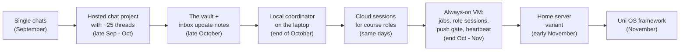

# How it evolved

Uni OS is the generalised version of a system that its author, Qiang Luo (ktr0a), built for a first year of BSc Computer Science at ETH Zurich, autumn semester 2026 (HS26). In its first two months the system was rebuilt several times, and each rebuild was forced by one concrete limit. Most of the framework's design only makes sense against that history, so this page tells it, anonymised and with coarse dates.

The original used Claude products throughout, so Claude product names appear where the limits were product-specific. The framework's files are agent-neutral, but Uni OS has only been tested with Claude Code ([agents.md](agents.md)).

Roles moved between runtimes four times in about ten days. The role briefs barely changed. What changed was where the sessions ran, and that is the main lesson: model **roles** (durable) separately from **sessions** and **runtimes** (disposable).

## Prologue: single chats (September)

**What it was.** The start of the term was one chat, which set up a university calendar with conventions that are still in use: lecture and exercise title prefixes, colours per event type, no reminders on course events, recurrences ending on the last lecture day. Then came a long desktop agent session that rebuilt the calendar, wrote a course guide per course and a **course facts skill**. The skill opens every answer the same way: get the real date, compute the term week, apply the course's lag between lecture and exercise class, and say which parts are confirmed and which are predicted.

**What went wrong.** The long session auto-compacted and dropped its raw history, so the first half had to be reconstructed from memory. Lessons: export before compaction, and keep state in files, not in a conversation.

**Survived into Uni OS.** The calendar conventions ([planning](../modules/planning/README.md)), the course facts skill as a template ([courses](../modules/courses/README.md), skill `course-facts`), and the rule that agents compute the real date and term week before anything else (`_agent/agent-start.md`).

## Stage 1: a hosted chat project (late September to October)

**What it was.** One claude.ai project with a coordinator chat plus one thread per job: lecture rundown and exercise help per course, quiz coaching, planning, and more. Over October it grew to about 25 threads. They shared the project instructions, a project library (exports of the earlier chats, uploaded files) and the project memory. Scheduled tasks fired prompts into threads, for example a daily watch of the course files folder with a phone push and a weekly check-in.

**What worked.**
- Separate threads kept each context small and on topic.
- One coordinator thread gave the student a single place to start.
- The integrity rules and the "real sources only" rule were written down early and held from then on.

**What didn't.**
- **Thread sprawl.** Every new need became a new thread. The student had to hunt for the right one, and the coordinator's memory degraded with each compaction until a fresh coordinator had to be created.
- **No single source of truth.** The library, the project memory and each thread's view of the tracker drifted apart.
- **Permission prompts.** Scheduled tasks inside a project ran at most in "auto" permission mode, so unattended runs stopped at approval prompts.
- **A duty that silently never happened.** The weekly check-in task had been bound to a session that ended the same day. It never ran, and nobody noticed for weeks.
- **No view, no feedback.** There was no dashboard, calendar changes happened only by prompting a thread, and nothing proactive warned the student about slipping plans.

**A side experiment.** A self-built always-on dashboard with an assistant was prototyped on the laptop: state in files, proposals before writes, undo everywhere. It was not adopted. Its ideas went into the later Obsidian cockpit (a dashboard inside the vault, the student's own API key in a keychain, an assistant that only proposes) and into the always-on host (jobs, pushes, remote sessions).

### The turning point: the vault and the update-note protocol (late October)

All knowledge moved into an Obsidian vault, and soon after the Google Drive folder itself became the vault. The new rule: everything goes into the vault right away. One fact shaped the next weeks: **the Google Drive connector in the project threads could create files and edit metadata, but could not change an existing file's content.**

The answer was the **inbox update-note protocol**. Threads created new files directly. For changes to existing files they wrote one self-contained update note per turn into `inbox/`, quoting the exact current lines to replace. A scheduled task on the laptop applied the notes three times a day.

An audit the next day found many leaks: changes written to the library without an update note, and stale "frozen" copies that were mistaken for live files. Three rules came out of it:
- **The vault wins.** A quoted line that no longer matches means the note is parked, never merged by guesswork.
- Frozen copies must say so and name the live path.
- Write directly **or** send an update note, never both: a session that did both produced duplicate `name (1).md` files on the drive.

The first daily prep notes and the first version of the cockpit plugin also date from these days.

**Survived into Uni OS.**
- The vault as the single source of truth, with everything outside `_agent/` for the human and everything inside for agents ([core](../modules/core/README.md)).
- The update-note protocol as a fallback for create-only writers, plus the cockpit's Done taps that use the same inbox ([inbox-sync](../modules/inbox-sync/README.md)).
- The roles as written briefs ([roles](../modules/roles/README.md)).

## Stage 2: a local coordinator on the laptop (end of October)

**What forced it.** Permission prompts in project tasks, drift between the library and the vault, and constant ambiguity about which environment was allowed to edit what.

**What it was.**
- A Claude Code session in the desktop app, opened on the vault folder in bypass-permissions mode, became the coordinator. It started one local session per role, and all of them inherited bypass mode.
- Everything the project had defined only in its own settings (instructions, task prompts, memory) was written into the vault as a system handbook.
- The project's scheduled tasks were paused, not deleted, and recreated as desktop scheduled tasks created from the bypass session, so they ran unattended.
- The daily folder watch became a local PowerShell script under Task Scheduler, with no agent at all.
- One-off work (an overnight workflow review, a migration) went to side sessions with a brief, their own folder and a written handover.

**What worked.** Direct edits, one coordinator with a state page that survived its own recycling, messaging between local sessions, and unattended tasks.

**What didn't.**
- Local sessions and desktop tasks run only while the laptop is awake and the app is open.
- Tasks started a few minutes late, sometimes about 12 minutes late, with a fixed offset added to their times, and missed slots were caught up at random times after wake-up. Every prompt needed slot arithmetic and an "already done?" guard.
- Agent sessions refused to edit their own permission settings, and registering an OS scheduled task from an agent was blocked as "unauthorized persistence". The student had to run a one-line command by hand.

**Survived into Uni OS.**
- The coordinator, its state page and the rule to recycle long sessions ([roles](../modules/roles/README.md)).
- Side-session handovers with an undo table.
- The system handbook ([core](../modules/core/README.md)).
- The unattended-prompt anatomy, slot logic and catch-up rules ([scheduler-local](../modules/scheduler-local/README.md)).
- The agent-free folder watcher ([vault-watch](../modules/vault-watch/README.md), Windows, experimental).

## Stage 3: cloud sessions for the course roles (the same days)

**What forced it.** The course roles (lecture rundowns, exercise help, quiz coaching) had to work with the laptop closed.

**What it was.** First the course roles went back to project threads, then, within hours, to Claude Code cloud sessions. Cloud sessions need a git repository, so a small private workspace repository held only the standing instructions and a settings file with accept-edits as the default mode. The sessions read the vault through the Drive connector and wrote changes as inbox update notes. Requests for laptop sessions went into `## For <session>` sections, which the sync job forwarded.

**What worked.** Availability with the laptop off, and the update-note protocol held up under real load. The vault stayed authoritative.

**What didn't.**
- Cloud sessions need a git repository; the vault is a synced folder, not a repo.
- There is no bypass mode, and a connector call that needed approval paused the session.
- They can't read files on the laptop.
- They can't message laptop sessions. A message sent to them from a bypass session sat "held, waiting for approval" until it expired.
- Their transcripts can't be read from the laptop, and one session could not save a helper script it had written.
- One cloud session stamped its notes an hour off after the daylight-saving switch.
- **Latency.** With three fixed sync runs a day, a note waited up to five hours, or thirteen overnight. A 10-minute poll with a one-hour rate limit fixed this later.

**Survived into Uni OS.** The inbox-sync module, including the poll and a ready-made instructions file for cloud sessions ([inbox-sync](../modules/inbox-sync/README.md)), and the messaging matrix in the roles module. [runtimes.md](runtimes.md) compares cloud sessions with the other runtimes.

## Stage 4: an always-on VM (end of October into November)

**What forced it.** Jobs and local sessions needed the laptop to be on. The agent app's own push notifications were suppressed while the student counted as "active", which on a busy laptop was most of the time.

**What it was.** In one evening the system got:
- a small Google Cloud VM (an `e2-custom-small` machine with 4 GB RAM, Ubuntu) running the Claude Code CLI on the subscription login;
- a Remote Control server, so the student could open sessions in the vault from the phone;
- the Drive folder mounted with rclone, and an hourly git history of every note.

Jobs first ran there in **failover** mode: the VM ran a job only when a laptop ping showed the desktop app had missed the slot, and wrote a marker so the laptop's catch-up would not run it twice. A day later every recurring job moved to mode **always** on the VM, with the laptop copies paused for rollback. Six role sessions became persistent in tmux and were resumed from their transcripts after crashes and reboots. A course-files-fetch role drove the laptop's logged-in Chrome through the browser extension, and an untrusting pick-up task on the laptop filed the downloads. ntfy became the push channel. A 15-minute health check repaired what it could, checked job outcomes, sampled memory and wrote status files into the vault.

**What worked.** Work went on with the laptop closed, and the phone could reach any role session. The list price was about $21 a month (see the [vm module](../modules/vm/README.md#cost-and-sizing)). The same job files ran on both machines, behind a short host header that translated paths and commands.

**What didn't, and what it taught.**
- **Memory, not CPU, was the limit.** A working role session used about 360 MB and a headless job about 250 MB. Six role sessions plus jobs on 4 GB got the verdict "tight", so the lecture rundowns and quiz coaches stayed in the cloud rather than pay for a bigger machine.
- **Small operational bugs.** Idle sessions never closed because idle time was read from the transcript file's modification time, which the agent touches about hourly. One-time dialogs silently blocked sessions. A stray keypress meant for one session answered a dialog in another.
- **Failover was brittle.** It depended on reading the desktop app's internal files. The simpler final design was one host per job, mode `always`.
- **Duties without triggers.** An overnight review checked every duty promised in the role briefs against what actually triggered it. Sixteen duties had no trigger at all: role sessions only act when spoken to. That list became the first checklist of the **heartbeat**, a proactive watcher whose deterministic pre-check decides whether an agent run is worth it. The heartbeat was designed from a written proposal, built staged, dry-run twice at representative times, reviewed, and approved with a guard dry run before switch-on.
- **Too many senders.** Health alerts, job failures and the outcome checks each had their own spacing and hours. With the heartbeat they moved behind one **push gate** with one budget and shared problem ids.
- **Usage concentrated in the long-lived sessions.** In one measured week the coordinator was about 19 % of usage, the infrastructure session about 13 %, and all scheduled jobs together about 1.6 %. Recycling long sessions at about 300k tokens of context, through their state pages, became the rule.
- **Too many small asks.** The coordinator once batched everything waiting on the student into one page with micro-steps, time and links, which replaced a stream of pings.

**Survived into Uni OS.**
- The always-on host ([vm](../modules/vm/README.md)), the push gate and outcome checks ([notifications](../modules/notifications/README.md)) and the heartbeat ([heartbeat](../modules/heartbeat/README.md)).
- The staged-rollout practice for new jobs, the usage map script and the optional `waiting-on-you` digest job ([roles](../modules/roles/README.md)).
- The course-files fetch with its untrusting pick-up ([course-files-fetch](../modules/course-files-fetch/README.md)).

## Stage 5: a home-server variant (early November)

**What forced it.** Cost and memory. A bigger cloud VM would have broken the monthly budget, and a spare 8 GB laptop was sitting unused.

**What it was.** The same code moved to WSL2 (Ubuntu) on the old laptop at home, reached over SSH on the local network or Tailscale. A keep-alive task keeps WSL running with nobody signed in, and the power settings never sleep. WSL2 was chosen over native Windows because the bash tools, systemd units and tmux-held sessions port unchanged; native Windows would have meant rewriting about 1,400 lines and redesigning session hosting.

**Trade-offs found.**
- Home power and Wi-Fi now matter, and Windows Update reboots need a window.
- The hypervisor did not start until a firmware graphics-memory setting was changed.
- A browser "verify it's you" prompt that fell back to the Windows password helped cause an account lockout.
- Windows plus Chrome plus the agent app cost about 2 GB, so six sessions were still "tight".
- The move was still being trialled when this framework was written.

**Survived into Uni OS.** The vm module is host-agnostic (`vm.provider = "gcp" | "home-server" | "other"`), with a separate guide for the home server ([`modules/vm/HOME-SERVER.md`](../modules/vm/HOME-SERVER.md)).

## Stage 6: the framework (November)

Turning a one-person system into Uni OS meant:
- every personal or university-specific value became a config key with the original's value as an example default ([config/schema.md](../config/schema.md));
- features became 25 modules with presets, dependencies and their own docs;
- agent files got agent-neutral names (`AGENTS.md`, `_agent/rules.md`, `_agent/roles/<role>.md`), and Claude-specific features got documented fallbacks;
- maps, registries and routing tables became generated content, refreshed by `uni-os render` even in files the student has edited;
- schedules live only in the config, and the always-on host and the laptop read the same job files;
- each outcome problem has one sender and one threshold;
- features the original student dropped (error-log retests, recall tests) are off by default rather than removed;
- the Windows laptop scripts stay Windows-only and experimental, with behaviour specs for porting ([porting-to-other-os.md](porting-to-other-os.md)).

## What stayed constant

Through every stage:
- **Integrity first.** Hints-only help, the student's work stays the student's, and course rules are never overridden ([academic-integrity.md](academic-integrity.md)).
- **Real sources only.** Content comes from the actual course material with pages cited, or nothing is written.
- **The student approves** irreversible steps, design changes and new recurring jobs.
- **Paused, not deleted.** Old tasks, old copies and old roles were paused or archived with a rollback written down.
- **A dated export at every transition:** a handoff file when a role moved, a library export before the project was retired, a state page before a coordinator was recycled.

## If you start today

The history does not need repeating. A good path through it:
1. Start laptop-only with the Standard preset ([setup/presets.md](../setup/presets.md)). Role sessions on the laptop and the desktop app's scheduled tasks are enough for a first term.
2. Add inbox-sync (it is not in Standard) only when some writer can only create files: cloud sessions, or the cockpit's Done taps, if you use the cockpit (Standard includes it when you use Obsidian).
3. Add the always-on host when a sleeping laptop starts costing you prep notes or check-ins, not before ([runtimes.md](runtimes.md)).
4. Switch new jobs on one at a time, after a dry run.
