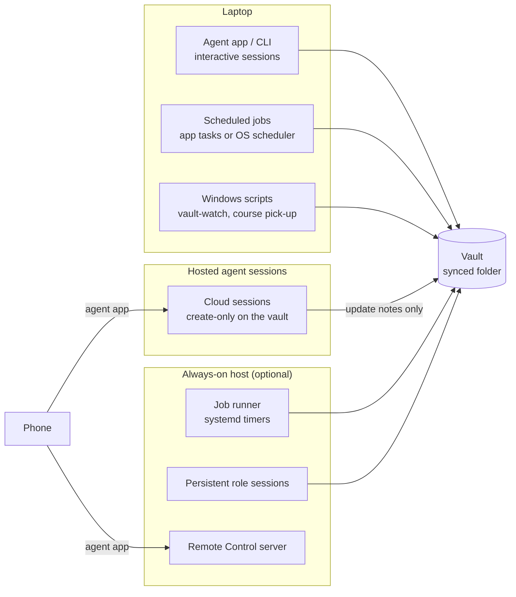

# Runtimes: laptop, cloud sessions, always-on host

A **runtime** (or host) is where agent sessions and scheduled jobs run. Uni OS knows three: `laptop` (the agent app or CLI on your computer), `cloud` (hosted agent sessions), and `vm` (an always-on machine: a cloud VM or a home server). The vault is the same in every case; only what can reach it, when, and with which permissions changes.

**The always-on host is optional.** Every module except `vm` works laptop-only; a few features need the host (the heartbeat's event wake-ups and question sessions, punctual runs while the laptop sleeps), as the table "What each module needs" shows. This page explains what each runtime can do, what it costs, how it fails, and what each module needs, so you can decide whether you want more than the laptop.

Uni OS has only been tested with Claude Code. The capabilities below are those of Claude Code in the original system (autumn 2026); other agents differ ([`agents.md`](agents.md)).



## The options

### 1. Laptop only

Interactive sessions run in the agent app or CLI, opened on the vault folder. Scheduled jobs run on the same laptop, in one of three ways (config `runtime.laptop_scheduler`, module [scheduler-local](../modules/scheduler-local/README.md)):

| `laptop_scheduler` | How jobs run | Notes |
|---|---|---|
| `agent-app` (default) | one scheduled task of the agent's desktop app per cron line, created by the setup agent from each job's `prompt.md` and slots | In Claude Code: desktop "Scheduled" tasks. They run only while the app is open, start a few minutes late (up to about 12 minutes was seen), and catch up missed slots when the laptop wakes. They run prompts, not commands, so command jobs (`inbox-poll`, `outcome-checks`) can't run this way. |
| `os` (experimental) | Windows Task Scheduler (cron, launchd or systemd timers after porting) runs `modules/scheduler-local/scripts/run_job.py`, which starts the agent CLI headless or runs the command | Works with the app closed, still not while the laptop sleeps. Runs command jobs too. The Windows registration snippet comes from `list_jobs.py windows <job>`. |
| `none` | nothing runs on the laptop | jobs run on the always-on host, or not at all |

Every job prompt computes its **nominal slot** (the latest scheduled time at or before now) and checks "already done?" first, because late starts and wake-up catch-ups are normal on a laptop.

### 2. Cloud agent sessions

Hosted sessions (in Claude Code: cloud sessions started from the app or claude.ai/code) work with the laptop off, which is why the original moved its course roles there for a while. Their limits shaped the whole system:

- **They need a git repository.** The vault is a synced folder, not a repo, so a cloud session works in a small private workspace repo that holds only standing instructions (`AGENTS.md`, `CLAUDE.md`, `.claude/settings.json` with `acceptEdits`), and reaches the vault through a storage connector.
- **They are create-only on the vault.** The Google Drive connector can create files but not change an existing file's content. Changes go through update notes in the inbox, which the `inbox-sync` job applies ([inbox-sync](../modules/inbox-sync/README.md)).
- **No bypass permissions.** Cloud sessions run at most in accept-edits, auto or plan mode, so they cannot do unattended work that needs approvals.
- **No laptop files.** They cannot read anything that exists only on the laptop.
- **No messaging.** Laptop and host sessions cannot reliably message them (a message sent from a bypass session waits for an approval nobody gives, then expires), and they cannot message back; requests travel as `## For <session>` sections in update notes.

Enable `runtime.use_cloud_sessions = true` and the `inbox-sync` module before you give a role to a cloud session. The standing instructions to paste into the workspace repo are installed as `_agent/inbox-sync/cloud-session-instructions.md`.

### 3. The always-on host (module `vm`)

A small Linux box runs the same agent CLI as the laptop, 24/7, **inside the vault**, which it mounts from the cloud drive with rclone. It runs the job runner (every `job.conf` becomes a systemd timer), persistent role sessions that are resumed after crashes and reboots, a Remote Control server so you can open sessions in the vault from your phone, a self-check every `vm.health_every_min` minutes (15), and an hourly git history of the vault's text notes. Full documentation: [`../modules/vm/README.md`](../modules/vm/README.md), setup [`../modules/vm/INSTALL.md`](../modules/vm/INSTALL.md).

The documented default is **Ubuntu 24.04 on Google Cloud**. The original system's host was an `e2-custom-small-4096` machine (4 GB RAM, 0.5 vCPU sustained, bursts to 2) at roughly $21 a month with its IPv4 address and weekly snapshots (about $21.60 at late-2026 list prices in us-central1; a monthly cloud credit in the author's subscription brought the out-of-pocket cost to about 10 EUR, under a 13 EUR budget alert). These are examples; check current prices. Any provider or Linux box with Ubuntu 24.04 and at least 4 GB RAM works with the same host code; memory, not CPU, is the binding constraint (about 360 MB per working role session, about 250 MB per job run, about 120 MB for the Remote Control server).

### 4. Home server variant

The same host code runs unchanged inside **WSL2 Ubuntu on a spare Windows laptop** that stays on at home: systemd, tmux and the rclone mount all work in WSL. The original moved its whole host from the 4 GB cloud VM onto an 8 GB laptop this way in one day. It costs electricity instead of a monthly bill, can keep a logged-in Chrome on the box, and needs more care: home network and power, Windows Update reboots, a keep-alive task so WSL runs with nobody signed in, and less free memory than you think (Windows and WSL overhead). Guide: [`../modules/vm/HOME-SERVER.md`](../modules/vm/HOME-SERVER.md). A native Linux machine at home works too (follow the "other providers" notes in `INSTALL.md`).

## Trade-offs

| | Laptop: agent-app tasks | Laptop: OS scheduler | Cloud sessions | Always-on host (cloud VM) | Home server (WSL2) |
|---|---|---|---|---|---|
| Runs when the laptop sleeps | no | no | yes | yes | yes (it is another machine) |
| Runs with the agent app closed | no | yes | yes | yes | yes |
| Punctual scheduled jobs | no: late starts, catch-up on wake | mostly; missed slots run on wake | not used for jobs here | yes: timers start within about 21 s of the slot | yes |
| Bypass permissions | yes, if the tasks were created from a bypass session | yes (`agent.permission_posture = "bypass"`) | **no** (accept-edits, auto, plan) | yes (all host sessions and jobs) | yes |
| Edits existing vault files | yes | yes | **no**: update notes through `inbox-sync` | yes, on the mounted vault | yes |
| Reads laptop-only files | yes | yes | no | no (only the synced vault) | no (its own disk and the vault) |
| Logged-in browser | yes, your own | jobs: no | no | only the laptop's Chrome through the bridge, while it is open | its own Chrome, signed in by you |
| Can be messaged by other sessions | yes (same permission mode) | no (headless) | no | yes, by title | yes, by title |
| Command jobs (`inbox-poll`, `outcome-checks`, `heartbeat-watch`) | no | yes | no | yes | yes |
| Phone access to sessions | while the laptop is on (Remote Control from the laptop, if you use it) | no | yes, through the agent app | yes, Remote Control server | yes |
| Money | none beyond your agent plan | none | none beyond your agent plan | about $21/month in the original (example) | electricity |
| Maintenance | keep the app open; check tasks after app updates | Task Scheduler entries, logs in `%LOCALAPPDATA%\uni-os` | a workspace repo; watch for parked update notes | logins (drive token, agent), updates, sizing, budget; [MAINTENANCE.md](../modules/vm/MAINTENANCE.md) | all of the VM's, plus Windows Update, power, WSL keep-alive |
| Typical failure | app closed or laptop asleep: jobs run late or not at all | laptop asleep; `PRECHECK` needing Git Bash; console flashing if started with `python.exe` | a note parked because the file changed; messages that never arrive | mount down, drive token revoked, memory pressure with too many sessions | a reboot or Windows Update; WSL stopped; home network down |

Rules that hold in every combination:
- **One job, one machine.** A job runs on exactly one host. Never leave it switched on at the laptop and on the always-on host in mode `always`; switch one off and the other on back to back, right after a slot, never around one.
- **One writer per file.** Cloud storage is last-writer-wins per file: two machines editing the same file within the sync window lose a write or create a conflict copy ([`storage.md`](storage.md)).
- **All role sessions share one permission mode**, or messages between them wait for an approval nobody gives.

## What each module needs

"Interactive" means sessions you talk to; jobs are listed with where they can run.

| Module | Laptop only (agent-app tasks) | Laptop with OS scheduler | Cloud sessions | Always-on host |
|---|---|---|---|---|
| core, student-model, courses, error-logs, resources, experiments, progress | full use, interactive | same | read through the connector; changes to existing files only with `inbox-sync` | full use (no Obsidian on the host; plain files) |
| study-pages, exercise-help, lecture-rundowns, quiz-coaching | full use; jobs `lecture-skim`, `quiz-prep` as app tasks | same, as OS tasks | roles work create-only (new pages are created directly; log rows go through update notes) | full use; jobs on timers |
| handwritten-notes | reads the PDFs on disk | same | through the connector | reads the PDFs on the mount |
| planning | role and calendar connector; job `deadline-audit` | same | role works create-only | full use |
| check-in | `week-page`; `check-in` asks you in the app task's session | both run headless (`run_job.py` uses session type `print`): `check-in` cannot wait for your answers there | not suited | `check-in` opens a Remote Control session and pushes its link to your phone |
| daily-prep | both jobs, if the app is open at the slot times | both jobs | not suited (needs calendar writes and edits) | both jobs, punctual |
| heartbeat | `heartbeat`, `heartbeat-weekend` as app tasks (the prompt runs the pre-check itself); questions inline (the push is the question) | same, with the pre-check in `PRECHECK` (no agent start when nothing fired) | no | all four jobs: event wake-ups (`heartbeat-watch`) and the question session (`heartbeat-ask`) need the host |
| notifications | the push gate works; `outcome-checks` can't run as an app task, so the heartbeat pushes outcome findings itself | `outcome-checks` every 15 minutes | no | the host is the one outcome sender (its `outcome-checks` job or the built-in check in `uni-vm health`) |
| inbox-sync | the applier `inbox-sync` at fixed slots only | applier plus `inbox-poll` (starts a sync soon after a note lands) | the writers this module exists for | applier plus poll |
| roles | coordinator on the laptop; job `waiting-on-you` | same | create-only roles | persistent role sessions, resumed after crashes |
| scheduler-local | this is the module | this is the module | no | not used (the host has its own runner) |
| obsidian, cockpit | Obsidian on the laptop (views also on Obsidian mobile) | same | no | no (the host never runs Obsidian) |
| vault-watch | Windows Task Scheduler task, no agent | same | no | no |
| course-files-fetch | role in a laptop session driving your browser; pick-up task on the Windows laptop | same | no (no browser) | role in a host session through the browser bridge while the laptop's Chrome is open; the pick-up still runs on the laptop that downloads |
| vm | no | no | no | this is the module |

### Every job

All jobs live in `<vault>/_agent/jobs/<job>/` after `uni-os init`. `RUNTIME` says where a job is meant to run; `DEFAULT_MODE` is its state when first installed (`off` = staged: nothing schedules it until you switch it on after a dry run; `always` = meant to run from the start). `python tools/uni_os.py jobs` prints the rendered schedules of your vault.

| Job | Module | Kind | Schedule (config key) | Session | `RUNTIME` | `DEFAULT_MODE` |
|---|---|---|---|---|---|---|
| `week-page` | check-in | agent | `schedule.week_page` | print | any | off |
| `check-in` | check-in | agent | `schedule.check_in` (weekly or every 2 weeks) | rc | any | off |
| `daily-study-prep` | daily-prep | agent | `schedule.daily_prep` | print | any | off |
| `study-prep-morning-check` | daily-prep | agent | `schedule.prep_check` | print | any | off |
| `heartbeat` | heartbeat | agent | `schedule.heartbeat` on `schedule.heartbeat_days` | print | any | off |
| `heartbeat-weekend` | heartbeat | agent | `schedule.heartbeat_weekend` on `schedule.heartbeat_weekend_days` | print | any | off |
| `heartbeat-watch` | heartbeat | command | every 10 minutes (`EVERY_MIN`) | print | vm | off |
| `heartbeat-ask` | heartbeat | agent | started by the heartbeat when it has a question | rc | vm | always |
| `inbox-sync` | inbox-sync | agent | `schedule.inbox_sync` | print | any | always |
| `inbox-poll` | inbox-sync | command | every `schedule.inbox_poll_every_min` minutes | print | any | always |
| `lecture-skim` | lecture-rundowns | agent | `schedule.lecture_skim` on `schedule.lecture_skim_days`, week 0 to `term.last_lecture_day` | print | any | off |
| `outcome-checks` | notifications | command | every 15 minutes (`EVERY_MIN`) | print | any | always |
| `deadline-audit` | planning | agent | `schedule.day_start` on `term.last_lecture_day` (no schedule without that date) | print | any | off |
| `quiz-prep` | quiz-coaching | agent | `schedule.quiz_prep` on `schedule.quiz_prep_dates` | print | any | off |
| `waiting-on-you` | roles | agent | `schedule.waiting_on_you` on `schedule.waiting_on_you_days` | print | any | off |
| `vm-health` | vm | command | every `vm.health_every_min` minutes | print | vm | always |
| `vault-history` | vm | command | hourly at minute `vm.history_minute` | print | vm | always |
| `vm-performance-verdict` | vm | agent | `schedule.vm_verdict` | print | vm | always |

The default times are the original system's values, shown only as examples; choose your own during setup. A job that ships `off` goes live in four steps (build report, staged, evaluated dry runs, switch on with your yes), described in the scheduler-local and vm module pages under "Releasing a new agent job".

On the always-on host, `DEFAULT_MODE` switches a timer on by itself only where that cannot cause a double run: a host-only job (`RUNTIME="vm"`) in `always`, or any job in `failover`. A `RUNTIME="any"` job in `always` (`inbox-sync`, `inbox-poll`, `outcome-checks`) arrives **off** on the host, because the laptop may already run it; moving it is `uni-vm jobs on <job>` right after pausing the laptop copy.

## Choosing

- **Start laptop-only.** Minimal and Standard presets need nothing else. Keep the agent app open (or let it start with the computer) if you use app tasks.
- **Add the OS scheduler** if you keep the app closed or want the command jobs on the laptop. It is experimental and Windows-first.
- **Add cloud sessions** only for roles that must answer while the laptop is off and can live with create-only writes. You also need `inbox-sync`.
- **Add the always-on host** when you want punctual jobs, phone access to sessions in the vault, persistent role sessions, or event wake-ups for the heartbeat, and you accept a monthly cost (or a spare machine) and some maintenance. In the original, the host ran every recurring job, six role sessions and the self-check within a week of being set up.

## Failover between laptop and host

Failover lets the laptop's agent app keep running a job while the host covers the slots the laptop misses. It is built and works, but it depends on the desktop app's internal files and is brittle; the original's final design was mode `always` for every recurring job (the host runs them, the laptop copies are paused). Use failover only if you have a reason to keep a job on the laptop.

**Modes on the host.** The live state of a job on the host is two things: whether its timer is on (`uni-vm jobs on <job>` / `uni-vm jobs off <job>`) and its mode, stored in `~/.local/state/uni-os/modes/<job>` (`uni-vm jobs mode <job> always|failover`; no file = `always`).

| Mode | Who runs the job | Markers |
|---|---|---|
| `always` | only the host; the laptop task must be paused | none |
| `failover` | the laptop's app task; the host runs a copy only if the laptop missed the slot | `_agent/vm/ran/<task>.md` after each host run |

**The job.conf keys.**

| Key | Default | Meaning |
|---|---|---|
| `LAPTOP_TASK` | the job id | id of the laptop app's task for this job, and the name of the ran marker |
| `FAILOVER_DELAY_MIN` | `25` | minutes after the slot before the host checks whether the laptop ran it |
| `MARKER` | `yes` | write `_agent/vm/ran/<LAPTOP_TASK>.md` after a failover run |

**How a scheduled host run in failover mode decides** (`modules/vm/host/bin/run-job`):
1. The laptop's ping task (`modules/vm/laptop/laptop-ping.ps1`, Windows, every 10 minutes while the Claude desktop app is open) sends the app's last-run time per task to the host (`laptop-tasks.json`) and touches a "laptop seen" file in the host's state folder.
2. The host waits `FAILOVER_DELAY_MIN` minutes after the slot.
3. If the laptop's task record shows a run for this slot (`lastScheduledFor`, else `lastRunAt`, at most 5 minutes before the slot): skip, log "laptop ran this slot".
4. If the laptop was seen in the last `LAPTOP_SEEN_MIN` minutes (host.env, default 15) but has not run the slot yet: wait 20 more minutes and check again; skip if it ran by then.
5. Otherwise run the job on the host and, with `MARKER="yes"`, write the ran marker:

```markdown
---
type: agent
audience: agent
updated: YYYY-MM-DD
tags: [uni/agent]
---
slot: YYYY-MM-DD HH:MM
ran_on_host: YYYY-MM-DD HH:MM
exit: N

The always-on host (<host name>) ran the laptop task "<task>" for the slot above because the laptop missed it (failover). A laptop catch-up run for the same slot can stop.
```

**The laptop side.** When the laptop wakes and its app catches up the missed slot, the run's first step (the failover check in `_agent/jobs/_header.md`, and in code in `run_job.py`) reads `_agent/vm/ran/<task>.md`: if `slot:` equals the run's nominal slot, it stops ("another host already ran it"). Manual runs (`uni-vm jobs run <job>`) and dry runs never wait for failover.

Why it is brittle: the ping reads the desktop app's internal `scheduled-tasks.json` files while the app may be writing them (the ping then skips a beat rather than send wrong data), and any change in the app's file layout breaks it. In mode `always` none of this is needed, which is why it is the recommendation.

## Moving a job between machines

1. Pick a moment right after one of the job's slots.
2. To the host: pause the laptop task (in Claude Code's desktop app, pause it in the task list), then `uni-vm jobs on <job>` immediately after.
3. Back to the laptop: re-enable the laptop task, then `uni-vm jobs off <job>` immediately after.
4. Record where the job runs in the coordinator's state page ("Scheduled jobs"), if you use the roles module.

Your agent can do all of this; say "move the daily prep job to the host" and it follows these steps.

## Related pages

- [`agents.md`](agents.md): which agent features each runtime relies on.
- [`storage.md`](storage.md): how the vault reaches each runtime.
- [`security-and-privacy.md`](security-and-privacy.md): bypass permissions, the host's attack surface.
- [`how-it-evolved.md`](how-it-evolved.md): why the original went from a chat project to a local coordinator, to cloud sessions, to a VM, to a home server.
