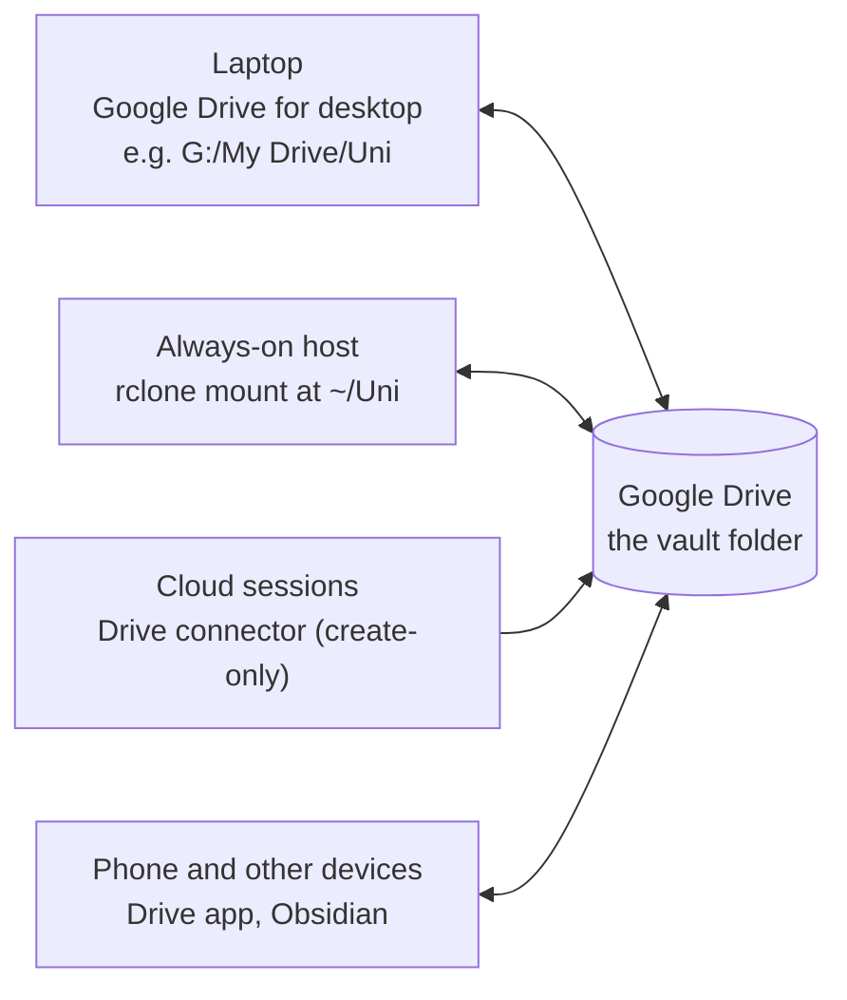

# Storage: where the vault lives and how it syncs

The vault is one folder of plain files (Markdown, HTML, PDFs, a few JSON and TOML files). Every agent session, job and device works on that same folder, so how it syncs decides what can go wrong. This page covers the documented default (Google Drive), the always-on host's rclone mount, conflict copies, provenance of files, other providers, what stays out of the vault, and Obsidian's settings.

The config records the choice in `storage.provider`: `"google-drive"` (default), `"onedrive"`, `"dropbox"`, `"icloud"`, `"syncthing"`, `"git"` or `"local"`. Only Google Drive was used in the original system; the others probably work and are untested.

## Google Drive (the default)

### On the laptop: Google Drive for desktop

The vault is a folder in your Drive, for example `G:/My Drive/Uni` on Windows, or `~/Library/CloudStorage/GoogleDrive-<account>/My Drive/Uni` on macOS. The macOS folder name contains your account address, so don't record that path in the config: make a link outside the Drive folder (`ln -s "<that path>" ~/Uni`) and record `~/Uni`, or leave `paths.vault` empty. The config key `paths.vault` records the path for agents, job prompts and laptop scripts; the `uni-os` command never uses it on its own: it takes the vault from `--vault`, `$UNI_OS_VAULT` or the folder you run it in.

Drive for desktop offers two modes:

| | Stream files (what the original used) | Mirror files |
|---|---|---|
| Where files are | in the cloud; a file downloads when it is first opened | a full local copy in a normal folder |
| Disk use | small cache | the whole vault |
| Offline | only folders marked "Available offline" | everything |
| File system | a virtual drive that reports itself as FAT32-like: **no symlinks or junctions** inside it | a normal local folder |
| Watchers | must read metadata only, or they download every file they open (vault-watch does exactly that) | no download cost |
| Tested with Uni OS | yes | no |

Quirks the original ran into (also in the vault's `_agent/tools-and-environment.md`, "Synced drive"):
- Drive drops a hidden `desktop.ini` into every folder on Windows. It is noise: scripts and watchers skip it, the recommended Obsidian ignore filter `/desktop\.ini$/` hides it, and nobody deletes it by hand.
- Drive shortcuts appear as 0 KB `.gdoc` stubs, and Google-native documents can't be read as files. Note the target instead.
- Some files have no extension in their Drive name: the laptop shows `name.pdf`, a Linux mount and the connector show `name`. Search without the extension when a path check fails.
- Files copied into the drive stay in the local cache until they are uploaded. Check the sync before you rely on another machine seeing a file.
- Offline, files you never opened are not on disk unless their folder is "Available offline" (the original marked its key folders, about 200 MB). Every agent session needs internet anyway.
- In Claude Code, laptop sessions in bypass mode write to the synced drive directly; a session in the desktop app's "auto" mode was blocked from writing there.
- Skills cannot be symlinked into the vault (no links on the streaming drive): copy them ([`agents.md`](agents.md), "Pointing your agent at the skills").

### On the always-on host: rclone mount

The host (module [vm](../modules/vm/README.md)) mounts the same Drive folder with rclone as a systemd user service, `uni-drive.service`, at `vm.mount_path` (default `~/Uni`). The rclone remote is `vm.drive_remote` (default `uni-drive`), created with your own Google OAuth client, `scope=drive` and `root_folder_id` set to the vault folder, so the remote's root is the vault ([`INSTALL.md`](../modules/vm/INSTALL.md), step 8).

The mount flags as shipped (`modules/vm/host/systemd/uni-drive.service`):

| Flag | Value | Why |
|---|---|---|
| `--vfs-cache-mode` | `full` | files behave like local files (random writes, editors, `git`); needed for agents that edit in place |
| `--vfs-cache-max-size` | `RCLONE_CACHE_MAX` from `host.env` (default `6G`) | caps the local cache |
| `--vfs-cache-max-age` | `2160h` | keeps cached files for 90 days |
| `--vfs-write-back` | `5s` | writes upload within about 5 seconds |
| `--vfs-refresh` | | refreshes the directory cache at start |
| `--dir-cache-time` | `1m` | changes made elsewhere show up within about a minute |
| `--poll-interval` | `15s` | asks Drive for changes every 15 seconds |
| `--attr-timeout` | `1s` | file sizes and times stay fresh |
| `--drive-export-formats` | `md,csv,txt,pdf` | how Google-native documents appear on the mount |
| `--cache-dir` | `~/.cache/rclone` | cache outside the vault |
| `--log-level`, `--log-file` | `NOTICE`, `~/.local/state/uni-os/rclone.log` | the health check trims this log in place at 5 MB, because rclone keeps it open |
| `--allow-other` | only with `RCLONE_ALLOW_OTHER=yes` in `host.env` | lets Windows read the mount on a WSL home server (`\\wsl.localhost\...`) |

Around the mount:
- **A delete on the mount is a real delete** in Drive (into Drive's trash). The vault rules forbid deletes and renames for agents on the host for this reason.
- **Vault sentinel.** Jobs with `NEEDS_VAULT="yes"` wait up to 2 minutes for the mount and the file `_agent/agent-start.md`, else they log "skipped" and exit 3, so an empty mount point is never mistaken for an empty vault.
- **Remount.** After every (re)mount the unit restarts the Remote Control server, because a remount strands it in the old, dead mount.
- **Search is slow on FUSE.** A recursive grep over the mount takes minutes. The hourly notes history (`vault-history`) keeps a git copy of every text note in `~/vault-history/`; `uni-vm grep` and `uni-vm find` search it in about 2 seconds (the copy can be up to an hour old).
- **The OAuth client must be published "In production".** Tokens of unpublished ("Testing") clients expire after 7 days. Tokens also die on a password change, on "remove access" in your Google account, or after 6 months unused. The health check reports `drive-auth` when `rclone about` fails.
- **Other storage on the host.** rclone backends for OneDrive or Dropbox work the same way with `rclone config`. A folder synced by something else (Syncthing, git) uses the installer's `--storage local` (`STORAGE_MODE=local` in `host.env`): then no mount unit is installed and the host uses the folder as it is.

### Cloud sessions: the Drive connector

Cloud agent sessions reach the vault through the Google Drive connector. It can create files and edit metadata, but not change an existing file's content, which is why the inbox-sync module exists ([inbox-sync](../modules/inbox-sync/README.md)). Two rules from the original: create notes with Google-type conversion off (`disableConversionToGoogleType: true`; a converted note arrives as an unreadable Google Doc stub), and find files by listing their folder or by exact title (title "contains" searches returned non-matching files). Connector reads may truncate long files.

## Conflict copies

Cloud storage is **last-writer-wins per file**. Two machines writing one file within the sync window either lose one write silently or create a conflict copy. Names depend on the tool:

| Tool | Conflict copy looks like |
|---|---|
| Google Drive | `name (1).md` |
| Dropbox | `name (conflicted copy ...).md` |
| Syncthing | `name.sync-conflict-<date>-<time>-<device>.md` |
| OneDrive | the file name with the computer name appended |
| Generic duplicates | `Copy of name.md` |

How the vault avoids them (rules in `_agent/CONVENTIONS.md`, section 9):
- **One owner per file.** Role briefs list the files each role writes (`owns`); error logs are split per stream so each has one owner.
- Re-read a file right before editing it; keep edits small and local; never edit the same file from two machines at the same moment.
- Write a file directly **or** send an update note for it, never both (that produced duplicate `(1)` files in the original).
- New files are always safe.
- Machine-written files that dashboards read by their Drive file id (`_agent/heartbeat/flags.json`, `_agent/vm/snapshot.json`) are rewritten **in place**, never by temp file and rename, so the id stays the same.
- Files where a second writer is risky are named in `CONVENTIONS.md`: the rules, the handbook, the progress pages, the course cards, the error logs, the coordinator's state page, the heartbeat's state.

Detection: the vault-watch module (Windows) alerts on any file matching `vault_watch.conflict_patterns` (default `* (1)*`, `*conflicted copy*`, `*.sync-conflict-*`, `Copy of *`; add a pattern for OneDrive). Without it, ask your agent "any conflict copies in the vault?" now and then. Fix a conflict by merging the two versions by hand (or with your agent), then deleting the copy after you checked the merge; agents ask before deleting.

## Provenance: where a file came from

A vault mixes your notes, agent-written pages and official course material. Uni OS keeps their origin visible:

| What | How provenance is kept |
|---|---|
| Official course files | Kept under their **official names** in the course's official subfolders (`official_subfolders`, created by `uni-os init`). Add-only: never renamed, edited or deleted. A newer version replaces an old one only with your OK: the old copy moves under its own name to `z_archive/<course folder>-outdated-YYYY-MM-DD/` at the vault root, and the course card gets a "Replaced <date>" line. |
| Fetched files (course-files-fetch) | The pick-up files a download only if the browser's own download record (the NTFS `Zone.Identifier` stream on Windows) names an allowed host; it records the host, never the URL, verifies the copy's SHA-256 and never overwrites. The fetch log is `_agent/course-fetch/course-fetch-log.md`. |
| Inventory of official files | vault-watch writes `_agent/vault-watch/sources-inventory.tsv` (path, size, modified time, area) and logs new, changed, moved and deleted official files. |
| Agent-written study material | Content only from the course's real sources, cited by section and page; every practice question labelled official or invented; estimates marked "(est.)" and inferences "(inferred)". |
| Error-log rows | A source tag on every row: `[script] p. 42`, `[slides]`, `[TA correction]`, `[quiz review]`, `[other AI]`, ... ([`file-formats.md`](file-formats.md)). |
| Files Uni OS installed | The manifest `_agent/.uni-os-manifest.json` records every file and folder `uni-os` wrote, with the module and a SHA-256, so `doctor` can tell untouched files from yours. |
| History of every note | On the always-on host, the hourly `vault-history` git snapshot (text files only, private paths skipped). Drive's own version history covers the rest. |

## Other providers

None of these was tested. What is known about how they would fit:

| Provider | Laptop | Always-on host | Conflict copies | Notes |
|---|---|---|---|---|
| OneDrive | the OneDrive client (Files On-Demand is a streaming mode like Drive's) | rclone `onedrive` backend, same mount unit | computer name appended: add a `vault_watch.conflict_patterns` entry | set `storage.provider = "onedrive"` |
| Dropbox | the Dropbox client | rclone `dropbox` backend | `conflicted copy` | set `storage.provider = "dropbox"` |
| iCloud Drive | macOS Finder, iCloud for Windows | no official Linux client; rclone's iCloud support is limited, check it before relying on it | numbered duplicates | best for a macOS-only setup without a host |
| Syncthing | the Syncthing app (a normal local folder) | Syncthing on the host, `--storage local` | `.sync-conflict-` | peer to peer: a device that is off does not sync; no cloud trash or versions unless you configure file versioning |
| git | a local clone you commit and pull | a clone, `--storage local`, plus a pull/commit job you write | merge conflicts instead of copies | jobs and sessions must commit and push; binary files (PDFs) bloat the history; never commit secrets or the private folders |
| local | one machine, no sync | not possible | none | fine for trying Uni OS out |

Whatever you choose: the storage connector your cloud sessions use must exist for that provider, and record new quirks in the vault's `_agent/tools-and-environment.md` when you meet them.

## What stays out of the vault, and what agents never open

**Never in the vault** (state that changes constantly, or secrets). These live outside on purpose; scripts refuse or warn when they would land inside:

| What | Where |
|---|---|
| The framework clone itself | its own folder, for example `~/uni-os` or `C:/Users/<you>/Documents/uni_os`; not inside the synced vault |
| Job run logs (`jobs.log`, `jobs/<job>/*.log`), locks | laptop: `%LOCALAPPDATA%\uni-os\` (Windows) or `~/.local/state/uni-os/`; host: `~/.local/state/uni-os/` |
| Push gate state (`state.json`, `notify.log`, `notify-settings.json`) | `push-gate/` in the same state folder |
| Heartbeat machine state (event markers, pending question, pre-check log) | `heartbeat/` in the same state folder |
| vault-watch scripts, snapshots and state | `vault_watch.install_dir`, default `%USERPROFILE%\Documents\uni-os\vault-watch` (the script exits 2 if its state folder is inside the vault) |
| Course pick-up scripts, policy and log | `course_fetch.install_dir`, default `%USERPROFILE%\Documents\uni-os\course-pickup` (outside, so no vault writer can change the policy) |
| Secrets (push topic, drive client, tokens) | `~/.config/uni-os/`, `~/.config/rclone/`, the agent's own login folder, Obsidian's secret storage ([`security-and-privacy.md`](security-and-privacy.md)) |
| Host-only files | `~/.config/uni-os/`, `~/.local/share/uni-os/jobs/`, `~/vault-history/`, `~/scratch/`, `~/.cache/rclone/` |

**In the vault, but never opened** (they still sync, but no tool or agent reads them):
- `paths.never_open` (default `["**/private/**"]`): every folder named `private`, anywhere. `doctor`'s secrets scan, the vault watcher, the notes history and the handwritten-notes rules skip these paths; vault-watch does not even list the file names inside.
- `paths.handwriting_app_data`: a tablet note app's own sync folder, if it lives inside the vault. Never touched, read or listed.

**Per-device files that should not travel** (the repo's `.gitignore` lists them for the example vault): `.obsidian/workspace*.json` (open tabs and panes), `.obsidian/plugins/*/data.json` for plugins that might hold secrets, `.trash/`. With a sync tool you can't exclude them from, they just sync harmlessly; with git, ignore them.

## Obsidian

Obsidian is recommended and optional: everything is plain Markdown, but the dashboards (Bases views, the Home page tiles, the cockpit plugin) are hard to get without it.

- **Settings live in the vault**, in `.obsidian/`, so they sync with it: the CSS snippet `.obsidian/snippets/uni-os.css`, the cockpit plugin under `.obsidian/plugins/uni-os-cockpit/`, app settings, bookmarks and graph groups. Dot-folders are invisible in Obsidian's file explorer.
- **Merging recommended settings.** The obsidian module renders its recommendations into `_agent/obsidian/` and merges them with `python modules/obsidian/scripts/merge_obsidian_config.py --vault "<vault>"` (a dry run by default; `--apply` writes; `--overwrite` also replaces values you set differently; `--only graph,bookmarks,app`). It only adds what is missing and never removes a bookmark, colour group, ignore filter or plugin. The ignore filters it adds: `_agent/archive/`, `_agent/inbox-applied/` (with inbox-sync), `_templates/` and `/desktop\.ini$/` (the last only matters on Google Drive).
- **Secrets are per device.** The cockpit's API key and private calendar addresses live in Obsidian's secret storage on each device; the synced settings file holds only their names. A second laptop, or a test copy of the vault, links its own.
- **Workspace state.** `.obsidian/workspace.json` changes whenever you open a tab; on two devices at once it may produce conflict copies. Uni OS never ships or edits it.
- **Rename inside Obsidian.** Moving a note on the drive, through a connector or with a shell command does not update links; Obsidian's file explorer does. Obsidian's index also lags a few minutes behind deletes and moves, so scripts read folders from disk.
- **Obsidian on a phone** needs its own way to reach the vault folder (Obsidian's paid sync service, or a sync app for your provider). Not tested with Uni OS.
- **Obsidian registers each vault** in its own settings file (on Windows `%APPDATA%\obsidian\obsidian.json`). Back it up before re-pointing a vault to a moved folder; re-pointing the same vault entry keeps its settings and the secrets plugins stored.

Without Obsidian, alternatives for a dashboard are a dashboard inside your agent app, your own HTML page that reads the vault, or a small wrapper script; the cockpit README lists the files such a page would read.

## Related pages

- [`runtimes.md`](runtimes.md): which runtime reaches the vault how.
- [`security-and-privacy.md`](security-and-privacy.md): secrets, private folders, backups.
- [`../modules/vm/MAINTENANCE.md`](../modules/vm/MAINTENANCE.md): renewing the drive login on the host.
- [`../modules/vault-watch/README.md`](../modules/vault-watch/README.md): conflict and drift detection on Windows.
