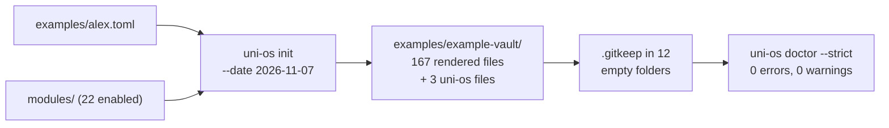

# Examples

This folder holds one complete, fictional example: the config of the student **Alex Example** and the vault that Uni OS renders from it. Use it to see what a setup produces before you run your own, and as a reference when you change templates.

| Path | What it is |
|---|---|
| [alex.toml](alex.toml) | Alex's complete config: every key of every module, with Alex's values |
| [example-vault/](example-vault/) | the vault `uni-os init` renders from `alex.toml`, checked in as it comes out (plus `.gitkeep` files in empty folders) |

Both are generated or fictional. Do not edit files in `example-vault/` by hand: change `alex.toml` or the modules, then re-render (see [Re-rendering the example vault](#re-rendering-the-example-vault)).



## Alex Example, the fictional student

Alex is a first-year BSc Computer Science student at the **Example Institute of Technology (EIT)**, in the term "Autumn 2026". Week 0 starts Mon 14 Sep 2026, the last lectures are on Fri 18 Dec 2026 and the exam session runs from Mon 25 Jan to Fri 19 Feb 2027. Nobody named in the config is real; `lecturers` lists are empty on purpose.

| Course id | Short | Course | Default assistance | Graded streams (assistance) | Bonus scheme |
|---|---|---|---|---|---|
| `algo` | AD | Algorithms and Data Structures | `hints-only` | weekly sheets (`hints-only`), in-class quizzes on 14 Oct, 11 Nov and 9 Dec (`hints-only`) | `threshold`: +0.25 at 80 % of sheet points |
| `dm` | DM | Discrete Mathematics | `hints-only` | graded sheets (`solo`), practice sheets (`hints-only`) | `points`: 8 points give +0.25 |
| `la` | LA | Linear Algebra | `hints-only` | weekly online quizzes (`solo`), exercise sheets (`hints-only`) | `best-n`: 10 of 12 quizzes give +0.25 |
| `prog` | PROG | Introduction to Programming | `coach` | programming exercises (`hints-only`, admission), team project (`hints-only`, grade) | `none` |

`solo` means the agent gives no help at all on that work. The two `solo` rows show how a per-assessment value overrides the course default; PROG shows a course whose default (`coach`) is more generous than its graded work.

Other choices worth knowing when you read the vault:

| Key | Value | Effect in the vault |
|---|---|---|
| `runtime.laptop_os`, `runtime.laptop_scheduler` | `"windows"`, `"agent-app"` | a Windows laptop whose agent desktop app runs the jobs as scheduled tasks ([scheduler-local](../modules/scheduler-local/README.md)) |
| `runtime.use_vm`, `runtime.use_cloud_sessions` | `false`, `false` | no always-on host and no cloud sessions |
| `calendar.standing_approval` | `false` | the planner proposes study blocks and writes them only after Alex says yes |
| `notify.quiet_windows` | the exam session, `urgent_ok = true` | ordinary pushes wait during the exam session; urgent ones still arrive |
| `paths.vault` | `"G:/My Drive/Uni-EIT"` | the vault path the job prompts are written for; the example vault itself lives in this repo |

`alex.toml` lists every key, also those of modules Alex does not enable (they are simply unused). It holds the same values as [config/uni-os.example.toml](../config/uni-os.example.toml), which explains every key with comments; [config/schema.md](../config/schema.md) has the type and default of each. The only keys left out are four old stuck-note aliases that `config/schema.md` documents for old configs. `tests/test_repo.py` and `tests/test_config.py` check that both files validate, list every key and hold the same values.

## Modules

Alex uses the **Standard** preset (20 modules) plus `inbox-sync` and `experiments`: 22 of the 25 modules. The config lists them in `modules.enabled` (with `uni_os.preset = "custom"`), so the render does not depend on the system of the computer that runs it. All 22 modules support any laptop system.

| Added to Standard | Why |
|---|---|
| `inbox-sync` | The cockpit's Done taps and cloud sessions can only create files. Their update notes land in `inbox/`; the `inbox-poll` and `inbox-sync` jobs apply them to the week page and the other files. |
| `experiments` | Shows the method for testing a change to how you study: the plan, block-log and coverage templates in `_templates/` and the `semester/experiments/` folder. |

| Left out | Why |
|---|---|
| `vm` | needs an always-on Linux host; Alex has none (`runtime.use_vm = false`) |
| `vault-watch` | an experimental, Windows-only watcher that runs as a Windows Task Scheduler task on the laptop |
| `course-files-fetch` | fetches official files through your own logged-in browser and files them with an experimental, Windows-only pick-up task |

These three need real infrastructure, which an example cannot show. Their keys stay in `alex.toml` with sensible values. In your own vault you switch one on with `python tools/uni_os.py enable <id>`; see [setup/changing-modules.md](../setup/changing-modules.md) and the [module catalogue](../modules/README.md).

## How the example vault was produced

From the repository root, on Windows 11 with Python 3.14:

```text
python tools/uni_os.py init --config examples/alex.toml --vault examples/example-vault --date 2026-11-07
python -c "import os,sys; [open(os.path.join(d,'.gitkeep'),'w').close() for d,s,f in os.walk(sys.argv[1]) if not s and not f]" examples/example-vault
python tools/uni_os.py doctor --strict --vault examples/example-vault
```

| Step | Result |
|---|---|
| `init` | 167 files from 22 modules, plus 12 empty folders: one per official subfolder (`AD/AD assignments/`, ...) and one handwritten-notes folder per course (`AD/AD handwritten/`, ...) |
| uni-os's own files | `_agent/uni-os.toml` (a byte-for-byte copy of `alex.toml`), `_agent/uni-os.json` (the machine copy the cockpit and scripts read) and `_agent/.uni-os-manifest.json` (every installed file with its SHA-256, to detect edits) |
| `.gitkeep` | git keeps no empty folders, so each of the 12 gets an empty `.gitkeep` |
| `doctor --strict` | 0 errors, 0 warnings; all 167 installed files untouched; the secrets check finds no keys, tokens, private calendar addresses or ntfy topics |

**Why `--date 2026-11-07`.** The date fills the `updated:` property and lines like "Last reviewed: 2026-11-07" in 83 files, the manifest included. Without `--date` it would be the day you run the command, and every re-render on another day would change those 83 files. Sat 7 Nov 2026 is the Saturday of term week 7, the day where the walk-through in the main [README](../README.md#a-week-in-alexs-term-the-weekend-of-7-8-nov-then-week-8-mon-9-to-sun-15-nov-2026) starts.

**Reproducible.** With the same command, two renders are byte-identical, also when you run them from another folder or with absolute paths. Nothing of the machine that rendered it ends up in the vault: the manifest records sources relative to `modules/`, and every path in `_agent/uni-os.json` is either relative to the vault or comes from the config (`paths.vault`, `%USERPROFILE%\...` install folders, `~/Uni`).

**What it is.** The vault exactly as a new student gets it, before the first week of use:

- `progress/weeks/` holds only its README: the first week page comes from the `week-page` job or `uni-os new-week`.
- No plans, no prep notes, no study pages yet; the error logs have their headings and no rows.
- Course cards contain placeholders such as "(add the link)" for facts the config does not hold. An agent fills them from the official course pages in the first week.
- Jobs are files only. Nothing is scheduled: registering them is a setup step on your own machine ([modules/scheduler-local/README.md](../modules/scheduler-local/README.md)).
- Skills are in `_agent/skills/`, not yet copied to `agent.skills_dir` (`.claude/skills`).
- `.obsidian/` holds only the cockpit plugin files and the `uni-os` CSS snippet. Uni OS never writes Obsidian's own settings; the Obsidian module merges them on request.

## How to browse it

### On GitHub, or in any Markdown viewer

Start at [example-vault/README.md](example-vault/README.md), the folder map. Plain Markdown, tables and Mermaid diagrams render; the Obsidian-only parts do not:

- embeds like `![[Courses.base]]` and the `.base` views in `views/`
- the `uni-os-cockpit` block at the top of `Home.md` (the cockpit plugin draws it)
- callouts like `> [!agent]-`, which show as plain quotes

### In Obsidian

Copy the vault out of the tracked folder first, so the files Obsidian creates when it opens a vault (`app.json`, `workspace.json`, ...) do not land in the repo. Git ignores `test-vault*` folders in the repo root:

```text
cp -r examples/example-vault ./test-vault-alex                      # Git Bash, macOS, Linux
Copy-Item -Recurse examples/example-vault test-vault-alex           # PowerShell
```

Then, in Obsidian 1.9 or newer (Bases views need it; the cockpit needs 1.13.2): **Open folder as vault** and choose `test-vault-alex`.

| To see | Do |
|---|---|
| the course colours and callout styles | Settings → Appearance → CSS snippets → switch on `uni-os` |
| the cockpit dashboard | Settings → Community plugins → turn off Restricted mode → enable "Uni OS cockpit" under Installed plugins ([modules/cockpit/README.md](../modules/cockpit/README.md#install)) |
| graph colours, bookmarks and link settings | close Obsidian, then `python modules/obsidian/scripts/merge_obsidian_config.py --vault ./test-vault-alex` shows the plan and `--apply` writes it (backups first) |

The cockpit's calendar parts (today, the week, next up) stay empty: the example has no calendar feeds and no calendar snapshot.

You can also open your agent in the copy and ask it something ("what is due in week 8?"). It starts at `AGENTS.md`. In Claude Code: `CLAUDE.md` imports `AGENTS.md`.

## What to look at first

| # | File in `example-vault/` | What it shows |
|---|---|---|
| 1 | [README.md](example-vault/README.md) | who starts where, and the folder map, generated from the enabled modules between `uni-os:begin map` / `uni-os:end map` lines |
| 2 | [Home.md](example-vault/Home.md) | the dashboard: term dates, the cockpit block, the course table, next deadlines, this week |
| 3 | [_agent/agent-start.md](example-vault/_agent/agent-start.md) | the first page for every agent: read order, the write-back duty, how to get the date and term week right |
| 4 | [_agent/rules.md](example-vault/_agent/rules.md) | the non-negotiable rules, with the integrity table generated from each course's `assistance` and assessments |
| 5 | [DM/dm.md](example-vault/DM/dm.md) | a course card: facts, the graded-streams table (graded sheets `solo`), bonus rule, sources. Compare [AD/ad.md](example-vault/AD/ad.md) (quiz dates) and [PROG/prog.md](example-vault/PROG/prog.md) (`coach` default, two error-log streams) |
| 6 | [_templates/week-page.md](example-vault/_templates/week-page.md) | the week page template, with "Due this week", "Results this week", "Notes" and the end-of-week check-in |
| 7 | [_agent/jobs/](example-vault/_agent/jobs/) | 15 jobs, each a `job.conf` (when and how) and, for agent jobs, a `prompt.md`; [README.md](example-vault/_agent/jobs/README.md) explains every key |
| 8 | [_agent/roles/](example-vault/_agent/roles/) | 5 role briefs (coordinator, exercise help, lecture rundown, plan and progress, quiz coach) and the routing between them |
| 9 | [_agent/skills/](example-vault/_agent/skills/) | 4 skills, each a `SKILL.md`: course-facts, log-error, read-handwritten-notes, study-page |
| 10 | [_agent/CONVENTIONS.md](example-vault/_agent/CONVENTIONS.md) | the routing table: which kind of fact goes into which file |

A few commands show more without writing anything into the vault:

```text
python tools/uni_os.py jobs --vault examples/example-vault                                    # the 15 jobs with slots and days
python tools/uni_os.py week --vault examples/example-vault --date 2026-11-07                    # Week 7 (Mon 2 Nov to Sun 8 Nov 2026)
python tools/uni_os.py new-week --vault examples/example-vault --date 2026-11-07 --dry-run      # prints the week 8 page
```

The `new-week` preview fills the template for Mon 9 to Sun 15 Nov 2026, with one "Due this week" row per assessment stream from the config. The `week-page` job then replaces those rows with the week's real items.

To see how a config value reaches the vault:

| In `alex.toml` | In `example-vault/` |
|---|---|
| `student.name = "Alex Example"`, `university.short = "EIT"` | `AGENTS.md`: "Alex Example's university vault (EIT, Autumn 2026)" |
| `schedule.week_page = { day = "Sun", time = "10:00" }` | `_agent/jobs/week-page/job.conf`: `SLOTS="10:00"`, `DAYS="Sun"` |
| `term.last_lecture_day = 2026-12-18` | the same job's `PRECHECK`, which skips the job after that day |
| the DM assessment "Graded sheets" with `assistance = "solo"` | `DM/dm.md` and `_agent/rules.md`: Graded sheets `solo` |
| `official_subfolders` of each course | the 8 empty folders such as `AD/AD assignments/` |

## Re-rendering the example vault

Re-render after any change that alters what `init` produces: templates, job prompts, role briefs or skills under `modules/`, a `module.toml`, the rendering code in `tools/uni_os/`, the cockpit build, or `alex.toml`. From the repository root:

```text
rm -rf examples/example-vault                  # PowerShell: Remove-Item -Recurse -Force examples/example-vault
python tools/uni_os.py init --config examples/alex.toml --vault examples/example-vault --date 2026-11-07
python -c "import os,sys; [open(os.path.join(d,'.gitkeep'),'w').close() for d,s,f in os.walk(sys.argv[1]) if not s and not f]" examples/example-vault
python tools/uni_os.py doctor --strict --vault examples/example-vault
git diff --stat -- examples/example-vault
```

Expect 0 errors and 0 warnings, and a diff that touches only the files your change should touch.

- **Keep the date.** A new `--date` changes 83 files and hides the real change. Change it only on purpose, and then also in the header of `alex.toml` and on this page.
- **Use a clean `init`, not `render`.** `render` reads the vault's copy of the config (`_agent/uni-os.toml`), not `alex.toml`; it keeps files whose template was removed or renamed; and it does not recreate deleted files. A fresh `init` gives exactly what a new student gets.
- **Cockpit changes:** build first (`cd modules/cockpit/plugin && npm run build`). The build writes `modules/cockpit/dist/` and `modules/cockpit/vault/.obsidian/plugins/uni-os-cockpit/`, and `init` copies the latter into the example vault.
- **A new config key:** add it to both `alex.toml` and `config/uni-os.example.toml` with the same value, and document it in `config/schema.md`; the repo tests check all three.

To confirm the render is still reproducible, render a second copy and compare (no output means identical):

```text
python tools/uni_os.py init --config examples/alex.toml --vault ./test-vault-check --date 2026-11-07
diff -r -x .gitkeep examples/example-vault ./test-vault-check
```
