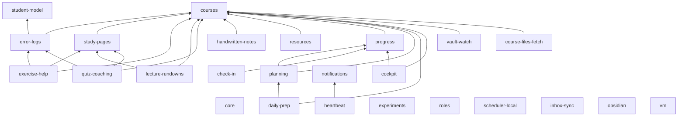

# Module catalogue

Uni OS is built from 25 modules. Each one is a folder `modules/<id>/` with a `module.toml` manifest, templates that `uni-os init` renders into your vault, and a `README.md` that is the module's full documentation page (what it does, why it exists, how it works, configuration, failure modes, lessons from the original system, how to remove it). This page is the map: what exists, what depends on what, and which preset includes it.

The tables below are written by hand from the `module.toml` files and the preset lists in [`../tools/uni_os/presets.py`](../tools/uni_os/presets.py); those files win if the two ever disagree. `python tools/uni_os.py modules` prints the live catalogue with the status of each module in your vault (`enabled`, `dep`, `disabled`, `available`), and `python tools/uni_os.py modules --preset <name>` prints a preset's resolved list.

Uni OS has only been tested with Claude Code (desktop app, CLI, Remote Control). Module pages say where they use a Claude-specific feature and what other agents do instead; the summary is in [`../docs/agents.md`](../docs/agents.md).

## Overview

"Layer" is a reading aid that groups modules by purpose. "Tier" is the `tier` field of `module.toml` (`core`, `standard`, `advanced`, `addon`). "Presets": **M** = Minimal, **S** = Standard, **F** = Full (lists in [`../setup/presets.md`](../setup/presets.md)).

| Layer | Module | Name | Tier | Presets | In one line |
|---|---|---|---|---|---|
| Foundation | [`core`](core/README.md) | Core | core | M, S, F | The vault skeleton: agent entry files, standing rules, conventions with the routing table, system handbook, inbox, note templates, Home and the generated vault maps. |
| Foundation | [`student-model`](student-model/README.md) | Student model | core | M, S, F | Four short pages in `me/` (profile, learning style, rhythm and habits, weak spots) so every agent's advice fits the student. |
| Foundation | [`courses`](courses/README.md) | Courses | core | M, S, F | One folder per course: course card, backlog, `notes/` and `reference/`, add-only official subfolders, an all-courses overview and the `course-facts` skill. |
| Foundation | [`error-logs`](error-logs/README.md) | Error logs | core | M, S, F | One append-only, five-column mistake log per course and stream; recurring patterns feed `me/weak-spots.md`; optional retest bank. |
| Study engine | [`study-pages`](study-pages/README.md) | Study pages | standard | M, S, F | Self-contained HTML teaching pages (KaTeX, quizzes checked by code, cheat sheet, final self-test) with a Markdown twin, or Markdown, HTML or PDF only; converter and quality checks. |
| Study engine | [`exercise-help`](exercise-help/README.md) | Exercise help (hints only) | standard | M, S, F | The exercise-help role: coaching by assistance level (default `hints-only`), hint pages, mistake maps, an error log kept current without being asked. |
| Study engine | [`lecture-rundowns`](lecture-rundowns/README.md) | Lecture rundowns | standard | S, F | The lecture-rundown role: skims, rundowns, recaps, summaries and cheat sheets from the course's real sources with cited pages; optional pre-lecture skim job. |
| Study engine | [`quiz-coaching`](quiz-coaching/README.md) | Quiz coaching | standard | S, F | The quiz-coach role for recurring graded quizzes: scope check, prep sheets, mocks on request, reviews into the error log; optional prep-sheet job. |
| Study engine | [`handwritten-notes`](handwritten-notes/README.md) | Handwritten notes | standard | S, F | A folder contract for PDFs a tablet note app exports into each course; agents read and link them, never write there. |
| Study engine | [`resources`](resources/README.md) | Resources | standard | S, F | A sources registry with an authority order, a log for TA and community websites, and the course-fact verification method. |
| Organisation | [`progress`](progress/README.md) | Progress tracking | standard | S, F | A dashboard (bonus or grade standing, done vs. to do, next 10 days), an append-only tracker log, and one parsed page per term week. |
| Organisation | [`planning`](planning/README.md) | Planning | standard | S, F | Term calendar page, planning system with the block notation, week plans, an exam-phase scheduling frame, the Plan & progress role, an optional deadline-audit job. |
| Organisation | [`check-in`](check-in/README.md) | Check-in and week pages | standard | S, F | Two jobs: `week-page` creates the coming week's page, `check-in` asks you for the period's results and closes the week, on the day and time you choose. |
| Organisation | [`daily-prep`](daily-prep/README.md) | Daily study prep | standard | S, F | An evening job writes one immutable prep note per day plus a MATERIAL block in each calendar study block; a morning job verifies and repairs it. |
| Organisation | [`heartbeat`](heartbeat/README.md) | Heartbeat (proactive watcher) | standard | S, F | A cheap deterministic pre-check decides whether an agent run is worth it; the agent then stays silent, sends one combined push, or asks one combined question. |
| Organisation | [`experiments`](experiments/README.md) | Study and habit experiments | advanced | F | A method for testing changes to how you study or live: pre-registered plan, block log, coverage list, review with a keep / change / try-next verdict. |
| Agents and automation | [`roles`](roles/README.md) | Roles and the coordinator | standard | S, F | Durable role briefs, one coordinator session with a state page, a generated routing table, messaging rules, handoffs, an optional "what's waiting on you" page. |
| Agents and automation | [`scheduler-local`](scheduler-local/README.md) | Laptop scheduler | standard | S, F | Runs the vault's jobs on the laptop: as scheduled tasks of the agent's desktop app, or (experimental) through an OS scheduler and `run_job.py`. |
| Agents and automation | [`notifications`](notifications/README.md) | Notifications (ntfy push + push gate) | standard | S, F | Phone pushes through one gate (daily budget, minimum gap, dedupe, quiet hours and windows, never "all good", no personal details), plus deterministic outcome checks. |
| Agents and automation | [`inbox-sync`](inbox-sync/README.md) | Inbox sync (update notes for create-only writers) | advanced | F | The update-note protocol that lets create-only writers (cloud sessions, cockpit Done taps) change existing files; a poll job and an applier job. |
| Obsidian | [`obsidian`](obsidian/README.md) | Obsidian views and styling | standard | M, S, F (only with `obsidian.enabled`) | Bases views, a CSS snippet with course colours and callouts, graph colour groups, bookmarks and a generated vault-map canvas. |
| Obsidian | [`cockpit`](cockpit/README.md) | Cockpit (Obsidian plugin) | addon | S, F (only with `obsidian.enabled`) | A dashboard plugin built from your notes and calendar feeds, with Done taps through the inbox and an optional AI side panel on your own API key. |
| Windows laptop | [`vault-watch`](vault-watch/README.md) | Vault watch | advanced | F | Experimental, Windows only: a metadata-only watcher of notes and official course files that logs every change and raises toasts (optionally one push) for what needs action. |
| Windows laptop | [`course-files-fetch`](course-files-fetch/README.md) | Course files fetch | advanced | F | Fetch official files through your own logged-in browser (read-only); an experimental, Windows-only pick-up task files the downloads with provenance checks. |
| Always-on host | [`vm`](vm/README.md) | Always-on host (cloud VM or home server) | addon | F | An always-on Linux box (Ubuntu on Google Cloud by default, or WSL2 on a spare laptop): job runner, persistent role sessions, Remote Control, self-check, hourly notes history. |

Notes on the presets:
- `obsidian` and `cockpit` are added by a preset only when `obsidian.enabled = true` (the default).
- Presets are resolved for the laptop's system (`runtime.laptop_os`, else this computer's). On macOS or Linux, Full leaves out `vault-watch` and `course-files-fetch`, whose laptop scripts are Windows-only and experimental. Added anyway (`--modules`, `uni-os enable`), both get a `uni-os doctor` warning until you port them ([`../docs/porting-to-other-os.md`](../docs/porting-to-other-os.md)). The course-files-fetch role and its `request_pickup.py` helper run anywhere; only its pick-up task is Windows-only.
- Full also adds `vm`, which needs an always-on host you set up yourself ([`vm/INSTALL.md`](vm/INSTALL.md)).
- Dependencies (`requires`) are always added on top of what you pick, and `core` is always installed.

## Module facts

| Module | Requires (besides `core`) | Recommends | Obsidian | OS | Runtime | Jobs | Roles | Skills |
|---|---|---|---|---|---|---|---|---|
| [`check-in`](check-in/README.md) | `progress` | `planning`, `notifications`, `scheduler-local`, `inbox-sync`, `experiments` | optional | any | laptop, vm | `check-in`, `week-page` | - | - |
| [`cockpit`](cockpit/README.md) | `courses`, `progress` | `obsidian`, `planning`, `daily-prep`, `inbox-sync`, `check-in` | required | any | laptop | - | - | - |
| [`core`](core/README.md) | - | `student-model`, `courses`, `obsidian` | optional | any | laptop, cloud, vm | - | - | - |
| [`course-files-fetch`](course-files-fetch/README.md) | `courses` | `roles`, `notifications`, `vault-watch` | irrelevant | windows | laptop, vm | - | `course-files-fetch` | - |
| [`courses`](courses/README.md) | - | `resources`, `error-logs`, `study-pages`, `progress` | recommended | any | laptop, cloud, vm | - | - | `course-facts` |
| [`daily-prep`](daily-prep/README.md) | `courses`, `planning` | `progress`, `obsidian`, `cockpit`, `heartbeat`, `scheduler-local`, `course-files-fetch` | recommended | any | laptop, vm | `daily-study-prep`, `study-prep-morning-check` | - | - |
| [`error-logs`](error-logs/README.md) | `courses`, `student-model` | `exercise-help`, `quiz-coaching`, `obsidian` | optional | any | laptop, cloud, vm | - | - | `log-error` |
| [`exercise-help`](exercise-help/README.md) | `courses`, `error-logs`, `study-pages` | `roles`, `progress`, `lecture-rundowns` | optional | any | laptop, cloud, vm | - | `exercise-help` | - |
| [`experiments`](experiments/README.md) | - | `planning`, `progress`, `student-model`, `check-in` | optional | any | laptop, cloud, vm | - | - | - |
| [`handwritten-notes`](handwritten-notes/README.md) | `courses` | `vault-watch` | optional | any | laptop, cloud, vm | - | - | `read-handwritten-notes` |
| [`heartbeat`](heartbeat/README.md) | `notifications` | `progress`, `daily-prep`, `check-in`, `planning`, `roles` | optional | any | laptop, vm | `heartbeat`, `heartbeat-weekend`, `heartbeat-watch`, `heartbeat-ask` | - | - |
| [`inbox-sync`](inbox-sync/README.md) | - | `roles`, `scheduler-local`, `notifications` | irrelevant | any | laptop, vm | `inbox-sync`, `inbox-poll` | - | - |
| [`lecture-rundowns`](lecture-rundowns/README.md) | `courses`, `study-pages` | `error-logs`, `roles`, `daily-prep` | optional | any | laptop, cloud, vm | `lecture-skim` | `lecture-rundown` | - |
| [`notifications`](notifications/README.md) | - | `heartbeat` | irrelevant | any | laptop, vm | `outcome-checks` | - | - |
| [`obsidian`](obsidian/README.md) | - | `courses`, `progress`, `student-model`, `cockpit` | required | any | laptop | - | - | - |
| [`planning`](planning/README.md) | `courses`, `progress` | `check-in`, `daily-prep`, `student-model`, `heartbeat`, `experiments` | optional | any | laptop, cloud, vm | `deadline-audit` | `plan-and-progress` | - |
| [`progress`](progress/README.md) | `courses` | `planning`, `check-in`, `obsidian`, `cockpit`, `heartbeat` | recommended | any | laptop, cloud, vm | - | - | - |
| [`quiz-coaching`](quiz-coaching/README.md) | `courses`, `error-logs`, `study-pages` | `progress`, `roles`, `daily-prep`, `heartbeat` | optional | any | laptop, cloud, vm | `quiz-prep` | `quiz-coach` | - |
| [`resources`](resources/README.md) | `courses` | - | optional | any | laptop, cloud, vm | - | - | - |
| [`roles`](roles/README.md) | - | `planning`, `exercise-help`, `lecture-rundowns`, `scheduler-local` | optional | any | laptop, cloud, vm | `waiting-on-you` | `coordinator` | - |
| [`scheduler-local`](scheduler-local/README.md) | - | `notifications` | irrelevant | any | laptop | - | - | - |
| [`student-model`](student-model/README.md) | - | `error-logs`, `planning`, `check-in` | optional | any | laptop, cloud, vm | - | - | - |
| [`study-pages`](study-pages/README.md) | `courses` | `obsidian`, `error-logs`, `lecture-rundowns` | recommended | any | laptop, cloud, vm | - | - | `study-page` |
| [`vault-watch`](vault-watch/README.md) | `courses` | `notifications`, `daily-prep`, `inbox-sync`, `course-files-fetch` | irrelevant | windows | laptop | - | - | - |
| [`vm`](vm/README.md) | - | `notifications`, `roles`, `heartbeat`, `inbox-sync` | irrelevant | any | vm | `vm-health`, `vault-history`, `vm-performance-verdict` | - | - |

How to read the columns:
- **Obsidian**: `required` (needs Obsidian), `recommended` (works without it, but reads best in it), `optional` (plain Markdown), `irrelevant` (no notes for humans to read in Obsidian).
- **OS**: the operating system of the laptop scripts. `windows` means experimental PowerShell, Task Scheduler and VBS launchers. Everything else is plain Markdown plus Python 3.11+ standard library.
- **Runtime**: where the module's sessions and jobs can run: `laptop` (the agent app or CLI on your computer), `cloud` (hosted agent sessions), `vm` (the always-on host). What each runtime can and cannot do is in [`../docs/runtimes.md`](../docs/runtimes.md), which also lists every job with its schedule key and default mode.
- **Jobs** are rendered into `<vault>/_agent/jobs/<job>/`, **roles** into `<vault>/_agent/roles/<role>.md`, **skills** into `<vault>/_agent/skills/<skill>/SKILL.md`. The formats are in [`../docs/file-formats.md`](../docs/file-formats.md).

## Dependencies

Solid arrows are hard dependencies (`requires`): enabling a module enables everything it points to. Every module also requires `core`, which is left out of the graph to keep it readable. Recommendations (`recommends`) are in the facts table above; they are never installed automatically.

Modules with no outgoing arrow (`student-model`, `experiments`, `roles`, `scheduler-local`, `inbox-sync`, `notifications`, `obsidian`, `vm`) depend only on `core`. A module that others need cannot be disabled on its own: `uni-os disable courses` is refused while `progress` is enabled, for example.

## Skills

Four modules ship skills in the open Agent Skills format (`SKILL.md` with `name` and `description` frontmatter). Setup copies them from `_agent/skills/` into the folder your agent reads skills from (`agent.skills_dir`), and they are copied again after every `uni-os render`, because render updates only the vault copy. Copy, don't link: Google Drive for desktop allows no symbolic links. How: [`../docs/agents.md`](../docs/agents.md).

| Skill | Module | Use it for |
|---|---|---|
| `course-facts` | courses | Any question about this term's courses: what a week, lecture or exercise session covers, sheet and deadline rhythm, graded work and bonus rules, what help is allowed, where to look things up. |
| `log-error` | error-logs | Appending a row to a course's error log ("log this error", or unasked the moment an error shows up), keeping "Patterns to watch" and `me/weak-spots.md` current. |
| `study-page` | study-pages | Building any study material (teaching page, skim, rundown, recap, summary, cheat sheet, hint page, quiz-prep sheet, mock quiz) in the vault's formats, with naming, checks and filing. |
| `read-handwritten-notes` | handwritten-notes | Finding and reading the student's handwritten PDFs, as page images when there is no text layer, without writing into the handwritten folders. |

## Working with modules

| You want to | Read |
|---|---|
| Pick modules during setup | [`../setup/presets.md`](../setup/presets.md) and [`../setup/interview.md`](../setup/interview.md) |
| Add, remove or reconfigure a module later | [`../setup/changing-modules.md`](../setup/changing-modules.md); in short: tell your agent, or run `python tools/uni_os.py enable <id>` / `disable <id>` |
| Understand how the pieces fit together | [`../docs/architecture.md`](../docs/architecture.md) |
| Write a new module | [`../docs/file-formats.md`](../docs/file-formats.md) (`module.toml`, templates, jobs, roles, skills) and [`../tools/README.md`](../tools/README.md) (how installing works, doctor contract checks) |
| Know which config keys a module reads | the module's README, section "Configuration", and [`../config/schema.md`](../config/schema.md) |

`uni-os disable <id>` never deletes your files: generated maps stop listing the module, its jobs get a `DISABLED` marker that both job runners skip, and its roles leave the routing table. Scheduled tasks you created on the laptop, and timers on the always-on host, are removed separately; each module's "Removing it" section says how.
