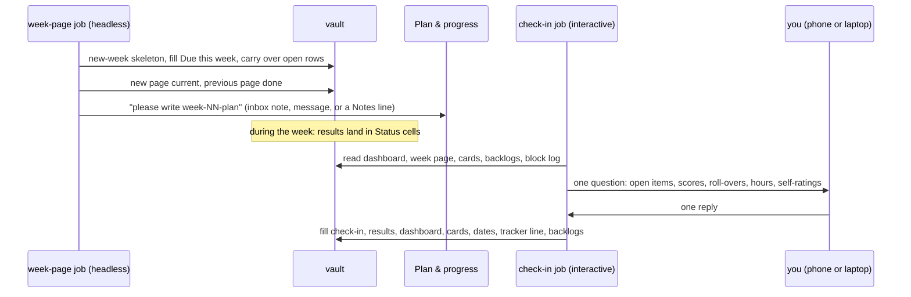

# Check-in and week pages

Two scheduled jobs run the weekly rhythm of the progress records so it doesn't depend on anyone remembering. **`week-page`** creates the coming week's page before it starts, with a "Due this week" table of the week's real items (sheets with their numbers, quizzes, hand-ins, graded sittings, with concrete deadlines and your personal targets), carries over what is still open, closes the previous page and asks the planner for the week plan. **`check-in`** opens a session at the end of each period, asks you **once** for the results it doesn't have yet (one line per course, answerable from your phone), and then fills the week's check-in section, recomputes the bonus standing, prunes old dates and appends the tracker line. Day, time and frequency are yours to choose.

## At a glance

| | |
|---|---|
| Tier | standard |
| Requires | `core`, `progress` |
| Recommends | `planning` (receives the week-plan request), `notifications` (the check-in push on hosts without their own), `scheduler-local` or `vm` (to run the jobs), `inbox-sync` (request route), `experiments` (focused hours from the block log) |
| Obsidian | optional |
| OS | any |
| Runtime | laptop (agent app scheduled tasks or an OS scheduler) or an always-on host |
| Jobs | `check-in` (interactive, `SESSION="rc"`), `week-page` (headless, `SESSION="print"`) |
| Roles | none |
| Cost | `week-page`: one headless agent run per week (a few minutes, mid-size model). `check-in`: one interactive session per period, two turns. The original used a mid-size model (Sonnet) at high effort for both |

## Why it exists

In the original system the weekly rhythm was written into a rules file ("Saturday check-in, Sunday plan") and was supposed to happen by itself. It didn't: role sessions act only when spoken to, and an audit of "duties written down but triggered by nothing" found the weekly plan among the misses. Two jobs fixed it. A Sunday job created the next week page from the template (with "Due this week" pre-filled from the course rhythm and the key dates), closed the old page, and from week 7 on dropped a note asking the planner for next week's plan. A Saturday evening job asked the student for the week's results in a session they could open on their phone, then updated the week page, the dashboard, the course cards, the tracker log and the backlogs. The check-in was put on Saturday evening "so Sunday stays free for catch-up", and its schedule had dated exceptions (moved to a Friday noon on weekends with an outside event). The framework keeps the mechanics and makes every day and time a setting.

## How it works

### `week-page`
1. Guards: the failover marker (with the `vm` module), the real date, the **target week** (Friday to Sunday: next week; Monday to Thursday: the current week, so a late run still creates a missing page), no page after the last lecture day, and "page already exists" (then only steps 2 and 3).
2. Skeleton: `python tools/uni_os.py new-week --vault <vault> --week N --status current --close-previous` renders `_templates/week-page.md` deterministically (never overwriting) and closes the previous page; if the CLI isn't available on the host, the agent renders the template's `{{week.*}}` placeholders itself.
3. Fill "Due this week" with the week's real rows from the course rhythm (`[[courses.assessments]]`), the key dates, the course cards and the course-facts skill; carry over rows of the previous page that are not done ("(carried over from week M)"; their results stay in week M until its check-in); `not released yet` for items that come out later; estimates and inferences labelled.
4. Status: the new page `current`, the previous page `done` (its check-in may still be open: the `_To fill_` markers say so).
5. With `planning`: if `semester/plans/week-NN-plan.md` doesn't exist, ask Plan & progress for it through the first available route: an inbox note with a `## For Plan & progress` section (`inbox-sync` forwards it), a direct message to that session, or a line in the page's Notes.

**Why an agent job and not `KIND="command"`.** `uni-os new-week` is deterministic and enough for the skeleton, and the job uses it. But the rows that make the page useful (sheet 8, not "the weekly sheet"; Tue 10 Nov 23:59, not "Tuesdays"; what is already out; what rolled over) need reading several files and judgment, and the plan request needs routing. If you prefer zero agent cost, switch `job.conf` to the commented `KIND="command"` lines: you get the skeleton with one placeholder row per graded item, and the planner or the check-in fills in the details.

### `check-in`
1. Guards: failover marker, real date and term week, frequency (`every = "2 weeks"`: odd term weeks only), and **which weeks**: the target is the current week from Thursday to Sunday and the previous week from Monday to Wednesday; with two weeks, also the week before. Only pages whose `## End-of-week check-in` still contains `_To fill_` count. Nothing left: one line, stop, no question.
2. Turn 1: read the dashboard, the tracker log's tail, the target page(s), the course cards, the backlogs, the dates page, the week plan and the block log; collect what is already recorded (never ask again); ask **once**: open items per course with answer options, missing scores, what rolls over, focused hours, what worked and what didn't, self-ratings, anything new for next week; plus "are your exam dates out yet?" in the last teaching weeks while the exam-phase plan still has placeholders. Announce the question with one push, then wait.
3. Turn 2: apply the answer: week page (Status cells verdict-first, results, check-in lines, `status: done`), dashboard (snapshot, bonus rows with arithmetic, detail, exercises, self-ratings, next 10 days), course cards, key dates older than a week removed, tracker line, backlogs, profile self-ratings, exam dates into the exam-phase plan, block log, roll-overs onto next week's page if it exists, and one message to Plan & progress if next week changes. Reply with a short summary.

**Why `SESSION="rc"`.** The check-in must talk to you. On an always-on host the runner opens an interactive session you can join from the phone (Claude Code Remote Control) and pushes its link after the first turn (`NOTIFY_DONE`); the session stays open for 36 hours (`KEEP_H`). Every other job is headless, because each new interactive session notifies the phone.

### Frequency and timing

| Setting | Effect |
|---|---|
| `every = "week"` | one check-in per term week |
| `every = "2 weeks"` | the job runs only in odd term weeks and fills both pages (the week before and the current one) in one conversation |
| day Thu to Sun | covers the current week (Saturday evening keeps Sunday free; Sunday evening sees the whole week) |
| day Mon to Wed | covers the previous week (a Monday morning check-in reviews the finished week) |
| `week_page.day` Fri to Sun | creates next week's page; Monday works too (then it creates the current week's page in the morning) |

Order doesn't matter: the check-in finds its pages by the `_To fill_` marker, not by `status`, so a check-in after the new page exists (Sunday evening, Monday) still fills the right week. One-off changes (a weekend away): the simplest is to say "check-in" earlier in any session (the scheduled run then finds nothing left to fill). A lasting change goes into `schedule.check_in` in the config and is re-rendered and re-installed on the host: the schedule lives in one place, never in a hand-edited copy.

### File formats

This module writes the formats of the `progress` module (see its README): week pages (`progress/weeks/week-NN.md`, the four headings, the done-status vocabulary, the `_To fill_` marker), `progress/current-status.md` sections, tracker lines, course-card bonus properties. Its own contracts:

- **Check-in done** = no `_To fill_` left in `## End-of-week check-in`. Filled lines: `Filled <Ddd D Mon> with <student> (check-in job).` then `- **Done:**`, `- **Focused hours:**`, `- **What worked:**`, `- **What didn't:**`, `- **Missed:**`, `- **Self-rating:**`, `- **Rolls over:**`. Unanswered old pages get `not checked in (no answer by <date>)` on each line.
- **Tracker line of a check-in:** `- <Ddd D Mon YYYY> ~HH:MM (check-in job, answers by <student>): **Week N check-in**: ...`.
- **Plan request** (week-page job, with `inbox-sync`): `inbox/YYYY-MM-DD_HHMM_week-page-update.md`, only a heading `# Update from week-page, <date>` and a `## For Plan & progress` section with the request text.
- **Failure flags:** a run that ends without its result writes `_agent/logs/flags/check-in.md` or `_agent/logs/flags/week-page.md` in the heartbeat module's format (front matter `job`, `at`, `level`; the first body line is the reason, with no personal details) and sends no push of its own; the next run of that job that ends complete (or finds nothing left to do) deletes it. A check-in nobody answered is not a failure.
- **job.conf** keys follow the `job.conf` format in [docs/file-formats.md](../../docs/file-formats.md#jobconf); PRECHECK runs with the vault as working directory.

## What gets installed

| Path | What |
|---|---|
| `_agent/jobs/check-in/job.conf`, `prompt.md` | the check-in job (interactive) |
| `_agent/jobs/week-page/job.conf`, `prompt.md` | the week-page job (headless) |

Both are installed **off** (`DEFAULT_MODE="off"`); setup switches them on after you agree to the times. On the laptop, the `scheduler-local` module turns them into scheduled tasks of your agent app (in Claude Code: desktop "Scheduled" tasks, which must run with full permissions to write the vault); on an always-on host, the `vm` module turns `SLOTS` + `DAYS` into timers.

## Configuration

| Key | Default | Meaning |
|---|---|---|
| `schedule.check_in.day` | `"Sat"` | weekday of the check-in (`Mon` to `Sun`) |
| `schedule.check_in.time` | `"19:45"` | local time |
| `schedule.check_in.every` | `"week"` | `"week"` or `"2 weeks"` |
| `schedule.week_page.day` | `"Sun"` | weekday the next page is created |
| `schedule.week_page.time` | `"10:00"` | local time |
| `term.last_lecture_day` | `""` (core) | no week pages after it (the exam-phase plan takes over) |

The defaults are the original student's times; setup asks for yours ("When do you want to look back on your week? Which day leaves you a buffer for catch-up?"), whether weekly or every two weeks, and on which device the jobs should run.

## Daily use

- When the check-in push arrives, open the session and answer in one message: "AD: sheet 8 done 4/4, quiz 3/4; DM: sheet 8 done except 8.5 (parked); LA: hand-in submitted; PROG: bonus 5/5; ~19 h focused; deep blocks worked, Thursday didn't; AD 85, DM 65, LA 70, PROG 90."
- "Check-in" in any session runs it now (before a weekend away).
- "Create next week's page now" if the job didn't run (laptop off).
- After the week-page job, the new page is the current one on the Home page and in the cockpit.

## Agents other than Claude Code

The prompts are agent-neutral; only tested with Claude Code. What differs:
- **Interactive scheduled sessions.** Claude Code offers them on the laptop (desktop scheduled tasks you open in the app) and on an always-on host (Remote Control sessions). Agents without scheduled interactive sessions: run `check-in` when you open a session and say "check-in" (the prompt works as a manual command), or let the scheduled run go headless: a run that cannot ask (session type `print`, such as the laptop's OS scheduler) changes nothing and sends one gated push "Check-in is due: open a session and type check-in".
- **The push.** On the always-on host the runner's `NOTIFY_DONE`; everywhere else one `uni-os push` through the gate of the `notifications` module (`--id ask:check-in`, never `--direct`, never a second channel such as an app's own notification tool). Without `notifications` nothing is pushed: the waiting session is the announcement.
- **Messages to Plan & progress.** Claude Code `SendMessage`; otherwise the inbox note or the Notes line.

## Failure modes and fixes

| Symptom | Cause | Fix |
|---|---|---|
| No week page on Monday | laptop off at the job time, job off, or the app wasn't open (desktop scheduled tasks run only while the app runs) | "create this week's page"; the next run catches up a missing current week; consider the always-on host |
| The check-in asks about the wrong week | check-in day vs target rule | Thursday to Sunday covers the current week, Monday to Wednesday the previous; move the day or say which week |
| The check-in asks again for things you reported | the result was told to a session that didn't write it | the progress rules require the four-place write in the same turn; tell the session to record it |
| Two pages `current` | a page made by hand, the old one not closed | `uni-os doctor` reports it; set the older one `done` |
| No check-in push on the laptop | the gate held it (quiet hours, a quiet window, the day's budget, a recent push with the same id), or the `notifications` module is off | open the session from the app's list; `uni-os push --check --id ask:check-in` says what the gate would do now |
| Check-in never closes | you didn't answer | the next check-in includes the old week with one line; nothing is invented |
| Job runs twice (laptop and host) | failover marker missing | enable the host's failover mode for the laptop job (the `vm` module), the prompt checks the marker |
| `_agent/logs/flags/check-in.md` or `week-page.md` exists | the job's last run could not write part of its result (a file not writable, the new page not created) | the first body line says what; fix it or ask your agent to finish the step; the next complete run deletes the flag (the heartbeat shows it as `job:<job>:failed` until then) |

## Lessons from the original system

- **Duties need triggers.** "Do it Saturday" in a document never fired; a job did.
- **Ask once, with options.** The check-in asked one short message, one line per course, offering answer formats and never guessing numbers; anything already recorded by course sessions wasn't asked again.
- **Interactive only where needed.** Every new interactive session pinged the phone, so only the check-in stayed interactive; everything else became headless.
- **Schedules need exceptions.** Weekends with an outside event moved the check-in to a Friday noon twice; a hand-edited schedule was almost reverted by a generator that kept its own copy. Keep the schedule in one place (the config); for a one-off, run the check-in early by hand instead of editing a copy of the schedule.
- **Results of carried-over items stay in their week.** The Sunday job wrote this into every new page's Notes.
- **Check-ins happen late.** The first real check-in was finished on Sunday evening, in the planner's session, after the new week page already existed. That is why the framework finds open check-ins by the `_To fill_` marker instead of by `status: current`, and why a check-in that nobody answered is folded into the next one instead of being lost.
- **Ask the planner, don't plan in the job.** From week 7 the Sunday job only requested the plan; the planner wrote it. Jobs that try to do another role's work create a second writer.
- **The status vocabulary matters to every reader.** Closed-by-choice items were reworded so dashboards counted them as closed.

## Removing it

`uni-os disable check-in` marks both jobs disabled (a `DISABLED` file in each job folder, which the job runners skip); also remove the laptop scheduled tasks, or switch the jobs off on the always-on host (`uni-vm jobs off check-in`, `uni-vm jobs off week-page`). Week pages and the dashboard stay; create pages and run check-ins by asking your agent.
