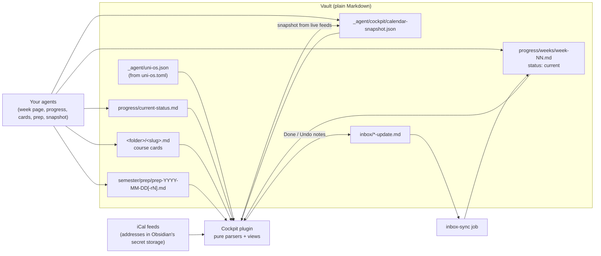
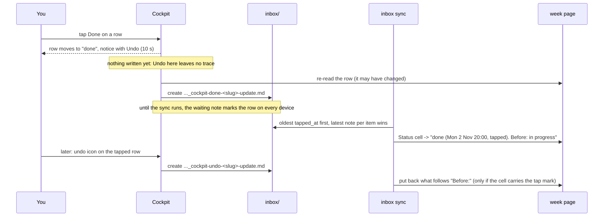

# Cockpit (Obsidian plugin)

The cockpit is an Obsidian community plugin, **Uni OS cockpit** (`uni-os-cockpit`), that turns the notes your agents already keep into a calm study dashboard: what is on now and next, what is due this week with live countdowns, where each course's bonus stands, the material for today's study blocks, and a Mon-Sun week grid. It never keeps its own copy of your data: it parses a few well-known notes (the current week page, the progress page, the course cards, the daily prep notes) and your calendar, so keeping the notes right keeps the cockpit right. Its only writes are small "update notes" in the inbox when you tap **Done** on a deadline, a "save to inbox" in the optional AI side panel, and a calendar snapshot for agents. Courses, colours, paths, schedule times and vocabulary all come from your config (`_agent/uni-os.json`, generated from `uni-os.toml`); nothing about one student or one university is built in.

## At a glance

| | |
|---|---|
| Tier | addon |
| Requires | `core`, `courses`, `progress` |
| Recommends | `obsidian` (Home dashboard, CSS), `planning` (calendar notation), `daily-prep` (prep card), `inbox-sync` (applies Done taps), `check-in` (week pages); a part that needs a module is hidden while it is off (see "What depends on other modules") |
| Obsidian | **required**, version 1.13.2 or later (it uses Obsidian's secret storage) |
| OS | any desktop OS Obsidian runs on; built and used on Windows; the plugin is not marked desktop-only but was never tried on a phone |
| Runtime | inside Obsidian on your laptop; no jobs, no roles, no VM |
| Jobs / roles | none |
| Cost | free. The optional assistant panel runs on your own Anthropic API key, billed separately from any chat subscription: the original's own estimate was about $1-5 a month at ~20 questions a day (Haiku 5.5 for lookups, Sonnet 5.5 for explanations), on a key capped by a monthly spend limit (e.g. $10) |
| Agents | works with any agent (it only reads files); tested only with Claude Code writing the notes |

## Why it exists

The original system (one student's first-year computer science semester, run by several AI agent sessions over an Obsidian vault on Google Drive) had all the facts in notes: a week page with a "Due this week" table, a progress page, course cards with bonus properties, daily prep notes. The Home note's Obsidian Bases views showed tables, but not the one thing a student needs at a glance: *what matters right now*, with countdowns that move, the calendar next to the deadlines, and the material for the next study block one click away.

The cockpit was built in two days (in a throwaway copy of the vault first) as a dashboard tab inside Obsidian with three rules:

- **The notes are the database.** No second copy that can go stale; the UI parses fixed headings, tables and properties that the agents already maintain, and says in a footer where each number came from and when that note last changed.
- **Read-only by default.** The only write path is an append-only inbox: a Done tap creates a self-describing update note that the inbox sync applies to the week page later. Until then the waiting note itself marks the row as done, on every device.
- **Secrets never in the vault.** The API key and the private calendar addresses live in Obsidian's secret storage on each device; the settings file (which syncs with the vault) only holds their *names*.

This public version generalises the original (about 4,000 lines of TypeScript, then with the four courses, their colours, their bonus formulas, one time zone, three calendar names and one student's handle compiled in) into a course registry read from the config, a small bonus rule engine, a user-defined feed list and synthetic test fixtures.

### Not using Obsidian?

Then this module is irrelevant: it is an Obsidian plugin and nothing else. Everything it shows is in plain Markdown files, so you can build your own view if you want one, for example:

- a **dashboard inside your AI app**: ask your agent each morning for "the status pack" (the same summary the cockpit's "copy status" button produces: today, tomorrow, bonus standing, due this week, next 10 days), or have a scheduled job write it to a note;
- a **self-built HTML page** that reads the same notes (the parsers in `plugin/src/parse.ts`, `prep.ts`, `done.ts` and `ical.ts` are pure TypeScript with no Obsidian imports, so a small page or script can reuse them);
- a **small wrapper** (a script, a tray app, a widget) around the same files and the same Done-tap note format.

That is your choice; the framework ships only the Obsidian plugin. The original also had, for a few days, a phone-friendly read-only page published as a private claude.ai artifact that read the calendar and the Drive vault through the viewer's own connectors and reused the plugin's parsers. It is not part of this framework; take it as an idea.

## How it works

### What it shows

- **Home**, in one of three layouts (switch in the tab's menu, with a command, or in the settings):
  - **Focus** (default): the date and week; a big "Now until 11:00 / Next at 14:15" headline in the course colour with the room and the block's first FOCUS line; urgent deadlines (under 24 h, or overdue) with countdowns and a Done button; a thin day strip of today's events; the **Prep card**; the next three deadlines ("more due this week" behind a click); one row of bonus bars.
  - **Dashboard**: the sections you switch on, in your order (now/next, day timeline, prep, due this week, bonus, next up, after this week, this week's load, recently changed notes); wide sections span the page, the rest flow into columns.
  - **Agenda**: today and the next days as one list; events, deadlines at their time and "Next 10 days" items after this week; what is over today folds away; the FOCUS lines and the prep items appear under the current or upcoming block; after the study cutoff it says "Done for today. No study after 19:00."
- **Week**: a Mon-Sun hour grid with overlapping events side by side (only the overlapping cluster shares the width), a "now" line, paging to other weeks, a click shows an event's description; under the grid the rest of the current week page (results, notes, end-of-week check-in) folded.
- **Courses**: one tile per course (big number, bullet graph: bar = banked, ghost = graded so far, tick = full-bonus mark, "+0.125 of 0.25 banked"), then a panel per course with the headline ("3 more from the 4 quizzes left"), the maths in words, banked / full bonus at / next, the rule, the progress page's "Done vs. to do" for that course, and links to the course card, the error logs (with the error-logs module) and the newest study pages.
- **Banner**: a ```` ```uni-os-cockpit ```` code block in any note (the core module puts one at the top of `Home.md`) renders one line, "Now: AD_ theory sheet 7 until 18:00" or "Next: V: DM, 14:15", plus "6 open this week · next: AD peer grading sheet 6 in 3 h", and a button that opens the cockpit.
- **Prep card** (only with the daily-prep module): the daily prep note for today (until the switch hour, 18:00 by default) or tomorrow, one row per block with its time, course dot and title, the items as one-click links (Markdown links, `code` vault paths; HTML study pages open in your browser, missing targets show greyed), and a presence line "Prep for Wed 28 Oct: ready, 2 gaps · 18:16 · open note" that turns orange when a note is missing when it shouldn't be.
- **Live calendar via iCal**: the plugin reads private iCal addresses (Google's "secret address in iCal format", Outlook's ICS link, iCloud's public link) every 10 minutes while Obsidian is open, with its own RFC 5545 reader (recurrences, exceptions, moved and cancelled instances, time zones, all-day events). Calendars without an address come from a snapshot file that agents write; with "keep the snapshot up to date" on, the plugin writes that file itself so agents see the same calendar.
- **Done taps**: every open deadline row has a quiet check button. The row moves to "done or passed" at once, with 10 seconds to undo; then a small note goes into the inbox and the next inbox sync updates the week page. An undo icon on a tapped row reopens it at any time.
- **Assistant panel** (optional, right sidebar): answers from your notes with Claude on your own API key. It reads the rules note, the current week page and a configurable list of notes (cached between questions), plus the cockpit's status pack with every question. Auto model choice (the fast model for lookups, the strong one for "explain / why / plan / compare", questions over 300 characters and anything with the open note), visible tokens and cost per answer, quick-question buttons, "include the open note", copy, and "Save to inbox". It never edits notes or the calendar. Its instructions come from a vault note you can edit (`_agent/cockpit/assistant-prompt.md`), with the integrity rules generated from each course's `assistance` level.
- **Copy status for your AI chat**: the same status pack on the clipboard, free, for any chat app next to Obsidian.

### What depends on other modules

The cockpit reads `modules.enabled` from `_agent/uni-os.json`, which `uni-os enable`, `disable` and `render` rewrite (the plugin reloads it by itself). A part that only makes sense with an optional module is hidden while that module is off, even though its schedule keys keep their values (`schedule.daily_prep` and `schedule.inbox_sync` have framework defaults, so they are always in the file). A hand-written `uni-os.json` without the list shows everything.

| Module | While it is off |
|---|---|
| `daily-prep` | No prep card in Focus or Dashboard, no presence line or prep items in the Agenda, no "study prep missing" warnings; prep notes are not read. The settings' Study prep part says why instead of offering the switch hour and warn time. |
| `inbox-sync` | Done and Undo still write their notes, and waiting notes still mark rows on every device, but no text names a sync time: the notices and the status pack say the week page updates "once you or your agent apply the inbox note", the footer calls waiting updates "for you or your agent to apply", and a tapped row reads "tapped · note in the inbox". |
| `error-logs` | No error-log links in the course panels. |
| `check-in`, `planning` | Nothing is hidden: the Week tab shows the week page's check-in section and the week plan link only when the notes have them. |

### Data flow



Refresh triggers: any change to a relevant note (debounced 400 ms; `_agent/uni-os.json` reloads the registry), a 60-second timer (countdowns, the now line), and returning to Obsidian (window focus, waking the laptop). Inbox notes are read **from disk**, not from Obsidian's metadata index (see the lessons).

### The Done tap, step by step



The note is rule-based and quotes no row, so a row edited after the tap can't make the sync park it. The exact format is in `vault/_agent/cockpit/README.md` (installed into your vault) and in `docs/file-formats.md`. Keep the `_cockpit-(done|undo)-` part of the file name: the inbox sync matches it so that a tap alone does not start a sync run, and it gives taps a longer grace period before a "stuck note" alert. If you close Obsidian inside the 10-second window, the plugin tries to write the note while unloading (a reload during the window was tested and works; quitting the app probably loses the tap).

### Data model and parsed formats

All headings, columns and words below are the defaults; most are configurable (see Configuration). Dates in notes are English: `Tue 3 Nov 23:59`, `Tue 3 Nov 13:15-15:00`, `Sun 8 Nov` (a date without a time means 23:59). The year is inferred: the candidate closest to today, preferring one whose weekday matches, so "Tue 5 Jan" read in December means January next year, and a wrong weekday can't flip the year.

| Source | What is read | Rules |
|---|---|---|
| Current week page: the note in `progress/weeks/` with `type: week` and `status: current` (highest `week` wins; fallback `week-NN.md` for the term week) | First table under `## Due this week`; columns found by header words (Item, Official deadline, a personal target column: the progress module writes "Personal target", the original called it "Sunday target" (any header containing "target"), Bonus, Status), so you can rename or reorder them. Also `## Results this week`, `## Notes`, `## End-of-week check-in` (a day in brackets after it, as the original's "(Sat)", is fine) for the Week tab. Link to `semester/plans/week-NN-plan.md` if it exists. | **done** only when the Status cell *starts with* a score (`3/4`, `2.5 / 4`) or one of ✓, done, submitted, closed, handed in, uploaded, dropped, skipped. **pending** (waiting for a result, never overdue) when it contains not reported, pending, not recorded. **soft** date (never overdue or urgent, shown as "no hand-in") when the deadline starts with "tutorial" or contains "(tentative)". **overdue** when the last moment (range end or deadline) has passed. **lapsed** ("passed", filed with the done items) when the date passed, nobody closed it and the Bonus cell is empty or starts with none / no / feedback only; a row with a bonus stays red until someone closes it. A range counts down to its start and reads "running until 19:00" during it. A past target date is hidden. "not released" in the status: no Done button. A Done-tap mark (`done (<stamp>, tapped). Before: <old>`) counts as done; a waiting undo note reopens it with `<old>`. |
| Progress page `progress/current-status.md` | The bold line `**Snapshot: ...**`; the table under `## Next 10 days` (When, What; any "Next N days" works); `## Exercises: done vs. to do` with one `### <course short name>` subsection per course; the first line under `## Self-rated understanding`, parts separated by ` · ` like `LA 80-85 %`. | Rows of "Next 10 days" dated before today are dropped; the rest after this Sunday show as "After this week" and in the Agenda. |
| Course cards `<folder>/<slug>.md` | Only the properties `bonus_banked` (the first `x / y` pair: banked / graded so far, or banked / total), `bonus_target` (for threshold courses `~N pts` is the estimated total), `next_bonus`. | The maths comes from `[courses.bonus]` in the config (below). |
| Daily prep notes `semester/prep/prep-YYYY-MM-DD[-rN].md` (only read while `daily-prep` is in `modules.enabled`) | Properties `type: prep`, `date`, `generated` (ISO with offset), `run`, `status`; one callout per calendar block `> [!<course>] HH:MM-HH:MM <title>` (course id, slug or short name, any case) with `> - item` lines (wrapped lines join the item); `## Gaps` bullets ("none" means no gaps). | Per date the highest `-rN` wins, then the latest `generated`. Today's note until the switch hour, tomorrow's after. Alerts: tomorrow's still missing after the warn time; today's missing although earlier days had one ("the morning check will try again" until 15 minutes after the morning check, then "didn't produce one either"). The Agenda matches prep items to events by date and start time, so a callout's start must equal its event's start. |
| Calendar: live feeds and `_agent/cockpit/calendar-snapshot.json` | Snapshot: `{ generated, source, range: {start, end}, events: [ {cal, title, start, end, location, desc, allDay} ] }`, `cal` = the calendar id (`courses`, `study_blocks`, `events`, `busy`, or one you add). | Classes calendar: titles matching `^(V\|L):` are lectures, `^(U\|Ü\|E):` exercise classes (plus the planning module's `calendar.lecture_prefix` / `exercise_prefix`), anything else a graded fixture (striped). Study calendars: the course is the comma-separated segment containing `_` (block notation `LA_ mock A`), else the first course named; `(X)` or `OP ...` is optional; "deep" marks deep blocks; the lines after `FOCUS:` in the description are the block's focus. Busy-only calendars show "Busy" unless you switch titles on (this device only). Calendars with a working live feed replace their snapshot entries; the snapshot is still used (and checked for age) while any switched-on class or study calendar isn't live. Emails are scrubbed from descriptions. |
| Inbox `inbox/*-update.md` (read from disk) | `done_item`, `undo_item`, `tapped_at` properties of tap notes; the count of other waiting update notes. | Per item the latest note by `tapped_at` wins. The footer says "2 updates waiting in the inbox, applied at 13:15". |
| `_agent/uni-os.json` | The registry: student, university, term (time zone, week 0), courses (id, name, short, folder, slug, colours, aliases, assistance, assessments, bonus), schedule times, calendar names, paths, `[cockpit]` keys, the enabled modules (`modules.enabled`). | Missing or broken: a warning, no courses, everything else still works. |

### The bonus rule engine

The original had one hand-written formula per course. Here a scheme per course (`[courses.bonus]`) covers the same cases; the banked numbers always come from the course card, which your progress agents keep current.

| `scheme` | Meaning | Example (the original's four courses, anonymised) | Shown |
|---|---|---|---|
| `threshold` | Full bonus at a share of all points (`threshold`, default 0.8), proportionally less below (`proportional = false`: all or nothing). Total: plugin override > card `~N pts` > `total`. | "full +0.25 at 80 % of all points; the maximum isn't published (the card keeps an estimate)" | "81 % of graded points (full bonus needs 80 %)"; "About 62 more of the ~78 points still to come (79 %) for the full +0.25. The total ~120 is an estimate, not official." Without any total: the share of what is graded so far. |
| `points` | Linear in points up to `full_at`; `full_at` = `total` (the default) means no slack. Dated sittings (`assessments[].dates`) give "N left". | "5 of 7 quiz points give the full +0.25" (`total = 7`, `full_at = 5`); "0.25 × B / 12, two orals of 6" (`total = 12`) | "3 more from the 4 quizzes left", "That is 0.75 per quiz on average"; "1 oral left, no slack: every point counts". Solo assessments add "Solo work, no AI help: ...". |
| `best-n` | `required` of `total` assessments must be passed (admission style); proportional below if `proportional = true`. | "8 of 10 sheets must pass" | "3 more passed sheets needed (4 left)" |
| `custom` | No maths: the card's `x / y` as a bar, your `description` as the headline, `rule` as the rule. | anything else | as written |
| `none` | No bonus: the course is left out of the bonus rows. | | "No bonus in this course" |

`max_bonus` is the size of the full bonus: a number in grade units (0.25) or a percentage string (`"10%"`); 0 (the default) means unknown (shares are shown, no bonus figure). Tone: "good" when on track (threshold reached; or the points still needed per remaining sitting are at most 75 % of a sitting's points), else "warn". A fresh card (`0 / 0 graded`, as the courses module writes it at setup) reads "Nothing graded yet" in a neutral tone, and a `points` or `best-n` course whose total is unknown (no `total`, `full_at` or `required`, and no "x / total" on the card) shows only what is banked, never "full bonus reached".

### Architecture of the code (`plugin/`)

The split from the original is kept: **pure modules** (no Obsidian imports, unit-tested under Node) and **Obsidian glue and UI**.

| File | Pure | What it does |
|---|---|---|
| `src/registry.ts` | yes | Reads `uni-os.json` into the registry (courses, detection patterns, colours, paths, schedule, calendars, vocabulary, notation, models, enabled modules); `moduleEnabled`, `detectCourse` (the course mentioned first: short name, full name, aliases, optional raw `detect` regex; short all-caps codes match case-sensitively and the block notation's `_` may follow), `calloutCourse`, `calendarRole`, `paletteOf`, `vocab()`. Never throws; problems become warnings. |
| `src/model.ts` | yes | Time helpers in the term's time zone (DST-safe `zdate`, `dayKey`, `hm`, `shortDay`, `relative`), the term week from `week0_monday`, `parseDayTime` with year inference. |
| `src/md.ts` | yes | Markdown helpers: frontmatter, `section` (by heading prefix or regex), `subsections`, `firstTable` (escaped pipes and wikilink aliases), `plain`, `firstNumberPair`. |
| `src/parse.ts` | yes | The model: event classification, snapshot parsing, the due table and its state rules, week-page parts, "Next 10 days", progress-page sections, `buildModel` (drops the prep state while daily-prep is off), selectors (`nowAndNext`, `sideBySide` lanes, `studyHours`). |
| `src/bonus.ts` | yes | The rule engine above. |
| `src/prep.ts` | yes | Prep note parser, newest-by-date, which note the card shows, alerts, run times from the schedule. |
| `src/done.ts` | yes | The Done/Undo note writer and reader, the tap mark, next sync time (none while inbox-sync is off). |
| `src/ical.ts` | yes | The RFC 5545 reader (unfolding, TZID / UTC / all-day, DURATION, RRULE with DAILY / WEEKLY / MONTHLY / YEARLY, INTERVAL, COUNT, UNTIL, BYDAY with ordinals, BYMONTHDAY, BYMONTH, WKST; RDATE, EXDATE, RECURRENCE-ID overrides, CANCELLED). |
| `src/context.ts` | yes | The status pack. |
| `src/prompt.ts` | yes | The assistant's prompt template (from the vault note) and its placeholders. |
| `src/settings.ts` | yes | Settings type, defaults (first-run values from `[cockpit]`), presets, forward-compatible merge (new dashboard sections slot in). |
| `src/data.ts` | no | `VaultSource`: finds the current week page, reads cards, prep notes, recent notes, study pages and the inbox (from disk), builds the model; which paths trigger a refresh; the assistant's context notes. |
| `src/feeds.ts` | no | Feed cache: fetches the iCal addresses from secret storage with Obsidian's `requestUrl`, window Monday of last week to five weeks ahead, per-device cache for offline use, the snapshot writer. |
| `src/main.ts` | no | Plugin lifecycle, registry loading, commands, ribbon, protocol handler `obsidian://uni-os-cockpit`, banner block, refresh loop, the Done/Undo state machine. |
| `src/cockpit-view.ts`, `src/render/*.ts`, `src/ui.ts` | no | The tab frame, the three home layouts, the week grid, the course panels, DOM helpers (course colour variables `--c` / `--c-light`, links with hover preview, the bullet graph). |
| `src/assistant-view.ts`, `src/claude.ts` | no | The assistant panel and the Anthropic client (`@anthropic-ai/sdk` in browser mode, prompt caching, streaming, `output_config.effort`). |
| `src/settings-tab.ts` | no | The settings page. |
| `styles.css` | | Every selector scoped under the plugin's classes; follows Obsidian's theme variables; no course named. |
| `test/*.test.ts` | | 100+ checks: registry, parsers, bonus engine, prep, Done/Undo, iCal, prompt, modules switched off, and an hour-by-hour sweep over a whole synthetic week (169 hours: due states never flip back, taps and undos on every open row, prep card choice, now/next). Fixtures in `test/fixtures/` are invented (Alex Example at the Example Institute of Technology). `test/smoke.cjs` loads the built plugin with a stand-in for the Obsidian API and runs load, Done tap, refresh, Undo and a config reload without daily-prep against a temporary vault (`npm run smoke`). |

### Extending it for new formats

- **A new parsed section or note**: write a pure parser (in `parse.ts` or a new file), add its result to `CockpitModel` in `buildModel`, read the note in `data.ts` (and add its path to `isRelevant` so changes refresh the view), render it in `render/`, and add a synthetic fixture plus a test. Keep parsers free of Obsidian imports.
- **A new heading name or status word**: no code needed, set the `[cockpit]` keys (`headings`, `done_words`, ...). Tell the module that writes the note (progress, check-in, daily-prep) so both sides agree, and update `docs/file-formats.md`.
- **A new bonus scheme**: add a branch to `bonusFor` in `bonus.ts`, its rule text to `ruleText`, a case to `bonus.test.ts`, and document its keys here.
- **A new dashboard section**: add it to `SectionId`, `SECTION_INFO` and `DEFAULT_SECTIONS` (settings.ts) and to `DASH` (render/home.ts); saved settings pick it up automatically.
- **Another UI** (a phone page, a widget): reuse the pure modules and write tap notes with `doneNote` / `undoNote` and your own `source` name; the inbox sync's filter matches `_<source>-(done|undo)-` only for the names it knows, so add yours there.
- **A part that needs another module**: check `moduleEnabled("<id>")` (registry.ts) where the data is read or the part is drawn, add the module to the table in "What depends on other modules", and test both states.
- After a change: `npm test`, `npm run check`, `npm run build` (writes `dist/` and the vault copy; both are committed and must stay identical to the build), `npm run smoke`, and reload the plugin.

## What gets installed

| Vault path | What |
|---|---|
| `.obsidian/plugins/uni-os-cockpit/main.js`, `manifest.json`, `styles.css` | the built plugin (copied verbatim from `modules/cockpit/vault/`, identical to `modules/cockpit/dist/`) |
| `_agent/cockpit/README.md` | notes for agents: what the cockpit reads (formats, filled in from your config), the Done-tap note format, how to refresh the calendar snapshot, the rules for iCal addresses, how to rebuild and reload the plugin |
| `_agent/cockpit/assistant-prompt.md` | the assistant panel's prompt template (edit freely) |

Created later by the plugin itself: `.obsidian/plugins/uni-os-cockpit/data.json` (your settings; no secrets), `_agent/cockpit/calendar-snapshot.json` (only with live feeds and the snapshot setting on; otherwise your agents write it), and tap notes in `inbox/`.

Not installed by this module: the ```` ```uni-os-cockpit ```` banner block at the top of `Home.md` (the core module adds it when the cockpit is enabled), and switching the plugin on (no module writes `.obsidian/community-plugins.json`; you enable it in Obsidian, step 2 below, because that also needs restricted mode off).

### Install

1. **With the framework** (normal): `python tools/uni_os.py enable cockpit` (or pick it in the setup interview; the Standard and Full presets include it when you use Obsidian). This copies the built plugin into your vault.
2. **Turn it on in Obsidian**: Settings → Community plugins → turn off Restricted mode (once) → find "Uni OS cockpit" under Installed plugins → enable. Open it with the dashboard icon in the left ribbon, the banner button on Home, or the command "Uni OS cockpit: Open cockpit".
3. **By hand** (no `enable`, e.g. a vault you built yourself): copy the three files from `modules/cockpit/dist/` into `<vault>/.obsidian/plugins/uni-os-cockpit/` and do step 2. The plugin still needs `_agent/uni-os.json`: generate it with `python tools/uni_os.py render`, or write it yourself in the shape of `plugin/test/fixtures/uni-os.json` (a synthetic example; leave out `modules.enabled` and every part is shown). Without it the cockpit shows a warning and no courses.
4. **From source** (Node 20+): in the framework clone, never inside a synced vault folder,
   ```
   cd modules/cockpit/plugin
   npm install
   npm test
   npm run build                      # writes ../dist/ and ../vault/.obsidian/plugins/uni-os-cockpit/
   npm run build -- --out "<vault>/.obsidian/plugins/uni-os-cockpit"   # also into your vault
   ```
   then reload the plugin (toggle it off and on).

## Configuration

### Config keys (`uni-os.toml`)

The cockpit reads the merged config through `_agent/uni-os.json`. Edit the TOML (or ask your agent) and run `python tools/uni_os.py render`; the plugin reloads the JSON by itself.

| Key | Default | Used for |
|---|---|---|
| `courses[]` `id`, `name`, `short`, `folder`, `slug`, `colour`, `colour_light` | (from the courses interview) | the registry: card path `<folder>/<slug>.md`, colours (lecture / exercise class), names |
| `courses[].aliases` | `[]` | extra names the cockpit recognises a course by in titles and table rows (e.g. a platform name). Short all-caps codes match case-sensitively. |
| `courses[].detect` | `""` | optional raw regular expression for recognising the course (e.g. `"\\bE\\d+\\b"` for exercise numbers); `""` = none |
| `courses[].error_log_streams` | `["main"]` | error-log links (`<slug>-error-log.md`, or `<slug>-error-log-<stream>.md` with several streams) |
| `courses[].assistance`, `courses[].assessments[].assistance` | `hints-only` | the assistant's integrity lines; "solo" notes in the bonus texts |
| `courses[].assessments[].dates` | (optional; list-of-table items carry no module defaults) | dated sittings `"YYYY-MM-DD"` or `"YYYY-MM-DD HH:MM"` (a timed one is over once it starts, a date-only one at the end of its day), for "N quizzes left" |
| `courses[].bonus.scheme`, `max_bonus`, `description`, `rule` | `"none"`, `0`, `""`, `""` (courses module) | the rule engine; `max_bonus` is the size of the full bonus (`0` = not known: shares are shown, no bonus figure); `rule` (else `description`, else a generated text) is shown next to the numbers |
| `courses[].bonus.threshold` | `0.8` | threshold: share of all points for the full bonus (`80` also means 80 %) |
| `courses[].bonus.total`, `total_estimated` | `0`, `false` | total points if published (0 = unknown; the card's `~N pts` is the estimate) |
| `courses[].bonus.proportional` | `true` | threshold / best-n: proportional share below the mark |
| `courses[].bonus.full_at` | `0` (= total) | points: points for the full bonus |
| `courses[].bonus.required` | `0` (= total) | best-n: how many must pass |
| `courses[].bonus.unit` | `"points"` | label ("quiz points", "oral points") |
| `courses[].bonus.counts` | `[]` (all bonus assessments) | which assessments' dates count as sittings |
| `student.name` (else `handle`), `student.language` | | the name written into tap notes ("Alex Example tapped Done"), the assistant's language |
| `university.short`, `university.programme`, `term.label` | | the assistant's first line |
| `term.timezone` | the device's zone | every time shown and parsed; iCal all-day dates |
| `term.week0_monday` | **required** | week numbers |
| `paths.agent_dir`, `paths.inbox` | `"_agent"`, `"inbox"` | where the config, snapshot and prompt live; where tap notes go |
| `schedule.daily_prep`, `schedule.prep_check` | `["17:30","19:30"]`, `"07:30"` | the prep card's texts and the morning alert (15 min after the check); ignored while daily-prep is off |
| `schedule.inbox_sync` | `["07:15","13:15","18:15"]` | "the week page updates at 13:15" (`[]`: "at the next inbox sync"); ignored while inbox-sync is off |
| `schedule.study_cutoff` | `"19:00"` | the Agenda's "No study after 19:00" (`""`: no cutoff) |
| `calendar.courses`, `study_blocks`, `events`, `busy` | `"Courses"`, `"Study blocks"`, `"Events"`, `"Busy"` | the default feed list (labels; roles classes / study / busy-only / busy-only) |
| `calendar.lecture_prefix`, `exercise_prefix` | `"L:"`, `"E:"` (the same defaults as the planning module) | lecture and exercise-class titles, always recognised on top of the patterns below |
| `agent.reply_rules` | `[]` | the optional `{reply_rules}` placeholder of the prompt template |
| `modules.enabled` | (written by `render`) | which optional parts are shown (see "What depends on other modules") |
| `cockpit.enabled` | `true` | not read by the plugin; the module list decides (`uni-os disable cockpit`) |
| `cockpit.layout`, `default_tab`, `open_on_startup`, `color_mode` | `"focus"`, `"home"`, `false`, `"accent"` | first-run plugin settings |
| `cockpit.prep_switch_hour`, `prep_warn_after` | `18`, `"19:30"` | prep card: switch to tomorrow's note; alert when tomorrow's is still missing |
| `cockpit.feed_minutes`, `write_snapshot`, `stale_days`, `urgent_hours`, `day_start`, `day_end` | `10`, `true`, `2`, `24`, `7`, `21` | first-run plugin settings |
| `cockpit.status_path`, `weeks_folder`, `prep_folder`, `plans_folder`, `overview_path` | the standard vault layout | where the notes are |
| `cockpit.study_folders` | `["notes","quiz-prep"]` | per course, the newest notes from these subfolders |
| `cockpit.snapshot_path`, `rules_path`, `prompt_note` | `""` (= `<agent_dir>/cockpit/calendar-snapshot.json`, `<agent_dir>/rules.md`, `<agent_dir>/cockpit/assistant-prompt.md`) | optional overrides |
| `cockpit.lecture_pattern`, `exercise_pattern`, `optional_pattern`, `deep_pattern`, `focus_marker`, `main_marker` | `"^(?:V\|L):"`, `"^(?:U\|Ü\|E):"`, `"^\\(\|^OP\\b"`, `"\\bdeep\\b"`, `"FOCUS:"`, `"_"` | calendar notation (regular expressions; `"/pattern/flags"` works too; `""` switches a pattern off). The defaults accept both the framework's `L:` / `E:` and the original's German-derived `V:` / `U:` |
| `cockpit.done_words`, `pending_words`, `no_bonus_words`, `soft_prefixes`, `soft_markers`, `not_released_words` | the English defaults in the table above | the due-table vocabulary (an empty list switches a class off) |
| `cockpit.headings.due`, `results`, `notes`, `check_in`, `next`, `exercises`, `self_rating`, `snapshot` | the headings in the table above | heading names (matched by prefix) |
| `cockpit.fast_model`, `strong_model` | `"claude-haiku-5-5"`, `"claude-sonnet-5-5"` | first-run assistant models |

### What the setup interview asks

- Do you use Obsidian? (No: skip this module.) Do you want the cockpit (Standard and Full presets include it)?
- Per course, from the courses interview: short name, colour, how the bonus works (scheme, threshold or points, total if published, dated quizzes or orals), which work is solo.
- When should the prep card switch to tomorrow, and when should a missing note count as late? (Defaults: the original's 18:00 and 19:30.)
- Do you want the AI side panel? (Then: create an Anthropic API key with a monthly spend limit and paste it into the plugin settings yourself; your agent never types it.)
- Do you want live calendars? (Then you link the private iCal addresses in the plugin settings yourself.)

### Plugin settings (Settings → Uni OS cockpit)

Presets (Minimal, Calm, Planner, Overview, Vivid blocks); general (layout, start page, open on startup, banner, source line); appearance (colour mode, spacing, text size, width, per-course colour overrides); Focus, Dashboard (sections on/off and order) and Agenda options; live calendar (one row per feed: label, role, secret, on/off; add or remove calendars; "Check the feeds" compares each feed with the snapshot; fetch interval; keep the snapshot up to date; titles of busy-only calendars on this device); study prep (switch hour, warn time); calendar and timeline (day range, fit early or late events, busy time, optional blocks, weekend, hour height, snapshot age warning); deadlines (urgency threshold, countdown style, personal targets, finished items); bonus (figure: points, bonus or share; per-course total estimate for threshold courses); assistant (API key secret, check the key, model choice, model ids, effort, longest answer, cost line, strip a sign-off when saving, quick questions, notes it reads, workspace id, base URL); where the data comes from (config path, reload, the paths read from the config, problems); reset (reads the `[cockpit]` defaults again; the secrets stay in secret storage, only the links to them are cleared). While daily-prep is off, the study prep part only says so.

The settings file `.obsidian/plugins/uni-os-cockpit/data.json` syncs with the vault and holds no secrets. The API key and the iCal addresses are stored in Obsidian's secret storage (Settings → Keychain) on each device; each device links its own.

### Linking the secrets (you do this, never your agent)

- **API key for the assistant panel**: create a key inside one workspace of the Anthropic Console, with a monthly spend limit (the original used e.g. $10). In Obsidian: Settings → Uni OS cockpit → Assistant → API key → **Link…** → **Add secret…** → name it (e.g. `anthropic`) → paste the key → select it → **Save**, then press **Check** (one tiny call to the fast model). An organisation-wide key also needs the workspace id field.
- **Live calendars**: get each calendar's private address. Google Calendar on the web: ⚙ Settings → under "Settings for my calendars" pick the calendar → **Integrate calendar** → copy **Secret address in iCal format**. Outlook: Settings → Calendar → Shared calendars → Publish a calendar → ICS link. iCloud: share the calendar publicly and copy the webcal link. Then Settings → Uni OS cockpit → Live calendar → the calendar's row → **Link…** → **Add secret…** → name it (e.g. `ical-courses`) → paste → select → **Save**, and press **Check the feeds**.
- Treat both like passwords. If an iCal address leaks, reset it at the provider (Google: the same page) and link the new one; the cockpit says "address not found (404): was it reset at the calendar provider?" when an old one stops working.
- The secret storage is per device and per vault: a second laptop, or a test copy of the vault, links its own entries.

## Daily use

- Open Obsidian: Home shows the banner; click it (or the ribbon icon) for the cockpit. Glance at Focus; switch to Agenda in the evening to see tomorrow with its prep items.
- Finished something on the due list? Tap the check. Wrong row? Undo in the notice, or later with the undo icon ("N tapped done, open to undo" in Focus).
- Before a study block: open the prep card's links straight from the cockpit.
- Ask the side panel: "What's due this week?", "Am I on track for the bonus?", "Explain the open note" (include the open note), then "Save to inbox" for an answer worth keeping.
- No API key? "Copy status for your AI chat" and paste it into your agent.

Things to say to your agent:
- "The cockpit says the calendar snapshot is stale: refresh it."
- "My Done taps aren't reaching the week page." (It checks the inbox and the inbox-sync job.)
- "The cockpit doesn't recognise 'Algo' as AD: add it as an alias." / "LA's bonus is 5 of 7 quiz points: put that into the config." (Then `render`.)
- "Make the cockpit open when Obsidian starts." / "Switch the cockpit to the agenda layout."
- "I changed the plugin: run the tests, rebuild it and reload it in Obsidian."

## Agents other than Claude Code

The plugin itself has nothing to do with your agent: it reads Markdown and JSON, and any agent that maintains the week page, progress page, course cards and prep notes in the documented formats feeds it. It was only tested with Claude Code writing those notes.

- **Calendar snapshot**: needs either the plugin's live feeds or an agent with calendar access (a calendar connector or API) that writes the JSON in `_agent/cockpit/README.md`. Without either, Today and Week stay empty and the cockpit says so.
- **Done taps**: need something that applies the inbox notes (the `inbox-sync` module's job, any agent following its prompt, or you by hand: each note says exactly what to change).
- **The assistant panel** calls the Anthropic API directly with your own key (Claude models only); it does not use Claude Code or any subscription. Another provider would need changes in `src/claude.ts` and `src/assistant-view.ts`. The free alternative works with any agent: "Copy status for your AI chat".
- In Claude Code: the original rebuilt and reloaded the plugin from a laptop session and used the Obsidian CLI (`obsidian vault=<name> plugin:reload id=<plugin id>`, `dev:errors`, `dev:screenshot path=...`) to check the result. Other agents can do the same from a shell, or you toggle the plugin off and on.

## Failure modes and fixes

| Symptom | Cause | Fix |
|---|---|---|
| Warning "No _agent/uni-os.json found", no courses | the config was never rendered, or the plugin points at another path | `python tools/uni_os.py render`; check Settings → Where the data comes from → Config file |
| A course or colour is wrong after editing the TOML | the JSON is generated | `render` again; the plugin reloads it (or run "Reload the course config") |
| Today and Week are empty | no live feed linked and no snapshot | link the iCal addresses, or ask your agent to refresh the snapshot |
| "The calendar snapshot is N days old" / "ends YYYY-MM-DD" | nobody refreshed it | live feeds with "keep the snapshot up to date", or an agent refresh |
| "Live calendar: the X feed failed (address not found (404))" | the private address was reset at the provider | copy the new address and link it again; the last good copy is shown meanwhile |
| A row looks behind | the week page only changes when an agent edits it or the inbox sync applies a note | the footer says when the week page last changed and how many updates wait; check the inbox-sync job |
| "Couldn't save the Done tap ... It is back in the list." | no current week page, the row changed or vanished, or the inbox can't be written | fix the week page (`status: current`), tap again |
| Taps never reach the week page | the inbox-sync module is off (the cockpit's texts then name no sync time), or its filter doesn't match the file names | enable it, or apply the notes by hand; keep the `_cockpit-(done\|undo)-` name |
| A done item still shows as open | its Status cell doesn't *start* with a done word or a score ("3/4", "done", "submitted") | reword the cell (the progress module's vocabulary), or tap Done |
| An item never drops off | it has a bonus (stays red until closed), or its deadline isn't parseable | close it in the week page; write dates like `Tue 3 Nov 23:59` |
| Prep card says "not there yet" in orange | the daily-prep job didn't run or failed | check the job's log; the presence line names the expected run times |
| No prep card at all, no prep warnings | `daily-prep` is not in `modules.enabled` | `python tools/uni_os.py enable daily-prep` if you want it; the plugin reloads the config by itself |
| Bonus shows "No bonus data on the course card" | `bonus_banked` has no `x / y` pair | keep the `x / y` numbers in the card property |
| Bonus maths looks off | scheme keys missing (`threshold`, `total`, `full_at`, ...) | add them under `[courses.bonus]`, or set a total estimate in the plugin settings |
| Assistant: "The API key was rejected (401)" / workspace error (400) | wrong key; organisation-wide key | use a workspace-scoped key, or set the workspace id |
| Assistant: "Not found (404)" or "price unknown for this model" | a model id the API or the cost table doesn't know | fix the model ids in the settings |
| The plugin isn't listed | restricted mode is on, or the files aren't in `.obsidian/plugins/uni-os-cockpit/` | turn restricted mode off; reinstall from `dist/` |
| Settings show odd values after an update | the saved `data.json` predates a new setting | new settings fill in by themselves; "Reset" reads the defaults again |

## Lessons from the original system

- **The real latency was the notes, not the UI.** When the student complained that the cockpit "updates too slowly", each leg was measured before anything was built: redraw 60 s, reading the notes 8 ms, a VM write reaching Drive in 2-3 s, Drive reaching the laptop in under 25 s, the file reaching Obsidian's index in 11-20 s. But a result reached the week page only at the next sync: 3 h 48 min later that day, up to 13 h overnight. A faster UI would have changed nothing; a write path (the Done tap) and stricter status rules did.
- **Status parsing bugs hid work.** "x / y" or "done" anywhere in a Status cell counted as done, which hid an open 2-point bonus task ("Task A done 2/2; task B open"). Fix: only the *start* of the cell counts. Past personal targets stayed on screen and nothing ever dropped off; fix: hide past targets, file no-bonus items whose date passed as "passed", keep bonus items red. The status vocabulary became part of the file-format contract, and week pages were reworded to match it.
- **Obsidian's metadata index lags deletions** (at least 3 minutes observed); modifications arrive in under a minute. The inbox is therefore read from disk, not from the index, or a note the sync had already moved away would still count as waiting.
- **Never run `npm install` inside the synced vault**: `node_modules` would sync to the cloud. Build in a separate folder (here: the framework clone) and copy the three built files.
- **Secrets per device.** The API key and the iCal addresses went into Obsidian's secret storage; only their names went into the synced settings file. The agent never typed a key or an address; the student did. iCal secret addresses work like passwords (anyone with one reads the calendar), and the provider can reset them.
- **Organisation-wide Anthropic keys need a workspace id header**; a workspace-scoped key with a monthly spend limit was simpler. Opus was never used in the panel (cost); the fast model was about 20 times cheaper per token than the strong one, so the auto routing sends lookups to it.
- **Live feeds were verified before trusting them**: against a public holiday feed and a local stand-in first, then the student's feeds matched the calendar connector's data for two weeks, and a test block created, moved and deleted in the calendar showed up within seconds. The only delay left is the fetch interval.
- **Undo before write.** The 10-second window means a mis-tap leaves no trace. A reload during the window was tested and still writes the note; quitting the app inside it probably loses the tap.
- **A tap means "finished", not "how it went".** A dry run of the sync on sample notes showed that a tap marks a row done even when the row says part of it is open; that was accepted as the meaning of a tap, and the note says to add no score.
- **Writing into a shared inbox needs explicit consent.** The agent's attempt to test a real tap was blocked by its permission check (writing into a shared folder). The student then approved exactly this: "a small inbox note, a fixed narrow format, new files only, an easy undo". Done and Undo were click-tested in a throwaway copy of the vault.
- **Change safely**: a backup of the built plugin and the source plus an exact undo recipe for each change, and a list of what was only inferred, not run (real tap in the real vault, the sync applying a real note, light theme).
- **HTML study pages don't render in Obsidian**: the cockpit opens them in the default browser and shows missing link targets greyed instead of hiding them.
- **Course colours follow the calendar colours**, so the same colour means the same course everywhere.
- **New in this port**: a tapped row whose old status said "not reported" read as "pending" after the sync wrote the tap mark (the pending words were checked first). The tap mark now wins. Generalising the bonus maths also exposed an empty-card case the four hand-written formulas never met: a fresh `0 / 0` card divided by zero (one formula) or read as "full bonus reached" (the generic ones); it now says "Nothing graded yet". The original's tests ran against frozen copies of real notes full of personal data; this version uses invented fixtures and keeps the hour-by-hour sweep.

## Removing it

1. `python tools/uni_os.py disable cockpit` (marks it disabled; never deletes your files).
2. In Obsidian: Settings → Community plugins → turn off or uninstall "Uni OS cockpit".
3. Delete the ```` ```uni-os-cockpit ```` block at the top of `Home.md` (`disable` leaves it there; without the plugin Obsidian shows it as an empty code block).
4. Optional: delete `.obsidian/plugins/uni-os-cockpit/`, `_agent/cockpit/`, and the secrets you created in Settings → Keychain (the API key and the calendar addresses). Waiting tap notes in `inbox/` are still applied by the inbox sync.
