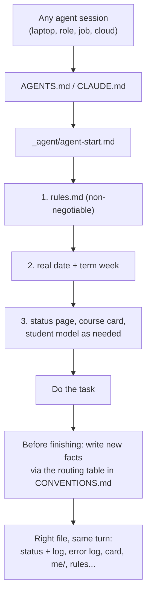

# Core

The vault skeleton that every other module builds on. Core installs the files that make a plain folder into a place many AI agents can share safely: entry points that send every agent to one start page, a fixed read order (rules, then the real date and term week, then state, then the course), standing rules with per-course academic-integrity policies, the update conventions with the routing table ("you learned X, put it in file Y, like this"), a component registry, a file of hard-won tool lore, an inbox drop zone with sorting rules, note templates, a Home dashboard, and two generated maps of the vault. Core works with any agent and without Obsidian; it was only tested with Claude Code.

## At a glance
| | |
|---|---|
| Tier | core (always installed) |
| Requires | nothing |
| Recommends | `student-model`, `courses`, `obsidian` |
| Obsidian | optional (Home gets live views and tiles with Obsidian; a plain-Markdown version otherwise) |
| OS | any |
| Runtime | laptop, cloud sessions, always-on host (VM): every runtime reads the same files |
| Jobs | none |
| Roles | none |
| Cost | nothing beyond your agent subscription; the files are plain Markdown |

## Why it exists
The original system started as a set of chat threads in a hosted AI project. Each thread had its own memory, its own copy of the tracker and its own idea of what was true. Facts got lost between threads, and when the student moved work to local agent sessions on the laptop, nobody could say which copy was current. The fix was to make **one folder the primary store** for every agent and the human, and to write down, as files in that folder:

- **where every agent starts** (`_agent/agent-start.md`), so a role session, a scheduled job and a cloud session all load the same rules before touching anything;
- **where every kind of fact goes** (`_agent/CONVENTIONS.md`), because "update the vault" means nothing unless each agent knows which file a quiz score, a mistake, a course fact or a new preference belongs in;
- **what the student has decided** (`_agent/rules.md`), dated and quoted, so that a rule set in one chat binds every later session;
- **what exists and where it runs** (`_agent/system-handbook.md`), because definitions that lived only in a hosted project's settings had to be dug out by hand when the system moved.

Core is that layer, generalised: every personal value became a config key or an example (Alex Example at the Example Institute of Technology).

## How it works

1. **Entry.** `AGENTS.md` at the vault root is the agent-neutral entry file (Codex, Cursor and others read it directly). `CLAUDE.md` contains only `@AGENTS.md` plus one line, so Claude Code imports the same content. Both point to `_agent/agent-start.md`.
2. **Read order.** The start page lists, in order: the rules (re-read after every context compaction), the real date and the term week (week 0 = the configured Monday; week *n* starts week 0 + 7*n* days), the status page, the needed course card, the student model before any advice or plan, `CONVENTIONS.md` before writing, and the lookup pages. Items for modules that are not installed are left out at render time.
3. **The write-back duty.** "Before you finish any task, update the vault with anything new and even slightly useful, in the same turn, unasked." This sentence is what keeps the vault current without a human curator.
4. **The routing table.** `CONVENTIONS.md` section 3 is a three-column table, *You learned... / Put it in / How*, with one row per kind of fact. Rows appear only for enabled modules (a result fans out to the status page, a dated log line and the course card's properties when `progress` and `courses` are installed). The table is generated between `<!-- uni-os:begin routing -->` and `<!-- uni-os:end routing -->` markers; rows added by agents for new kinds of things go into section 3b, outside the markers. That makes the table **self-extending**: CONVENTIONS section 10 says "when you add a new kind of thing, create it in the closest folder, index it, give it properties, add a row".
5. **Rules.** `rules.md` holds every standing rule by category: every reply, personal reply rules (rendered from `agent.reply_rules`), study-material format (respecting `study.formats`), academic integrity (a legend of the four assistance levels and a per-course table from the config), course-specific rules (from `courses.notes`), calendar (if `planning`), working style (batch interventions, destructive actions only with a yes and a backup, laptop command posture from `agent.permission_posture`), and anti-preferences. New rules are added dated, with the student's words quoted; replaced rules stay with an inline "(Since <date>: ...)" note; the newest wins; what the student says now beats the file, except for integrity rules.
6. **Two audiences.** Everything outside `_agent/` is the human area (short, linked, tables over prose); `_agent/` is for agents. The only crossing is a one-line pointer (the collapsed "For AI agents" callout on Home).
7. **Reaching the vault.** CONVENTIONS section 9 says how each runtime gets in: the laptop edits the synced folder directly; cloud sessions whose storage connector can only create files send update notes (inbox-sync module) and never overwrite; an always-on host reads a mount and must never delete or rename on it. It also lists the files where a second writer is risky, because cloud storage is last-writer-wins per file.
8. **Generated maps.** `README.md` (folder map), `where-to-find-what.md` ("I want... open"), the routing table and the registry and jobs table in `system-handbook.md` are templates guarded by `{{#if modules.<id>}}`, so they always match the installed modules. The generated parts sit between marker lines, `<!-- uni-os:begin <name> -->` and `<!-- uni-os:end <name> -->` (regions `map` in `README.md`, `lookup` in `where-to-find-what.md`, `courses` and `routing` in `CONVENTIONS.md`, `setup` and `registry` in `system-handbook.md`, and `integrity` and `course-rules` in `rules.md`: the per-course help table and the course rules from `courses.notes`, so a changed assistance level or a new course reaches an edited rules file). `uni-os render` (also run by `enable` and `disable`) replaces a whole file only while nobody has edited it since install (it compares the manifest hash). In an edited file it replaces only the text between each pair of markers and keeps everything else, such as CONVENTIONS section 3b, the handbook's own components and change log, and the lookup's "Added in this vault". A file whose markers are missing or broken is skipped and listed, never guessed (CONVENTIONS, "Generated regions"). This is the main fix for the original's worst failure mode: hand-maintained maps drifting out of date.
9. **Inbox.** `inbox/inbox.md` defines the drop zone (file naming `YYYY-MM-DD_short-topic.ext`, "keep it near-empty") and the five-step sorting procedure an agent follows: read, record the facts via the routing table, file the item, archive the inbox copy, report.
10. **Catch-up when a writer couldn't reach the vault.** A session that worked in its own store (a hosted chat project, a session without the storage connector) says so; the next session with vault access runs the catch-up recipe in CONVENTIONS section 9: copy everything newer than the last "full sync" line of the handbook's change log (the watermark), apply waiting update notes, mine the sessions since then for facts no file captured, make missing Markdown twins, and append a new "full sync" line.
11. **Weekly rhythm** (with the `check-in` module): CONVENTIONS section 11 says which job closes the week, refreshes the status page and the course cards, prunes old dates, and creates the next week page, at the times from `[schedule]`.

## What gets installed
| Vault path | What |
|---|---|
| `AGENTS.md` | agent-neutral entry point: start page, four never-skip rules |
| `CLAUDE.md` | `@AGENTS.md` plus one line for Claude Code |
| `Home.md` | dashboard (Obsidian embeds, Bases views and course tiles inside `{{#if obsidian.enabled}}`; a plain-Markdown version otherwise); installed once, then edited by hand for new tiles and pinned links |
| `README.md` | vault identity, "You are / Start at" table, generated folder map |
| `where-to-find-what.md` | generated "I want... / Open" table, per-course matrix, agent-area table |
| `inbox/inbox.md` | drop-zone rules and the sorting procedure |
| `_templates/lecture-note.md`, `study-page.md`, `inbox-note.md` | Obsidian-compatible templates (`{{date:YYYY-MM-DD}}`, `{{title}}` are left for Obsidian); `study-page.md` is the Markdown-only study page: callouts with Obsidian, bold labels and `
` answers without it (`obsidian.enabled`); the week page template belongs to `progress` |
| `_agent/agent-start.md` | read order, write-back duty, "if you are..." table, time and dates |
| `_agent/rules.md` | standing rules, integrity policies per course, personal reply rules |
| `_agent/CONVENTIONS.md` | source-of-truth order, two areas, routing table (plus 3b for your own rows and how generated regions are kept current), properties and type registry, Obsidian or Markdown rules, how to write, logs (error-log row format), notes vs sources vs app-owned folders, how each runtime reaches the vault and the catch-up recipe, self-extension rule, weekly rhythm (with `check-in`) |
| `_agent/system-handbook.md` | setup summary, component registry (one row per enabled module), jobs table (every job of every enabled module, with its schedule keys), roles pointer, your own components, accounts and where secrets live, the move-between-runtimes checklist, append-only change log (whose newest "full sync" line is the catch-up watermark) |
| `_agent/tools-and-environment.md` | tool lore: storage and calendar connector quirks, PDFs, web access, shell, inputs, time zones, Obsidian, the synced drive, building and printing, agent platform notes |

## Configuration
Core reads these keys (defaults in `module.toml`; the setup interview asks for the ones marked "asked"):

| Key | Default | Purpose |
|---|---|---|
| `student.name`, `student.handle` | name asked (required); handle `""` | who the agents help: every sentence about the student uses the name; the optional handle is only an identifier (start page, registry, profile) |
| `student.language` | `"English"` | reply and file language |
| `student.dictates` | `false` | adds the "work out dictation slips from context" rule |
| `university.name`, `.short`, `.programme` | (asked) | titles, start page |
| `university.lms` | `"Moodle"` | named in source-of-truth order and the sign-in rule |
| `term.label`, `term.timezone`, `term.week0_monday` | (asked) | term week arithmetic, local time |
| `term.last_lecture_day`, `.lecture_free_from`, `.exam_session_start`, `.exam_session_end` | `""` (left out when empty) | frame line on Home and the start page |
| `storage.provider` | `"google-drive"` | named in the reaching-the-vault section |
| `obsidian.enabled` | `true` | Obsidian embeds, callouts and rules vs the plain-Markdown variants |
| `agent.primary` | `"claude-code"` | shown in the registry |
| `agent.permission_posture` | `"accept-edits"` | the laptop-command rule (`bypass`, `accept-edits`, `ask`); the original ran `bypass` |
| `agent.default_model`, `agent.heavy_model` | `""` | optional model-preference rule |
| `agent.reply_rules` | `[]` | personal reply rules, rendered as bullets (e.g. a sign-off token that doubles as a "rules loaded" canary) |
| `study.formats` | `["html", "md"]` | study-material formats named in the rules (`html`, `md`, `pdf`) |
| `study.math` | `"katex"` | maths renderer named in the rules |
| `study.assistance_default` | `"hints-only"` | default assistance level |
| `study.personal_deadline_rule` | `""` | optional rule like "every sheet released in a week is done by that Sunday" |
| `runtime.laptop_os` | `"windows"` | shown in the registry |
| `runtime.use_cloud_sessions` | `false` | adds the cloud-session paragraphs |
| `courses[].assistance` | `"hints-only"` | per-course assistance level (`solo`, `hints-only`, `coach`, `full`) |
| `courses[].notes` | `[]` | per-course standing rules, rendered into rules.md |
| `courses[].assessments[].name`, `.assistance` | (from the courses module; `assistance` inherits the course's) | the "graded items and their policy" column of the integrity table |

Keys owned by other modules (`schedule.*`, `calendar.*`, `notify.*`, `study.chunk_words`) are only read inside `{{#if modules.<id>}}` blocks, so their defaults always come from the owning module; `courses[].error_log_files` is derived by `uni-os` from `error_log_streams`. The setup interview asks for the identity and term keys, the help policy per course, personal reply rules, the permission posture and whether the student dictates.

## Daily use
You rarely open the core files yourself; your agent does. What you say:
- "From now on, never give me full solutions in DM, only hints." → the agent adds a dated rule with your words to `rules.md` (or changes `courses[].assistance` and re-renders) and quotes it back.
- "Where do I find last week's quiz review?" → the agent answers from `where-to-find-what.md`.
- "Sort my inbox." → it follows the procedure in `inbox/inbox.md` and tells you what went where.
- "Add a row for my lab reports: they go into each course's `labs/` folder." → a new row in CONVENTIONS section 3b, plus the folder index.
- "What runs automatically and when?" → it reads `system-handbook.md`.
- "Change the check-in to Sunday 18:00." → it edits `_agent/uni-os.toml`, re-renders, and reinstalls the job.

In Obsidian, Home is the page you keep open. Edit it by hand only to add tiles or pin links; the views fill themselves.

## Agents other than Claude Code
Core is agent-neutral by design: `AGENTS.md` is the entry point and nothing essential lives in `CLAUDE.md`. Uni OS has only been tested with Claude Code (desktop app, CLI and Remote Control).
- Codex, Cursor and others read `AGENTS.md` at the vault root. Gemini CLI reads `GEMINI.md`: create one with the line "Read AGENTS.md first." if needed.
- The "In Claude Code: ..." notes in CONVENTIONS section 9 and the "Agent platform notes" in `tools-and-environment.md` say what differs (cloud-session limits, scheduled tasks, Remote Control, hooks) and what to do instead.
- Agents without file access (a plain chat) can still follow the rules if you paste `AGENTS.md` and `_agent/rules.md`, but they can't write back; that is what the inbox-sync module's update notes are for.

## Failure modes and fixes
| Symptom | Cause | Fix |
|---|---|---|
| An agent ignores a rule | It never read `rules.md`, or the context was compacted | The start page says to re-read after every compaction; for long-running sessions add the optional "rules changed" hook (Claude Code) or restart the session. A sign-off token in `agent.reply_rules` shows at a glance whether the rules were loaded. |
| Facts end up in the wrong file or nowhere | A new kind of fact with no routing row | Add the row to CONVENTIONS section 3b (the self-extension rule). |
| README map or lookup table out of date | Modules enabled or disabled without re-rendering | Run `python tools/uni_os.py render`; check `uni-os doctor`. |
| `uni-os render` lists a generated file as "skipped" (generated regions cannot be refreshed) | A marker line was deleted, renamed or broken while the file was edited | Restore the marker lines from a scratch render (`init --config <vault>/_agent/uni-os.toml --vault <scratch> --force`), then render again; `render --force` would replace the whole file and drop your own rows. |
| Two machines wrote the same file; one edit vanished or a conflict copy appeared | Cloud storage is last-writer-wins | Re-read before editing, small edits, one writer per task; see the risky-files list in CONVENTIONS section 9. |
| Times an hour off in notes | UTC from a tool, or a daylight-saving switch | Convert to local time first; write the switch dates into the calendar page. |
| A cloud session "edited" a file but nothing changed | Its storage connector can only create files | It must send an update note (inbox-sync) instead. |
| The inbox fills up | Nobody sorts human drops (jobs only touch update notes) | Ask "sort my inbox" once a week; update notes stuck too long are flagged by the inbox-sync and vault-watch modules, if installed. |

## Lessons from the original system
- **One primary store, every definition as a file.** Project instructions, scheduled-task prompts and memory that lived only in a hosted project had to be exported into the vault by hand later. Since then: if it isn't a file in the vault, it doesn't exist.
- **The routing table is the product.** Most "the AI forgot" problems were really "the AI didn't know where to put it". A table with an example per row fixed it, and the self-extension rule kept it growing with the system.
- **Doc drift is the main failure mode.** After two restructures, the README map, the inbox rules, the canvas, a CSS comment and the graph settings all carried stale paths, and a "stale lines to fix" list appeared. Hence: state each fact once, link to it, and generate maps from the config.
- **Two audiences, two areas.** Mixing agent instructions into human notes made both worse; a one-line pointer is enough.
- **Rules evolve; keep the history.** Superseded rules stayed in place with an inline "(Since <date>: ...)" note, so older sessions' behaviour stayed explainable. The integrity rules tightened over the term (from "full answers fine for ungraded work" to "hints only everywhere"), and the per-course policy table made that a one-line change.
- **Get the real date first.** Sessions that guessed the date or the term week planned for the wrong week; the start page puts the clock second, right after the rules.
- **Silence is the norm.** "All good" messages from routines were explicitly unwanted; only problems and things that need the student get reported.
- **Write directly or send an update note, never both.** A session that did both produced duplicate `(1)` files on the synced drive; CONVENTIONS section 9 now says so.
- **Every promised duty needs a trigger.** Role and cloud sessions act only when spoken to. An audit of the role briefs found 16 promised duties that had no trigger at all (no job, no calendar block, no message from the student), so they silently never happened. Since then every recurring duty maps to a scheduled job, a calendar block the student follows, or an explicit request; the handbook's jobs table and CONVENTIONS section 11 make that mapping visible.
- **Status cells cite their evidence and keep the old value** ("done 4/4 (Mon 2 Nov, screenshot). Before: open"), so a later session can tell who decided what, and when.
- **Batch human interventions.** Long jobs collect every question, click and sign-in into one batch near the end and keep working on sensible defaults; irreversible steps still wait.
- **The password step always stays with the student.** Agents may click through single sign-on but never type a password, even with permission; logged-in course pages are read-only ("Do not change anything, solely click through the data and read.").

## Removing it
Core can't be disabled: every other module depends on it. You can delete or rewrite any of its files by hand (they are yours), but then `uni-os doctor` reports them missing, and agents lose their start page. To start over, back up the vault and run `uni-os init` into a new folder.
