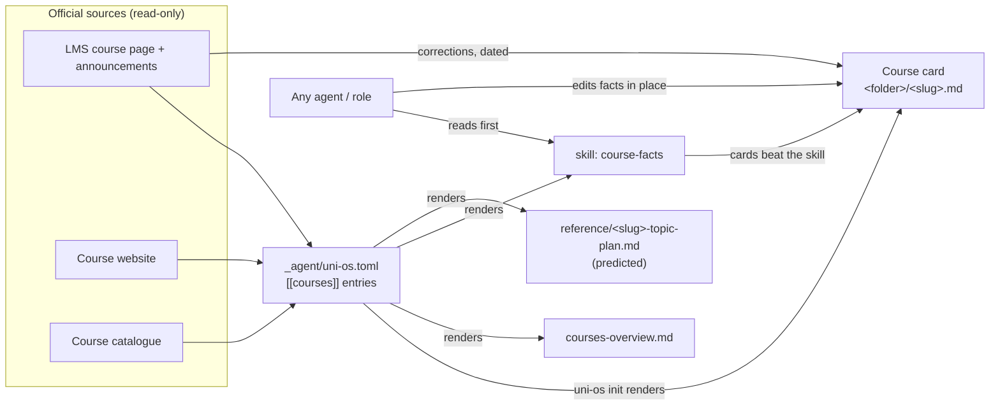

# Courses

The backbone of Uni OS: one folder per course with a fixed layout, a **course card** that is the single source of truth for that course's facts, a backlog, a notes folder, a reference folder with a predicted per-week topic plan and a one-page course guide, add-only folders for the university's official files, an all-courses overview, and the **course-facts skill** that lets any agent answer "what does today's exercise session cover?" correctly. Every other study module (error logs, study pages, quiz coaching, daily prep, progress) builds on the folders and facts this module sets up.

## At a glance
| | |
|---|---|
| Tier | core (always installed) |
| Requires | `core` |
| Recommends | `resources`, `error-logs`, `study-pages`, `progress` |
| Obsidian | recommended (the card properties feed the dashboards); everything is plain Markdown and works without it |
| OS | any |
| Runtime | laptop, cloud sessions, VM (no jobs of its own) |
| Jobs | none |
| Roles | none (every role reads the course cards; the planning, exercise-help and lecture-rundown roles write to them) |
| Skills | `course-facts` |
| Cost | none |

## Why it exists
In the original system (built for a first term of a computer science BSc, four courses) the same questions came up every day: which sheet is discussed in tomorrow's session, when is it due, does this quiz count, what is the bonus rule, may the agent help with this task, which page of the script is this. Answers were scattered across the LMS, a course website, the course catalogue, PDFs and chat history, and agents got them wrong in predictable ways:

- They assumed an exercise session covers the same week's lectures. It usually lags by about a week, and the lag differs per course. This was the single most common wrong answer.
- They mixed up week numberings (the LMS counted weeks from 1, the term from 0; one course's "week" straddled two term weeks; sheet numbers ran one ahead of term weeks).
- They trusted old notes over new announcements (a "Friday release" came from corrected re-uploads; the official day was Thursday).
- They cited the wrong page (printed vs PDF page offsets differ per script).
- They filled in lecture content from plans instead of the real slides.

The fix was structural: one card per course holding every fact with its source and date, a fixed folder layout so agents always know where things are, a skill that encodes the week arithmetic and the per-course session rule, and strict filing rules so the university's files are never renamed or lost.

## How it works


1. **Setup.** The setup agent interviews the student (or reads the course pages with them) and writes one `[[courses]]` entry per course into the config: identity, slots, release and due days, hand-in channel, the session rule, week numbering, graded streams (`assessments`), bonus scheme, help policy, real sources, page offsets, official subfolders.
2. **Install.** `uni-os init` renders the templates once per course (path expansion over `{{course.folder}}`): the course card, the backlog, `notes/README.md`, the topic plan and the course guide. It also renders `courses-overview.md` and the `course-facts` skill with all courses. It creates the empty official subfolders of each course too, one per `official_subfolders` entry (the module's `[[folders]]` entry in `module.toml`; no placeholder files inside). Install never overwrites a file that exists and never deletes a folder. The setup agent then checks that the student's existing folders match the configured names.
3. **First week.** The student (with an agent) checks every card against the official pages, fills the gaps (rooms, notation, what is not published), and builds the topic plan week by week. The verification method lives in the `resources` module.
4. **During the term.** Any agent that learns a course fact edits the card in place, in the same turn, with the date and the source ("Corrected <date>: ..."). After each lecture one line goes into the card's Lecture log. Every new file in the course folder gets a row in the card's "In this folder" table. Parked tasks go into `backlog.md`.
5. **Answering questions.** An agent asked about a course loads the `course-facts` skill: it gets today's real date, computes the term week from week 0, reads the course card for newer facts, applies the session rule, and says what is certain and what is predicted. Answers are two or three sentences.

### The course card
`<folder>/<slug>.md`, `type: course`. Properties the dashboards read:

| Property | Shape | Read by |
|---|---|---|
| `type` | `course` | Obsidian Bases (Courses view), cockpit |
| `course` | the course id (`algo`, never the slug `ad` or the short name) | everything that filters per course |
| `bonus_banked` | starts with an `x / y` pair, e.g. `"12.5 / 16 graded (78 %)"`; `"none"` without a bonus | Courses view, cockpit bonus bars, progress |
| `bonus_target` | free text; `~N pts (est.)` is read as an estimated total, e.g. `"80 % of ~128 pts (est.)"`, `"5 / 7"` | Courses view, cockpit |
| `next_bonus` | starts with a date like `Tue 3 Nov 23:59`, then what | Courses view, cockpit |
| `updated` | `YYYY-MM-DD` | Courses view |

The graded-streams table and the assistance level line sit between the marker lines `<!-- uni-os:begin assessments -->` and `<!-- uni-os:end assessments -->`: a generated region. `uni-os render` refreshes it from the config (`assistance` and `[[courses.assessments]]`) even after the card was edited and keeps the rest of the card, so a changed assistance level reaches every card. Change streams and assistance levels in the config, not in the card; text typed between the markers is overwritten.

The `course` property of every note about a course (card, backlog, reference, study pages, error logs, quiz prep) is the course **id** from the config; `uni-os doctor` warns about any other value.

Body sections, in order: **Facts** (lecturers, LMS page, platforms, lecture and exercise slots, recordings, exam format as logistics only, exam-session dates, non-weekly course events) · **Weekly rhythm and bonus** (a table of graded streams rendered from `assessments`, with the assistance level and its legend right below; sheets; the session rule; week numbering; quiz scopes; bonus rule; official integrity rule) · **Conventions** (course notes, notation, how TAs grade, the student's routine) · **Real sources** (ground truth for "what was lectured", page-offset table, the "deck is the whole chapter" rule) · **Lecture log** · **Known gaps and open questions** · **Official files** (subfolders and filing rules) · **In this folder** (file index).

### Filing rules
1. Sources are add-only: official files keep their official names; an agent may add a newly downloaded official file to the matching subfolder and link it from the card; it never renames, moves or deletes one. A newer version replaces an old one only on the student's OK, and the old copy moves, under its own name, to `z_archive/<course folder>-outdated-YYYY-MM-DD/` at the vault root (one dated folder per replacement, never deleted; with `vault-watch` on, any change there raises an alert).
2. Notes and sources never mix: agent-made files go into `notes/`, `reference/`, `quiz-prep/` or the course folder's top level.
3. Notes get unique, course-prefixed, lowercase-kebab-case names (`ad-heaps-study-page.md`). The scaffold's `backlog.md` and `notes/README.md` are the only generic names; always link by relative path.
4. Agent-typed copies of unreadable PDFs are `<official name>-transcript.md` and say "If this copy and the PDF ever differ, the PDF wins."
5. Every new file gets a row in the card's "In this folder".
6. Nothing that solves, hints at or summarises `solo` work is stored anywhere.

## What gets installed
| Vault path | What |
|---|---|
| `courses-overview.md` | All courses at a glance: table, session offsets, help policy, same-layout table, official subfolders, filing rules, colours, page offsets, per-week content map (predicted). Every per-course table and the layout table are generated regions (`courses`, `rhythm`, `help`, `layout`, `official-subfolders`, `colours`, `page-offsets`): `uni-os render` keeps them current from the config even after the page was edited. The per-week content map is filled by hand |
| `<folder>/<slug>.md` | Course card (one per course) |
| `<folder>/backlog.md` | Parked tasks: `| Task | Why parked | Est. minutes | Added |`, strike when done |
| `<folder>/notes/README.md` | What goes into `notes/`, naming, rules |
| `<folder>/reference/<slug>-topic-plan.md` | Predicted per-week content map: summary table with status (predicted / checked / shifted) and one block per week (lectures, read, do, checkpoint, rough time) |
| `<folder>/reference/<slug>-course-guide.md` | One-page course guide: at a glance, your week, sessions, timeline, weekly cycle, graded work, topics, integrity allowed / not allowed, where to look |
| `<folder>/<official subfolder>/` | Empty folders for the university's files, one per entry in `official_subfolders`, created by `uni-os init` (and by `uni-os render` when you add a course or a subfolder) from the `[[folders]]` entry in `module.toml`. No placeholder files inside, because official folders hold only official files. Never deleted: a subfolder removed from the config stays in the vault |
| `z_archive/<course folder>-outdated-YYYY-MM-DD/` | Not installed: created by an agent only when the student OKs replacing an official file with a newer version; the old copy keeps its name there |
| `_agent/skills/course-facts/` | The skill (`SKILL.md` + `references/rhythm-patterns.md`, `verify-a-fact.md`, `course-onboarding.md`); setup copies it into the folder your agent reads skills from (`agent.skills_dir`), again after every render |

## Configuration
Course entries live in `_agent/uni-os.toml` as `[[courses]]` tables. Identity keys have no defaults; everything else does (this module's `[defaults.course]`), so a minimal course is six lines.

| Key | Default | Purpose |
|---|---|---|
| `id`, `name`, `short`, `folder`, `slug`, `colour` | (required) | Identity. `folder` may contain spaces and `&`; `slug` prefixes file names |
| `colour_light` | `""` | Lighter shade for exercise sessions |
| `language` | from `student.language` | Language of lectures and materials, e.g. "German lectures, English script" |
| `ects` | `""` | Credits |
| `lecturers` | `[]` | Optional (never real names in shared examples) |
| `lecture_slots`, `exercise_slots` | `[]` | e.g. `["Thu 10:15-12:00"]` |
| `exercise_group` | `""` | The student's own group or tutorial, written in full (e.g. `"group 3"`); templates print it as is |
| `lms_url`, `website`, `platforms`, `recordings` | `""` / `[]` | Where the course lives online |
| `sheet_release`, `sheet_due`, `hand_in` | `""` | Weekly rhythm |
| `session_rule` | `""` | One sentence: "In the <day> session of week n: <which sheet is discussed>, <what happens in the room>, <which sheet comes out>." The most important fact; shown as "Session rule" on the card, the overview and the skill |
| `week_numbering` | `""` | Course-internal numbering vs term weeks |
| `official_subfolders` | `["assignments", "assignments/solutions", "script and slides"]` | Folders for the university's files (name them after what the course publishes) |
| `real_source` | `""` | Which documents are ground truth for what was lectured |
| `page_offsets` | `[]` | `[{ source, rule }]`, e.g. `rule = "PDF page = printed page + 8"` |
| `exam_format` | `""` | Logistics only: length, mode, language, aids |
| `integrity` | `""` | The course's official integrity / AI rule |
| `assistance` | from `study.assistance_default` (`"hints-only"`) | Default assistance level: `solo`, `hints-only`, `coach`, `full` |
| `notes` | `[]` | Course-specific conventions, one per line |
| `error_log_streams` | `["main"]` | Read here only to list the error logs in the card |
| `handwritten_folder` | `""` | Used when `handwritten-notes` is on; `""` = `<folder> handwritten` |
| `assessments` | `[]` | `[[courses.assessments]]`: `name`, `kind` (sheet / quiz / oral / project / midterm / other), `schedule`, `counts_for` (bonus / grade / admission / none), optional `points_max` (0 = not published), `assistance` (defaults to the course's), `scope` (official wording, inferred parts marked) |
| `bonus.scheme` | `"none"` | none / threshold / points / best-n / custom |
| `bonus.description`, `bonus.rule`, `bonus.target` | `""` | How it is earned, the formula as free text, a short "full bonus at" string for the card property |
| `bonus.max_bonus` | `0` | Cap as a number in grade units (e.g. `0.25`) or a percentage |

Other keys read: `university.name/short/programme/lms`, `university.catalogue` (default `""`), `university.recordings` (default `""`), `term.label`, `term.week0_monday`, `term.timezone`, `term.last_lecture_day`, `term.lecture_free_from`, `term.holidays` (listed in the skill's key dates), `term.exam_session_start`, `term.exam_session_end` (dates only), `calendar.courses`, `calendar.study_blocks`. `course.error_logs` is derived by Uni OS from `error_log_streams` (never set it by hand).

**What the setup interview asks** (per course): name and short name; folder name (what the student already uses on their drive); colour; lecture and exercise slots and the student's group; where the course lives (LMS page, website, platforms, recordings); when sheets come out and are due, and how they are handed in; what happens in the exercise session of a given week (if the student doesn't know yet, the agent infers it from the rhythm and marks it to be checked); every graded stream with its schedule, points and what it counts for; the bonus formula; the official integrity rule and how much help the student wants per stream; which documents count as the real source; what the course publishes (to name the official subfolders). The agent fills as much as possible from the course pages itself and asks only for the rest.

Example (fictional student Alex Example; the first lines are the entry from `examples/alex.toml`, the rest shows the optional keys):
```toml
[[courses]]
id = "algo"
name = "Algorithms and Data Structures"
short = "AD"
folder = "AD"                      # may contain spaces and "&", e.g. "A&D"
slug = "ad"
colour = "#1e66f5"
lecture_slots = ["Tue 10:15-12:00", "Thu 10:15-12:00"]
exercise_slots = ["Wed 14:15-16:00"]
sheet_release = "Thu 12:00"
sheet_due = "Thu 23:59, one week later"
official_subfolders = ["AD assignments", "AD slides & script"]
assistance = "hints-only"
# optional keys
hand_in = "LMS upload, one per working group"
session_rule = "In the Wednesday session of week n: discussion of sheet n-2 (handed in last Thursday) and questions on sheet n-1 (due tomorrow); in quiz weeks the in-class quiz runs first; sheet n comes out on Thursday."
week_numbering = "LMS 'Week k' = term week k-1"
real_source = "the script (cite chapter and printed page), plus that lecture's slides"
page_offsets = [{ source = "Script (PDF)", rule = "PDF page = printed page + 8" }]
integrity = "Copying costs both groups the points; no AI-generated solutions or code."

[[courses.assessments]]
name = "In-class quizzes"
kind = "quiz"
schedule = "weeks 4, 8 and 12, Wed 14:15-14:35 in the exercise session; opens 14:10 behind a password; 15-min timer from the start of the attempt, hard close 14:35"
counts_for = "bonus"
points_max = 10
assistance = "hints-only"   # the attempt is always yours; hints-only allows prep and a review afterwards
scope = "Official: 'all material is relevant; the focus lies on the previous 2 weeks'. In practice: the two previous lecture days and those weeks' sheets (inferred)."

[courses.bonus]
scheme = "threshold"
description = "sheet points over the term; quizzes count double"
max_bonus = 0.25
rule = "bonus = min(0.25, 0.25 * points / (0.8 * max)); the semester maximum is not published"
target = "80 % of all points"
```

## Daily use
- "What does tomorrow's AD exercise session cover?" The agent loads `course-facts`, computes the week, applies the session rule, answers in two or three sentences.
- "The DM sheets come out on Thursday now, not Friday." The agent corrects the card with the date ("Corrected ...") and the topic plan, changes `sheet_release` in the config and runs `uni-os render`, which refreshes the overview's rhythm table and the `course-facts` skill.
- "Lecture today stopped at slide 42, section 7.2." One line in the card's Lecture log.
- "Park sheet 3 task 3.2, I'm out of time." A row in `backlog.md` with the reason and an estimate.
- "I downloaded the new script into the script folder." The agent links it from the card's Real sources and checks whether the page offset changed.
- "What help am I allowed on the oral bonus problem?" The agent reads the help policy: `solo` means no help at all.

## Agents other than Claude Code
Everything is plain Markdown plus one skill in the open Agent Skills format (`SKILL.md` with frontmatter). Agents that read skills get `course-facts` from wherever setup put it (`agent.skills_dir`); agents that don't can read `_agent/skills/course-facts/SKILL.md` directly; `AGENTS.md` and the core rules point there. Reading logged-in course pages needs a session that can drive the student's browser (in Claude Code: the desktop app's built-in browser or Claude in Chrome; other agents: their own browser tool, or the student pastes the page). Uni OS has only been tested with Claude Code.

## Failure modes and fixes
| Symptom | Cause | Fix |
|---|---|---|
| Wrong answer about an exercise session | Session rule missing or wrong; agent skipped the skill | Fill `session_rule` (see `references/rhythm-patterns.md`), copy it onto the card; check it against the first two sessions |
| Off-by-one week | Two numberings mixed | Write `week_numbering`; always say which numbering you mean |
| Agent cites wrong pages | Missing page offset, or a new script version | Add the offset to the card and config; note the script version and date |
| Card contradicts the skill | Skill rendered before a correction | Cards win; update the config and re-render the skill |
| A fact typed into the overview's tables or the card's graded-streams table is gone after a render | It was typed between generated-region markers, which render rewrites from the config | Put the fact into the config (`[[courses]]`) and render; write facts that have no config key outside the markers |
| Card grows into a diary | Progress narratives written into the card | Move narratives to week pages; keep facts and one-line results |
| Official file renamed or lost | Agent tidied a source folder | Restore from the drive's history; reinforce the add-only rule in the core rules |
| Dashboard shows NaN or nothing | Card properties lost their shape | Keep `bonus_banked` starting with `x / y`, dates like `Tue 3 Nov 23:59` |
| `uni-os init` fails on a course | A required identity key is missing | Add `id`, `name`, `short`, `folder`, `slug`, `colour` to the entry |
| Official subfolders missing | Deleted by hand (`uni-os render` never recreates a folder you deleted), or `official_subfolders` is empty | Run `uni-os init --vault <vault>` to restore them, or fix `official_subfolders` and run `uni-os render`; `uni-os doctor` lists missing folders |
| A new file appears in the wrong folder (an agent note inside an official subfolder) | Filing rule 2 ignored | Move it to `notes/` or `reference/`, fix the card's "In this folder" row; official subfolders hold only official files |

## Lessons from the original system
- **The session lag is the main failure mode.** The original course skill opened with it in bold ("an exercise session almost never covers the material of that same day"), and wrong answers stopped once each course had its "In the <day> class of week n" sentence.
- **Week numbering mismatches were everywhere:** LMS weeks 1-indexed, a pasted schedule 1-indexed, a TA's "week N" = the term's N-1, one course's weeks straddling Friday + Wednesday, programming sheet numbers = term week + 1. Every file states which numbering it uses.
- **Facts drift, so cards keep their history.** Cards accumulated lines like "(Older notes say Friday: those were corrected re-uploads)" and "Settled <date>: ...". That trace made it possible to see why a belief existed and to undo a wrong correction.
- **Bonus totals are often unpublished.** Two of four courses never published a semester maximum. The cards kept an explicit estimate with its basis, and the rule "update `bonus_target` as soon as a sheet, the grade files or a TA gives real numbers".
- **Lecture decks are whole chapters.** Only the student's word (or a transcript matched against the slides) says where a lecture stopped. Rundowns built from a plan instead of the real slides had wrong pages and invented items; the rule "content only from real sources, cite the page; if the source can't be opened, say so" came from that.
- **Page offsets differ per script and per file** (printed + 8, printed + 12, printed = PDF - 1, a second part with no offset that "may renumber"). They belong in a table on the card.
- **A stable folder layout made dashboards free.** Because every course had the same folders and every note a `type` property, Obsidian views could list study pages, error logs and cards without anyone maintaining lists.
- **Official names, add-only.** Keeping the university's file names meant agents could cite "sheet 6" and the file-fetch job could recognise new files. Superseded versions went to dated archive folders, never the trash.
- **Predicted plans must say so.** The per-week topic plans were "about 95 % reliable": good for planning, wrong often enough that anything deciding points was checked on the LMS first.
- **Long per-assignment narratives made one card unreadable** (minute-by-minute status lines). Progress belongs on week pages; the card keeps facts.
- **The course skill must never pre-approve anything.** The original skill contained a line pre-approving a university consent screen; the framework skill deliberately has no such line.

## Removing it
`courses` is a core module: other modules depend on its folders and facts, so it can't be disabled. To drop a single course, remove its `[[courses]]` entry and run `uni-os render` (the skill and the generated tables then leave it out); the course folder stays untouched in the vault (archive it by hand if you like).
