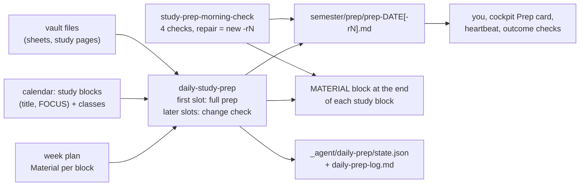

# Daily study prep

Every evening an agent job looks at tomorrow's study blocks in your calendar and puts **everything each block needs** (the sheet with the tasks to do, the script section with its page, the study page, the integrity warning) into one fixed place: a prep note `semester/prep/prep-YYYY-MM-DD.md`, plus a `MATERIAL` block at the end of each block's description in the calendar, so the links are on your phone too. A later evening run catches the planner's changes; a morning run checks today's note against the calendar as it is now and against the disk, and repairs it with a new revision. Notes are never edited: a change is a new file `-r2`, `-r3`, and the highest revision wins.

## At a glance

| | |
|---|---|
| Tier | standard |
| Requires | `core`, `courses`, `planning` |
| Recommends | `progress`, `obsidian`, `cockpit` (Prep card with presence line and alerts), `heartbeat` (flags a missing or unverified note), `scheduler-local` or `vm` (to run the jobs), `course-files-fetch` (closes "sheet not in the vault" gaps) |
| Obsidian | recommended (the note is a Markdown page with course-coloured callouts) |
| OS | any |
| Runtime | laptop scheduler or always-on host; needs a calendar tool that can update event descriptions |
| Jobs | `daily-study-prep` (`schedule.daily_prep`, headless), `study-prep-morning-check` (`schedule.prep_check`, headless) |
| Roles | none (Plan & progress owns the runbook and receives gap reports) |
| Cost | one headless agent run per `schedule.daily_prep` slot plus the morning check (three a day with the defaults; a few minutes each, mid-size model at high effort in the original); change checks are short when nothing changed |

## Why it exists

The original student's rule (week 6): "every day, the material for the next day's study blocks must be in one fixed place." Before, each block started with ten minutes of hunting: which sheet, which task, which page of the script, does the study page exist yet, is this the graded task I must not get help on? The prep job removed that, and it surfaced problems a day early: a sheet that wasn't in the vault yet (released behind a login), a promised study page that only existed in a chat app's library, a block the planner had moved.

The mechanics were shaped by failures:
- **Immutable revisions.** Cloud writers in the original could only create files, never edit them, so every change became a new `-rN` file. That also kept the history readable (a day went up to `-r5` when a sheet arrived late and the vault was re-laid out).
- **Several attempts.** Agent-app scheduled tasks on the laptop ran only while the app was open and fired late (one morning run at 09:54 instead of 07:30), so every run catches up whatever is missing for today and tomorrow. The routine later moved to an always-on host.
- **A morning verification with four checks**, because the planner reshapes blocks in the evening and the morning, because a vault re-layout silently broke links, and because a calendar write once failed.
- **A note for every day**, also free days: a missing note is what raises the alarm.

## How it works



One attempt (the runbook, `_agent/daily-prep/RUNBOOK.md`, has every step):
0. **Time, state, targets.** Real local time; `state.json`; target = tomorrow (evening runs) or today (morning run), plus the catch-up rule (any of today/tomorrow without a note or still `open`).
1. **Read the day.** Study blocks from the study-blocks calendar (skipping `OP` and other non-study items), classes from the courses calendar, personal calendars only for collisions (titles never copied). `FOCUS:` lines first, then the week plan's "Material per block", the week page, the course cards.
2. **Material per block.** Sheets (with the tasks), scripts (section and page offset), study pages (checked on disk), the lecture's chapter for classes; requests other sessions left in `carry`; **integrity filters**: never a solution of a graded or identical older task, task sheet only for `solo` work, the warning kept in the item, nothing the student keeps closed inside an integrity window (e.g. their model summary sheet in the week before an oral), the per-course assistance level and official rule from the config. Cloud links for PDFs are reused from earlier notes, never guessed.
3. **Gaps.** Anything named but not in the vault is listed under `## Gaps` and as `PENDING:` in MATERIAL, always with a fallback; the owner learns from the log (or an inbox note when a session must act).
4. **Write the note** as a new file (next `-rN` if one exists), in the contract format.
5. **Calendar.** For each study block: read the event, keep its description, replace only the final `MATERIAL (daily prep, ...)` block, notifications off, read it back. Classes are never edited.
6. **Change check** (later slots): recompute the block signature (start times + titles), re-read classes, re-check gaps; a change means a new `-rN` and updated MATERIAL; no change means only a log line.
7. **Morning verification:** (1) the newest note exists with its properties; (2) every callout's start and end equal its event's, and the counts match; (3) every study block's MATERIAL block names the newest note with the same items; (4) every vault path and relative link exists on disk. Anything off: a new `-rN`. Either way `verified` and a log line.
8. **Mark and log.** The day is `done` once note and calendar are written (gaps allowed).
9. **Tell you only in the run summary**: no push. Outside watchers (cockpit, heartbeat, the host's outcome checks) raise the alarm if a note is missing.

Failures: retry once; do the half that works and leave the day `open`; if the calendar refuses writes, **never work around it** (no API keys, no feeds): write the note, mark `calendar: pending`, log it. A run that ends incomplete also writes a **failure flag** `_agent/logs/flags/<job>.md` (the heartbeat module's contract: front matter `job`, `at`, `level`; the first body line is the reason; `red` when a day has no note, `amber` when the note exists but MATERIAL blocks or a repair are missing); the next complete run of that job deletes it. Gaps with a fallback are not failures.

### File formats

These are contracts; the cockpit, the heartbeat, the host's outcome checks and the morning check read them. `scripts/prep_note.py` is an executable reference (`python modules/daily-prep/scripts/prep_note.py check <vault> --date YYYY-MM-DD` validates the newest note and tests its paths; tests in `tests/`). It was checked against the original's 31 notes: all but a handful with free-text `run` values parse cleanly.

**File name:** `semester/prep/prep-YYYY-MM-DD.md`, revisions `-r2`, `-r3`, ... The plain name is revision 1; the **highest revision wins**, then the latest `generated`. Files are never edited, moved, renamed or deleted.

**Prep note** (a Thursday of the example student in `examples/alex.toml`: two classes and two study blocks):
```markdown
---
type: prep
audience: me
date: 2026-11-12                    # the day being prepared
generated: 2026-11-11T17:31+01:00   # ISO with offset
run: "17:30"                        # nominal slot, quoted, or manual
status: ready                       # ready | ready-with-gaps
tags: [uni/prep]
---
# Prep for Thu 12 Nov 2026 (week 8)

<one paragraph: which run, why this revision, how many blocks, events around them>

> [!dm] 08:15-10:00 DM_ practice sheet 8
> - Sheet: `DM/DM assignments/sheet08.pdf` (practice sheet, hints only)

> [!ad] 10:15-12:00 L: AD
> - Script chapter 6 (predicted by the topic plan): `AD/AD slides & script/script.pdf`

> [!ad] 13:15-16:00 AD_ Sheet 7 rest (deep)
> - Sheet: `AD/AD assignments/sheet07.pdf` (tasks 7.3-7.5, due today 23:59; hints only)
> - Study page: [ad-dynamic-programming-study-page](../../AD/notes/ad-dynamic-programming-study-page.md), interactive `AD/notes/ad-dynamic-programming-study-page.html`

> [!la] 16:15-18:00 E: LA
> - Exercise class: sheet 8 is discussed: `LA/LA assignments/sheet08.pdf`

## Gaps
- none
```
- Callout header exactly `> [!<course>] HH:MM-HH:MM <title>`: `<course>` is the course's **slug** (the same id the vault's CSS snippet colours; readers should also accept the course `id`), anything else (e.g. `note`) means no course; 24 h times with leading zeros; title exactly as in the calendar. **Start and end equal the calendar event's** (agenda views match by date and start time). One callout per study block and per class, in time order.
- Items: `> - ` lines (continuations start with `> `). Vault notes as relative links from `semester/prep/` (angle brackets around paths with spaces or `&`); HTML pages and PDFs as backticked vault paths; integrity warnings inside the item.
- `## Gaps` is the last section: `- none`, or one bullet per gap with its fallback. Readers count bullets that don't read `none` / `no gaps` / `nothing` / `-`. `status: ready-with-gaps` exactly when gaps exist.
- Title `# Prep for <Ddd D Mon YYYY> (week N)`; readers tolerate a suffix after the bracket, writers don't add one.

**MATERIAL block** (last block of each study block's description):
```
MATERIAL (daily prep, Wed 11 Nov 17:31; all of it in Obsidian: semester/prep/prep-2026-11-12)
- Sheet: AD/AD assignments/sheet07.pdf (tasks 7.3-7.5, due today 23:59; hints only)
- Obsidian AD/notes/ad-dynamic-programming-study-page.md
- PENDING: <gap> (fallback: <fallback>)
```
"Obsidian" becomes "the vault" when `obsidian.enabled = false`. Only this block is replaced on later runs; the planner's text above it (tasks, `FOCUS:`) is kept byte for byte.

**`_agent/daily-prep/state.json`:** `{"days": {"YYYY-MM-DD": {"status": "done|open", "attempts", "prep_file_name", "blocks_sig": "HH:MM <title> | HH:MM <title>", "gaps": [...], "done_by", "last_change_check", "verified", "calendar": "pending"?}}, "carry": {"YYYY-MM-DD": ["<item>"]}}`. The outcome checks read `days[<date>].gaps` (non-empty for more than a day = alert); the heartbeat reads presence and `verified`.

**`_agent/daily-prep/daily-prep-log.md`:** one line per attempt, `- YYYY-MM-DD HH:MM  <kind> for <target>: ...` (full prep: blocks, items, gaps, note, MATERIAL, day done|open; change check: unchanged or what changed; morning check: note, callouts n/n, MATERIAL n/n, paths ok|broken; ok|fixed with <note>).

**Timing contract with dashboards:** tomorrow's note exists within 30 minutes after the first `daily_prep` slot (the cockpit switches from today's to tomorrow's note at its "prep switch" time, 18:00 in the original with a 17:30 run); a warning shows when tomorrow's note is missing after the last evening slot, or today's after `prep_check` (+15 minutes).

## What gets installed

| Path | What |
|---|---|
| `semester/prep/README.md` | the prep-note contract (format, naming, MATERIAL block, rules for the folder, upstream changes) |
| `_agent/daily-prep/RUNBOOK.md` | the routine, step by step, with per-course integrity filters from the config |
| `_agent/daily-prep/state.json` | per-day markers (starts empty) |
| `_agent/daily-prep/daily-prep-log.md` | the run log |
| `_agent/jobs/daily-study-prep/` | job (evening runs) |
| `_agent/jobs/study-prep-morning-check/` | job (morning run) |

Jobs are installed **off**; setup switches them on.

## Configuration

| Key | Default | Meaning |
|---|---|---|
| `schedule.daily_prep` | `["17:30", "19:30"]` | evening runs: the first is the full prep for tomorrow, the others are change checks |
| `schedule.prep_check` | `"07:30"` | morning verification of today |
| `calendar.study_blocks` / `courses` / `events` / `busy` | (planning) | calendar names; study blocks are read and get MATERIAL, classes are read-only |
| `calendar.provider` | `"google"` | `none`: blocks come from the week plan's day lines; no MATERIAL blocks |
| per course: `slug`, `assistance`, `notes`, `integrity`, `page_offsets`, `assessments[].assistance` | (courses) | callout id, assistance level, course rules, the official integrity rule, script page offsets and which graded items are `solo`; all used by the integrity filter and the item lines |

Setup asks: when your study day usually starts (the morning check should run before it), when the planner usually finishes changing tomorrow (the first evening run should come after), and whether you want a second evening run.

## Daily use

- Evening: open tomorrow's note (or the cockpit's Prep card) once; on the phone, each calendar block shows its MATERIAL lines.
- "Rerun today's prep" after you changed today's blocks yourself; "add the LA recap page to tomorrow's prep" (goes into `carry`); "why is the AD block marked PENDING?"
- A gap names its fallback; when the missing file arrives, the next run drops it.

## Agents other than Claude Code

The prompts and the runbook are agent-neutral; only tested with Claude Code. Needs: a scheduler (agent app or OS), file access to the vault, and a calendar tool that can read events and update a description **without notifying guests**. In Claude Code the Google Calendar connector was used (tools loaded on demand with ToolSearch). Without a calendar tool, set `calendar.provider = "none"`: the job reads the week plan's day lines and writes only the note. Some agents' permission layers refuse calendar writes from unattended runs (one Claude Code session in the original had `update_event` refused by its permission classifier): give scheduled jobs the permission they need, or accept `calendar: pending`.

## Failure modes and fixes

| Symptom | Cause | Fix |
|---|---|---|
| No note for tomorrow in the evening | laptop asleep or app closed at the slot; job off | the morning check catches up; consider the always-on host; check the job log |
| Note lists a block that moved | the planner changed the calendar after the run | the next change check or the morning check writes `-rN`; the planner can trigger a rerun |
| `PENDING` for a sheet you have | the file is somewhere else or named differently | save it in the course's official folder under its official name; the next run finds it |
| "calendar: pending" in state | the calendar tool refused writes | grant the job write access or accept note-only prep; never work around with keys |
| `_agent/logs/flags/daily-study-prep.md` (or `study-prep-morning-check.md`) exists | the job's last run ended incomplete; the first body line says why | fix the cause; the next complete run deletes the flag (the heartbeat shows it as `job:<job>:failed` until then) |
| Broken links after reorganising folders | paths changed | the morning check's path test writes a fixed `-rN`; move files inside Obsidian so links update |
| Wrong week number in the title | another numbering crept in | the project numbering in `semester/calendar-and-dates.md` is the only one |
| MATERIAL names an old revision | a manual note was written without updating the calendar | the morning check fixes it |
| Duplicate `name (1).md` files | cloud sync conflict | left in place; the note links the original |

## Lessons from the original system

- **One fixed place beats smart search.** The student only ever opened one note; every source (calendar, plan, course folders) fed it.
- **Never edit, write a revision.** Also what made the history useful: each revision's first paragraph says why it exists ("the sheet 8 PDF arrived in the vault Fri evening, so the gap is closed").
- **The callout start time must equal the calendar start.** The agenda matched items to events by start time; a note that took times from the plan lost the match.
- **Re-read the calendar every run.** Blocks were reshaped at 18:00 and in the morning; a note from 17:30 was often stale by 07:30.
- **Sheets behind a login arrive late.** Released sheets reached the vault only when a fetch session ran (about a day later), so next-day prep had gaps; a fetch on release evening was the fix candidate.
- **Pages that exist only in a chat app's library are unreachable** for a job on the laptop or a server; treat them as gaps with the fallback "open it in the app".
- **Rules propagate slowly.** After the student dropped error-log retests, the next prep note still scheduled one, because the calendar description predated the decision. Change the source (the calendar or the plan), not the note.
- **Don't push "all good".** The routine sent no pushes; independent watchers alerted only when a note was missing.

## Removing it

`uni-os disable daily-prep` marks both jobs disabled (a `DISABLED` file in each job folder, which the job runners skip); also remove the laptop scheduled tasks, or switch the jobs off on the always-on host (`uni-vm jobs off daily-study-prep`, `uni-vm jobs off study-prep-morning-check`). Old notes stay as history; MATERIAL blocks stay in past calendar events (they are only text). Dashboards then show no Prep card.
