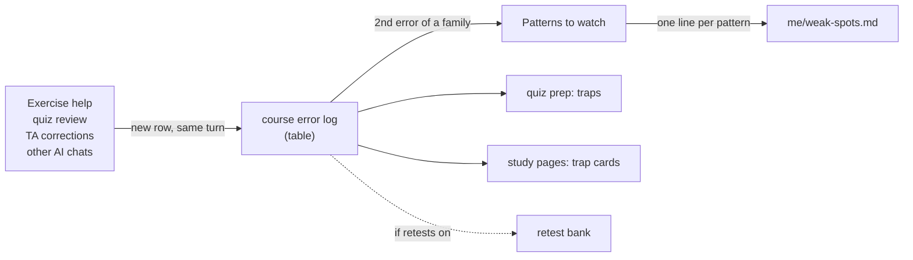

# Error logs

Every course gets an error log: one append-only Markdown table in which each mistake or point of confusion becomes a row (date, where, what went wrong, the correct idea, source). Under the table, a short list of **patterns to watch** collects the mistakes that keep coming back, and each pattern is mirrored into `me/weak-spots.md`, the cross-course view. The logs are written by the agent the moment an error shows up, without being asked, and read by everything else in the study engine: quiz prep ("traps from your own error log"), the trap cards of study pages, cheat sheets and the daily prep. A course with two kinds of work (say theory sheets and programming tasks) can have one log per stream. An optional retest bank turns rows into small cold-redo tasks.

## At a glance

| | |
|---|---|
| Tier | core |
| Requires | `core`, `courses`, `student-model` |
| Recommends | `exercise-help`, `quiz-coaching`, `obsidian` |
| Obsidian | optional (the "Error logs" view lists them; plain Markdown otherwise) |
| OS | any (the helper script needs Python 3.11+, standard library) |
| Runtime | laptop, cloud, VM |
| Jobs | none |
| Roles | none of its own; owned by `exercise-help`, fed by `quiz-coaching` |
| Skill | `log-error` |
| Cost | none beyond normal agent use |

## Why it exists

In the original system every course had a log from the first week, and it turned out to be the most reused file of the whole study engine. Quiz prep sheets listed "traps from your own error log" and named drills after pattern numbers ("pattern 8: verify a claimed inverse"). Study pages got a "Mistakes this chapter invites" card from it. A definitions deck had "Watch:" lines quoting the student's own slips. When graded hand-ins came back with TA annotations, every lost point went in with the TA's words and the page. The cross-course page `me/weak-spots.md` summarised the patterns, and planning used it to decide where extra time goes.

Two rules made it work: **log it the moment it happens, unasked** (a rule for every exercise-help session), and **append only** (a wrong row is corrected by a new row, never edited), so the history stays trustworthy.

## How it works

1. **A row is added** whenever the student makes or reports an error: in exercise help (the owning role), after a quiz review (every miss), when TA-annotated hand-ins come back (every lost point, with the TA's words and PDF page; for group hand-ins the row says authorship is inferred), and for errors reported from elsewhere (another AI chat, a handwritten page). "Log this error" from the student means: log it now.
2. **Row schema** (the parsed contract):

   `| Date | Where | What went wrong | Correct idea | Source |`

   - *Date*: `Ddd D Mon` (e.g. `Mon 26 Oct`).
   - *Where*: `Sheet 3, 3.2 b) <short task name>`, `Quiz W5 Q3`, `Lecture Mon 26 Oct, clicker 2`, `Study page <name>, quiz B Q4`, `Sheet 4 corrections p. 2`, `retest of <date> row (R3)`. Say which numbering is meant when the course numbers weeks differently.
   - *What went wrong*: concretely what was written or chosen, TA quotes in quotes, and the student's state if they mention it (tired, rushed, frustrated).
   - *Correct idea*: the general rule, a check on a small case, and the habit. Never the full solution of a current graded task.
   - *Source*: a tag plus the place: `[script] p. 42` (printed page), `[slides]`, `[handout]`, `[task]`, `[lecture]`, `[TA correction]`, `[quiz review]`, `[derived]`, `[user note]`, `[other AI]`, `[retest]`.

   Why no "status" column: rows are append-only, so a change of state (understood now, retested, corrected) is a new row, not an edit.
3. **Patterns to watch**: at the second error of the same family the role adds a numbered pattern: `1. **<pattern name>** (<dates and where>): <what goes wrong>. Fix: <habit, technique or page>.`
4. **Weak spots**: every pattern is mirrored as one line in `me/weak-spots.md` under the course (`**<pattern>**: <what goes wrong>. Fix: <...>. Source: <log link>`); a pattern seen in two courses also goes under "Across courses". Weak spots is the pattern view; the dated detail stays in the logs.
5. **Open points**: sticking points to take to the exercise class (for example after a task-time cap was hit) and unanswered questions; struck through when settled.
6. **Session notes**: context that changes how a batch of rows should be weighed (a very tired evening, frustration, a timer running out) goes into a dated `## Session note (<Ddd D Mon>)` section right below the table instead of into the rows, so one bad evening does not become a false pattern.
7. **Integrity**: work under the `solo` assistance level is never discussed, logged or linked. The header of every log says so.

### Streams: one file per stream
`courses[].error_log_streams` lists the streams of a course (default `["main"]`). A course with **one** stream has `<course folder>/<slug>-error-log.md`; a course with **several** has `<course folder>/<slug>-error-log-<stream>.md` for each, e.g. `ad-error-log-theory.md` and `ad-error-log-programming.md` (stream names are lowercase-kebab-case). Why separate files instead of sections in one file: each stream is usually handled by its own session (in the original, theory sheets and programming tasks of one course had separate help sessions), and **one owner per file** avoids the last-writer-wins conflicts of a synced drive. How it is built: the template's path is `vault/{{course.folder}}/{{error_log.file}}`, which `uni-os init` expands once per course and stream (the resolved config lists each course's logs as `courses[].error_logs` and `courses[].error_log_files`, so every other module and the cockpit find them by the same rule). If you add a stream later, `python tools/uni_os.py init` (restores missing files) or `python _agent/tools/error_log.py sync` creates the new log; neither ever overwrites. Renaming a course from one to several streams leaves the old `<slug>-error-log.md` in place: move its rows into the right stream log by hand, then delete it.

### The helper script (`_agent/tools/error_log.py`)
Optional: agents can edit the logs directly, but the script makes the common operations exact.

| Command | What it does |
|---|---|
| `list` | every log with its row count |
| `sync` | creates missing logs from a built-in copy of the template (tests keep the two identical) |
| `add --course C [--stream S] --where … --what … --idea … --source … [--date YYYY-MM-DD]` | (`--stream` is required when the course has several streams) appends one row at the bottom of the table (escapes pipe characters, turns line breaks into ` `, bumps `updated`, re-reads the file right before writing) |
| `check [--course C]` | properties, the three sections, the five-column header, five cells in every row |
| `retest-bank --course C` | creates the course's retest bank (only when retests are on) |
| `retest-pick --course C [--n N]` | the next items to retest |

`C` is the course id (`algo` in the example config); the slug, short name or folder also work. The script finds the vault from `--vault`, `$UNI_OS_VAULT`, the current folder or its own location, and reads `_agent/uni-os.json` (or the TOML).

### Optional: the retest bank (off by default)
Generalised from the original's programming retest bank. With `study.error_logs.retests = true`, the owning role turns error-log rows into small **new** tasks that test the same idea (never the graded task itself) in `<course folder>/<slug>-retest-bank.md`:

`| # | From log rows | Prompt (given to the student, no hints) | Look for |`

Once a week the daily prep (or the student) takes up to `retest_items` items per course for a `retest_minutes`-minute slot. The student solves cold, without notes, about 10 minutes per item; the role checks against "Look for" and logs `| <date> | retest of <date> row (R3) | ok / again, … | what to look at next time | [retest] |`. `ok` = cold and correct at the first try (first compile for code), `again` = needed a hint or failed (comes back next week). An item that was `ok` twice is retired. `retest-pick` prints the next items: never-tried first, then the ones tried longest ago.

## What gets installed

| Vault path | What |
|---|---|
| `<course folder>/<slug>-error-log.md` (one-stream course) or `<course folder>/<slug>-error-log-<stream>.md` (one per stream) | the log: properties (`type: error-log`, `course` = the course id as on the course card, `stream`, `tags: [uni/<course id>, error-log]`; the file name uses the slug), header (owner session, columns, source tags, session-note and integrity lines), the table, "Patterns to watch", "Open points" |
| `_agent/tools/error_log.py` | the helper script |
| `_agent/skills/log-error/SKILL.md` | the "log this error" procedure for agents |

## Configuration

| Key | Default | Meaning |
|---|---|---|
| `courses[].error_log_streams` | `["main"]` | streams of a course, e.g. `["theory", "programming"]` |
| `study.error_logs.retests` | `false` | turn on the retest bank |
| `study.error_logs.retest_items` | `3` | items per course per weekly retest slot |
| `study.error_logs.retest_minutes` | `20` | length of that slot |
| `study.assistance_default`, `courses[].assistance`, `courses[].assessments[].assistance` | `hints-only` | read to decide what must never be logged (`solo`) |
| `term.label` | `"this term"` | shown in each log's title |

The interview asks: does any course have two separate kinds of work that different sessions should handle (streams); do you want weekly retests of your own mistakes (with the honest note that the original student dropped them after a week).

## Daily use
- "Log this error: I forgot the base case in 4.2." The agent appends the row in the right course log and shows it.
- Nothing to say most of the time: exercise help and quiz review log errors unasked.
- "What are my patterns in linear algebra?" / "Update my weak spots from the logs."
- "Show me the open points for tomorrow's exercise class."
- With retests on: "Give me this week's retests for DM."

## Agents other than Claude Code
The logs are plain Markdown and the script is plain Python, so any agent works the same way. In Claude Code the `log-error` skill loads automatically when the student says "log this error"; other agents follow the same file because the role briefs point to it. Create-only cloud agents (that cannot edit existing files) send the row as an inbox update note (module `inbox-sync`) instead of editing the log. Only tested with Claude Code.

## Failure modes and fixes

| Symptom | Cause | Fix |
|---|---|---|
| Rows missing after a tutoring session | the role did not log unasked | the role brief makes logging part of every turn; ask "log everything from today" to catch up |
| Table renders broken | an unescaped pipe character inside a cell | `error_log.py check` finds the line; escape the pipe with a backslash (the `add` command does it) |
| Two sessions edited the same log at once and one row vanished | last-writer-wins on a synced drive | one owner per log (streams); re-read right before writing; the `add` command does both |
| Patterns over-weighted by one bad evening | errors under fatigue | write the state in the row; weigh such rows less when drawing patterns |
| A solo task appears in a log | assistance policy ignored | delete that row (the one exception to append-only) and recheck the policy in `_agent/uni-os.toml` |
| `sync` creates nothing for a new course | the course is missing from the config | add it under `[[courses]]`, then run `sync` |

## Lessons from the original system
- The log was the **most reused file** of the study engine: quiz prep, trap cards, cheat sheets, weak spots and the daily prep all read it. Keep its format stable; it is a parsed contract.
- **Log the moment it happens, unasked.** Logging "later" never happened.
- **Append only** with correction rows kept the history honest; nobody had to wonder whether an old row had been rewritten.
- **Say what went wrong concretely**, with the TA's words: vague rows ("confused about induction") were useless a week later.
- **Test every closed form on n = 1, 2, 3** was the most frequent "correct idea"; a cheap check catches off-by-one errors before they cost points.
- **A checklist's wording can itself cause a mistake**: one quiz prep sheet dropped the words "in the worst case" and the student answered accordingly. The miss was logged together with a fix to the prep sheet.
- **Weigh errors made under fatigue differently**: a session note in the log explained a cluster of slips and kept them from becoming a false pattern.
- **Hints in too many small pieces frustrate**: one row's correct idea was about the tutoring itself ("say the missing idea in one line sooner"), which changed the exercise-help protocol.
- **Retests did not work for that student.** Weekly cold redos of old rows were dropped after about a week ("that doesn't really work") and replaced by a 15-minute open-notes recap at the start of each study block. The logs stayed, for reading. Hence retests are optional and off by default here, and any feature should be easy to switch off.

## Removing it
This is a core module, so `disable error-logs` is refused while `exercise-help` or `quiz-coaching` are enabled. If you really want it gone: disable those first, then `python tools/uni_os.py disable error-logs`. The logs stay in your course folders (they are your data); delete them by hand if you wish, and remove the weak-spots lines that link to them.
