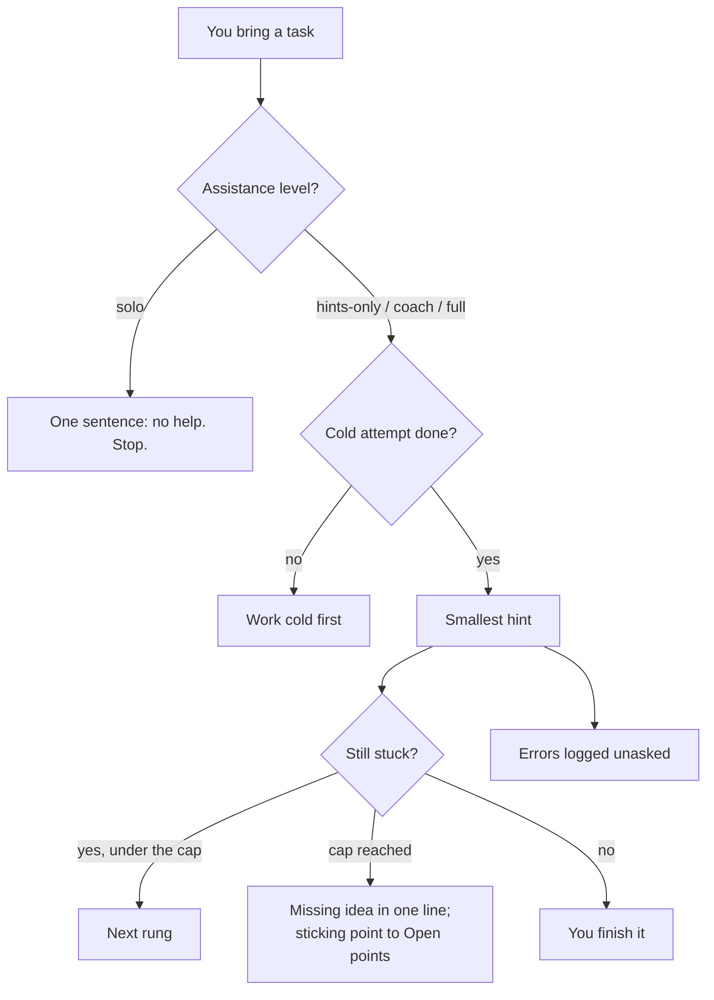

# Exercise help (hints only)

This module adds the **exercise-help role**: the agent session you work through exercise sheets, assignments and programming tasks with. By default it gives **hints only**: the smallest hint that gets you moving, a stronger one only if you are still stuck. It may explain a technique on a different worked example and check your own steps line by line; it does not write your proof, final answer or code. How much help is allowed is set per course and per graded assessment in the config (`solo`, `hints-only`, `coach`, `full`), and `solo` means no help at all: the agent says so and stops. Alongside, the role keeps the course's error log current without being asked, builds HTML hint pages for maths-heavy tasks and mistake maps after graded hand-ins come back, and keeps the course backlog.

## At a glance

| | |
|---|---|
| Tier | standard |
| Requires | `core`, `courses`, `error-logs`, `study-pages` |
| Recommends | `roles`, `progress`, `lecture-rundowns` |
| Obsidian | optional |
| OS | any |
| Runtime | laptop, cloud, VM |
| Jobs | none (the role acts when you bring a task) |
| Roles | `exercise-help` (one shared brief; one session per course, or per stream) |
| Cost | agent usage only |

## Why it exists, and why hints only

The original system began with looser rules: full answers for some courses' ungraded tasks, worked solutions for some sheets. After a few weeks the student switched every course to hints only, for every sheet, graded or not, for two reasons that apply to most students:

1. **Learning.** A worked solution feels like progress but is gone a day later. Getting the smallest nudge and finishing yourself is what makes the next sheet (and the exam) doable. The bar the original plans used was "you can solve that week's exercises unaided".
2. **Integrity.** Most courses allow help with understanding but require graded work to be your own; some forbid any AI help on specific tasks (an oral bonus problem, a timed bonus task), and for graded programming tasks AI-written code can count as plagiarism. Getting caught costs far more than any bonus point. An agent that writes solutions makes the boundary fuzzy; an agent that only hints keeps it clear.

So the framework's default is `hints-only`, and the setup interview asks for each course's official integrity rule and each graded assessment's rule, so the agent can be stricter where the course is (`solo`) and, if you want and the course allows, looser on ungraded practice (`coach`, `full`). The rules in this module bind every kind of output: chat answers, hint pages, diagrams, and examples.

## How it works

### Assistance levels
The level for a piece of work is resolved, first match wins: the graded assessment's `assistance` (`courses[].assessments[].assistance`), the course's `assistance`, `study.assistance_default` (default `hints-only`), finally `hints-only`. When it is unclear which level applies, the agent uses the stricter one and asks.

| Level | The agent does | The agent never does |
|---|---|---|
| `solo` | **nothing on this work**: says so in one sentence and stops. No hints, no checking, no diagrams, no logging or linking, no storing or summarising your work on it | anything at all on that work |
| `hints-only` (default) | the hint ladder; explains a technique on a *different* worked example; checks your own steps and points at the exact wrong line and why; guiding questions; complexity and edge-case checks; extra test cases for your own code | writes your proof, derivation, final answer or code; gives "the last step"; points to the official solution of the same task |
| `coach` | everything above, plus full explanations on similar tasks and a line-by-line review of a complete draft with each fix named in words | writes the final text or code of the graded task |
| `full` | full worked solutions for ungraded practice where the course allows it, every step written out | skips steps; is used for work the course restricts |

- **Course rules are never overridden**, not even when you ask in the moment (for `solo` work, graded work the course requires to be your own, and timed graded windows). The agent declines in one sentence and offers what is allowed.
- **The level changes in the config, not in the moment.** Under `hints-only` the agent never gives the full solution, not even at the end, also on ungraded practice; asked for one, it gives the next rung (or, after the time cap, the missing idea in one line) and tells you that a looser level for ungraded practice is a config change. The original student chose hints-only for every sheet so that a tired "just tell me" would not end in a worked solution.
- **Timed graded windows** (a timed bonus task, a live quiz): no help of any kind while they run.
- **Graded programming**: never your code, not even a "fixed" line; the exact line that is wrong, a hand-trace, extra test inputs, the idea or data structure to use, complexity checks.

### The hint ladder and the protocol
1. **Cold first**: you work alone for a while before the first hint (`study.exercise_help.cold_minutes`, default 25; a course card can set times per difficulty, as the original did with 10 / 20 / 25-30 minutes for one / two / three stars). The agent asks if it is unclear and does not police it.
2. **Ladder**, one rung per message unless you ask for more: (1) which definition or technique applies, (2) which first step, (3) which intermediate claim to aim for, and only after the time cap (top) the missing idea in one line. The one-liner is still not the written-out proof.
3. **Stuck-task protocol** (from a 2.5-hour stuck episode): lead with the content verdict ("content complete" or the one missing thing), format remarks last and optional, a proof complete in content is not sent back for write-up; keep your style; cap `study.exercise_help.part_cap_minutes` (default 45) per task part, then the missing idea in one line and move on, with the sticking point noted for the exercise class; for "show how to compute" tasks, say up front what a finished answer looks like; say what went right too.
4. **Reused tasks**: if a task is identical to an older public one (a previous year's sheet), the agent says so openly, but does not point you to its official solution by default; it explains on a different solved example.
5. **Official solutions** of an ungraded task: only if you explicitly ask for that file after your own attempt (`official_solutions_after_attempt = true`), never for graded work.
6. **Proof-writing vs ideas**: when the idea is there but the proof "cannot be written down", the role points to the course's proof skeletons checklist (made by the lecture-rundown role) instead of giving more content hints; in the original this was the main blocker in the proof-heavy course.
7. **Programming**: stuck longer than `stuck_bug_minutes` on one bug means ask; without a debugger, port the logic to a quick script and cross-check against brute force on many small random inputs; your own tests are checked against a reference and against deliberately broken versions.

### Error log always current
Every error or point of confusion goes into the course's error log **the moment it shows up, unasked, in the same turn**, including errors you report from elsewhere (quiz feedback, other AI chats, handwritten pages). When graded hand-ins come back with TA annotations, every lost point becomes a row with the TA's words and the page (for group hand-ins, authorship is marked as inferred). The "Correct idea" column holds the general rule, never the solution of a current graded task. See module `error-logs` and the `log-error` skill.

### Hint pages and mistake maps
- **HTML hint page** (`_templates/hint-page.html`): the technique on a different, fully worked example; then the hint ladder for your task, each rung behind a click and opening only after the previous one (the page remembers on your device how many you used); then "Check your own steps" and, for computation tasks, the shape of a finished answer. Never the final answer. Built and shown with the `study-page` skill, with a Markdown twin in which the hints stay collapsed.
- **Mistake map** (`_templates/mistake-map.md`), after a graded sheet comes back: "This only locates and explains the mistakes. The fixes are for you (and your group) to write." One table per task, `| # | Where (page, line) | Issue | Type |`, Type one of Wrong claim / Gap / Minor, plus values to check a corrected version against. Each Wrong claim and Gap is also logged.

## What gets installed

| Vault path | What |
|---|---|
| `_agent/roles/exercise-help.md` | the role brief, with a table of course sessions and logs rendered from the config |
| `_templates/hint-page.html` | HTML hint-page template (verbatim) |
| `_templates/mistake-map.md` | mistake-map skeleton |

The role writes the course error logs (module `error-logs`), `<course>/backlog.md` (module `courses`), and hint pages and mistake maps in `<course>/notes/`.

## Configuration

| Key | Default | Meaning |
|---|---|---|
| `study.assistance_default` | `"hints-only"` | level for every course and assessment without its own |
| `courses[].assistance` | (unset: the default) | level for a whole course |
| `courses[].assessments[].assistance` | (unset: the course's) | level for one graded item, e.g. `"solo"` for an oral bonus problem or a timed bonus task |
| `study.exercise_help.cold_minutes` | `25` | cold attempt before the first hint |
| `study.exercise_help.part_cap_minutes` | `45` | cap per task part before the one-line idea |
| `study.exercise_help.stuck_bug_minutes` | `25` | programming: stuck time on one bug before asking |
| `study.exercise_help.official_solutions_after_attempt` | `true` | ungraded tasks only: official solution on explicit request after an own attempt (`false`: never) |
| `agent.heavy_model` | `""` | model for these sessions (empty = host default) |

The interview asks, per course: the official rule on collaboration and AI use (quote it if you can), which graded items must be solo (oral problems, timed tasks), whether graded code may be AI-assisted at all, and which level you want for ungraded practice. It recommends `hints-only` everywhere and `solo` wherever the course demands it.

## Daily use
- "Recap time: help me with the definitions for today's DM block." (the short open-notes recap that opens a study block; reading, not a test)
- "I know why it's true but I can't write the proof." (pointer to the proof skeletons checklist rather than more hints)
- "I'm on sheet 4, exercise 2b. I tried induction but I'm stuck at the step." (one hint)
- "Here's my proof, is it complete?" (content verdict first, then the exact lines)
- "Another hint." / "Give me the one-line idea, I've been at this for 45 minutes."
- "Make me a hint page for 3.4." / "Sheet 5 came back corrected, here are the PDFs: make a mistake map."
- "My code fails the hidden tests, here it is." (the wrong line and a trace, never a fixed version)
- "Park 6.3 for later." (backlog row)

## Agents other than Claude Code
The brief and templates are plain files; any agent can follow them. In Claude Code the coordinator (module `roles`) starts one session per course; elsewhere, open one chat per course and point it at `_agent/roles/exercise-help.md`. Claude Code sends hint pages with `SendUserFile`; other agents give the path. The integrity rules do not depend on the agent: they are text in the brief and the config, so any agent that reads them is bound by the same contract. Only tested with Claude Code.

## Failure modes and fixes

| Symptom | Cause | Fix |
|---|---|---|
| The agent gave a full solution | a looser level was resolved, or the agent drifted | check the levels in `_agent/uni-os.toml`; tell the session "hints only, re-read your brief"; the brief is re-read after every compaction |
| Hints come in too many tiny pieces | ladder followed too literally | the cap: after `part_cap_minutes` the missing idea comes in one line ("say the missing idea in one line sooner" was a logged lesson) |
| The agent helped on solo work | the assessment was not marked `solo` | add `assistance = "solo"` to that assessment; delete anything stored about it |
| Errors not logged | the session forgot | the brief makes logging part of every turn; "log everything from today" catches up |

## Lessons from the original system
- **Hints only, everywhere** replaced a patchwork of per-course rules and was easier to follow for both the student and the agent.
- **The stuck-task protocol** came from one exercise that took 2.5 hours: content verdict first, a time cap per part, the missing idea in one line, the sticking point noted for the exercise class.
- **Format remarks are noise** while the content is still open; a proof that is complete in content is not sent back for write-up.
- **Reused tasks happen**: many tasks of one course were reused from earlier years' public sheets. Saying so openly, without pointing to the old solution, kept things honest.
- **Graded code is special**: for one course AI-written code counted as plagiarism, so the agent pointed at lines instead of fixing them, and declined full code even when asked, giving the exact lines and a trace instead.
- **Integrity rules bind everything**: diagrams, hint pages, built tools and file fetchers too (a fetcher refused a solution file that was only allowed after a date).
- **Retests were dropped**: cold redos of old errors did not work for that student and were replaced by a 15-minute open-notes recap at the start of each study block (definitions, what matters, what the lecture did; not scored), which this role helps with when asked; hence retests are off by default (module `error-logs`).
- **Task texts may live outside the vault**: for the programming platform the student pasted each task; the course card says where task texts come from, so the role asks instead of guessing.

## Removing it
`python tools/uni_os.py disable exercise-help` removes the role from routing; the role file, templates, error logs and pages stay. Close the course sessions in your agent app. Your integrity settings stay in the config and still bind every other role.
