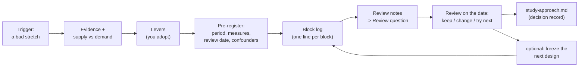

# Study and habit experiments

An optional method for changing how you study without fooling yourself. When a stretch of weeks goes badly, your agent first gathers evidence and counts hours (what the work needs vs what the week really yields), proposes a few concrete levers, and agrees with you on measures and a review date **before** day one. During the experiment every study block gets a one-line log entry with a verdict word; patterns are collected as questions for the review; at the review date the verdict is keep / change / try next, each with evidence. If you want to judge a whole week structure, you freeze it for a few weeks with explicit rules. Habit changes outside study (evenings, sleep, phone) get a lighter one-change-at-a-time log.

## At a glance

| | |
|---|---|
| Tier | advanced (optional) |
| Requires | `core` |
| Recommends | `planning` (Plan & progress keeps the log by default and applies changes), `progress` (results to compare), `student-model` (rhythm file to validate layouts), `check-in` (focused hours from the block log) |
| Obsidian | optional |
| OS | any |
| Runtime | any session with vault access |
| Jobs | none (the review date gets a calendar block; a scheduled reminder is optional) |
| Roles | none by default; an optional "Experiment owner" brief is included in the method page |
| Cost | a one-off analysis session at the start, one line per block during the run, one review session |

## Why it exists

In the original system, the student's fifth week ended "mostly undone again" despite working almost every day. A dedicated session gathered evidence from the tracker, the error logs and the calendar and found that capacity was fragmented, not missing: about 38 planned hours of self-study in one- and two-hour pieces between classes delivered about 18 to 22 focused hours, against roughly 25 hours of demand, so every week ended three to six hours short and the gap always landed on whatever was scheduled last. The student adopted a restructured week ("adopt all from tomorrow") for two weeks with a one-line log after every block and a planned review.

The trial taught as much about running experiments as about studying: mornings held while afternoon deep blocks after lecture mornings failed; the layout had put a deep block inside the student's own documented low; free-recall retests didn't improve after three tries and were dropped; "the stuck rule was held by neither side"; plan changes in the middle of the trial muddied the data. That last point led to a three-week **frozen plan** with explicit freeze rules, valves, a parking list and success measures agreed in advance. In parallel a separate session ran habit experiments (an evening routine, measured nightly) with one change at a time, and recorded overlaps with the study trial as confounders instead of crediting them. The framework keeps the method; the trial itself was a one-off and is not shipped.

## How it works

1. **Start.** You say what isn't working. The agent (Plan & progress, or an "Experiment owner" session you create) gathers evidence first, then writes `semester/experiments/YYYY-MM-<slug>-plan.md` from the template: trigger and evidence, a demand table against the real supply, levers, what to drop, and the pre-registered part (period, checkpoints, success measures as rough guides, review date, next lever "not before the review", confounders). You adopt, change or reject; your answer is quoted.
2. **Run.** Every study block gets one line in `...-block-log.md` (verdict word, focused minutes, focus 1-5, planned vs real start, what got done, why it slipped, source). Blocks whose outcome is unknown are asked about once a day, batched. Patterns go into the plan's review notes as dated observations with `-> Review question:`.
3. **Freeze (optional).** For judging a structure: block times and slot subjects fixed until the evaluation date for every session and job; tasks inside a block, the bad-day rule, declared valves, a ±20 minute shift and declared exceptions are not changes; misses are logged, not replanned; a real change only for a new fixed event (one tracker line marked `deviation`); ideas go on the parking list until the evaluation.
4. **Coverage list** a day or two before the review, written from `_templates/experiment-coverage.md` into `...-coverage.md`: every planned block that ended against its logged outcome, holes quantified in planned minutes and mapped to the checkpoints they affect, one deduplicated batch of short questions to you (checked against what the planner already asks), inferences listed (log verdict words in CAPITALS, the reader's own interpretation as `word*`). It is a coverage list, not an assessment: it proves the evidence is complete before anyone judges it. Your answers go into the block log as new lines; what stays unknown becomes "not reported". A calendar block on that day is its trigger, booked when the experiment starts.
5. **Review** on the date (a calendar block makes sure it happens), and only once the coverage list exists and its questions were asked: each checkpoint against the log and the results; at most three items each for keep, change and try next, with evidence and caveats; decisions dated into `semester/study-approach.md`; calendar changes go to Plan & progress.
6. **Habits.** `me/habits-experiments.md`: one change, `study.experiment_weeks` weeks, one simple measure; rule, if-then plan, measure, "worked if", baseline, a daily log; rule changes dated with their reason; open hypotheses and parked options for next time.

### File formats

| File | Shape |
|---|---|
| `semester/experiments/YYYY-MM-<slug>-plan.md` | from `_templates/experiment-plan.md`: `type: plan`, `status: proposed|running|frozen|reviewed`; sections In short, Trigger and evidence, Diagnosis (`| Item | h/week | Note |`), The change, Period / measures / review, Baseline, Confounders, Freeze rules, Parking list, Review notes (`- <Ddd D Mon> (via <session>): <observation>` + `-> Review question: ...`), Verdict (Keep / Change / Try next) |
| `semester/experiments/YYYY-MM-<slug>-block-log.md` | from `_templates/experiment-block-log.md`; append-only table `| Date | Block | Subject | Focused min (focus 1-5) | Done |`; "Done" starts with **DONE / PARTIAL / FAILED / MISSED / SKIPPED** and ends with `Source: <who, via which session>`; tags `OUTLIER DAY`, `INFERRED` |
| `semester/experiments/YYYY-MM-<slug>-coverage.md` | from `_templates/experiment-coverage.md`: `type: log`; At a glance (blocks ended, blocks with a line, holes with planned minutes, weakest day), per-day tables `| Block | Logged outcome | Note |`, Holes (no line / piece missing / days without a line, plus a checkpoint table), one batch of questions, Open for the review, What I checked and what I inferred |
| `me/habits-experiments.md` | sections Running (`## Running: E<n>, <name> (<start> to <end>, review <date>)` with Rule, Measure, Worked if, Baseline, Log table), Finished, Open hypotheses, Parked options |

The check-in reads a running block log for "Focused hours"; the heartbeat (if enabled) may treat a running freeze as "freeze-safe" mode (only allowed moves, all through Plan & progress). To let the heartbeat annotate ended blocks with their logged outcome, set `heartbeat.block_log_glob = "semester/experiments/*-block-log.md"` while an experiment runs (its parser reads the first two columns, Date and Block).

## What gets installed

| Vault path | What |
|---|---|
| `semester/experiments/README.md` | the method, freeze rules, block-log format, who runs it, the optional Experiment owner brief |
| `_templates/experiment-plan.md` | plan template |
| `_templates/experiment-block-log.md` | block-log template |
| `_templates/experiment-coverage.md` | coverage-list template (before the review) |
| `me/habits-experiments.md` | the habits log with its template |

## Configuration

| Key | Default | Meaning |
|---|---|---|
| `study.experiment_weeks` | `2` | default length of an experiment and of a habit experiment |

Setup asks only whether you want the module. Measures, periods and review dates are agreed per experiment.

## Daily use

- "My weeks keep ending undone. Can we look at why?" (starts the evidence and diagnosis)
- "Log: the 08:00 block, started 08:20, about 70 minutes, focus 3, finished 8.2, stuck on 8.3." / "The Thursday block didn't happen."
- "Freeze the plan until the oral, with the Saturday overflow as a valve." / "Put this idea on the parking list."
- "Review the trial." (on the review date) / "What did the block log say about afternoons?"
- "I want to try going to bed earlier" (a habit experiment).

## Agents other than Claude Code

Plain Markdown and a method; any agent can run it. Only tested with Claude Code. In the original, block reports reached the log through messages between Claude Code sessions (`SendMessage`), and a later variant logged each block with a one-tap phone page opened by a push about two minutes after the block ended, plus one evening catch-all push (a hosted page with its own data store, outside the vault). That push variant is not shipped; with an always-on host and the `notifications` module you could build it as a small command job that reads the day's blocks and sends one push per finished block.

## Failure modes and fixes

| Symptom | Cause | Fix |
|---|---|---|
| Nothing can be concluded at the review | the plan changed every few days | freeze; log misses instead of replanning; use the parking list |
| A layout "fails" on day one | it ignored the energy curve | validate against `me/rhythm-and-habits.md` before starting |
| The review never happens | no trigger | a calendar block on the review date; the check-in mentions it in that week |
| Results credited to the wrong change | two changes at once | one change at a time; list confounders |
| Gaps in the log | blocks not reported | ask once a day, batched; mark unknowns, never invent |
| The review judges on half the data | holes found only during the review | write the coverage list a day or two before; ask its one batch of questions first |
| A brief keeps proposing an old plan | the review was cancelled but the role brief wasn't updated | update the brief and the plan's status when an experiment ends or is superseded |

## Lessons from the original system

- **Diagnose with hours before proposing anything.** The demand table against real supply explained the "always behind" feeling in one line.
- **Validate layouts against the rhythm file.** A deep block placed in the student's documented low failed: "a design flaw of the trial layout, not only bad luck".
- **The stuck rule must be held by the helper too.** Help sessions kept hinting past the agreed cap; the timer now binds the helping session as well.
- **A quick-feedback subject rescues a stalled afternoon.** A hard proof subject stalled; a short break and a switch to programming saved the block. That became a written fallback (the bad-day rule).
- **Self-reported minutes are rough.** Outlier days were tagged and excluded from averages.
- **Change too often and the data is worthless.** That is why the freeze exists, and why ideas wait on a parking list.
- **Pre-register, but loosely.** Success measures were "okayed as rough guides, not hard cut-offs": nobody knew yet which measure mattered.
- **Make features easy to drop.** Retests were dropped after a week; the old banks stayed for reading only.
- **Tallies must name their items.** A relayed "6 done, 8 partial" that didn't say which blocks couldn't be checked against the calendar later; relayed reports also need their block assignment marked as an inference. Nudges that stopped silently meant outcomes only arrived when the student volunteered them, which is why the coverage list exists.
- **Keep a review that became moot honest.** The first trial's review was cancelled because the freeze already encoded its decisions; the trial owner's brief went stale and had to be told the freeze wins.

## Removing it

`uni-os disable experiments`. Experiment files and the habits log stay; nothing else depends on them (the check-in simply stops reading a block log).
