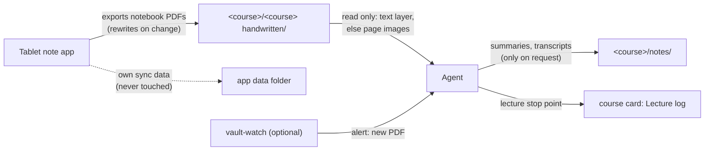

# Handwritten notes

A folder contract for handwritten work. A tablet note app exports each notebook as a PDF into a handwritten folder inside the matching course folder (by default `<course folder>/<course folder> handwritten/`, e.g. `AD/AD handwritten/`). Agents may read those PDFs for context, as page images when there is no text layer, and link them from course notes. They never write into those folders, never touch the app's own data folder, never open private folders, and never transcribe or check handwritten work on graded `solo` tasks. The module ships the rules (`_agent/handwritten-notes.md`) and a skill (`read-handwritten-notes`) with a small page-render helper.

## At a glance
| | |
|---|---|
| Tier | standard |
| Requires | `core`, `courses` |
| Recommends | `vault-watch` (alerts when new PDFs arrive) |
| Obsidian | optional (Obsidian opens the PDFs in its own viewer) |
| OS | any (the note app runs on your tablet) |
| Runtime | laptop, cloud sessions, VM: anything that can read the vault |
| Jobs | none |
| Roles | none (any session reads; nobody writes) |
| Skills | `read-handwritten-notes` |
| Cost | none (your note app may cost money) |

## Why it exists
In the original system the student wrote lecture notes and exercise drafts on an Android tablet. At first the PDFs lived in the app's own folder on the drive, far from the course material, so agents never saw them. Exporting each course's notebooks straight into that course's folder put handwritten notes next to the official sheets and the study pages: an agent asked "where did today's lecture stop?" or "is my attempt at 3.2 on the right track?" could open the actual notes.

Two dangers came with that, and the rules exist because of them:
- **The app's data folder is live.** It held the notebooks themselves (archives and image assets) and synced back to the tablet. Deleting or moving a file there deletes the notebook on the tablet. On an always-on host the folder was fully visible on the drive mount; a written rule was the only protection.
- **A private subfolder** of the app held personal documents that must never reach an agent.

And one technical problem: handwriting PDFs have no text layer. Text extraction and cloud drive connectors return empty text, so agents must render pages as images and read them visually.

## How it works

1. **Setup.** `uni-os init` creates one empty handwritten folder per course (no files are placed inside, because the folder belongs to the app); `uni-os render` adds the folder of a newly added course. The student points the app's export at those folders: some apps can auto-export or back up notebooks as PDFs to a cloud folder, others export one notebook at a time. The folder names include the course name on purpose: a folder picker on a tablet shows names without paths, and four folders all called `handwritten` are indistinguishable.
2. **Writing.** The student writes. The app rewrites a notebook's PDF in place whenever it changes; a new notebook's PDF appears after the next sync; a deleted notebook's PDF may disappear.
3. **Noticing.** With `vault-watch` on, new PDFs in handwritten folders show up in its source-files alerts, so a study agent can pick them up. Without it, the student says "I uploaded my notes".
4. **Reading.** The agent follows the `read-handwritten-notes` skill: find the file (by modification time, confirm if ambiguous), check the course's help policy (stop and ask if it may be `solo` work), try the text layer once, then render only the needed pages at about 75 dpi and read them. In Claude Code the Read tool opens a PDF page range directly as images; other agents use `scripts/render_pages.py` (PyMuPDF or poppler's `pdftoppm`), which writes PNGs to a temporary folder outside the vault and refuses to write next to the PDF.
5. **Keeping results.** Only when the student wants: a lecture stop point goes into the course card's Lecture log; a study note into `notes/`; a requested transcription into `notes/<slug>-<notebook>-transcript.md` with its source pages, `[unclear]` marks and "If this copy and the PDF ever differ, the PDF wins."

## What gets installed
| Path | What |
|---|---|
| `_agent/handwritten-notes.md` | The folder contract: one row per course with its handwritten folder, the app data and private folders from config, the rules, naming hints |
| `_agent/skills/read-handwritten-notes/SKILL.md` | The reading procedure |
| `_agent/skills/read-handwritten-notes/scripts/render_pages.py` | Page-render helper (copied verbatim, not templated) |
| `<folder>/<handwritten folder>/` | One empty folder per course, created by `uni-os init` (and by `uni-os render` for a newly added course) from the module's `[[folders]]` entry, with no README inside. The name is the derived `course.handwritten_dir`: `handwritten_folder`, or `<course folder> handwritten` when that is empty. Folders are never deleted, also not when the module is disabled |

The course card's "Official files" and "In this folder" sections and `courses-overview.md` mention the handwritten folder automatically when this module is enabled.

### `render_pages.py` behaviour (for porting or reuse)
- `python render_pages.py "<file.pdf>" [--pages 1-3,5] [--dpi 75] [--out <dir>]`
- Output: `page-<n>.png` in `--out` (default: a new temporary folder), one absolute path printed per line.
- Safety: never modifies the PDF; refuses an output folder inside the PDF's folder; DPI limited to 30-400.
- Backends: PyMuPDF (`page.get_pixmap(dpi=...)`), else `pdftoppm -png -r <dpi> -f <n> -l <n> -singlefile`.
- Exit codes: 0 ok (a warning if no page was in range), 1 bad arguments or unreadable PDF, 2 no backend installed.

## Configuration
| Key | Default | Purpose |
|---|---|---|
| `course.handwritten_folder` (per course) | `""` | Folder inside the course folder; `""` means `<course folder> handwritten`. Uni OS derives `course.handwritten_dir` from it (the name actually used); templates use that |
| `study.handwriting_app` | `""` | Name of the app, shown in the rules (e.g. "GoodNotes", "Notability", "Samsung Notes", "reMarkable") |
| `paths.handwriting_app_data` | `""` | The app's own sync/data folder, if it lives inside the vault: never touched, never read |
| `paths.handwriting_app_exports` | `""` | The app's own export folder, if it has one inside the vault: where notebooks land that are not mapped to a course, and the fallback when a course folder is missing. Read-only; agents look there when a file is missing from a course folder |
| `paths.never_open` (shared core key) | `["**/private/**"]` | Glob patterns agents never open, list or search; add the note app's private folder here (e.g. `"Notes App/PDF/private/**"`) |

Also read: `course.folder`, `course.short`, `course.assistance`, `course.assessments` (to know which work is `solo`).

**What the setup interview asks:** Do you write by hand on a tablet? Which app? Can it export PDFs automatically into a folder on your cloud drive, and does it keep its own data folder inside the vault area (which agents must never touch)? Does it have its own export folder for notebooks that belong to no course? Is there any folder with private documents agents must never open? Do you want the default folder names (`<course> handwritten`) or your own? `uni-os init` then creates the empty folders and the student points the app at them; the agent never connects the app or approves its permission screens. A folder renamed later: change `handwritten_folder`, run `uni-os render` (it creates the new folder; the old one stays), and move the PDFs by hand or let the app re-export.

If you use Obsidian, add the app data folder and the private paths to Obsidian's excluded files (Settings, Files and links, Excluded files; the setup agent can do it with you), so they stay out of search, graph and link suggestions. They still show in the file explorer: that setting does not hide them there. If you use `vault-watch`, put the app's export folder into `vault_watch.quiet_dirs` (app output: logged, not alerted); the handwritten folders are already quiet by name.

## Daily use
- "I uploaded my notes from today's LA lecture. Where did we stop?" The agent finds the newest PDF in the LA handwritten folder, reads the last pages, and writes the stop point into the Lecture log.
- "Look at my attempt at sheet 4, task 2: am I on the right track?" The agent checks the assistance level for that sheet first; with `hints-only` it reads the attempt and points at the first wrong line without writing the solution.
- "Transcribe my DM definitions notebook into a note." The agent renders the pages, transcribes into `notes/`, marks unclear parts and cites the pages.
- "What did I write about heaps last week?" The agent lists the AD handwritten folder by date and reads the matching notebook.

## Agents other than Claude Code
Nothing Claude-specific is required. In Claude Code the Read tool views PDF pages directly; agents without built-in PDF viewing run `render_pages.py` and read the PNGs with their image tool; agents without image input can't read handwriting and should say so. Cloud sessions can read the PDFs only if the vault is reachable from them. Uni OS has only been tested with Claude Code.

## Failure modes and fixes
| Symptom | Cause | Fix |
|---|---|---|
| Agent says the PDF is empty | Handwriting has no text layer | Read page images (skill step 4) |
| A notebook vanished from the tablet | Something deleted or moved a file in the app's data folder | Restore from the drive's trash or version history; put the folder in `paths.handwriting_app_data` so the rules name it |
| Agent's summary no longer matches the notes | The app rewrote the PDF after a change | Re-read; summaries are dated for this reason |
| Misread formula | Low resolution or ambiguous handwriting | Raise `--dpi` to 110-150 for those pages; mark `[unclear]` and ask |
| PDFs land in the app's own folder instead of the course folder | The app lost its target folder (renamed, trashed, permission) and fell back to its export folder | Re-pick the folders in the app (the student, on the tablet); check the folder names still match. Set `paths.handwriting_app_exports` so agents look there meanwhile |
| A README or transcript appeared inside a handwritten folder | An agent ignored the contract | Move it to `notes/`; the folders are app-only |
| A course has no handwritten folder | It was deleted (`uni-os render` never recreates a deleted folder), or the course was added without a render | `uni-os render` creates the folder of a new course; `uni-os init --vault <vault>` restores a deleted one; `uni-os doctor` lists missing folders |

## Lessons from the original system
- **Course-folder exports made handwritten notes useful.** Once notebook PDFs sat in each course folder, agents used them for lecture stop points and exercise checks; before that, nobody opened them.
- **The app's data folder needs a written "never touch" rule.** Deleting a file there deletes the notebook on the tablet, and on an always-on host the folder was visible on the drive mount. The rule in the agent files was the only protection; a watcher and the text index were also set to skip it.
- **Private means never opened.** One app subfolder held personal documents; the rule was absolute ("agents don't open it"), and the folder was excluded from Obsidian search, from the always-on host's text index and from its history snapshots.
- **Per-file app access protects the student's own files.** The app used per-file drive access, so it only saw files it had created; files the student put into the same folders by hand were safe from it.
- **Handwriting PDFs read empty.** The drive connector returned no text; rendering pages with PyMuPDF at 75 dpi worked. The same applied to a lecturer's handwritten slides, which OCR badly.
- **Integrity covers handwriting too.** The rule "never transcribe, summarise or store the student's handwritten work on graded solo problems" was written explicitly after the PDFs became visible to agents.
- **The app's permissions stay with the student.** Agents never connected the real app to the drive or tapped its consent screens; a separate development copy of the app wrote only to a sandbox folder, so no test could touch real notebooks.
- **Fallbacks need a known place.** When a picked course folder was trashed or no longer accessible, the app wrote PDFs to its own export folder and said so in its settings; agents that only looked in the course folder reported notes as "missing".
- **Folder names must be readable without paths.** The app matched picked folders to courses by whole-word name ("LA handwritten" -> LA); generic names would have been ambiguous in the picker.
- My own app for this, Quiet Notes, is not part of Uni OS; I may publish it separately later. Any app that exports PDFs into a folder works.

## Removing it
Disable the module (`uni-os disable handwritten-notes`). The rules file and the skill stop being referenced; the handwritten folders and their PDFs stay where they are (they belong to your app). Delete the folders yourself only after pointing the app elsewhere.
