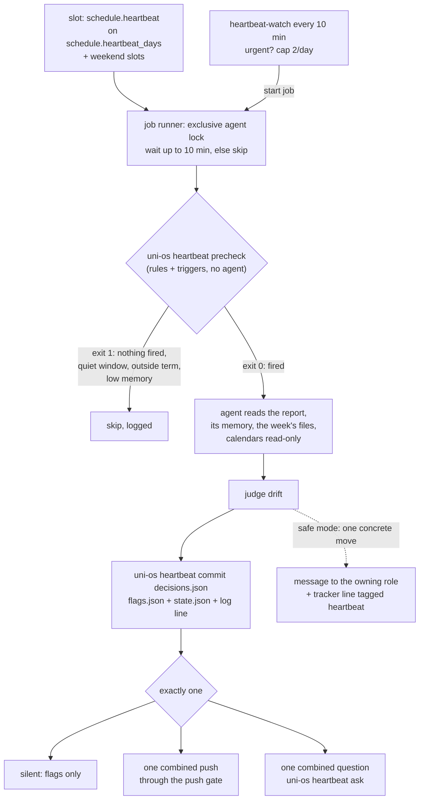

# Heartbeat (proactive watcher)

A standing brief instead of hand-made reminders. A few times a day a **deterministic pre-check** (`uni-os heartbeat precheck`, plain Python, about a second, no agent) reads the study system's files, applies a fixed rule set and decides whether anything happened since the last run. Only if something fired does an **agent** start: it reads the pre-check's report, its own memory and the week's files, judges drift (plan vs reality, results only you know, duties nobody triggers, gaps between sessions), and then does exactly one of three things: **stays silent** (writes flags for dashboards), **sends one combined push**, or **asks one combined question**. Silence is the normal outcome. You should not have to anticipate triggers or remember reminders: the heartbeat notices them.

## At a glance
| | |
|---|---|
| Tier | standard |
| Requires | core, notifications |
| Recommends | progress, daily-prep, check-in, planning, roles (each one gives it more to watch) |
| Obsidian | optional (dashboards can show `flags.json`; nothing needs Obsidian) |
| OS | any (Python 3.11+ standard library) |
| Runtime | laptop or VM; event wake-ups and question sessions need the always-on host (VM module) |
| Jobs | `heartbeat` (weekdays), `heartbeat-weekend`, `heartbeat-watch` (event wake-ups, no agent), `heartbeat-ask` (the question session) |
| Roles | none of its own; it acts only through the role that owns a file (usually Plan & progress) |
| Commands | `uni-os heartbeat precheck \| report \| watch \| commit \| state \| flags \| log \| tracker \| ask \| rerun \| outcomes` |
| Cost | the pre-check is free; an agent run happens only when something fired (the original estimated 17-22 runs a week, about 15 minutes of a mid-size model each, a small share of a subscription's usage). On a small VM one headless run peaked at about 300 MB of memory for about 4 minutes |

## Why it exists
Every other part of the system does one fixed task: the prep job writes tomorrow's note, the check-in job closes the week, the sync job applies inbox notes. In the original system nothing read the **whole** state and asked "is this still on track?". That left four gaps:
- **Plan vs reality was only noticed at the end of the week.** A missed study block or a slipping personal target surfaced at the weekly check-in, too late to re-plan.
- **Date-triggered duties had no trigger.** An audit of the role briefs found 16 promised duties (quiz-prep pages, summary-sheet pages, results nobody asked for, hand-offs after a review, exam-phase planning, ...) that no job and no user message ever started, because role sessions only act when someone speaks to them. That list became the heartbeat's first duty checklist.
- **Results only the student knows stayed unrecorded for days** (quiz scores sat in the student's head while the dashboard showed "took place; result not recorded"). Asking once a day for missing results turned out to be its most useful single duty.
- **Cross-session gaps were invisible:** a message between sessions that left no trace, a stale fact repeated in several files, two producers writing about one fact, a parked inbox note.

The cost problem was solved by putting a deterministic pre-check in front: the expensive agent only runs when the cheap check found something new.

## How it works

### 1. The pre-check: rules
The rule set is a port of the original's dashboard rules (the same thresholds and wording on the page and in the pushes), generalised so that every path, time and threshold comes from the config. Levels: **red** = needs action, **amber** = watch, **grey** = unknown (never shown as fine). Ids are stable across runs: the push gate dedupes on them, `flags.json` keeps "since" by them, snoozes name them. A `<slug>` or `<item>` part is the name in lower case with other characters turned into `-`, at most 50 characters (60 for file and session names); a longer one is cut and ends in `-` plus the first 6 hex digits of the name's SHA-1, so two long names that start alike never share an id (the host's `outcome-checks` and `inbox_poll.py` use the same rule). A rule whose module is not enabled, or whose input file does not exist, is skipped and listed under "can't see"; a rule that crashes on an odd file becomes a grey `rule-error:<rule>` finding instead of silencing the others.

| Rule (module) | Input | Finding |
|---|---|---|
| Current week page missing (progress) | `progress/weeks/week-NN.md`, NN = term week from `term.week0_monday`; only during the lecture period, not in holidays | red `week:missing:<file>` |
| Two week pages current (progress) | `status: current` in the week pages' front matter | amber `week:two-current` |
| Current page not current (progress) | its `status` | amber `week:status:<file>` |
| Next week's page missing (check-in) | after the `schedule.week_page` slot + 2 x grace | amber `week:next-missing:<file>` |
| Check-in still empty (check-in) | the week page's `## ...check-in` section, `heartbeat.checkin_grace_hours` after the `schedule.check_in` slot (weekly check-ins) | amber `week:checkin-empty:<file>` |
| Due items (progress) | the week page's `## Due this week` table (`Item \| Official deadline \| Personal target \| Bonus \| Status`); done = status starts with a score `x/y` or a word in `heartbeat.done_words`; a date without a year is the one within half a year of today ("5 Jan" in December is next January, "28 Dec" in January last December) | red `due:<item>:overdue`; amber `due:<item>:behind` (personal target passed); "due within 48 h" noted |
| Results not recorded (progress, notify) | due rows that are events (`heartbeat.event_words`: quiz, timed, oral, ...) past their time; dated quiet windows (graded fixtures) that ended within `heartbeat.result_window_days` | candidates `due:<item>:result`, `result:<fixture>` for the one question (never "overdue") |
| Prep notes (daily-prep) | `semester/prep/prep-YYYY-MM-DD[-rN].md` (highest revision wins), `_agent/daily-prep/state.json` | red `prep:today-missing:<date>` after `schedule.prep_check` + grace + 10 min; amber `prep:today-unverified:<date>` after the check + grace; tomorrow: amber after the first `schedule.daily_prep` slot + grace, red after the last slot + grace; amber `prep:gap:<date>` |
| Inbox notes stuck (inbox-sync) | `*-update.md` files in the inbox at least `notify.inbox_stale_hours` old (Done-tap notes: `notify.inbox_stale_hours_taps`); the one threshold every sender uses | amber `inbox:stuck:<slug of the file name>` |
| Job failure flags (any) | `_agent/logs/flags/<job>.md` written by a job that ended without its full result | red (or the file's level) `job:<job>:failed` |
| Job runs (scheduler-local, vm) | the job runners' log (`heartbeat.jobs_log`, default `<state>/jobs.log`) lines `YYYY-MM-DD HH:MM \| <job> \| exit N \| ...`; the host snapshot's `jobs[]` with the job's `SLOTS`/`DAYS`/`DATES` from its `job.conf` | red `job:<job>:failed`, `job:<job>:missed` (slot + grace passed, no run), `job:<job>:did-not-fire` |
| Host (vm) | the host snapshot (`heartbeat.snapshot_file`): age, `mount_ok`, `remote_control_ok`, login, memory, job sessions, role sessions, alerts; `_agent/vm/status.md`; the daily rows of `_agent/vm/performance.md` | red `host:snapshot-stale` (older than `snapshot_stale_min`), `host:<part>`, `host:memory` (< 500 MB; amber < 700), `host:status-overall`, `host:part:<part>` (a part of the status file's table DOWN or LOGGED OUT), `host:oom:<day>` (an OOM kill in the last 3 days), `role:<role>:down`; amber `role:<role>:off`, `session:<name>:not-closed`, `host:status-old` (its "checked" time over 26 h ago); a status file not written yet is "can't see"; "laptop not seen by the host" is "can't see" only while a job runs in failover mode (in mode `always` there is no laptop ping by design) |
| Bonus pace (progress) | course cards' `bonus_banked: "x / y"` and `bonus_target: "NN %..."` | red below the bar - 5 points, amber within 5 points: `bonus:<course>:pace` |
| Vault watch (vault-watch) | `_agent/vault-watch/alerts.md`, last 24 h; `_agent/vault-watch/log.md` against `schedule.vault_watch` | amber conflict copies, amber/grey deletions: `watch:alert:<hash>`; amber `watch:missed-run` (no log line since its last slot + grace: expected if the laptop was off) |

Some findings are marked **outcome checks** (prep note missing, inbox note stuck): they are safe to push without judgment, so exactly **one deterministic sender** pushes them, with these ids and texts word for word. The report's line "Outcome sender:" names it: `host` (the vm module is on: the always-on host's `outcome-checks` job, or the built-in check in `uni-vm health`), `job` (the notifications module's `outcome-checks` job on a laptop that runs command jobs, `runtime.laptop_scheduler = "os"`), or `heartbeat` (neither can run, so this job pushes them itself). With `host` or `job` the heartbeat only flags them. The full precedence is in the notifications module, "One sender per problem".

### 2. The pre-check: triggers and the gate
The pre-check exits 0 ("run the agent") when, since the last committed run:
- it is the **first run**;
- an **input changed**: a short hash of each of current status, week page, week plan, today's and tomorrow's prep note, tracker log, duty checklist, requests, block log (optional), inbox listing, course-card bonus fields, the rule verdicts and the outcome-check keys (the hashes are recomputed right after each commit, so the run's own writes don't re-fire it);
- a **due item crossed 24 h or 6 h** before its deadline;
- a **study block ended** (from the prep note's callouts `> [!course] HH:MM-HH:MM title`, else the week plan; blocks starting with `heartbeat.non_study_block_prefixes` such as lectures, exercise classes, optional personal blocks are not study blocks);
- a **new outcome-check problem** or a **new red finding** that is not flagged yet and not snoozed;
- a new vault-watch conflict or deletion; or an **event** started by `heartbeat-watch` in the last 30 minutes; or `--force`.

It exits 1 ("skip") inside a quiet window (`notify.quiet_windows`), outside the term (more than a week before week 0, or after the exam session), when the host has less than `heartbeat.min_memory_mb` free (Linux only), or when nothing fired. Every decision is logged to `precheck.log` in the heartbeat state folder.

The pre-check **fails open**. Both job runners read every non-zero `PRECHECK` exit as "skip", so a pre-check that can't judge (an invalid config, an unreadable file, a bug) must not end with an error code: it prints `run: pre-check error: <message>`, logs it to `precheck.log`, writes the failure flag `_agent/logs/flags/heartbeat.md` (front matter `job`, `at`, `level: red`; the first body line names the error; `heartbeat-weekend.md` when the runner exports `UNI_JOB=heartbeat-weekend`) and exits 0. The agent runs, the next pre-check shows the flag as `job:heartbeat:failed`, and a run that commits deletes it. A dry run writes no flag. Only `uni-os heartbeat precheck --report` and the other subcommands still exit 2 on an error.

### 3. The agent run (the standing brief)
The brief (`_agent/jobs/heartbeat/prompt.md`) tells the agent to read `uni-os heartbeat report`, its memory, the week's files, the calendars (read-only) and the duty checklist; to judge drift; and to finish with `uni-os heartbeat commit <decisions.json>` plus at most one push or one question. Its key rules, kept from the original word for word where possible:
- "Something you already flagged and that is unchanged is not news. Re-push an unresolved red item only after 24 h; never re-push a snoozed one. **Grey means unknown, never fine.**"
- "Rule findings keep the report's id and level. If you judge one stale, say so with evidence; the cure is a message to the session that owns the file. **Never fix the file yourself.**"
- "Asking once a day for missing results is your most useful single duty." "**Silence is the normal outcome.**"
- A Never list: official course files, writing results or bonus numbers, the shared rule documents, job and host configuration, course sites beyond read-only, mail, its own calendar edits, graded solo work and graded fixtures, "all good" pushes, personal matters, personal details in a push.

**Acting modes** (`heartbeat.act_mode`): **safe** (the default) allows only messages to the owning role asking for one concrete move, re-running an allowed job (`heartbeat.rerun_allowed`, e.g. the prep morning check after a plan change) and the one question; everything else is a flag, and every intervention gets one tracker-log line tagged "heartbeat" (`uni-os heartbeat tracker`) so a later evaluation can separate its effect. **full** additionally lets it act and report, but only after you switch it explicitly, typically after a few weeks of safe mode and an evaluation. Inside a `heartbeat.safe_windows` period (for example a plan freeze) it is always safe.

**The question** (`uni-os heartbeat ask --ids ... --text ...`) is checked against the push gate now and 15 minutes later (so no question session opens at the start of a quiz window). Every question uses the gate id `heartbeat-ask`, so the gate's dedupe makes "at most one question a day" a hard rule. Two ask modes (`heartbeat.ask_mode`, default `auto`):
- **session** (on the always-on host, or with an explicit `heartbeat.start_job_command`): the question is queued and the job `heartbeat-ask` opens an interactive session; the runner pushes its link through the gate (`NOTIFY_GATE="heartbeat-ask"`). You answer there; the session passes your answer verbatim to the role that records results and never writes results itself. If the job can't be started, the question falls back to inline.
- **inline** (laptop-only setups): the question itself is the push ("One question: LA quiz 4 score? Tell any session."); you answer by telling any session, which routes it to the role that records results.

The report's first lines say which mode applies, so the agent words the question for it.

### 4. Memory and output
`_agent/heartbeat/` in the vault: `flags.json` (what it flags now; dashboards show it as "needs attention"), `state.json` (its memory), `heartbeat-log.md` (one line per run), `requests.md` ("stop telling me about X"), `duties.md` (the duty checklist). The two JSON files are rewritten **in place** (no temp file and rename), so a synced file keeps its id for dashboards that read files by id. Machine state that must not sync (event markers, the pending question, the pre-check log, outcome-check first-seen times) lives in the heartbeat state folder outside the vault: `~/.local/state/uni-os/heartbeat/` on Linux/macOS, `%LOCALAPPDATA%\uni-os\heartbeat\` on Windows. Formats: see `_agent/heartbeat/README.md` (installed).

## What gets installed
| Path | What |
|---|---|
| `_agent/heartbeat/README.md` | the folder's format contract (flags, state, log, requests, job flags) |
| `_agent/heartbeat/flags.json`, `state.json` | placeholders until the first committed run (`"status": "not-switched-on"`) |
| `_agent/heartbeat/heartbeat-log.md`, `requests.md` | append-only logs with their format line |
| `_agent/heartbeat/duties.md` | the duty checklist, pre-filled from your enabled modules |
| `_agent/jobs/heartbeat/` | `job.conf` (weekday slots, a `PRECHECK` that runs `uni-os heartbeat precheck`, exclusive agent lock, 15 min, headless) and `prompt.md` (the standing brief) |
| `_agent/jobs/heartbeat-weekend/` | the weekend slots; its prompt points to the same brief |
| `_agent/jobs/heartbeat-watch/` | event wake-ups (command, every 10 min, VM) |
| `_agent/jobs/heartbeat-ask/` | the question session (interactive, never on a timer, VM) |

The scheduled heartbeat jobs are installed switched off (`DEFAULT_MODE="off"`); see "Switching it on". The question job has no timer at all: it only runs when `uni-os heartbeat ask` starts it.

## Configuration
Times are local (`term.timezone`); days are `Mon`..`Sun`. The setup interview asks the first group; the rest are tuning knobs with the original's values.

| Key | Default | Interview question / meaning |
|---|---|---|
| `schedule.heartbeat` | `["07:50", "13:05", "18:05"]` | "When should the watcher look on weekdays?" (the original: after the morning prep check, before the midday jobs, after the end of the study day) |
| `schedule.heartbeat_days` | `["Mon".."Fri"]` | "On which days?" |
| `schedule.heartbeat_weekend` | `["09:00", "17:40"]` | "And at the weekend?" (empty = never) |
| `schedule.heartbeat_weekend_days` | `["Sun"]` | the original skipped Saturday because the weekly check-in covered it |
| `heartbeat.act_mode` | `"safe"` | "May it only ask the owning role for moves (safe), or act itself (full)?" Start with safe |
| `heartbeat.safe_windows` | `[]` | periods that force safe mode, `{from, to, reason}` (e.g. a plan freeze) |
| `heartbeat.ask_mode` | `"auto"` | session (a question session on the always-on host), inline (the question is the push) or auto (session on the always-on host, else inline) |
| `heartbeat.start_job_command` | `""` | how this host starts a job now, with `{job}` for the job id. Empty = the job runner's `UNI_JOB_START` (the laptop runner exports it), else on the always-on host (`UNI_HOST=vm`) `systemctl --user start --no-block uni-job@{job}.service`; with none of these: no event wake-ups, no re-runs, inline questions. The started job is detached and waits for the agent lock |
| `heartbeat.event_hours` | `"07:30-20:45"` | when event wake-ups may start a run |
| `heartbeat.event_cap` | `2` | extra event runs per day |
| `heartbeat.event_near_slot_min` | `45` | no event run when the next slot is this close |
| `heartbeat.event_min_gap_min` | `30` | no event run this soon after the last run |
| `heartbeat.min_memory_mb` | `600` | skip when the host has less free memory (Linux) |
| `heartbeat.grace_min` | `20` | grace after a job's slot before its result counts as missing |
| `heartbeat.inbox_stuck_hours` / `inbox_tap_stuck_hours` | `0` / `0` | aliases kept for old configs: 0 = use the one threshold `notify.inbox_stale_hours` / `notify.inbox_stale_hours_taps` (4 / 14 h, module inbox-sync); a non-zero value still overrides it for the heartbeat rules, which would make the senders disagree, so leave them at 0 |
| `heartbeat.checkin_grace_hours` | `16` | hours after the check-in slot before an empty check-in is flagged |
| `heartbeat.gap_open_hours` | `24` | a prep gap older than this becomes an outcome push |
| `heartbeat.result_window_days` | `7` | how long after a graded fixture a missing result stays a question candidate |
| `heartbeat.snapshot_file` | `"_agent/vm/snapshot.json"` | the host's machine-readable status (VM module) |
| `heartbeat.snapshot_stale_min` | `40` | the host snapshot is written every 15 min; older than this = red |
| `heartbeat.jobs_log` | `"{state}/jobs.log"` | the job runners' run log; `{state}` = the uni-os state folder outside the vault (both the laptop scheduler and the VM runner write it there) |
| `heartbeat.flags_dir` | `"_agent/logs/flags"` | where jobs write failure flags |
| `heartbeat.block_log_glob` | `""` | optional study-block log tables (e.g. from an experiment), to annotate ended blocks |
| `heartbeat.non_study_block_prefixes` | `["L:", "E:", "V:", "U:", "OP", "("]` | block titles that are not study blocks (lectures, exercise classes, optional personal blocks); match your block notation |
| `heartbeat.done_words` | `["✓", "done", "submitted", "closed", "handed in", "uploaded", "dropped", "skipped"]` | status words that close a due row (a score `x/y` always does); the done-status vocabulary of module progress, the same list as `cockpit.done_words` |
| `heartbeat.event_words` | `["quiz", "timed", "oral", "exam", "midterm", "tutorial", "rehearsal", "test"]` | due rows that are events: past their time they are "result not recorded", never "overdue" |
| `heartbeat.on_demand_roles` | `["course-files-fetch"]` | role sessions that are normally off (not flagged) |
| `heartbeat.rerun_allowed` | `["study-prep-morning-check"]` | jobs the heartbeat may re-run |
| `heartbeat.outcome_prefix` | `"Outcome check: "` | text before outcome-check pushes |

It also reads, from other modules: `term.*` (week 0, last lecture day, exam session, holidays), `schedule.daily_prep`, `schedule.prep_check`, `schedule.week_page`, `schedule.check_in`, `schedule.vault_watch`, `notify.quiet_windows`, `notify.inbox_stale_hours`, `notify.inbox_stale_hours_taps`, `runtime.laptop_scheduler` (who sends outcome pushes), `[[courses]]` (folders, slugs, assistance), `paths.agent_dir`, `paths.inbox`, `calendar.*`.

## Switching it on (a release pattern worth copying)
New recurring jobs that act on their own need your explicit yes. The original treated the heartbeat as a release, not a toggle, and the pattern is worth reusing for any job that can push or message:
1. **Stage.** Install it switched off (the default). The job files are there; no timer can fire.
2. **Dry runs at representative times.** For example a weekday morning and a Sunday evening:
   `UNI_DRY_RUN=1 UNI_OS_NOW="2026-11-15 17:40" uni-os heartbeat precheck` records the real gate decision; then run the job once as a dry run with `--force` semantics (your host's "run this job now as a dry run"; In Claude Code on a laptop: run the prompt in a session with "DRY RUN" in front). Dry runs write only to the dry-run folder, push nothing (the gate prints "would send") and message nobody (the agent logs "WOULD message ..."). Read the outputs: the flags it would show, the push it would send, the question it would ask, how long it took, how much memory it used.
3. **Review.** You (or your coordinator session) read the brief, `job.conf` and the dry-run outputs and decide.
4. **Guard.** Shortly before the agreed switch-on time, one more dry run is judged automatically. It fails, and the switch-on is held, if: the runner's exit was not 0; the run's log does not end with exit 0; the pre-check printed a Python traceback; there is no valid `flags.json` (schema 1, every flag with an id, a level red/amber/grey and a one-line text of at most 300 characters) or no log line from the run's commit; or the gate refused a push (look for "would not send (exit 13)" in `UNI_OS_PUSH_DRY_LOG`). On failure: keep the timers off and send yourself one line; either way write a short summary into the vault.
5. **Switch on at an agreed time,** right after a slot rather than just before one (a one-off timer, or by hand). Optionally `uni-os heartbeat state --ask-test`: the first run that may ask makes one test question so the question path is proven once.
6. **Rollback** is one step: switch the jobs off again. Nothing else changes.
7. **Evaluate** after a few weeks in safe mode (the tracker lines tagged "heartbeat" show what it did) before considering full mode.

## How to tune it, and how to silence it
- **Too chatty:** lower `notify.max_per_day`, raise `notify.min_gap_hours`; check `heartbeat-log.md` for what fires most; snooze recurring non-issues.
- **Fires too often for nothing:** inputs that change constantly (a tracker log written every hour) make it run often but stay silent; that costs agent time, not attention. Remove slots or raise `heartbeat.grace_min`.
- **Misses things:** add rows to `_agent/heartbeat/duties.md`; make jobs write failure flags (`_agent/logs/flags/<job>.md`); set `heartbeat.block_log_glob` if you log study blocks.
- **Silence one thing:** tell any session "stop telling me about X until Friday". It appends a line to `_agent/heartbeat/requests.md`; a line naming the flag id (or a prefix like `` `prep:gap:*` ``) works at the next pre-check, free text at the next agent run. `resume` lifts it.
- **Silence a period:** add a quiet window (`notify.quiet_windows`); the heartbeat skips runs inside it and no push goes out (held pushes are not queued: what is still true is raised after the window).
- **Silence it completely:** switch the jobs off (your host's job switch, or remove the laptop scheduled task). The outcome checks have their own off switch (`outcomes-off` file in the heartbeat state folder).

## Daily use
You mostly notice it when it is quiet. Things you might say:
- "What is the heartbeat flagging right now?" (the agent runs `uni-os heartbeat flags`)
- "Why did the heartbeat run at 13:05?" (`uni-os heartbeat state`, the pre-check log, `heartbeat-log.md`)
- "Stop telling me about the LA reading pages until next Monday."
- "I got 3.5/4 on the AD quiz." (answering its question, or telling any session: the role that records results writes it)
- "Run the heartbeat now as a dry run and show me what it would do."
- "Add a duty: summary sheet for DM by the last lecture."

## Agents other than Claude Code
Only tested with Claude Code. The deterministic part (`uni-os heartbeat ...`) is plain Python and agent-neutral. A job runner (laptop scheduler path 2, or the always-on host) runs the `PRECHECK` before starting any agent; an agent app's own scheduled task (Claude Code desktop "Scheduled" tasks, header session type `app`) has no pre-check, so the brief itself runs `uni-os heartbeat precheck` first and stops on `skip:` (that run then costs a short agent start, not a full read). The agent part needs: a headless run of the brief (Claude Code `claude -p`; Codex `codex exec`; Gemini CLI `gemini -p`; or the agent app's scheduled tasks), calendar read access through the agent's connector (optional), and a way to message other sessions. In Claude Code the brief uses SendMessage/ListAgents (loaded with ToolSearch) to reach role sessions by title, and Remote Control sessions for the question; other agents use the fallbacks the brief names: an update note in the inbox for the owning role, and the inline ask mode (the question is the push). Event wake-ups need a host that can start a job on demand (`heartbeat.start_job_command`).

## Failure modes and fixes
| Symptom | Cause | Fix |
|---|---|---|
| It never runs the agent | nothing fired, or every slot is in a quiet window, or outside the term | `uni-os heartbeat precheck --json` shows why; the pre-check log lists every decision |
| It runs the agent every slot but stays silent | an input changes all the time | fine but costly: see "How to tune it" |
| Red week page missing every Monday | the week-page job runs after the first heartbeat slot, or `term.week0_monday` is wrong | move the first slot later, or check `uni-os week` |
| False "missed" job slots | a job's `SLOTS` in `job.conf` differ from the host's timers | regenerate the jobs from the config (one source of truth for every schedule) |
| `job:heartbeat:failed` stays on the dashboards | a run could not commit (the report failed, or commit refused its file twice) and wrote its own failure flag `_agent/logs/flags/heartbeat.md` | read the flag and the job log; the next run that commits deletes the flag |
| The pre-check printed `run: pre-check error: ...` and the agent ran anyway | the pre-check hit an internal error (most often `_agent/uni-os.toml` is not valid TOML after a hand edit, or a file it reads is unreadable) and failed open on purpose, so a broken pre-check never silently skips every run; it also wrote `_agent/logs/flags/heartbeat.md` (red) | read the message (also in `precheck.log`); fix the config with `uni-os config validate` or the file; the next run that commits deletes the flag |
| An outcome problem (stuck inbox note, missing prep note) reaches the phone twice | two machines both push it (the gate dedupes per machine) | the report's "Outcome sender:" names the one sender; see the notifications module, "One sender per problem" |
| "Laptop not seen by the host" under can't see | a job is in failover mode and the laptop's ping task isn't reaching the host | start the laptop ping (module vm, laptop helpers), or put the job back in mode `always`; without failover jobs the note doesn't appear |
| The report shows `rule-error:<rule>` (grey) | an input file has an unexpected format, or a config value is invalid (e.g. `"31:99"`) | fix the file or value; the other rules keep working |
| Commit refused | invalid decisions JSON (bad id, level, multi-line text, no log line) | the brief tells the agent to fix and retry twice, then log the refusal |
| Questions never open a session | not on the always-on host, or the heartbeat-ask job is off on it | expected on a laptop (questions go inline); on the host check `uni-vm jobs` and `uni-os heartbeat state` (ask mode) |
| The job is always "skipped (precheck)" on a laptop | the `PRECHECK` can't find the framework (exit 127 counts as a skip) | the runner must export `UNI_OS_HOME` (and `UNI_PYTHON`); test with `uni-os heartbeat precheck` in the vault |
| The agent runs every slot from the desktop app and then stops at once | an app scheduled task has no `PRECHECK`; the brief runs the pre-check itself | expected; for fewer agent starts use a job runner (scheduler-local path 2 or the VM) |
| Two hosts both run it | a job switched on on the laptop and the VM | only one machine may run the heartbeat (its machine state and the push budget live on one machine); switch over back to back, never around a slot |
| A dry run changed something | the agent changed it with something that doesn't read `UNI_DRY_RUN` (a file edit, a message, another command) | only `uni-os heartbeat` and `uni-os push` honour `UNI_DRY_RUN`; for everything else the dry run is an instruction: the brief forbids file changes and messages in dry runs, so tighten the brief and repeat the dry run |

## Lessons from the original system
In the original, the heartbeat was designed from an audit and a written proposal, built "staged", dry-run at two representative times, reviewed, and scheduled to go live with a guard dry run the evening before; these lessons come from that design, build and the dry runs:
- **Name things distinctly.** The original ended up with three different "heartbeats": this watcher, a laptop "I'm awake" ping to the VM, and a dashboard's "host heartbeat" (the age of a status file). Its docs had to carry a disambiguation table. In this framework, "heartbeat" means only the watcher; the others are the laptop ping and the host snapshot age (VM module).
- **One rule set, not two.** The dashboard's rules (JavaScript) were ported to the pre-check (Python) with the same thresholds and wording so the page and the pushes would never disagree, and every rule change had to be made twice. Here the Python rules are the single source; dashboards should read `flags.json` and the report's JSON instead of re-implementing rules.
- **The pre-check is the cost saver.** "Nothing due within 48 h" is not a useful skip during a semester; "nothing changed since the last run" is. Hashing the inputs (and re-hashing right after each commit, so the run's own writes don't re-fire it) made most slots free.
- **Dry runs are instructions, not a sandbox.** A dry-run agent is told not to change anything; only helpers that honour `UNI_DRY_RUN` actually guarantee it. Every `uni-os heartbeat` subcommand and `uni-os push` do (they write only to the dry-run folder and send or start nothing), and the brief turns messages into "WOULD message" log lines.
- **No question session at a quiz's start.** The ask path checks the gate now and 15 minutes later, because a question session that opens just as a timed quiz starts is worse than no question.
- **Write machine files in place.** The dashboard read the flags file by its Drive file id; a temp-file-and-rename would have created a new file id every run and broken the dashboard.
- **Don't push what the host already pushed.** Host and job failures go out as direct alerts from the host; the heartbeat only flags them.
- **During a plan freeze, act only through the planner.** The original ran its first weeks in "freeze-safe" mode: the only allowed moves were the freeze's own moves, requested from the planning role, each logged with a tagged tracker line for the evaluation at the end of the freeze. That became the generic safe mode and `heartbeat.safe_windows`.
- **Not everything missing is drift.** During an experiment the student logged study blocks on a separate page the heartbeat could not read; a block with no row in the vault's log was explicitly "not drift and not a flag". Make sure the brief knows which signals live elsewhere.
- **A one-time live test of the question path.** The first eligible live run had to ask one question (a marker file that a real ask removes), so the riskiest path was proven once under supervision.
- **Probe a capability before relying on it.** Before the first dry run the builder checked, read-only, that a headless run on the host could load the calendar tools, list the calendars and events, and see the role sessions it would message. No API key or private calendar address was needed, and none was put on the host.
- **The model will "fix" a rule's level if you let it.** In the first dry run the agent saw a week-page row marked open while the tracker log said "uploaded", and downgraded the red "overdue" itself. The brief now says rule findings keep the report's id and level; staleness is stated in the flag text, and the cure is a message to the role that owns the row. In the second dry run it asked the planner to refresh the stale rows instead.
- **Simulated runs produce simulation artifacts.** A Sunday-evening run simulated on a Thursday's vault showed 14 reds, most of them artifacts (an old host snapshot, "missed" jobs, no Sunday prep note); the model said so in its flag texts and pushed nothing. Do one dry run at a real slot as well.
- **One recursive search on a synced drive hung a run for two minutes.** The brief forbids recursive scans and names the paths to open (or an indexed search on the host).
- **Calendar-only changes can't wake the pre-check.** Without calendar credentials on the host (deliberately none), a moved block is seen only at the next slot, by the agent through its connector, or through the prep note's own change.
- **Nits from the dry runs** that shaped the brief: a tracker line read "(heartbeat): heartbeat: ..." (the helper adds the tag), a question also asked about a non-result (questions are only for missing results), decision files piled up in the state folder (write them to the temp folder).
- **Status at the time of writing:** the original heartbeat had been built, dry-run twice, reviewed and approved, with its first live week still ahead. Treat its thresholds as tested starting points, not as long-run tuned values.
- **Every promised duty needs a trigger.** Role sessions only act when spoken to; only jobs act on their own. The duty checklist is the safety net, not the solution: when a duty keeps showing up, give it a job.

## Removing it
`uni-os disable heartbeat` (never deletes files): its jobs are removed from routing and should be switched off on every host. Optionally delete `_agent/heartbeat/` from the vault and the heartbeat state folder. The notifications module and its outcome checks keep working without it (they use the same rule set through `uni-os heartbeat outcomes`).
