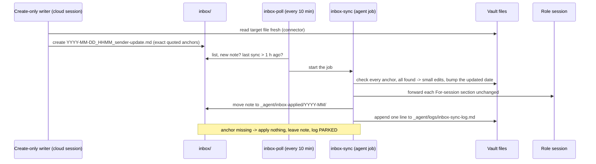

# Inbox sync (update notes for create-only writers)

Some agents can **create** files in your vault but cannot **change** an existing one: cloud agent sessions that reach a Google Drive vault through the Drive connector, a chat project with a storage connector, or a dashboard button that writes a file. This module gives them a safe way to change the vault anyway. They drop an **update note** into the vault's `inbox/` that names each target file and quotes, exactly, the current lines it wants to change. One trusted job, `inbox-sync`, applies the notes with an optimistic-concurrency check (the quoted line must still be there, character for character), parks notes whose anchors no longer match, forwards `## For <session>` sections to sessions the writer can't message, moves applied notes to an archive and logs every run. A tiny command job, `inbox-poll`, starts the sync within minutes of a new note instead of hours.

**It is a fallback, needed only if you have create-only writers.** If all your sessions run on the laptop or an always-on host, they edit the vault directly and you don't need this module.

## At a glance
| | |
|---|---|
| Tier | advanced |
| Requires | core |
| Recommends | roles (for `## For <session>` forwarding), scheduler-local or vm (to run the jobs), notifications (its outcome checks push the stuck-note alert) |
| Obsidian | irrelevant |
| OS | any (the poll script is Python 3.11+, stdlib only) |
| Runtime | the jobs run on the laptop or an always-on host; the writers are in the cloud |
| Jobs | `inbox-sync` (agent, fixed slots, skipped when no note waits), `inbox-poll` (command, every 10 min) |
| Roles | none |
| Cost | one short agent run per batch of notes (a mid-size model is enough); the poll costs nothing |

## Why it exists
The original system's course roles moved to cloud sessions so they would work with the laptop off. Cloud sessions read the vault through the Google Drive connector, and that connector **can create files and edit metadata but cannot change an existing file's content** (checked; this one fact is the root of the whole protocol). Yet those roles constantly needed to change existing files: a new row in an error log, a line in a course card's lecture log, a result in the progress page. At the same time the vault was being edited directly by laptop sessions, the always-on host and the student in Obsidian, so a cloud session's copy of a file was often older than the vault.

The answer was a create-only write-ahead log: the writer reads the file fresh and writes an intent document with exact anchors; one applier applies it only if the anchors still match ("the vault wins"), parks it otherwise, and archives everything. The same bus carried messages: cloud sessions can't message laptop or host sessions, so a `## For Plan & progress` section in a note was forwarded by the applier. Later the Obsidian cockpit's "Done" buttons used the same inbox with rule-based notes.

## How it works

1. **Writer** (cloud session): reads the target file through the connector, then creates `inbox/YYYY-MM-DD_HHMM_<sender>-update.md` (local time) with one `## <path>` section per target file, numbered instructions (append row, append bullet, replace line, insert after line), every replaced line quoted exactly, optional `## For <session title>` sections and a `## Not changed` section. One note per turn. New files (study pages) are created directly, not through notes.
2. **Poll** (`inbox-poll`, a Python script, no agent): every 10 minutes inside the poll window it lists the inbox. If a note waits that it hasn't seen, and the last sync (fixed or poll-started) is more than an hour old, it records the list as seen and starts `inbox-sync`. Done taps never start a sync on their own. It also prints an `OUTCOME inbox:stuck:<slug of the file name>` line into its run log for every note at least `notify.inbox_stale_hours` old (4 h; Done taps `notify.inbox_stale_hours_taps`, 14 h). The slug is the file name in lower case with other characters turned into `-`, at most 60 characters; a longer one is cut to 53 and ends in `-` plus the first 6 hex digits of the file name's SHA-1, so two long names that start alike get two ids (the heartbeat rules and the host's `outcome-checks` use the same rule). The phone alert for such a note has exactly one sender: with the vm module the always-on host, else the notifications module's `outcome-checks` job (or, where no command job can run, the heartbeat). They all use the same id and the same text, without the file name. The poll's own `--push` is only for a setup with neither the vm nor the notifications module: whenever one of them is enabled, it stands down and prints why (precedence: notifications module, "One sender per problem").
3. **Applier** (`inbox-sync`, an agent job): its `PRECHECK` skips the agent entirely unless an `*-update.md` waits (or the inbox can't be listed, or an earlier run left its failure flag `_agent/logs/flags/inbox-sync.md`, which the next successful run deletes). It reads the rules, takes the notes oldest first, and for each: already applied? ordering hint satisfied? **every anchor found exactly?** Only then it applies with small edits, forwards `## For` sections, moves the note to `_agent/inbox-applied/YYYY-MM/` and logs. Anything unclear, contradicting the vault, or forbidden by the integrity rules is refused and left in place.
4. **Fixed runs** at the configured slots are the safety net for everything the poll missed (parked notes are retried there).

Vocabulary in the log: `PARKED` (anchor not found or waiting for an earlier note), `WAITING` (could not forward a `## For` section), `REFUSED` (unclear, contradicts the vault, or forbidden content), `ALREADY APPLIED`, `LEFT` (a Google-converted stub that can't be read).

## What gets installed
| Path | What it is |
|---|---|
| `_agent/inbox-sync/README.md` | the protocol: when to write a note, file name, storage specifics, the exact format, Done-tap notes (if cockpit), the applier rules, log format, timing |
| `_agent/inbox-sync/note-template.md` | a blank update note |
| `_agent/inbox-sync/cloud-session-instructions.md` | the standing instructions for create-only sessions, ready to copy into a cloud workspace repo (`AGENTS.md` + `.claude/settings.json` with accept-edits) or a chat project's instructions |
| `_agent/logs/inbox-sync-log.md` | the run log (append only) |
| `_agent/inbox-applied/README.md` | the archive of applied notes, by month |
| `_agent/jobs/inbox-sync/job.conf`, `prompt.md` | the applier job |
| `_agent/jobs/inbox-poll/job.conf` | the poll job |
| framework: `modules/inbox-sync/scripts/inbox_poll.py` | the poll (`poll`, `check`, `stale` subcommands); tests in `modules/inbox-sync/tests/` |

## Configuration
| Key | Default | Meaning |
|---|---|---|
| `schedule.inbox_sync` | `["07:15", "13:15", "18:15"]` | fixed runs of the applier (local time). The original's values; pick times that suit you |
| `schedule.inbox_poll_window` | `"07:00-22:00"` | the poll starts syncs only inside this window (`"always"` for all day) |
| `schedule.inbox_poll_every_min` | `10` | how often the poll looks |
| `schedule.inbox_poll_min_gap_min` | `60` | at most one sync per this many minutes, fixed runs included |
| `notify.inbox_stale_hours` | `4` | a note waiting at least this long counts as stuck. The one threshold for every sender: the poll's `OUTCOME` line, the heartbeat rules and `uni-os heartbeat outcomes`, the always-on host's own check. The old keys `heartbeat.inbox_stuck_hours` and `vm.inbox_stuck_h` are aliases that default to 0 = "use this key" |
| `notify.inbox_stale_hours_taps` | `14` | the same for Done taps, which wait for fixed runs by design (aliases `heartbeat.inbox_tap_stuck_hours`, `vm.tap_stuck_h`) |
| `agent.default_model` | `""` | model of the applier (empty = the agent's default); a mid-size model at high effort was enough |
| `paths.inbox` | `"inbox"` | the drop folder |

Host environment for the poll (set by the job runner; see `job.conf`): `UNI_OS_HOME` (framework clone), `UNI_PYTHON`, `UNI_JOB_START` (how to start a job, `{job}` = id; the always-on host's default is its systemd job unit, the laptop runner `run_job.py` sets itself), `UNI_STATE_DIR` (host-side state and run logs: the poll reads `<state>/jobs/inbox-sync/*.log` to see when the last sync ran), `UNI_PUSH_CMD` (push command, only for `poll --push` in a setup without the vm and notifications modules), `UNI_DRY_RUN`.

The setup interview asks: will any role run as a cloud session (or in a chat project), or will a dashboard write Done taps? If no, skip this module. If yes: which sessions, the fixed-run times, the poll window, and whether stale notes should push to your phone.

## Daily use
- Mostly invisible. A cloud session says "the error-log row waits for the next sync (usually within the hour)".
- "Is anything stuck in the inbox?" Any session reads `inbox/` and the last lines of `_agent/logs/inbox-sync-log.md`.
- A note got **parked**: tell the sending cloud session "your note was parked, re-send it against the current file". It re-reads the file and writes a new note; the old one can then be moved to the archive by an interactive session (logged "not a job run").
- "Run the inbox sync now" in a laptop session: it follows the same prompt and logs "(not a job run)".
- Drop your own things into `inbox/` freely (exports, screenshots, `YYYY-MM-DD_short-topic.ext`): anything not ending in `-update.md` is left alone. Keep the inbox near-empty: sort anything older than a week.

## Agents other than Claude Code
- The protocol is plain Markdown and works with any writer that can create a file in the vault's storage, and any agent that can edit files as the applier.
- Forwarding `## For <session>` sections uses Claude Code's SendMessage (and the relay rule for headless jobs). Agents without cross-session messaging can't forward: the applier logs `WAITING`, and the coordinator or the student carries the section. Consider writing such requests as coordinator-state rows instead.
- "Cloud sessions" here means Claude Code cloud sessions (they need a git workspace repo and can't use bypass mode) or a claude.ai project with the Drive connector; other hosted agents with a create-only storage connector fit the same slot.
- The `PRECHECK` is a bash test (the always-on host runs jobs with bash). On a host without bash, use `python modules/inbox-sync/scripts/inbox_poll.py check --vault <vault>` instead (exit 0 = run).

## Failure modes and fixes
| Symptom | Cause | Fix |
|---|---|---|
| A note sits in the inbox, log says `PARKED ... quoted line not found` | the file changed after the writer read it | the writer re-reads the file and re-sends; the vault wins, never merge by hand unless you log it as "not a job run" |
| A cloud session's note arrives as a Google Doc stub | it created the file with conversion on | always `disableConversionToGoogleType: true`; the applier logs `LEFT` |
| Notes wait hours | only fixed runs; the poll is off or the host is down | switch on `inbox-poll` (a command job: it needs the always-on host or an OS scheduler, not a desktop-app task); the outcome checks' stuck-note alert tells you after 4 h |
| The same stuck note pushed twice | two machines pushing (the gate dedupes per machine), e.g. an old custom script | the shipped senders never overlap: one sender per setup, same id `inbox:stuck:<slug>` and text everywhere; `uni-os heartbeat report` names the active sender ("Outcome sender:") |
| Times in note names are an hour off | the writer used UTC or the wrong DST offset | the cloud instructions say: local time in the configured timezone, convert first |
| Search for `-update` notes finds wrong files | connector "title contains" search is unreliable | list the folder and filter; exact title matches work |
| Writer quotes text it never saw | connector reads truncate long files | download the content or say the end wasn't readable; the applier parks wrong quotes anyway |
| `WAITING ... could not forward` | the target session isn't reachable (laptop off, title changed, no messaging) | the coordinator forwards it; keep titles exact |
| A dashboard shows a deleted note | Obsidian's file index keeps deleted files for minutes | plugins count inbox notes from disk, not from the index |
| The sync ran (exit 0) but nothing changed | parked or refused notes | read the log line; the stale alert exists because exit 0 is not success |

## Lessons from the original system
- **The Drive connector can create files and edit metadata, but cannot change content.** Everything here follows from that.
- **The vault wins.** Once laptop sessions edited files directly, a cloud session's copy was often stale. Quoting the current line and parking on mismatch prevented silent overwrites; senders re-sent against the current file.
- **Latency was the real complaint.** With three fixed runs, a cloud note waited up to 5 hours (13 overnight). The 10-minute poll with a one-hour rate limit fixed it; a real note reached the always-on host through Drive in about 22 seconds. Dashboards that need instant feedback (Done taps) update their own view optimistically and let taps wait for the next run.
- **Skip the agent when there is nothing to do.** A shell `PRECHECK` that tests for `*-update.md` made most scheduled runs free.
- **Notes from one sender often build on each other.** "Apply after today's 13:35 note" lines made ordering explicit; the applier applies them in order within one run.
- **When an anchor row has moved** (rows were appended later), appending at the end of the table and logging the choice kept logs in time order.
- **Rule-based notes don't go stale.** Done taps say "change only this item's Status cell; if it already starts with done, change nothing", so they never need an anchor.
- **Exit 0 is not success.** A deterministic outcome check (note older than 4 h, 14 h for taps) found stuck notes that a green job status hid.
- **One alert, one sender, one threshold.** Over time three places checked for stuck notes (the poll, the outcome checks, the host's health check), each with its own threshold key and id, and one note could reach the phone twice. Now there is one threshold (`notify.inbox_stale_hours`), one id (`inbox:stuck:<slug>`), one push text without the file name, and exactly one active sender per setup.
- **Times:** a cloud session stamped notes one hour ahead after the daylight-saving switch. Local time, converted, everywhere.
- **Google conversion:** a converted note is a stub the applier can't read; always turn conversion off.
- **Truncation:** long Markdown logs came back cut in the middle through the connector, so writers must not quote parts they didn't see.
- **An exception that worked:** a cloud session with the laptop folder connected could edit directly, but then had to back up the file, re-read it right before editing and log its change in the sync log like the applier.

## Removing it
`python tools/uni_os.py disable inbox-sync`, then switch off the two jobs on whichever host runs them (laptop scheduled tasks, or the host's job runner). Notes already in the inbox stay there; apply or delete them by hand first. The archive and the log stay as history. Give no role to a cloud session afterwards.
