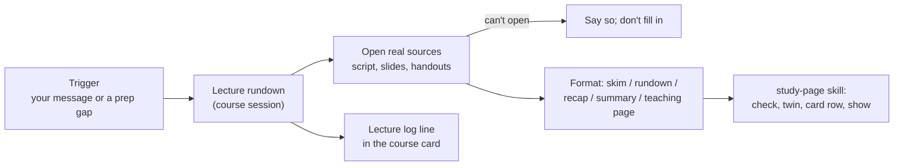

# Lecture rundowns

This module adds the **lecture-rundown role**: the agent session that explains your lectures. Before a lecture it writes a short skim (intuition first, no quiz) so the lecture is not the first time you see the material; after the lecture it writes a rundown of what was actually covered; before a sheet or quiz it writes a recap of exactly the tools you need; and on request it builds summaries, cheat sheets, definitions decks and full interactive teaching pages (module `study-pages`). An optional scheduled job writes the pre-lecture skim on its own for the courses you pick. Its one hard rule: **content comes only from the course's real sources (script, slides, handouts, official plan), with section and page cited, and if a source can't be opened it says so instead of filling in.**

## At a glance

| | |
|---|---|
| Tier | standard |
| Requires | `core`, `courses`, `study-pages` |
| Recommends | `error-logs` (traps for cheat sheets), `roles` (coordinator routing), `daily-prep` (asks for skims) |
| Obsidian | optional |
| OS | any |
| Runtime | laptop, cloud, VM (anything that can read the course's PDFs) |
| Jobs | `lecture-skim` (optional, off when installed): a skim before each lecture of the chosen courses |
| Roles | `lecture-rundown` (one shared brief; one session per course) |
| Cost | agent usage; teaching pages on the strongest model cost about 1.5-2 % of a week's usage each in the original; the skim job was estimated at 0.1-0.2 % per run |

## Why it exists

Lectures in the original system's first year were fast, and reading the script first was "too slow and passive" for the student, who learns by seeing. Two things helped most: a **skim before the lecture** (the big picture, the definitions and a small example for each expected section, ready a little before the lecture starts) and a **rundown or teaching page after it**. The hardest, fastest, theory-only course benefited most.

The role also produced the system's most important content rule. Early on, one rundown was written from a *predicted* weekly plan instead of the script: it cited wrong pages and invented items. From then on: open the real file, cite section and page, never infer from a plan or from general knowledge, and say so when a source can't be opened.

## How it works

**One shared role, one session per course.** There is a single brief (`_agent/roles/lecture-rundown.md`) for all courses. Each course gets its own session titled "<COURSE SHORT> · Lecture rundown" (for example "AD · Lecture rundown"), told in its first message which course it serves. Everything course-specific (which files are the sources, the page offset between printed and PDF pages, notation conventions such as "every plain log means log base 2", which sections are optional) lives in the **course card**, so it is written once and every role reads the same facts. Per-course copies of the brief would drift apart; the original kept one brief with per-course notes for the same reason. One session per course keeps each session's context small and its file ownership clear (`<course>/notes/`).

### Formats

| Format | When | Shape |
|---|---|---|
| **Skim** | before a lecture; ready at least `study.rundowns.skim_lead_hours` before it starts | intuition first, **no quiz**; what the plan predicts and that the official roadmap wins; "Where today may start" (if the last lecture's end is unconfirmed); "Big picture"; one block per expected section (intuition, precise definition with its number, small example); optional sections marked; "What I checked, what I inferred" |
| **Rundown** | after a lecture | what was actually reached (from your word or the slides reached; a deck is the whole chapter, not what was lectured); per section intuition, exact definitions and results with pages, a worked example on a different case than any sheet task, traps; "Not covered yet"; plus a Lecture log line in the card |
| **Recap** | before a sheet or quiz | the definitions and methods the sheet needs, each with page; "What you need for sheet N" as a list of tools, never the solution; traps from your error log; a short self-check |
| **Summary / cheat sheet** | on request | "keep statements and procedures, drop explanations"; every definition, lemma and theorem with page; your traps; "no task solutions"; fits the course's allowed aid format if it has one |
| **Teaching page** | on request | the full `study-pages` template: sections of about `study.chunk_words` words, demos, mid quizzes checked by code, cheat sheet, final self-test |
| **Definitions deck** | on request, then extended after lectures when you ask | exact wording quoted from the script with page, plus a "Watch:" line from your own past slips; "5 minutes a day: cover, say it with every quantifier, compare word by word" |
| Recall key (optional, off) | on request | numbered core items with pages, behind "write from memory first"; the original student dropped recall tests after a week |

Markdown skeletons for the first four are installed in `_templates/`; HTML versions are built from `_templates/study-page.html`. Names, properties and the build steps are in the `study-page` skill. Every name starts with the course slug and ends with the kind word: `<slug>-lecture-<ddd><d><mon>-<topic>-skim`, `...-rundown`, `<slug>-<what>-recap`, `<slug>-<topic>-summary`, `<slug>-<topic>-cheatsheet`, `<slug>-definitions-deck`, `<slug>-proof-skeletons-walkthrough`, `<slug>-running-summary`.

### The optional skim job (`lecture-skim`)
Role sessions act only when spoken to, so a promise like "the skim is ready before the lecture" needs a trigger. In the original system that promise sat in the brief with nothing behind it until a duty audit noticed; the fix was a headless job, and it is shipped here **off by default** (the original kept it staged until the student said yes). When switched on, it runs at `schedule.lecture_skim` on `schedule.lecture_skim_days`, and skips without starting the agent when `study.rundowns.skim_courses` is empty or the day is outside the teaching weeks (week 0 to `term.last_lecture_day`; a `PRECHECK`, not a `DATES` range, so a run still starts while the job's failure flag exists and clears it). Each run:

1. finds, for every chosen course, the next lecture that has not started and starts within 24 hours (from `courses[].lecture_slots`, corrected by the course card), and which sections it will probably cover (from the Lecture log and the plan, labelled as a prediction);
2. **stops if a skim for that lecture already exists** (the course's rundown session may have written it), so the job and the role never produce two;
3. opens the real script, applies the page offset, and **writes nothing if the source can't be opened**;
4. writes the skim (intuition first, exact definitions with numbers and printed pages, no quiz, about 10 minutes of reading), checks it, makes the twin and adds the card row;
5. respects the integrity rules (no current sheet tasks, no solution links, nothing near `solo` work, blackout windows from the course card), sends **no notification**, and never edits prep notes: the daily prep picks the page up, and a missing page shows there as a gap;
6. when a skim was due but could not be written, leaves a failure flag `_agent/logs/flags/lecture-skim.md` (the heartbeat module's format) instead of a push; the next run that ends complete deletes it.

The job is plain `job.conf` + `prompt.md` (see the `scheduler-local` and `vm` modules for how jobs run).

### Rules the role follows
Real sources only, printed page numbers, predictions labelled as predictions, optional sections marked the way the course marks them, course notation first, intuition before definitions (if `study.intuition_first`), never skip "obvious" algebra steps, every practice question labelled invented/adapted/official (adapted and official mean this term's material), never the finished solution of a current graded task (sheet questions are routed to exercise help), quick visuals in chat when structure is involved (Mermaid up to about 10 nodes, or a text diagram at most 38 characters wide for the phone), and every page filed and shown in the same turn.

## What gets installed

| Vault path | What |
|---|---|
| `_agent/roles/lecture-rundown.md` | the role brief, with a table of the course sessions rendered from the config |
| `_templates/lecture-skim.md` | skim skeleton |
| `_templates/lecture-rundown.md` | rundown skeleton |
| `_templates/lecture-recap.md` | recap skeleton |
| `_templates/topic-summary.md` | summary / cheat-sheet skeleton |
| `_agent/jobs/lecture-skim/job.conf`, `prompt.md` | the optional pre-lecture skim job (installed off) |

Pages are created later in `<course folder>/notes/`.

## Configuration

| Key | Default | Meaning |
|---|---|---|
| `study.rundowns.skim_lead_hours` | `1` | a requested skim is ready at least this long before the lecture starts (the original: due by 13:00 for a 14:15 lecture) |
| `study.rundowns.recall_keys` | `false` | offer post-lecture recall-key pages |
| `study.rundowns.skim_courses` | `[]` | course ids the `lecture-skim` job writes skims for (the original: only its hardest course) |
| `schedule.lecture_skim` | `["10:30"]` | run times of the skim job; choose a time that ends `skim_lead_hours` before the earliest skimmed lecture (an evening slot covers the next morning's lecture) |
| `schedule.lecture_skim_days` | `["Mon", "Wed"]` | run days (the original's lecture days; set them to the days of the lectures you skim, or the day before for morning lectures) |
| `term.last_lecture_day` | `""` | when set, the skim job runs only in the teaching weeks |
| `study.intuition_first` | `true` | intuition and pictures before definitions |
| `study.formats`, `study.chunk_words` | from `study-pages` | page formats and section size |
| `agent.heavy_model` | `""` | model for this role's sessions (empty = host default) |
| `courses[]` | | course names, folders and slugs for the session table |

Course facts the role needs are asked when the course is set up (module `courses`): source files, page offsets, notation conventions, optional-section markers, lecture slots. The interview also asks whether you like skims before lectures (and if so, for which courses the job should write them and when), and how you learn best (pictures first or definitions first).

## Daily use
- "Skim tomorrow's DM lecture." / "What will Wednesday's LA lecture be about?"
- "Today's AD lecture got to the end of 5.3. Make me a rundown." (The role logs where it stopped.)
- "Recap weeks 3-4 for sheet 6." / "Summarise chapter 4 on one page." / "Make a cheat sheet in the allowed format."
- "Make me a study page on heaps." / "Add three definitions from today to my definitions deck."
- "Why does the proof of Lemma 4.2 need injectivity?" (answered in chat, with page and a small diagram)
- "I know how the proof goes but I can't write it down." (a proof skeletons checklist) / "Any good video on amortised analysis?" (video picks)
- "Switch on the skim job for DM." (the setup agent adds `dm` to `study.rundowns.skim_courses`, sets the run time and turns the job on)

## Agents other than Claude Code
The brief is plain Markdown and works with any agent that can read the course PDFs and write files.
- **Sessions per course**: in Claude Code the coordinator (module `roles`) starts one session per course; in other agents open one chat or workspace per course and paste "You are the lecture-rundown role for <course>; read `_agent/roles/lecture-rundown.md`".
- **Reading PDFs**: Claude Code reads PDFs and page images directly; other agents may need a PDF-to-text step. Large scripts that a connector cannot read can be converted to a text copy once (for reading only; never redistribute the text).
- **Showing pages**: `SendUserFile` in Claude Code; a file path elsewhere.
- **Subagents**: in Claude Code, bulk reading of long sources can be delegated to a subagent to keep the session's context small; other agents just read in parts.
- **The skim job**: in Claude Code it runs as a desktop scheduled task or headless (`claude -p`) through the laptop scheduler, or on the VM; other agents run `prompt.md` with their own non-interactive mode (module `scheduler-local`).
Only tested with Claude Code.

## Failure modes and fixes

| Symptom | Cause | Fix |
|---|---|---|
| Wrong page numbers | printed vs PDF page offset not applied, or a new script version renumbered pages | keep the offset (per script part) in the course card; re-check after a new version |
| Content that the lecture never covered | rundown written from the deck or the plan | rule 3: only your word or the slides reached say where a lecture stopped; tell the role where it stopped |
| Empty text from a PDF | handwritten or scanned handout | read the page images (the role does this; say if it fails) |
| Long deck read only halfway | connector or tool truncates long files | read in parts; for very large scripts make a text copy once |
| "Skim wasn't ready" | no trigger fired | switch on the `lecture-skim` job for that course, ask the evening before, or let the daily prep list the gap |
| Two skims for one lecture | the job and a session both wrote one | both check "stop if it exists" first; if it still happens, keep the newer and remove the other from the card table |
| The skim job wrote nothing | no lecture within 24 h, the source could not be opened, or `skim_courses` is empty | read its final reply in the job log; it always says why. When a skim was due and could not be written, the job also leaves `_agent/logs/flags/lecture-skim.md` (level amber; the heartbeat shows it), which its next complete run deletes |
| Page too thin | material squeezed into too few sections | sections of about `study.chunk_words` words; ask for "bigger" |
| The role answers a sheet task | role confusion | it should route sheet questions to exercise help; remind it of rule 9 |

## Lessons from the original system
- **Content only from real sources, with pages.** Born from a rundown that was built from a predicted plan and had wrong pages and invented items.
- **Decks are chapters, not lectures.** A lecture deck covers the whole chapter; only the student's word or a transcript matched to the slides says where a lecture stopped. The course card keeps a Lecture log for exactly this.
- **Week numbering is a trap.** Course plans and LMS pages often number weeks differently from the term (1-indexed weeks, a TA's "week N" being the term's week N−1, lecture weeks straddling two calendar weeks). Every page says which numbering it means.
- **Page offsets differ per script and per script part**, and can change with a new version. Store them in the card and cite printed pages.
- **Some handouts return empty text** and handwritten lecture notes OCR badly: read the page images.
- **Pre-lecture skims mattered most for the hardest course**, and only worked when they were ready before the lecture: hence a lead time, not a fixed clock time.
- **A duty without a trigger does not happen.** "Skim due by early afternoon when the prep asks" stayed a promise in the brief until an audit of every duty against its trigger found nothing behind it. The answer was a small headless job that is idempotent (stops if the page exists), source-or-nothing, and limited to the teaching weeks.
- **Pictures first.** The student followed visual explanations much better than script-style text; quick diagrams in chat became a standing rule. Mermaid sometimes showed as plain text, so diagrams are written to read well even unrendered.
- **No off-topic lenses.** A maths summary with computer-science side remarks that the course did not ask for was unwanted noise; stay inside the course.

## Removing it
`python tools/uni_os.py disable lecture-rundowns` removes the role from the routing table and marks the `lecture-skim` job disabled; the role file and your pages stay in the vault. If you had switched the job on, also remove its scheduled task on the laptop or turn it off on the VM (`uni-vm jobs off lecture-skim`). Close the course sessions in your agent app. The `_templates/` skeletons can be deleted by hand.
