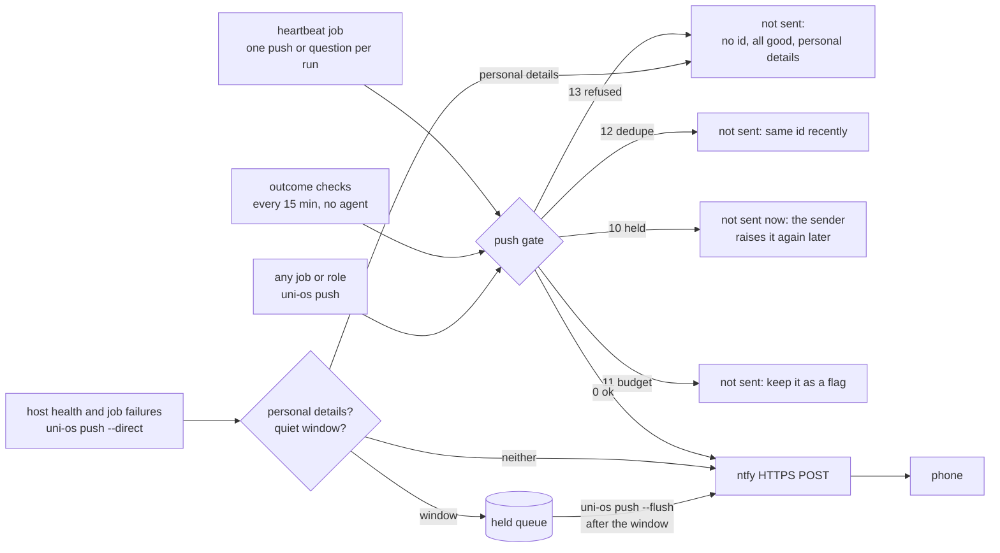

# Notifications (ntfy push + push gate)

Phone pushes for the study system, sent through **one gate** that every sender shares: a daily budget, a minimum gap, dedupe per problem, quiet hours and quiet windows (held back; the sender raises the problem again later if it is still true), and two hard refusals: never an "all good" message, never personal details. The default channel is [ntfy](https://ntfy.sh) (free, open source, a phone app plus a plain HTTP POST); the topic that addresses your phone is a secret and lives only in a file outside the vault. The module also ships the **outcome checks**: deterministic checks that a job's *result* exists, because "exit 0 says a job ended, not that its result is there".

## At a glance
| | |
|---|---|
| Tier | standard |
| Requires | core |
| Recommends | heartbeat (the main sender; it shares the gate and the problem ids) |
| Obsidian | irrelevant |
| OS | any (Python 3.11+ standard library; pushes go out over HTTPS) |
| Runtime | laptop or VM; best on an always-on host (a sleeping laptop pushes nothing) |
| Jobs | `outcome-checks` (command, every 15 min, no agent; installed switched on) |
| Roles | none (every job and role may call `uni-os push`) |
| Commands | `uni-os push`, `uni-os heartbeat outcomes` |
| Cost | free with the public ntfy.sh server; a self-hosted ntfy server is optional |

## Why it exists
The original system's agents could not reach the student's phone reliably:
- **The agent app's own push tool was held back.** Claude Code's built-in push notification is suppressed while the user counts as "active" (on a headless always-on box the terminal always looks active), so scheduled jobs could not use it. Laptop toasts only reach the laptop.
- **Interactive sessions notify on their own.** Every new remote-controllable session pinged the phone, so "open a session to tell the student something" was noisy and not a channel.
- **Several senders, no shared budget.** Host health alerts, job failures, the outcome checks and later the heartbeat each had their own spacing and hours. A single bad afternoon could produce a burst of pushes about one cause.

ntfy fixed the channel (one-way: the student answers through the agent app, not through the push). The push gate fixed the budget: one state file, one set of rules, one place to decide whether the student's attention is worth spending. The refusals encode the system's oldest rule: **silence is the norm** (routines never send "all good").

## How it works

Rules in order, the first that applies decides (`uni-os push` exit code in brackets):
1. **Refused (13).** No problem id (`--id`): a push must be about a flagged problem, never an "all good". An empty text. A text that reads like "all good" (`all good|fine|ok|clear|green`, `nothing to report|new|flagged|wrong`, `everything is ok|fine|on track`, `no problems|issues found`, plus your own patterns). Personal details: a mail address, a link in the text (pass it with `--click`), a long digit run (phone, matriculation or account numbers). Scores like `3.5/4`, dates and times are fine.
2. **Dedupe (12).** Every id of this push was already pushed within `dedupe_hours`. With several ids, only the fresh ones count; with `--item id=text` the text is rebuilt from the fresh items only.
3. **Held (10).** Inside quiet hours or a quiet window. The push is not sent and not recorded (the original called it "deferred: send again later"): the heartbeat keeps the problem as a flag and raises it at its next run if it is still true, the outcome checks find it again on their next run after the quiet time. Nothing is queued, so nothing stale (a prep note that was written at 22:00 after all) arrives at 07:30.
4. **Budget (11).** `max_per_day` pushes a day across all senders, at least `min_gap_hours` apart. `--urgent` skips the gap, never the day cap. Not queued: the sender keeps the problem as a flag, and the heartbeat raises it again later if it is still true.
5. **Sent (0).** One HTTPS POST to `<ntfy_server>/<topic>` with a title, a priority (1-5) and optionally a click URL and up to three action buttons. The push and its ids are recorded.

The other exit codes: **1** the request to the push server failed, or the gate was busy ("gate busy, try later", see below); nothing was sent by this call and nothing recorded. **2** a usage or setup error (no topic file, a topic file inside the vault, an unknown option).

**Direct pushes** (`--direct`) are for the host's own health alerts and job failures: they need no id and skip the "all good" rule (a host may say "recovered"), dedupe, quiet hours and the budget, and are not counted against it. The personal-details refusal still applies. Inside a quiet window (nobody wants a buzz in the middle of a timed quiz) they are **queued**, and `uni-os push --flush` releases the queue as **one** combined push ("Held during a quiet window: a; b") once the window is over, exactly as the original's notify helper did for its timed-task windows. The outcome-checks job flushes on every run; on the always-on host the health check does too. Queued alerts older than `hold_max_hours` are dropped at release. The host rate-limits direct alerts itself (the original: at most one alert and one "recovered" per problem per 3 h).

**State lives outside the vault**, per user and machine: `~/.local/state/uni-os/push-gate/` on Linux and macOS (`$XDG_STATE_HOME` respected), `%LOCALAPPDATA%\uni-os\push-gate\` on Windows. Files: `state.json` (pushes, ids, the queue of held host alerts; pruned to 14 days; written under a lock with a temp file and an atomic rename), `notify.log` (every attempt, trimmed), `notify-settings.json` (the last known `[notify]` settings, so a direct alert still goes out with the right server and quiet windows when the vault itself is unreachable, for example during a Drive outage, or when its config can't be used: `_agent/uni-os.toml` is not valid TOML, or a `[notify]` value is invalid such as `quiet_hours = "late"`; the gate then prints one line on stderr saying so, uses the cached settings, or its own defaults when there is no cache, and keeps the cache as it was), `.lock` (every send holds it while it reads the state, decides, sends and records, so two senders at the same moment never push the same problem twice; a call that can't get it within 45 s, longer than one send's 20 s HTTP timeout, gives up with exit 1 "gate busy, try later" and sends nothing, on Linux, macOS and Windows alike).

**Dry runs** (`--dry-run`, or `UNI_DRY_RUN=1` which the job runners set) write nothing and print the decision ("DRY RUN would send / would defer / would hold / would not send (exit N)"). Set `UNI_OS_PUSH_DRY_LOG=<file>` to also collect those lines (a switch-on guard reads them). Tests use `UNI_OS_PUSH_FAKE_SEND=<file>` (append instead of sending, but record) and `--now "YYYY-MM-DD HH:MM"`.

### The outcome checks ("exit 0 is not success")
A job runner knows that a job *ended*; it does not know whether the job's result is there. The outcome checks look at results, deterministically, with no agent, every 15 minutes (`uni-os heartbeat outcomes --push`; the rules live with the heartbeat's rule set so both always agree):

| Check | Id | Pushes |
|---|---|---|
| Tomorrow's prep note exists after the last daily-prep run + grace (module daily-prep) | `prep:tomorrow-missing:<date>` | "no prep note for Wed 11 Nov yet" |
| Today's prep note exists after the morning check + grace + 10 min (module daily-prep) | `prep:today-missing:<date>` | "no prep note for today (Tue 10 Nov)" |
| No update note waits in the inbox for over `notify.inbox_stale_hours` (4 h; Done-tap notes: `notify.inbox_stale_hours_taps`, 14 h, they wait for a fixed sync run by design) (module inbox-sync) | `inbox:stuck:<slug of the file name>` (a slug over 60 characters is cut and ends in `-` plus 6 hex digits of the name's SHA-1, so two long names never share an id) | "update note waiting in the inbox for over 4 h, not applied by the inbox sync" (no file name: names can carry personal details; the flag in the vault names the file) |
| No prep gap stays open for over `heartbeat.gap_open_hours` (24 h), counted from when the check first saw it | `prep:gap-open:<date>` | "prep gap open for over 24 h for Wed 11 Nov" (never the gap text, never the file name) |

The ids, thresholds and texts are the heartbeat's own rules (the checks are the findings it marks "outcome check"), so a dashboard, a flag and a push always say the same thing. One deliberate difference from the original: its outcome check pushed "no prep note for tomorrow" one hour after the *first* evening prep run (17:30 + 60 = 18:30); here it pushes once the *last* run plus grace has passed (19:30 + 20 min), because the second run exists to fill exactly that gap. Until then the missing note is an amber flag for the heartbeat.

They push through the same gate with the same ids the heartbeat uses, so the student never hears about one problem twice. A problem found during quiet hours is not queued: the next run after the quiet time finds it again if it is still true. Each run also releases host alerts queued during a quiet window (`uni-os push --flush`).

Where it runs:
- **Always-on host (VM module):** the job is installed with `DEFAULT_MODE="always"` (as in the original, where the outcome checks ran every 15 minutes long before the heartbeat existed). On the host it arrives switched off like every `RUNTIME="any"` job, and the host's built-in copy of these checks runs inside `uni-vm health` until you switch the job on there (`uni-vm jobs on outcome-checks`); from then on the built-in copy steps aside.
- **Laptop only:** a repeating OS scheduler task (`EVERY_MIN="15"`, module scheduler-local, path 2). An agent app's own scheduled tasks run prompts, not commands, so with that path the job can't run, and the heartbeat pushes these findings itself.

#### One sender per problem
Every implementation of these checks uses the same ids and the same push texts, word for word, but the push gate keeps its dedupe state on each machine, so two machines checking the same thing would reach the phone twice. Exactly one sender is active in any setup; the first row that matches wins:

| Setup | The one sender of outcome pushes | Everything else |
|---|---|---|
| The `vm` module is on | the always-on host: this job when it is switched on there (`uni-vm jobs on outcome-checks`), else the host's built-in check in `uni-vm health`, which steps aside only while this job's timer is on (never both, never neither) | `uni-os heartbeat outcomes --push` on any other machine prints its `OUTCOME` lines and sends nothing ("push: not from this machine") |
| No `vm`, and the laptop runs command jobs (`runtime.laptop_scheduler = "os"`) | this job on the laptop's OS scheduler | |
| No `vm`, laptop agent-app tasks only (they run prompts, not commands) | the heartbeat job: it pushes findings marked "outcome check" itself, with their ids | |
| Neither `notifications` nor `vm` (inbox-sync alone) | the inbox poll, only if you add `--push` to its job | |

In the first three rows the heartbeat only flags outcome findings (its report says "Outcome sender: host / job / heartbeat"), the inbox poll's `--push` stands down (it reads the vault config and prints why), and the vault watch (module vault-watch) keeps stuck notes and missing prep notes as laptop toasts and out of its own phone push. One threshold too: a note counts as stuck after `notify.inbox_stale_hours` (Done taps: `notify.inbox_stale_hours_taps`), defaulted by module inbox-sync; the older keys `heartbeat.inbox_stuck_hours`, `heartbeat.inbox_tap_stuck_hours`, `vm.inbox_stuck_h` and `vm.tap_stuck_h` are aliases that default to 0 = "use the notify key".

Off switch without editing anything: create the file `outcomes-off` in the heartbeat state folder (`uni-os heartbeat state --json` prints where), or switch the job off. Adding your own check: any script can push a deterministic problem with `uni-os push --item <stable-id>=<text> --prefix "Outcome check: " --source <script>`; the gate does the rest (stable ids, so dedupe works).

### How jobs, roles and the host call it
| Caller | Call | Notes |
|---|---|---|
| The heartbeat job | `uni-os push --check ...` then `uni-os push "<item>; <item>" --source heartbeat --id <id> ...` | at most one push (or one question) per run; `--urgent` only for a deadline within 6 h |
| The heartbeat's question | `uni-os heartbeat ask ...` | goes through the gate with the id `heartbeat-ask`, so at most one question a day |
| Outcome checks | `uni-os heartbeat outcomes --push` | releases queued host alerts first (`--flush`) |
| A job's done-push (`job.conf` `NOTIFY_DONE` + `NOTIFY_GATE`) | runner: `uni-os push "$NOTIFY_DONE" --id "$NOTIFY_GATE" --source <job> --click <session link> --urgent` | for interactive jobs that need the student (the link opens the session) |
| Host health, job failures (VM module) | `uni-os push --direct --source host --title <host> --text "<problem>" --prio high` | outside the budget; the host rate-limits per problem; queued inside quiet windows |
| Laptop job failures (scheduler-local, `--push-failures`) | `uni-os push --source job:<id> --direct --id job-failed:<id> "<text>"` | outside the budget like host failures; exit 10-13 are not failures |
| The inbox poll's stuck-note alerts (inbox-sync, `--push`, only in a setup without `vm` and `notifications`) | `uni-os push --source inbox-sync --prefix "Outcome check: " --item inbox:stuck:<slug>=<text>` | the outcome checks' ids and texts; it stands down whenever another sender owns them |
| Any role | `uni-os push "<text>" --id <id> --source <role>` | rarely: prefer a flag for the heartbeat (`_agent/logs/flags/<job>.md`) |

The agent-facing rules are installed as `_agent/notifications.md` (what to push, ids, exit codes and what to do with each).

## What gets installed
| Path | What |
|---|---|
| `_agent/notifications.md` | the push rules for every agent: when, how, exit codes, never-list |
| `_agent/jobs/outcome-checks/job.conf` | the deterministic outcome-checks job (installed switched on; every 15 minutes) |
| outside the vault | `~/.config/uni-os/ntfy-topic` (you create it, see below); the gate's state folder (created on first use) |

## Configuration
All keys live under `[notify]` in `_agent/uni-os.toml`. The setup interview asks them as questions and proposes the original's values:

| Key | Default | Interview question |
|---|---|---|
| `notify.provider` | `"ntfy"` | "Do you want phone pushes? (ntfy, or none = log only)" |
| `notify.ntfy_server` | `"https://ntfy.sh"` | "The public ntfy server, or your own?" |
| `notify.ntfy_topic_file` | `"~/.config/uni-os/ntfy-topic"` | (path of the secret file; must be outside the vault, the gate refuses otherwise) |
| `notify.title` | `"Uni OS"` | "What title should pushes show?" |
| `notify.default_click` | `""` | "Open something when a push is tapped?" (Claude users: `https://claude.ai/code`) |
| `notify.max_per_day` | `3` | "At most how many pushes a day, from everything together?" |
| `notify.min_gap_hours` | `2` | "At least how many hours between two pushes?" |
| `notify.dedupe_hours` | `24` | "After how long may the same problem be pushed again?" |
| `notify.quiet_hours` | `"21:00-07:30"` | "When should your phone stay silent? (pushes are held and arrive afterwards)" |
| `notify.quiet_windows` | `[]` | "Which graded fixtures need silence (timed quizzes, orals, timed online tasks)?" The setup agent proposes windows from your `[[courses.assessments]]`; add new ones when dates are announced |
| `notify.never_all_good` | `true` | (keep it: the system never sends "all good") |
| `notify.require_id` | `true` | (keep it: every push names the problem it is about) |
| `notify.block_personal` | `true` | (keep it: refuse mail addresses, links in the text, long numbers) |
| `notify.extra_all_good_patterns` | `[]` | regexes for "all good" in your language, e.g. `["alles (gut\|ok)", "tout va bien"]` |
| `notify.max_length` | `300` | longer texts are cut |
| `notify.hold_max_hours` | `24` | queued host alerts (held in a quiet window) older than this are dropped at release |
| `notify.direct_priority` | `4` | ntfy priority of direct (host) alerts |

Quiet windows come in two shapes:
```toml
[notify]
quiet_windows = [
  { from = "2026-11-19 07:30", to = "2026-11-19 10:00", reason = "LA quiz 5" },          # one fixture
  { from = "2026-11-24", to = "2026-11-24", reason = "DM oral" },                         # whole day(s)
  { day = "Mon", from = "08:00", to = "10:00", until = "2026-12-21", reason = "weekly AD quiz" },  # weekly
]
```
`reason` is what the logs and the heartbeat report show; it also becomes a "result missing?" candidate for the heartbeat's daily question once a dated window has ended. Inside a window every push is held, even `--urgent` ones, and the heartbeat skips its runs: that is right for a two-hour timed quiz. For a long period where you only want the important things (a whole exam session), add `urgent_ok = true`: such a **soft** window holds ordinary pushes but lets `--urgent` and direct pushes through, and the heartbeat keeps running inside it:
```toml
  { from = "2027-01-25", to = "2027-02-19", reason = "exam session", urgent_ok = true },
```

### Set up ntfy (5 minutes)
1. Install the **ntfy** app on your phone (Android: Play Store or F-Droid; iOS: App Store).
2. Make a long random topic name; anyone who knows it can read your pushes and send you some, so treat it like a password:
   `python -c "import secrets; print('uni-' + secrets.token_urlsafe(18))"`
3. In the app: **Subscribe to topic**, paste the name, keep the server `ntfy.sh` (or your own).
4. Store the topic only in the secret file, outside the vault:
   - Linux/macOS: `mkdir -p ~/.config/uni-os && printf '%s\n' '<topic>' > ~/.config/uni-os/ntfy-topic && chmod 600 ~/.config/uni-os/ntfy-topic`
   - Windows (PowerShell): `New-Item -ItemType Directory -Force "$HOME\.config\uni-os" | Out-Null; Set-Content -Encoding ascii "$HOME\.config\uni-os\ntfy-topic" '<topic>'`
   - On a VM: the same file on the VM (each machine that pushes needs it).
5. Test: `uni-os push "Uni OS test push: pushes work" --direct --source setup`. The phone should buzz within seconds.
6. Android: exempt the ntfy app from battery optimisation, or pushes arrive late.

Never put the topic into the vault, the config file, a prompt, a log line, a README or a screenshot. `uni-os doctor` scans the vault for ntfy topics.

## Daily use
You rarely touch it; agents and jobs push for you. Things you might say to your agent:
- "Add a quiet window for the LA quiz on Thursday 19 November, 07:30 to 10:00."
- "No pushes on Saturdays." (the agent adds a weekly quiet window `{ day = "Sat", from = "00:00", to = "23:59" }`)
- "What did the system push today?" (the agent runs `uni-os push --status` and reads the gate's `notify.log`)
- "Too many pushes: make it two a day, three hours apart."
- "Turn phone pushes off for now." (`notify.provider = "none"`: everything is logged, nothing is sent)

## Agents other than Claude Code
The gate is a plain command (`uni-os push`), so every agent that can run a shell command uses it the same way: Codex, Gemini CLI, Cursor, a cron job. Nothing here depends on Claude-specific features. In Claude Code the built-in push notification tool is deliberately not used (it is suppressed while you count as active, and it bypasses the budget). Only tested with Claude Code.

## Failure modes and fixes
| Symptom | Cause | Fix |
|---|---|---|
| No push arrives, exit 2 "no ntfy topic file" | the secret file is missing on this machine | create it (step 4); each pushing machine needs its own copy |
| No push arrives, exit 0 | wrong topic in the app or the file; Android battery optimisation | compare the two topics; exempt the app |
| Exit 1 "could not reach the push server" | offline, or ntfy.sh rate limit | nothing is recorded, the sender retries or keeps a flag; self-host if you hit limits |
| Exit 1 "gate busy, try later" | another sender held the gate's lock for over 45 s (a send hanging on a slow network, or a stuck process) | nothing was sent or recorded; the next run sends it if it is still true. If it repeats, look for a hung `uni-os push` process and end it |
| A push you expected was refused (13) | it said "all good", or had a link, a mail address or a long number | rephrase as a problem with an id; links go into `--click` |
| A push held at night never arrives in the morning | by design: held pushes are not queued | the sender raises it again if it is still true (the heartbeat at its next slot, the outcome checks every 15 minutes) |
| Host alerts held in a quiet window never arrive | nothing calls `uni-os push --flush` | switch the outcome-checks job on (or let the VM health check flush) |
| One job eats the whole budget | it pushes about every small thing | make it write a flag for the heartbeat instead; or give it its own ids so dedupe works |
| A dry run sent real pushes | the push bypassed `uni-os push` (a direct `curl` to the server, a script of your own), so nothing read `UNI_DRY_RUN` | send every push through `uni-os push`, which honours it (so do the host's `uni-vm notify` and outcome checks); a tool of your own must check `UNI_DRY_RUN=1` itself |
| The same problem arrives twice | two machines both push outcome checks (the gate dedupes per machine), e.g. a laptop copy of this job from before the vm module | not with the shipped code: one sender per setup (see "One sender per problem"); `uni-os heartbeat report` names it. Check that no older script pushes on its own |
| A sender's push fails with exit 2 "unrecognized arguments" | an old option spelling | `uni-os push --help`; `--text`, `--ids`, `--key`, `--prio`, `--flush-held` are accepted aliases |
| Pushes stop during a Drive outage | the config is in the vault | the gate falls back to the last cached settings; direct alerts still go out |
| Every push prints "push gate: the vault config can't be used (...)" on stderr | `_agent/uni-os.toml` is not valid TOML, or a `[notify]` value is invalid | pushes still go out with the last cached settings (or the defaults); fix the file (`uni-os config validate` names the line) |

## Lessons from the original system
- **The topic is a password.** The original printed the ntfy topic in a repo README and a generated report page; that had to be flagged as "do not copy". Here the topic exists only in one file outside the vault, and the gate refuses to read a topic file that sits inside the vault.
- **Dry runs are instructions, not a sandbox.** A dry run of a push job sent real pushes and recorded them as sent, so the real push never came. Now every push goes through the gate, which honours `UNI_DRY_RUN=1` and writes nothing at all in a dry run; everything else a dry-run agent might do is still held back only by its instructions.
- **One gate for all judgment pushes.** Before the gate, the outcome checks had their own 3-hour spacing, their own 24-hour dedupe, their own hours and a hard-coded do-not-disturb window. When the heartbeat arrived, both moved to one gate with one budget (3 a day, 2 h apart, 07:30-21:00, plus the graded-fixture windows) and shared ids, so the watcher and the deterministic checks never told the student the same thing twice.
- **Health alerts stay outside the budget.** A dead vault mount must reach the phone even after three other pushes that day; the host rate-limits those per problem instead (one alert and one "recovered" per 3 h).
- **Quiet windows were first hard-coded** for timed online tasks in the push script itself; held pushes went out as one combined push after the window. That mechanism is kept and moved into the config.
- **Some pushes deliberately skipped the gate.** During a three-week study experiment, a "block done, tap to log your focus" push after every planned study block was wanted every time and so ran outside the budget. If you build something like it, use your own ids and `--direct`, and say so in its job.
- **Defer judgment pushes, queue host alerts.** The original gate answered "deferred, send again later" (exit 10) inside quiet hours and graded-fixture windows and recorded nothing, because its senders ran again anyway; only the notify helper queued host alerts during a timed task and sent them as one push afterwards. A queued judgment push would arrive stale ("no prep note for tomorrow" at 07:30 although the note was written at 22:00), so this gate keeps exactly that split.
- **A question costs two notifications.** When the heartbeat opens a question session, the push with its link counts against the budget, and the agent app adds its own "new session" notification. Budget questions accordingly (at most one a day).
- **Channels for answers are separate.** ntfy is one-way. When the system needs an answer it opens an interactive agent session and pushes its link (`--click`); the student answers there.

## Removing it
`uni-os disable notifications` (never deletes files). Then: delete `~/.config/uni-os/ntfy-topic`, unsubscribe in the app, and optionally delete the gate's state folder. With the module off, `uni-os push` still works but every caller should treat pushes as unavailable; the heartbeat keeps writing flags (dashboards still show them). To keep everything but stop sending, set `notify.provider = "none"` instead.
