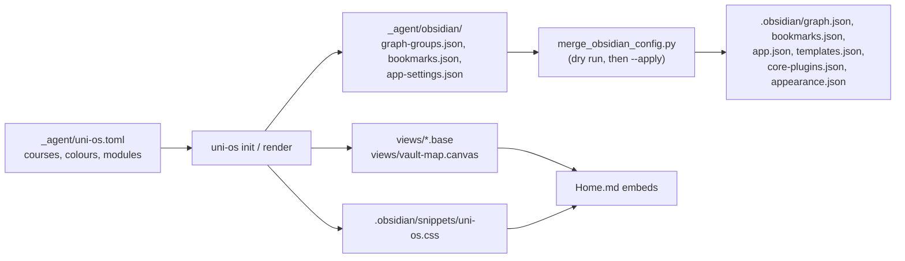

# Obsidian views and styling

Turns the vault into a working Obsidian dashboard. The module installs seven Bases views (courses, weeks, study pages, error logs, inbox, recently changed, latest), a CSS snippet that gives every course its colour and its own callout type, a generated vault-map canvas, and three files of recommended Obsidian settings (graph colour groups, bookmarks, app settings) that a small script merges into your existing `.obsidian/` configuration without overwriting your choices. Everything is generated from the config, so courses, colours and folder names are never hard-coded. Obsidian is recommended, not required, for Uni OS: everything else is plain Markdown. Uni OS was only tested with Claude Code.

## At a glance
| | |
|---|---|
| Tier | standard |
| Requires | `core` |
| Recommends | `courses`, `progress`, `student-model`, `cockpit` |
| Obsidian | required (1.9 or newer, for Bases) |
| OS | any (Obsidian desktop; the views also work in Obsidian mobile) |
| Runtime | laptop (Obsidian); agents only read and render the files |
| Jobs | none |
| Roles | none |
| Community plugins | none needed (the optional `cockpit` module adds one) |
| Cost | free (Obsidian is free for personal use) |

## Why it exists
In the original system, `Home.md` was the page the student kept open all day. It was almost entirely computed: a Bases table of the course cards' bonus properties, an embed of the "Next 10 days" section of the status page, the current week page, course tiles in course colours, the newest week plan and quiz prep, and the recently changed notes. That only worked because the notes carried consistent `type` properties and the views, the CSS, the graph and the canvas all agreed on folder names and colours.

They often didn't. After two restructures, the graph colour groups still pointed at an old folder layout (so course colouring silently matched nothing), the canvas showed a week-6 plan in week 8 and called an active error log empty, the CSS comment named an old location, and a view listed a folder that no longer existed. The lesson: **generate every Obsidian artefact from one config**, and treat Obsidian's own settings as the user's property (merge, never overwrite).

## How it works

1. **Views.** Each `.base` file filters notes by their `type` property and folder, the way the original's did:

   | View | Shows | Filter |
   |---|---|---|
   | `Courses.base` | one row per course card: bonus banked, full bonus at, next bonus fixture, updated | `type == "course"` |
   | `Weeks.base` | week pages, newest first, with term week, start, end, status | `type == "week"` |
   | `Study pages.base` | study pages, HTML pages and PDFs in each course's `notes/` and `quiz-prep/`, grouped by folder; one view for all courses plus one per course | course folders (from config) and `type == "study-page"` or `.html`/`.pdf` |
   | `Error logs.base` | every error log, most recently changed first; one view per course | `type == "error-log"` |
   | `Inbox.base` | everything waiting in `inbox/` except `inbox.md`, oldest first | folder `inbox` |
   | `Recently changed.base` | the 15 most recently changed notes, without archive, applied inbox notes, logs, templates and reference copies | `.md`, sorted by modification time |
   | `Latest.base` | named views: "Week plan" (newest `week-NN-plan`), "Prep notes" (newest prep notes), "<course> quiz prep" (newest 3 per course), "Newest notes" | views appear only for enabled modules (planning, daily-prep, quiz-coaching) |

   Home embeds whole views (`![[Courses.base]]`) or one named view (`![[Latest.base#Week plan]]`).
2. **CSS snippet** (`.obsidian/snippets/uni-os.css`): a callout type per course (`> [!<slug>]`, e.g. `[!ad]`) in the course colour with a graduation-cap icon; area callouts `[!me]`, `[!week]`, `[!semester]`, `[!deadline]`, `[!agent]`, `[!course]`; the `[!grid]` callout that lays nested callouts out side by side (the Home tiles); a wider Home page (`cssclasses: uni-os-home`); course and area folders coloured in the file explorer; `_agent/`, `_templates/`, `AGENTS.md` and `CLAUDE.md` muted. Colours are mixed from one variable per callout with `color-mix()`, because some Obsidian versions ignored `--callout-color` for custom types.
3. **Vault map** (`views/vault-map.canvas`): text cards with `[[path|Title]]` links, grouped into Me, Semester, Progress, Courses (one card per course in its colour), Resources and "For agents", with Home in the middle. Groups and cards appear only for enabled modules. Course cards are stacked 100 px apart by their index; past ten courses the extra cards land far below the map (drag them up once).
4. **Settings to merge** (`_agent/obsidian/*.json`): rendered spec files, not Obsidian's own. `scripts/merge_obsidian_config.py` (in the framework, stdlib Python) merges them:
   - dry run by default; `--apply` writes; `--only graph,bookmarks,app` limits it;
   - adds only what is missing, reports values you set differently as "kept", and replaces them only with `--overwrite`;
   - never removes a bookmark, colour group, ignore filter or plugin;
   - backs up every file it changes to `.obsidian/uni-os-backup-<timestamp>/` and writes atomically;
   - builds anchored graph queries from folder names (`path:/^A&D\//`; regex characters escaped, spaces as `\s`) and converts `#RRGGBB` to the integer colour Obsidian stores;
   - skips bookmarks whose file doesn't exist yet.
   The agent-facing steps are in `_agent/obsidian/obsidian-setup.md`.

## What gets installed
| Vault path | What |
|---|---|
| `views/Courses.base`, `Weeks.base`, `Study pages.base`, `Error logs.base`, `Inbox.base`, `Recently changed.base`, `Latest.base` | Bases views |
| `views/vault-map.canvas` | generated vault map |
| `.obsidian/snippets/uni-os.css` | course and area colours, callouts, grid, Home width, explorer colours |
| `_agent/obsidian/graph-groups.json` | graph colour groups and search filter, to merge |
| `_agent/obsidian/bookmarks.json` | bookmarks, to merge |
| `_agent/obsidian/app-settings.json` | recommended app settings, ignore filters, templates folder, core plugins, snippet name, to merge |
| `_agent/obsidian/obsidian-setup.md` | step-by-step setup and quirks for agents |

Shipped in the framework, not the vault: `modules/obsidian/scripts/merge_obsidian_config.py` and its tests in `modules/obsidian/tests/`.

## Configuration
| Key | Default | Purpose |
|---|---|---|
| `obsidian.enabled` | `true` | core uses it to choose Obsidian embeds or plain Markdown; this module needs it on |
| `courses[].colour` | (asked) | the course's colour everywhere (`#RRGGBB`) |
| `obsidian.area_colours.me` | `#F6BF26` (yellow) | student model: callout, graph group, canvas group, folder colour |
| `obsidian.area_colours.progress` | `#00BCD4` (cyan) | progress and week pages |
| `obsidian.area_colours.semester` | `#795548` (brown) | semester (dates, planning) |
| `obsidian.area_colours.deadline` | `#EF6C00` (orange) | deadline callout |
| `obsidian.area_colours.agent` | `#6E7681` (grey) | agent area |
| `obsidian.area_colours.course` | `#607D8B` (blue-grey) | the neutral `[!course]` callout and the canvas Courses group |

The setup interview asks whether you use Obsidian and, if so, suggests a colour per course. A good source is the Google Calendar event palette (the original used one dark/light pair per course: blueberry/peacock, basil/sage, grape/lavender, tomato/flamingo), so that calendar, notes and graph match. Rule: never give two areas similar colours.

## Daily use
- Keep `Home.md` open; it fills itself from the views.
- "Add my new course's colour to Obsidian." → the agent edits the config, re-renders, runs the merge (dry run, then `--apply` after your yes).
- "Why is the Weeks view empty?" → the agent checks the week pages' `type: week` properties.
- "Move this note into DM/notes." → the agent moves it inside Obsidian (or asks you to drag it), so links update.
- Use the bookmarks sidebar for the five pages you open daily; use `views/vault-map.canvas` to show someone how the vault is laid out.

## Agents other than Claude Code
Nothing here is agent-specific: the views, CSS and canvas are files, and the merge script is plain Python. Any agent can run it. Agents should never edit `.obsidian/` directly except through the script and with the student's yes; that rule is in `_agent/CONVENTIONS.md`.

## Without Obsidian
Without Obsidian the dashboards are hard to get: Bases views, Home embeds, callout tiles, the graph and the canvas are Obsidian features, and the cockpit is an Obsidian plugin. Everything else in Uni OS works as plain Markdown (core renders a plain-Markdown Home). Alternatives you or your agent may build:
- Ask the agent: "What's due this week?", "Show my standing per course" (it reads the same files the views read).
- A dashboard inside your AI app (an artifact or canvas page that reads the status page and week page).
- Your own static HTML page generated from the vault by a small script.
- Another Markdown tool with queries (e.g. a VS Code extension or a different notes app). The `type` properties and folder layout stay the same, so any query tool can filter on them.

## Failure modes and fixes
| Symptom | Cause | Fix |
|---|---|---|
| A view shows nothing | notes lack the `type` property, or Obsidian is older than 1.9 | add the property (templates have it); update Obsidian |
| A frontmatter column stays empty | the column is not prefixed with `note.` in `properties:` | the shipped views already use it; keep it when editing |
| Callouts have no colour | snippet not enabled | Settings > Appearance > CSS snippets: enable `uni-os` (the merge does it) |
| A course's tiles take an area's colour, or the Home grid breaks | the course slug equals a built-in callout name (`me`, `week`, `semester`, `deadline`, `agent`, `course`, `grid`) | give the course another `slug` in the config and re-render |
| Graph colours match the wrong notes | unanchored query like `path:me` | use the generated anchored queries |
| Graph colours match nothing after a restructure | folder renamed, groups not regenerated | re-render and re-run the merge; delete the old group in Graph view |
| The merge "did nothing" | Obsidian was open and wrote its settings back on close | close Obsidian, run with `--apply`, reopen |
| Canvas cards out of place | more than ten courses, or Obsidian moved cards | drag them; Obsidian keeps your layout until the next render |
| Links broke after moving notes | moved outside Obsidian | move inside Obsidian; or let the agent fix the links |
| A note in the inbox stays in the Inbox view after deletion | Obsidian's index lags | wait a minute; scripts read the disk |

## Lessons from the original system
- **Bases columns need the `note.` prefix** for frontmatter properties; plain keys only rename `file.*` columns. (Found by checking the views inside Obsidian after they were written by an agent.)
- **Custom callout colours need explicit CSS:** the version in use ignored `--callout-color` for custom types.
- **Graph colour queries must be anchored regexes:** `path:me` also matched folders and notes whose path merely contained "me". And they must follow folder moves: after the course notes moved, the old queries silently coloured nothing for days.
- **Canvas: text cards with links**, because small file cards only show a clipped title. A hand-maintained canvas went stale within a week; generate it.
- **Move notes inside Obsidian** (its file explorer, or its command-line interface running `app.fileManager.renameFile`), so every link updates. Moves on the drive or through a storage API don't update links.
- **New notes and attachments into `inbox/`:** anything created ad hoc in Obsidian lands where an agent will sort it, instead of cluttering the vault root.
- **HTML files visible in the explorer** ("detect all file extensions"): interactive study pages open in the browser from Obsidian, and their Markdown twins read inside it.
- **Don't ship `workspace.json` or plugin `data.json`:** per-device state and, for plugins, possibly secrets. Keys belong in Obsidian's keychain.

## Removing it
`uni-os disable obsidian` stops rendering these files; it deletes nothing. To remove the views and the snippet, delete `views/*.base`, `views/vault-map.canvas` and `.obsidian/snippets/uni-os.css`, and switch the snippet off in Settings > Appearance. Merged settings stay in `.obsidian/` (restore a backup from `.obsidian/uni-os-backup-<timestamp>/` if you want them gone). Home's embeds then show "not found" placeholders: delete those lines from `Home.md` (Home is installed once and then yours to edit).
