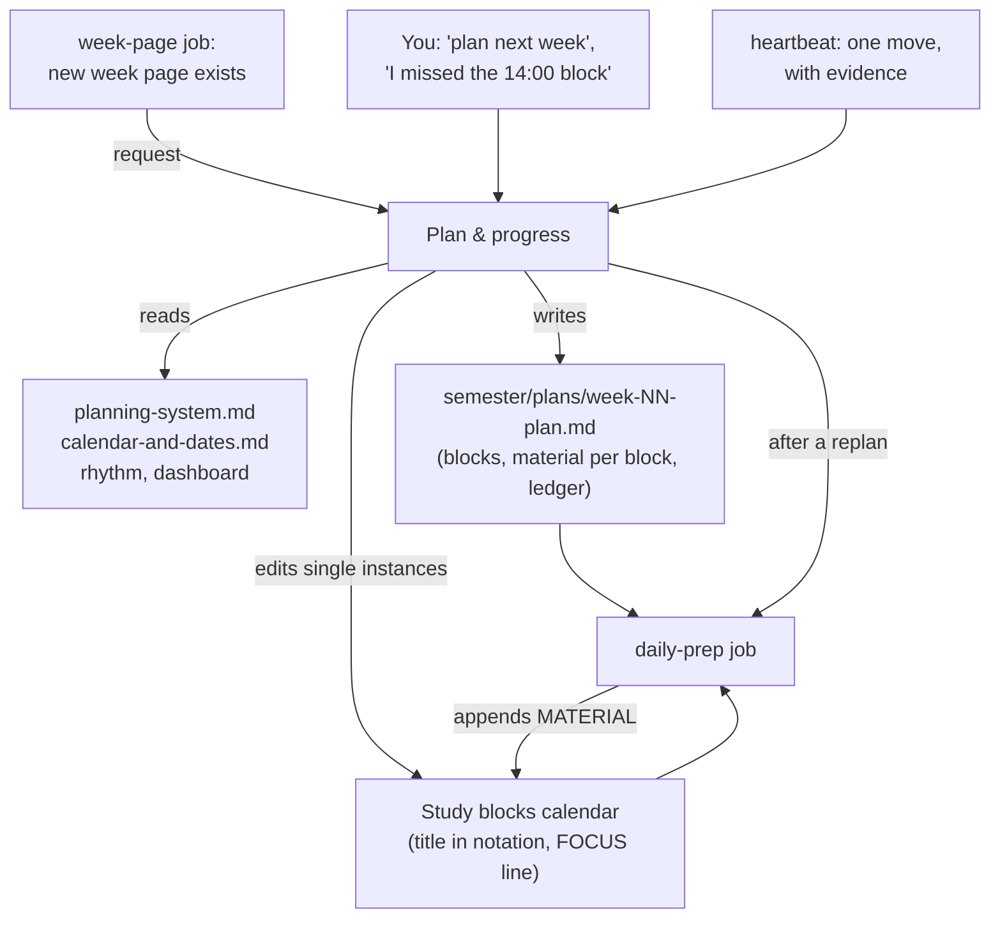

# Planning

A planner agent that turns "what is due" into blocks in your calendar and keeps them true when the week doesn't go to plan. You get a term calendar page (week numbering, weekly class grid, release rhythm, key dates, exam logistics), a planning system page (which calendar holds what, a terse block notation for titles, what goes into a block's description, house rules, planning principles, the week-plan procedure), one written plan per week with a ledger of every calendar edit, a decision record for your study approach, and a frame for scheduling the exam phase. The role **Plan & progress** owns all of it, together with the progress records.

## At a glance

| | |
|---|---|
| Tier | standard |
| Requires | `core`, `courses`, `progress` |
| Recommends | `check-in` (asks for the week plan when a new week page exists), `daily-prep` (reads each plan's "Material per block"), `student-model` (rhythm file for validating layouts), `heartbeat`, `experiments` |
| Obsidian | optional |
| OS | any |
| Runtime | laptop, cloud, VM; the role needs a calendar tool (Google Calendar connector in the original) and write access to the vault |
| Jobs | `deadline-audit` (optional, off when installed): the read-only deadline audit, once before the exam phase. The role itself is triggered by the `week-page` job's request, by you, or by the heartbeat |
| Roles | `plan-and-progress` ("Plan & progress") |
| Cost | one session; a week plan is one longer turn per week, replans are short turns. The original ran it as a persistent session on an always-on host |

## Why it exists

The original student planned self-study into a calendar of their own, block by block, around a dense class timetable. Without rules, plans drifted: a block's description still described last week's task, the same subject was moved five times and became the residue of every week, a deep block landed in the student's known afternoon low, and a plan changed twice in six hours. The planner role and its conventions grew out of that:
- **Separate calendars by ownership**, so the official timetable is never touched and personal events only serve to avoid collisions.
- **A terse title notation** (`X_` main subject, `(X)` optional, `[X]` read ahead, `OP` optional personal) so a glance at the week says what each block is for, and machines can parse it.
- **Descriptions with owner-separated parts**: the planner writes tasks, place, stop rule and a `FOCUS:` line; the daily-prep job appends a `MATERIAL` block at the very end and touches nothing else.
- **A written plan per week** with stacked dated updates (never rewrites), a cut order, and a ledger of every calendar edit, so later questions ("why did DM move?") have answers.
- **Standing approval with a report**: after the first weeks the student let the planner edit study blocks without asking, on the condition that it always says exactly what it changed.

## How it works

1. **Setup** renders `semester/calendar-and-dates.md` (week rule, a term-week table, weekly grid from each course's `lecture_slots` / `exercise_slots`, release rhythm from `sheet_release` / `sheet_due`, graded items from `assessments`, term end and holidays, an exam-logistics table) and `semester/planning-system.md` (calendars from `calendar.*`, the default block notation, house rules from `schedule.*`, the approval mode). The term-week table, the weekly grid, the release rhythm and the graded-items table are generated regions (`term-weeks`, `grid`, `rhythm`, `graded`): `uni-os render` refreshes them from the config even after the page was edited, so a changed last lecture day or a course added mid-term appears there without hand edits. The term-week table lists week 0 (`term.week0_monday`) through the week of `term.last_lecture_day` (weeks 0 to 13 while that key is empty), each with its Monday; it comes from the derived `term.weeks` (`config/schema.md`). Notes and exceptions go in the bullet lists under each table; the daylight-saving switch date, the other numberings (translation lines), the key dates and the exam-logistics table stay hand-kept.
2. **Each week**, when the new week page exists (the `week-page` job asks) or when you say "plan next week", Plan & progress reads the planning system, the last plan's open items, the new week page, the dates page, your rhythm file and the dashboard, then the live calendar. It counts demand (hours per item, labelled estimates) against supply (block hours), places bonus and hard-clock items first and the hardest subject in the freshest slots, applies your personal-target rule and the rebalance rule, writes a cut order, and writes `semester/plans/week-NN-plan.md`.
3. **Calendar**: blocks get titles in notation and descriptions with tasks, place, material, stop rule and `FOCUS:`. With `calendar.standing_approval = true` the planner applies them (single instances, notifications off) and lists every change in the plan's ledger; otherwise it proposes and waits for your yes. Every write is read back.
4. **During the week**, a missed or moved block, a late sheet or low energy triggers a replan: a new slot before the personal target, or a cut. The change goes on top of the plan as a dated update; the planner reports the block outcome to the running experiment (if any) and reruns the prep job for today or tomorrow. It never edits a prep note.
5. **Dates** learned anywhere go into `calendar-and-dates.md` (and into the dashboard's "Next 10 days" if close). In the last teaching weeks the check-in asks whether exam dates are out; when they are, the planner fills `plans/exam-phase-plan.md` and books the countdowns.
6. **Deadline audit** (on request, and once before the exam phase): a read-only pass that compares every documented date with the calendar and with the study blocks before it, sorted into four categories (doc date without event, docs disagreeing, calendar contradicting docs, graded deadline without a block before it), each finding with line-level evidence and a confidence level, plus a "checked and consistent" list and a "could not check" list. It writes one report, `semester/plans/deadline-audit-YYYY-MM-DD.md`, and changes nothing else; fixes go through the planner's usual rules after you have read it. On request, Plan & progress runs it in its session ("audit my deadlines"). The optional job `deadline-audit` (installed **off**) runs the same procedure headless once, on `term.last_lecture_day` at `schedule.day_start`; it uses no keys of its own, has no schedule when no last lecture day is set, and its `PRECHECK` skips when today's report already exists. The original ran the audit once as a side session in week 7; its findings fed the heartbeat's checks.

### The default block notation

| Notation | Meaning |
|---|---|
| `X_` | X is the main subject of the block |
| `X, Y` | the order the subjects are worked in |
| `(X)` | optional |
| `[X]` | reading ahead for the next lecture or exercise class, not consolidating past material |
| `OP` | optional personal (gym, errands): not a study block |
| `(deep)` | a long focus block |

Examples with course shorts: `AD_, DM` · `AD_ Sheet 6` · `LA_ quiz prep, (PROG)` · `[DM]` · `OP Gym` · `(Catch-up)` · `(Bad-day overflow)`. This is a **default**: change the table in `semester/planning-system.md`, set `calendar.notation = "custom"`, tell your agent, and adjust the cockpit's title patterns (`[cockpit]` table) if you use it.

### File formats

Parsed by the daily-prep job, the heartbeat and the cockpit; keep them.

- **Calendar titles.** Courses calendar: lectures start with `calendar.lecture_prefix` (default `L:`), exercise classes with `calendar.exercise_prefix` (default `E:`); everything else there is a graded fixture. The cockpit accepts `V:`/`L:` and `U:`/`E:` by default. Study-blocks calendar: the notation above; a block's course is the segment with `_` (`LA_ mock A`), else the first course named; `(`... or `OP` = optional; `deep` = a long block.
- **Descriptions.** Free text with a `FOCUS:` line (the line after the marker, or up to six bullet lines under it, are shown by dashboards). The **last** block may be the daily-prep job's `MATERIAL (daily prep, <Ddd D Mon HH:MM>; all of it in <Obsidian|the vault>: semester/prep/<note>)` followed by one line per item. Nobody else edits it.
- **Week plan** `semester/plans/week-NN-plan.md` (template `_templates/week-plan.md`): frontmatter `type: plan`; title `# Week N plan (<range>): <context>`; updates stacked at the top as `## Update <Ddd D Mon> ~HH:MM: <what> (<who decided>)`; `## Blocks` with **one line per day** `- **Mon:** HH:MM-HH:MM <title> · HH:MM-HH:MM <title>` (the heartbeat reads these when no prep note exists); `## Material per block (...)` (**required**: the daily-prep job reads it); `## Calendar edits (applied <time>, single instances, notifications off)` with Changed / Created / Deleted. Dashboards find the newest plan by the zero-padded file name.
- **Key dates** in `calendar-and-dates.md`: table `| Date | Course | What |`, dates as `Ddd D Mon HH:MM`, bold for graded fixtures, cancelled rows struck through with "**DROPPED (<who>, <date>)**".

## What gets installed

| Vault path | What |
|---|---|
| `semester/calendar-and-dates.md` | term weeks (generated table), weekly grid, release rhythm, graded items, key dates, term end, exam logistics |
| `semester/planning-system.md` | calendars, block notation (default, changeable), descriptions, approval rules, house rules, principles, week-plan procedure, freeze pointer, plan history |
| `semester/study-approach.md` | decision record: current approach, history, ideas parked |
| `semester/plans/README.md` | what lives in `plans/` and the shape of a week plan |
| `semester/plans/exam-phase-plan.md` | scheduling frame for the lecture-free period and the exam session (phases, day template, countdown T-10 to T+1, merge rule, exam-date watcher); scheduling only |
| `_templates/week-plan.md` | the week-plan template |
| `_agent/roles/plan-and-progress.md` | the role brief (from `roles/plan-and-progress.md`) |
| `_agent/jobs/deadline-audit/job.conf`, `prompt.md` | the optional deadline-audit job (installed off) |

## Configuration

| Key | Default | Meaning |
|---|---|---|
| `calendar.provider` | `"google"` | `google` (the original's Google Calendar connector), `other` (whatever calendar tool your agent has), or `none` = no calendar; the week plan's Blocks section is the schedule |
| `calendar.courses` / `study_blocks` / `events` / `busy` | `"Courses"` / `"Study blocks"` / `"Events"` / `"Busy"` | calendar names, found by name at run time (ids never stored) |
| `calendar.notation` | `"default"` | `custom` after you change the notation table |
| `calendar.lecture_prefix` / `exercise_prefix` | `"L:"` / `"E:"` | title prefixes in the Courses calendar (the original used German `V:` / `U:`) |
| `calendar.standing_approval` | `false` | `true`: the planner edits study blocks without asking first, then reports |
| `calendar.default_location` | `""` | location written into every block until real spots are named |
| `schedule.day_start` / `weekday_stop` / `study_cutoff` | `"08:00"` / `"18:15"` / `"19:00"` | earliest start, weekday stop, no blocks after |
| `schedule.focus_minutes` / `break_minutes` | `70` / `10` | focus span and break length |
| `study.personal_deadline_rule` | `""` | e.g. "every sheet released in a week is done by that Sunday" |
| `term.holidays` | `[]` | `[{ name, from, to }]` |
| `term.week0_monday` | required (core) | week 0 of the term-week table (`term.weeks`, derived) |
| `term.last_lecture_day` | `""` (core) | the last row of the term-week table (its week), and the date the optional `deadline-audit` job runs on (at `schedule.day_start`); empty = the table shows weeks 0 to 13 and that job only runs when started by hand |
| per course: `lecture_slots`, `exercise_slots`, `sheet_release`, `sheet_due`, `assessments`, `assistance`, `week_numbering`, `exam_format` | (courses module) | the weekly grid, the rhythm, the help policy, the course's own week numbering (written as a translation) and the exam logistics (format, length, aids; logistics only) |

The setup interview asks: which calendar app (and whether agents may use it), the calendar names, how you title lectures and classes, whether the planner may edit without asking, your earliest start, weekday stop and latest block, your focus span, protected slots and rest time, your personal deadline rule, holidays.

## Daily use

- "Plan next week." / "Replan today: the 14:00 block didn't happen." / "I have an appointment Thu 15:00-16:30, move what collides." / "I'm wrecked, give me a cut order for the rest of the week."
- "Put AD quiz 2 on Wed 11 Nov 14:15 in the calendar." / "When is the next graded thing?" / "How many hours of LA are planned this week?"
- "Freeze the plan for three weeks." (with the `experiments` module) / "My exam dates are out: <paste>." / "Audit my deadlines against the calendar."
- In the calendar app on your phone, each block's description shows what to do, where, when to stop, the FOCUS line and (with `daily-prep`) the MATERIAL links.

## Agents other than Claude Code

The role brief and pages are plain Markdown; any agent with a calendar tool and vault access can play Plan & progress. Only tested with Claude Code. Differences:
- **Calendar access.** The original used the Google Calendar connector in Claude Code (list calendars, get, update with notifications off, create, delete single instances). Another agent needs an equivalent tool; without one, set `calendar.provider = "none"` and the week plan's day lines become the schedule (the prep job then reads them).
- **Persistent session.** In Claude Code the role ran as a long-lived session (on an always-on host, reachable from the phone with Remote Control). Elsewhere, open a fresh session with the role brief when you need it; the brief's start-up list makes that cheap.
- **Messages between sessions.** Requests from the `week-page` job reach the role as an inbox note (`inbox-sync`), a direct message (Claude Code `SendMessage`), or a line in the week page's Notes, whichever your setup supports.

## Failure modes and fixes

| Symptom | Cause | Fix |
|---|---|---|
| The prep note or the phone shows yesterday's task for a block | a replan changed the plan file but the calendar write failed or was never applied | the planner must read every edit back; ask "check today's blocks against the plan"; rerun the morning check |
| Same subject moved again and again | no cut order, every miss replanned | freeze the layout (experiments) or write a cut order and accept drops |
| A deep block keeps failing in the afternoon | layout ignores the energy curve | validate against `me/rhythm-and-habits.md`; move hard subjects to the freshest slots |
| Calendar edit "denied" | the agent's permission mode or the connector refused | don't work around it (no API keys, no feeds); approve in the app or apply by hand from the plan's ledger |
| Times one hour off | the calendar tool returned UTC | convert to `term.timezone`; read back after writing |
| A recurring class was changed for good | an edit hit the series instead of an instance | restore in the calendar app; the rules say single instances only |
| Week numbers disagree between files | another numbering (LMS, course site) leaked in | one project numbering; add the translation to `calendar-and-dates.md` |
| The term-week table ends too early or too late | `term.last_lecture_day` is empty (the table then shows weeks 0 to 13) or wrong | set it in `_agent/uni-os.toml`, `uni-os render` |
| `render` lists `semester/calendar-and-dates.md` as skipped: "regions differ (not in the file: term-weeks)" | the page was edited before the term-week table became a generated region | replace your term-week table with the two marker lines `<!-- uni-os:begin term-weeks -->` and `<!-- uni-os:end term-weeks -->` (each alone on its line), then `uni-os render` fills it |
| A deadline was missed although it was in the notes | it was in a note but not in the calendar (or only in an event's description) | "audit my deadlines"; switch on the `deadline-audit` job for a run before the exam phase |
| `_agent/logs/flags/deadline-audit.md` exists | the audit job could not write its report, or wrote it without the calendar side | the first body line says why; the next complete run deletes the flag |

## Lessons from the original system

- **Calendar updates replace the whole description.** The connector's update call overwrote everything, so every edit starts from a fresh read of the event and keeps machine-written lines (the prep job's MATERIAL block). Its times came back in UTC and looked one hour off; recurring instances have their own ids, so edits went to the instance, never the series.
- **Verify writes.** An evening's calendar edits were reported done but never applied; the next day ran on old descriptions and the prep job served stale material. Read every event back after changing it.
- **The calendar wins once applied.** Plan files can lag; a correction says so ("the block table below is the pre-correction version").
- **Judge a block by its title.** Descriptions lag when blocks move; titles are what the student sees and what parsers read.
- **Plans change by stacked updates.** Each update quotes the student, lists old -> new per block and the hours moved, and says what it supersedes. Rewriting history made earlier decisions impossible to trace.
- **Hours accounting makes imbalance visible.** Counting hours per subject showed the best-liked course getting the most time while two others were behind; the rebalance rule (freed time to the lowest-rated course) came from that.
- **Too many changes ruin the data.** "Every week I'm trying to change something, and this is not good. It's very bad for data." That led to a three-week frozen plan (see the `experiments` module).
- **Every block needs a place.** Time lost finding a room was a real cost; a default spot in the location field fixed it.
- **Programming tasks run long.** Online-judge tasks consistently took longer than their slots; a deadline-day start made the student lean on hints. Plan them early in their cycle.
- **Protect what works.** An exercise class the student valued was marked protected and never offered up as free time.

## Removing it

`uni-os disable planning` removes the role from the routing table, marks the `deadline-audit` job disabled and stops re-rendering these files; your plans, pages and audit reports stay. If you had switched the job on, also remove its laptop task or turn it off on the always-on host (`uni-vm jobs off deadline-audit`). `daily-prep` requires `planning`, so disable it first. Calendar blocks the planner made stay in your calendar.
