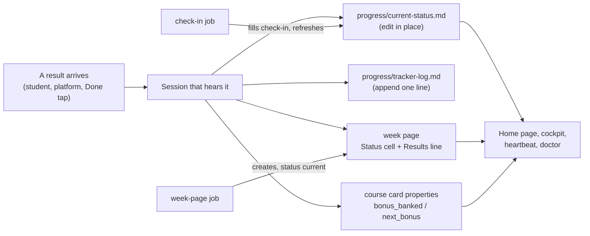

# Progress tracking

Your agents keep one honest answer to "where do I stand?". A dashboard page shows your bonus or grade standing per course with the arithmetic written out, what is done and what is still open, your latest self-ratings and the next 10 days. An append-only tracker log keeps every result and decision with its date and source. One page per term week lists what is due that week, what came back, and the end-of-week check-in. Several of these formats are parsed by the cockpit plugin, the heartbeat and `uni-os doctor`, so they are fixed contracts (see [File formats](#file-formats)).

## At a glance

| | |
|---|---|
| Tier | standard |
| Requires | `core`, `courses` |
| Recommends | `planning` (week plans link to week pages), `check-in` (creates and closes week pages on a schedule), `obsidian`, `cockpit` (shows the dashboard and the "Due this week" table), `heartbeat` (asks for missing results) |
| Obsidian | recommended (Home embeds and Bases views read these pages; plain Markdown works without it) |
| OS | any |
| Runtime | laptop, cloud, VM (any session that can write the vault) |
| Jobs | none of its own (the `check-in` module adds `check-in` and `week-page`) |
| Roles | none of its own (the `planning` module's `plan-and-progress` role is the main writer) |
| Cost | no agent usage of its own; every update costs a few file edits in the session that hears a result |

## Why it exists

In the original system (a first-year computer science student's term) results arrived from everywhere: a weekly online quiz, group sheets graded by a TA, an oral bonus, programming tasks with automatic tests, timed bonus tasks. Each course had its own bonus scheme (full bonus at 80 % of all points; 5 of 7 quiz points; linear in oral points; proportional below a threshold). Without a single place, nobody knew whether a bonus was still reachable, sheets silently rolled over, and every agent asked the student the same questions again.

The fix was a strict split between **state** and **history**: the dashboard is edited in place and always shows the current numbers; the tracker log only ever grows. Every result fans out to the dashboard, the log, the course card's bonus properties and the week page in the same turn. A weekly page made the week tangible ("what is due by Sunday?") and gave the check-in a fixed place to land.

## How it works



1. **Week page created.** Before each term week, the `week-page` job of the `check-in` module (or your agent when you ask) creates `progress/weeks/week-NN.md` from `_templates/week-page.md`, fills "Due this week" with the real items of that week (from your course rhythm in the config, the course cards, the key dates and anything still open), sets it `current` and the previous page `done`.
2. **Results come in.** Whoever hears a result (you in chat, a course session, a Done tap applied by the inbox sync, the check-in) writes it to four places in the same turn: the dashboard, the log, the course card, the week page. Statements by the student win over derived data; estimates and inferences are labelled; numbers are never guessed.
3. **Check-in.** At the end of each period the `check-in` job asks you once for the results it doesn't have yet, fills the week page's check-in section, re-dates the dashboard snapshot, recomputes every bonus row, prunes the "Next 10 days" table and appends one tracker line.
4. **Readers.** The Home page embeds "Next 10 days"; Bases views list week pages by `status`; the cockpit parses the dashboard, the week page and the course cards; the heartbeat checks due items and the bonus pace; `uni-os doctor` validates the shapes.

### Bonus and grade tracker logic

Agents compute the standing from your config: each course's `[[courses.assessments]]` (what counts for `bonus`, `grade`, `admission` or nothing, with optional `points_max` and `dates`) and its `[courses.bonus]` table. The `rule` text is the authority. The numbers are spelled out per scheme:

| `scheme` | Meaning | "Bonus now" | "What's still needed" |
|---|---|---|---|
| `threshold` | full bonus at a share of all term points (`threshold`, e.g. 0.8), proportionally less below unless `proportional = false` | `max_bonus x min(1, banked / (threshold x total))` | points to the line out of the points still available, and the average share that needs |
| `points` | linear in points up to `full_at` (default `total`): "5 of 7 quiz points give the full bonus" is `total = 7`, `full_at = 5` | `max_bonus x min(1, banked / full_at)` | `full_at - banked` from the fixtures left, and the average per fixture |
| `best-n` | `required` of `total` assessments must be passed (e.g. 8 of 10 sheets), proportional below if `proportional = true` | full at `required` passes | `required - passed` more passes out of the fixtures left |
| `custom` | the `rule` text, literally (e.g. "average of the best 10 of 12 quizzes >= 70 %") | as the rule says | as the rule says |
| `none` | no bonus | `-` | `-` |

Unpublished totals are estimated from the rhythm and labelled "(est.)". Grade-counting assessments (a midterm, a project) appear in the course's detail table with their weight; admission requirements show the count so far. The optional keys `threshold`, `total`, `total_estimated`, `proportional`, `full_at`, `required`, `unit` and `counts` in `[courses.bonus]` are shared with the cockpit's bonus engine, so the dashboard and the cockpit compute the same numbers.

### File formats

These shapes are contracts. The cockpit plugin, the heartbeat pre-check, `uni-os doctor` and the jobs read them; `scripts/org_formats.py` in this module is an executable reference (with unit tests in `tests/`).

**Week page** `progress/weeks/week-NN.md` (NN = two-digit term week; week 0 = `term.week0_monday`):

```markdown
---
type: week
week: 7
start: 2026-11-02          # Monday, ISO
end: 2026-11-08            # Sunday, ISO
status: current            # upcoming | current | done
audience: me
updated: 2026-11-06
tags: [uni/week]
---
# Week 7: Mon 2 Nov to Sun 8 Nov 2026

Plan: [week-07-plan.md](../../semester/plans/week-07-plan.md)

## Due this week
| Item | Official deadline | Personal target | Bonus | Status |
|---|---|---|---|---|
| AD exercise sheet 6 (out Thu 29 Oct) | Thu 5 Nov 23:59 | Sun 1 Nov | 10 pts | open: tasks 1-3 done, 4 open |
| DM graded sheet 4 (out Mon 2 Nov) | Mon 9 Nov 12:00 | Sun 8 Nov | 2 pts (solo) | done 1.5 / 2 (Fri 6 Nov ~16:10, LMS feedback) |

## Results this week
- Fri 6 Nov ~16:10: DM graded sheet 4 = **1.5 / 2** (LMS feedback).

## Notes
- Created Sun 1 Nov 10:00 by the week-page job. Carried over from week 6: ...

## End-of-week check-in
- Done: _To fill_
- Focused hours: _To fill_
- What worked: _To fill_
- What didn't: _To fill_
- Missed: _To fill_
- Self-rating: _To fill_
- Rolls over: _To fill_
```

- The four headings are exact and in this order (`## Due this week`, `## Results this week`, `## Notes`, `## End-of-week check-in`). The original's "(Sat)" suffix is gone because the check-in day is configurable.
- `status`: exactly one page is `current`. `upcoming` only for pages made more than three days ahead. **Check-in done = no `_To fill_` marker left in the check-in section**, independent of `status` (a page can be closed by the next page before its check-in runs).
- Table columns are located by header words: `item`, `official|deadline`, `target|sunday` (the personal-target column, header from `study.target_column`), `bonus`, `status`. Readers must accept the original "Sunday target" header too.
- **Item** starts with the course `short` (course detection) and is unique within the week (Done taps match it exactly).
- **Official deadline**: `Ddd D Mon HH:MM`, English abbreviations, 24 h; ranges `Wed 11 Nov 14:15-14:45`; a soft date (no hand-in) starts with `tutorial` or contains `(tentative)` and is never overdue. The year is inferred from the term.
- **Bonus**: points (`4 pts`), or `none` / `no` / `feedback only` (= no bonus; a passed open item then "lapses" instead of turning overdue).
- **Status (the done-status vocabulary)**, checked in this order after leading Markdown emphasis is stripped: a Done-tap mark `done (<Ddd D Mon HH:MM>, tapped). Before: <old cell>` = done; `not reported`, `pending` or `not recorded` anywhere = **pending** (took place, result unknown; this wins over a done word, so `submitted (score pending)` is pending); a cell that **starts with** `✓`, `done`, `submitted`, `closed`, `handed in`, `uploaded`, `dropped`, `skipped` (whole words) or a score `x / y` / `x/y` = **done**; `not released` = a future item; anything else (including `not done`, `not submitted`) = open, and overdue once its deadline has passed. The looser historic reading "contains done / submitted / x/y / ✓ and not 'not done'" must give the same answer, which it does when the verdict comes first. This is the order the cockpit uses.

**Dashboard** `progress/current-status.md`:

| Part | Parsed shape |
|---|---|
| Snapshot | first bold line `**Snapshot: <Ddd D Mon YYYY>, <time of day> (end of term week N).**` |
| `## Bonus standing` | table `Course / Banked / Bonus now / What's still needed / Full bonus at` (read by agents and people; the cockpit computes its own bonus view from the course-card properties and `[courses.bonus]`) |
| `### <short> detail` | tables `Stream / Results / Total` |
| `## Exercises: done vs. to do (as of <date>)` | one `### <short>` subsection per course; the cockpit shows each in that course's panel |
| `## Self-rated understanding` | **first line**: parts separated by ` · `, each `<short> ~NN %` or `<short> NN-MM %` |
| `## Next 10 days` | table `When / What`, When = `Ddd D Mon[ HH:MM]`; rows before today are dropped by readers; `Later: ...` paragraph after it; the Home page embeds this section, so the heading is fixed |

**Tracker log** `progress/tracker-log.md`: append-only lines `- <Ddd D Mon YYYY> ~HH:MM (<source>): **<key fact>** <details>; <consequence>; <unknowns>.` under `## Entries`. Corrections are new lines. The heartbeat appends its own lines with the source `(heartbeat)`.

**Course card properties** (the card itself belongs to the `courses` module): `bonus_banked: "x / y graded (p %)"` (first `x / y` = banked / graded so far), `bonus_target: "80 % of ~156 pts (est.)"` (threshold courses: `NN % of ~M` is parsed for the pace check) or `"8 points"`, `next_bonus: "<Ddd D Mon HH:MM> <what> (<solo|group>)"`.

## What gets installed

| Vault path | What |
|---|---|
| `progress/current-status.md` | the dashboard, with one row and one "Exercises" subsection per course from your config |
| `progress/tracker-log.md` | the log header and its line format; entries are appended below `## Entries` |
| `progress/weeks/README.md` | what week pages are, the lifecycle, status values |
| `_templates/week-page.md` | the week-page template: runtime placeholders `{{week.number}}`, `{{week.nn}}`, `{{week.monday}}`, `{{week.sunday}}`, `{{week.label}}`, `{{week.status}}`, `{{date:YYYY-MM-DD}}` stay for `uni-os new-week`; the course rows (one per assessment of each course) are rendered at install |
| `_agent/progress-tracking.md` | the rules for agents: the four-place write, log format, lifecycle, the done-status contract, dashboard sections, the bonus logic, never-list |

## Configuration

| Key | Default | Meaning |
|---|---|---|
| `study.target_column` | `"Personal target"` | header of the personal-target column (the original: "Sunday target") |
| `study.personal_deadline_rule` | `""` | your own deadline rule, e.g. "every sheet released in a week is done by that week's Sunday"; fills the personal-target column |
| `[[courses.assessments]]` | `[]` | what each course grades: `name`, `kind`, `schedule` (free text, e.g. "weekly; out Mon, due Sun 23:59"), `counts_for`, optional `points_max`, `dates` |
| `[courses.bonus]` | `scheme = "none"` | `scheme`, `max_bonus`, `description`, `rule` (plus the optional engine keys listed above) |
| `term.week0_monday` | (required, core) | the Monday of term week 0 |

What the setup interview asks for this module: every graded or bonus-bearing item per course and its rhythm; the bonus or grade scheme in the course's own words; whether you keep a personal deadline rule and what to call its column; whether you want self-ratings at the check-in.

## Daily use

- Tell any session what happened: "AD quiz 3 out of 4", "DM sheet 6 done except 6.5, parked", "LA hand-in uploaded". It updates the dashboard, the log, the card and the week page, and says what it changed.
- Ask: "where do I stand in AD?", "what's still open this week?", "can I still get the full bonus in LA?" The answer comes from the dashboard with the arithmetic.
- "Create next week's page" (if you don't use the `check-in` module's job), "check-in" (for an unscheduled check-in).
- In Obsidian, the Home page shows "Next 10 days"; the Weeks view lists all week pages; the cockpit shows the current week's due items with Done buttons.

## Agents other than Claude Code

Nothing here depends on Claude Code: these are Markdown files and rules in `_agent/progress-tracking.md` that any agent can follow when your `AGENTS.md` points it there. Only tested with Claude Code. Agents that cannot edit existing files (for example some cloud connectors that can only create files) must send an update note through the `inbox-sync` module instead of editing; the sync applies it with an anchor check ("the vault wins").

## Failure modes and fixes

| Symptom | Cause | Fix |
|---|---|---|
| A finished item still shows as open (or an open one as done) | the Status cell doesn't start with the verdict | rewrite the cell verdict-first (`done 4 / 4 (...)`, `open: tasks 1-2 done`) |
| Dashboard numbers are old | a session recorded a result only in one place | ask "sync progress from the tracker log"; the agent replays newer log lines into the dashboard and re-dates the snapshot |
| Two week pages are `current` | a page was created by hand and the old one not closed | set the older one `done` (`uni-os doctor` reports it) |
| No current week page | the week-page job didn't run (laptop asleep, job off) | "create this week's page"; check the job's log |
| Check-in never filled | you didn't answer the check-in session | the next check-in marks the old page "not checked in" and asks about both weeks at once |
| Bonus row says "on track" with no numbers | an agent summarised instead of computing | ask for the arithmetic; the rules require it next to every verdict |
| Times one hour off in log lines | a tool returned UTC | convert to `term.timezone` before writing |

## Lessons from the original system

- **Status vocabulary is part of the parser contract.** "Done" or a score anywhere in a cell once counted as done and hid an open two-point bonus task; the fix was "only the start of the cell counts", and closed-by-choice items were reworded so they parse.
- **The real latency was the notes, not the UI.** A result reached the week page only at the next sync, hours later. Writing in the same turn (and a Done tap that leaves a note) fixed more than a faster dashboard would have.
- **Keep state and history apart.** The log reached 61 KB in six weeks; the dashboard exists so nobody reads the whole log.
- **Label estimates.** Bonus totals were often unpublished; every derived maximum carried "(est.)" and "the official maximum is not published", and the arithmetic stood next to every verdict (in the shape "80 % of ~M is X, so ~Y more out of the ~Z still available (~P %)").
- **Carried-over results stay in their week.** Results of items carried into a new week belong to the old week until its check-in; otherwise week totals stop meaning anything.
- **Dictated messages are ambiguous.** Ambiguous reports were recorded "to be confirmed" and verified read-only on the platform before anything was ticked.
- **Status cells cite their evidence and keep the old value** ("submitted (LMS shows 'Submitted for grading', checked <date>). Before: open"), which made later disagreements easy to settle.

## Removing it

`uni-os disable progress` stops the module's files from being re-rendered and removes its contracts from the generated maps; your pages stay. Disable `check-in` first (it writes week pages), and expect `planning` and `daily-prep` to lose their links to week pages. Delete `progress/` yourself only if you no longer want the history.
