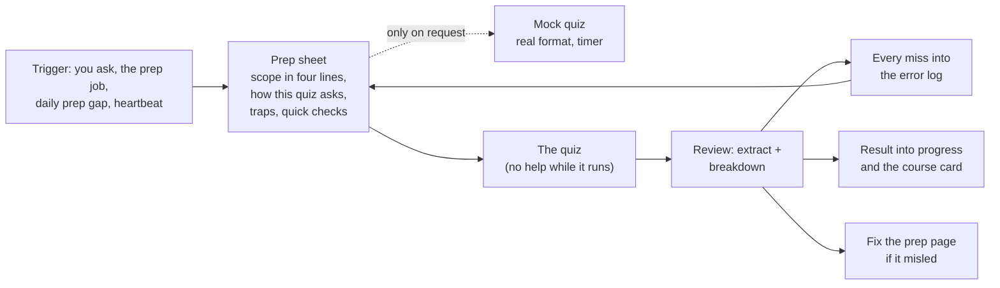

# Quiz coaching

Many courses have small graded quizzes during the term: a timed quiz on the learning platform every week, a short written quiz at the start of the exercise class every second week, or online quizzes that open with each exercise sheet. Each one is worth only a little, but together they decide the bonus, and they are the best feedback you get before the exams. This module adds the **quiz-coach role**: before each quiz it checks the scope, builds a prep sheet (what to know, how this quiz tends to ask, your own traps, quick checks with answers checked by code) and, if you ask, a mock quiz in the real format; after each quiz it turns the official review or the photo of your graded paper into a breakdown, logs every miss in the error log, records the result, and fixes the prep material if it misled you. An optional scheduled job builds the prep sheet on its own a few days before each quiz. Every practice question is labelled invented, adapted or official, and adapted or official always means this term's own material.

## At a glance

| | |
|---|---|
| Tier | standard |
| Requires | `core`, `courses`, `error-logs`, `study-pages` |
| Recommends | `progress` (results), `roles`, `daily-prep` and `heartbeat` (they notice a missing prep sheet) |
| Obsidian | optional |
| OS | any |
| Runtime | laptop, cloud, VM |
| Jobs | `quiz-prep` (optional, off when installed): builds the prep sheet a few days before each graded quiz |
| Roles | `quiz-coach` (one shared brief; one session per course with graded quizzes) |
| Cost | agent usage; a prep sheet is a short page, a mock a medium one (the original's job run, prep sheet plus mock, cost about 0.5 % of a week's usage) |

## Why it exists

In the original system three courses had three different quiz regimes, and the same three-part loop worked for all of them: **prep → quiz → review**, where the review feeds the error log and the next prep. Concretely:

- A **live weekly quiz** on the learning platform: a fixed morning window behind a TA password, a 15-minute timer per attempt but a hard close of the window (so starting late costs minutes), about 12-15 questions (true/false, single choice, select-all, a typed number), one attempt, worth a few bonus points each. Prep was a checklist page built the same morning; after each quiz the saved attempt review became a text extract and a breakdown.
- A **written quiz every second week** at the start of the exercise class: 15 minutes, no aids, two short problems, best five of seven counted. Prep was a bigger sheet with origin tags per item and a timed mock in the real format the day before; after grading, a photo of the paper and every TA comment went into the error log.
- **Online quizzes tied to the sheets**, open for two weeks with retries: misses went into the error log with a short summary.

The reviews paid off: "how this quiz asks" tables built from real past reviews of the same course made the patterns visible (options that differ by one symbol, "trace a tiny input and type a number", "guaranteed / necessarily / in the worst case"), and a dropped qualifier in one checklist, which caused a wrong answer, taught the rule "copy the course's exact words".

## How it works

### The quiz is described by parameters
Each course's quizzes are listed in the config as `[[courses.assessments]]` with `kind = "quiz"`; the details are written once, with date and source, in the course's quiz facts (`<course>/quiz-prep/<slug>-quiz-prep.md`): format, window, timer vs hard close, number and types of questions, points and counting (e.g. best n of m), attempts and aids, the **official scope wording quoted** plus the inferred mapping to lectures and sheets, the **numbering trap** (e.g. the platform's "Quiz Week k" is term week k−1), and where the review comes from.

### Prep sheet
Built the evening before or the same morning, HTML when there are formulas or quick checks (on the study-page engine), Markdown otherwise:
1. quiz facts box; 2. **scope in four lines** (lectures with cut-off and pages, the sheet in scope and why, not in scope, unknown); 3. weighting with stars (★★★ the newest lecture "never asked before, so expect most questions here", ★★ the one before, ★ older material, ★★ always: your trap family); 4. **how this quiz asks**, a table of real patterns from your past reviews; 5. core material per topic, each item tagged by origin (`Plan W<n>`, `S<k> Ex <j>`, `plan only`, `sheet only`, `edge`) and ending with "In practice: ..." and a traps callout from the error log; 6. a cheat card; 7. a drill on the weak pattern; 8. about ten quick checks with answers checked by code, each labelled with pattern and origin; 9. a **sheet map, hints only**; 10. a do-list for the last minutes; 11. sources and checks.

### Mock quiz (only on request)
The real format and timing on the study-page engine (final quiz with a clock). For written quizzes, "train at 10, expect 15". Computed answers are checked by code (in the original, typed matrices were checked by multiplying them out and any valid basis was accepted, with specific diagnoses such as "C was taken from R; it must come from the original A"); proofs are self-marked against a rubric the way the TA would mark them. Every problem is labelled official (this term's sheets or quizzes), adapted or invented.

### Review
You save the attempt review (HTML or PDF) into `quiz-prep/raw/`, or photograph the graded paper, or paste the feedback. The role writes a **review extract** (a searchable text copy: your chosen answers, the attempt summary, each question with status, mark, text, feedback and correct answer) and a **breakdown** (`type: quiz-review`: result, time used, scope seen, right, missed with the correct idea, pattern, lessons for the next quizzes, prep fixes). Then every miss goes into the error log, the score into the progress files and the course card, and misleading prep wording is fixed with a dated note.

### Assistance levels and quizzes
The quiz attempt itself is always the student's own: no help while it runs, at any level. The quiz's resolved level (assessment, then course, then `study.assistance_default`) decides prep and review: `hints-only` (the default) and looser allow prep sheets, mocks on request, explanations and the review after the result is out; `solo` means the course forbids help on that quiz, so the coach builds nothing aimed at it, does no review and logs nothing from it. In the original system the quizzes were at the default level. Set `solo` on a quiz only if the course really forbids preparing it with help.

### The optional prep job (`quiz-prep`)
Role sessions act only when spoken to. In the original, nothing triggered the prep page for the remaining written quizzes of one course, so a headless job was added that ran on fixed dates, four days before each quiz; it is shipped here **off by default**. It runs at `schedule.quiz_prep` on the dates in `schedule.quiz_prep_dates` (";"-separated; empty = it never starts the agent). The quiz coach fills a **Planned quizzes** table in each course's quiz-prep file (run date, quiz, date and time, lectures up to, sheet in scope, file stem) and proposes the run dates. Each run: finds the quizzes within `study.quiz.prep_lead_days`; skips `solo` quizzes; **stops if the sheet already exists** (the coach may have built it); maps the official scope rule to lectures and sheets and labels it inferred; builds the sheet from real sources only (writes what is missing instead of filling in); adds the timed mock where the course's quiz facts say "Mock with the prep sheet: yes" (or `study.quiz.auto_mocks` is on); checks, twins and indexes it; sends **no notification** (the daily prep picks it up, and a missing page shows there as a gap); when a due sheet could not be built it leaves a failure flag `_agent/logs/flags/quiz-prep.md` (the heartbeat module's format), which the next complete run deletes.

### Rules
No help while a graded quiz is running; course sites are read-only (never start an attempt, never submit); inferred scope is labelled inferred; practice questions come from this term's material or are invented, and say which; the course's exact qualifiers are copied; current sheet tasks stay hints-only even inside prep material; mock questions may have worked answers because they are practice.

## What gets installed

| Vault path | What |
|---|---|
| `_agent/roles/quiz-coach.md` | the role brief, with the course sessions rendered from the config |
| `<course folder>/quiz-prep/<slug>-quiz-prep.md` (one per course) | the course's graded assessments (from the config), quiz facts to fill in, the file formats, and an index of prep and review files |
| `_templates/quiz-prep-sheet.md` | prep-sheet skeleton (Markdown version) |
| `_templates/quiz-review.md` | review-breakdown skeleton |
| `_agent/jobs/quiz-prep/job.conf`, `prompt.md` | the optional prep job (installed off) |

Prep sheets, mocks, extracts and breakdowns are created later in `<course folder>/quiz-prep/`; saved raw reviews and photos in `quiz-prep/raw/`.

## Configuration

| Key | Default | Meaning |
|---|---|---|
| `courses[].assessments` | `[]` | graded items; quiz coaching handles `kind = "quiz"` (`name`, `kind`, `schedule`, `counts_for`, `assistance`, `points_max`) |
| `study.quiz.auto_mocks` | `false` | build a mock with every prep sheet of every course (off: mocks on request, or per course with "Mock with the prep sheet: yes" in its quiz facts) |
| `study.quiz.prep_lead_days` | `4` | the `quiz-prep` job builds sheets for quizzes within this many days |
| `schedule.quiz_prep` | `["09:00"]` | run time of the `quiz-prep` job |
| `schedule.quiz_prep_dates` | `""` | run dates, e.g. `"2026-11-07; 2026-12-05"` (four days before each quiz); empty = the job never runs |
| `study.assistance_default`, `courses[].assistance`, `courses[].assessments[].assistance` | `hints-only` | a quiz's level decides prep and review (`solo` = nothing aimed at that quiz) |
| `agent.heavy_model` | `""` | model for these sessions |

The interview asks, per course: is there a recurring graded quiz; its format (platform quiz, written in class, online with retries), when it runs, how long, how many questions and of which types, how it counts, the official scope wording, how the course numbers its quizzes, where you will find the review afterwards, whether the course allows preparing it with help (normally yes: the level stays `hints-only`), and whether you want a timed mock with every prep sheet and the prep job to build it on its own. Quiz windows can also be entered as quiet windows for notifications (module `notifications`).

Note on the file name: the per-course index is called `<slug>-quiz-prep.md` rather than `README.md`, because the vault keeps note names unique (several folders named `README.md` make links and Obsidian's quick switcher ambiguous).

## Daily use
- "Prep me for Monday's quiz." / "What's in scope for quiz 4?"
- "Make me a mock for Thursday's quiz, 15 minutes." (only when you ask)
- "Here's the review of today's quiz" (attach or drop the saved page into `quiz-prep/raw/`). / "Here's a photo of my graded quiz 3."
- "Which question types do I keep missing?" / "Drill me on the recurrence pattern."
- "The remaining AD in-class quizzes are on Wed 11 Nov and Wed 9 Dec: plan them and build the prep sheets automatically." (Planned quizzes table, run dates four days before each, job switched on)

## Agents other than Claude Code
Plain files; any agent works. Reading the platform's quiz review through your logged-in browser needs a browser-capable agent (in Claude Code: the Claude in Chrome extension or the built-in browser; read-only; module `course-files-fetch` covers the rules); otherwise save the review page yourself into `quiz-prep/raw/`. HTML prep sheets are shown with `SendUserFile` in Claude Code, by path elsewhere. The `quiz-prep` job runs like every job: in Claude Code as a desktop scheduled task, a headless `claude -p` run through the laptop scheduler, or on the VM; other agents run `prompt.md` in their own non-interactive mode (module `scheduler-local`). Only tested with Claude Code.

## Failure modes and fixes

| Symptom | Cause | Fix |
|---|---|---|
| Prep covered the wrong lectures | scope rule mapped wrongly, or the quiz numbering offset ignored | quote the rule, write the numbering in the quiz facts, label the mapping as inferred |
| A miss caused by the prep sheet | a qualifier dropped or a fact simplified | fix the page with a dated note; log the miss with the cause |
| No prep sheet before the quiz | no trigger fired | switch on the `quiz-prep` job with the quiz dates; ask the evening before; enable `daily-prep` or `heartbeat`, which flag a quiz without prep |
| The prep job built nothing | no quiz within `prep_lead_days`, the quiz is `solo`, the sheet already existed, or a source was missing | its final reply in the job log says which; a sheet that was due but could not be built also leaves `_agent/logs/flags/quiz-prep.md` (amber, red within 24 h of the quiz), which the heartbeat shows and the next complete run deletes |
| The coach refuses to prepare a quiz | the quiz (or its course) is set to `solo` | set the quiz's `assistance` to `hints-only` if the course allows prepared help |
| Timer ran out | started late against a hard close, or slow on one item | the prep's do-list says when to start; review records time used |
| Review extract incomplete | the saved page was partial, or a platform in another UI language | save the full attempt review (HTML or PDF); the extract says what was missing |

## Lessons from the original system
- **Prep → quiz → review → error log → next prep** is the loop; the review is where the learning happens.
- **"How this quiz asks"** tables from real past reviews of the same course were more useful than generic advice.
- **Copy the exact words.** A checklist that dropped "in the worst case" caused a wrong answer.
- **Scope rules are inferred.** Official scope lines are vague ("all material, focus on the previous two weeks"); the mapping to lectures is the coach's reading and is labelled as such.
- **Numbering traps** (platform weeks one off from term weeks; course weeks straddling two calendar weeks) caused confusion until every page named its numbering.
- **Timer vs hard close**: a 15-minute timer inside a window that closes at a fixed time means starting late costs minutes.
- **Mocks only on request**: the student declined automatic weekly mocks; one targeted mock the day before a written quiz worked better.
- **Give date-bound duties a job.** "A prep page before each quiz" was a promise without a trigger for one course until a small headless job on fixed dates took it over; it stops when the page exists, so it never fights the coaching session.
- **Record the state**: "timer ran out on the last question" explained a miss better than any content analysis.

## Removing it
`python tools/uni_os.py disable quiz-coaching` removes the role from routing and marks the `quiz-prep` job disabled (if you had switched it on, also remove its laptop task or run `uni-vm jobs off quiz-prep`); your quiz-prep folders, sheets and reviews stay. Quiz misses already logged stay in the error logs.
