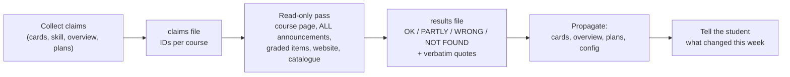

# Resources

Three cross-course method pages that keep agents honest about where course facts come from: a **sources registry** (`resources/sources-and-links.md`) with an explicit authority order and the "real source" per course, a **TA and community websites log** (`resources/ta-websites-log.md`) where every external study resource gets a read-only review (owner, edition, numbering offset, licence, integrity note), and the **course verification method** (`resources/course-verification.md`): collect every claim the system believes, check each against the official pages, give verdicts with quotes, and push the corrections back into the course cards.

## At a glance
| | |
|---|---|
| Tier | standard |
| Requires | `core`, `courses` |
| Recommends | none (pairs well with `course-files-fetch`, which needs the same browser route) |
| Obsidian | optional |
| OS | any |
| Runtime | laptop, cloud sessions, VM; a verification pass needs a session that can see the student's logged-in browser (in practice the laptop) |
| Jobs | none |
| Roles | none (any session may append; the coordinator or planning role usually runs verification passes) |
| Skills | none (the `course-facts` skill points here for verification) |
| Cost | none |

## Why it exists
Agents invent things when they don't know which source counts. In the original system:
- A lecture rundown built from a weekly plan instead of the real slides had wrong pages and invented items. The fix was a per-course "real source" recipe ("the official weekly handout first, then the script pages"; "the deck, and the student says where the lecture stopped") written down in one place.
- Course facts came from four places (a course skill, chat memory, a tracker, an exported context pack) and disagreed. One read-only verification pass in week 5 against the real course pages found a wrong release day (inferred from re-upload timestamps), two "extra sessions" that were other groups' slots, a broader quiz scope than believed, a catalogue-vs-course-page disagreement on exam language, and a week-numbering offset. Corrections then flowed into the skill, the cards and the context pack.
- Students and TAs share excellent material (TA websites, repositories with summaries and cheat sheets, card decks), but it is usually last year's edition with shifted numbering, often has no licence, and sometimes contains solutions to current graded work. A log with a fixed review checklist made it safe to use.

## How it works
### Sources registry
`resources/sources-and-links.md` states the authority order for course facts ((1) what the student says now, (2) official course pages and announcements, (3) course catalogue, (4) course cards, (5) the course-facts skill, (6) predicted plans, (7) anything derived), lists every course's official pages (rendered from config), shows the vault as the file store (official subfolders per course, naming patterns once known), and gives the real source per course for rundowns and study pages. Agents append whenever they learn a new location.

### TA and community websites log
Append-only. When the student sends a link or an agent finds a resource, the agent reviews it read-only and appends an entry with: owner, edition, what it offers, caveat (numbering offset vs this year), licence, a content map, related sites, an integrity note per course, and what was saved into the vault. The review checklist: owner and edition, numbering against this year, coverage, correctness spot-check, licence, integrity, what it adds, saved copies. Material without a licence is read-only for personal use: never redistributed, never copied into shared material; useful patterns are re-expressed in your own words.

### Course verification

1. Claims are written **before** browsing, as precise testable statements with IDs (`AD1`..., `G1`), including open questions. The page renders starter claims from the config for every course.
2. The pass runs in a session that can see the student's logged-in browser; the student signs in, the agent never types a password; strictly read-only.
3. Every claim gets a verdict and the official wording in quotes, with a source abbreviation (CP course page, ANN announcements, GB graded items, SITE website, CAT catalogue). New facts and "still open" items are listed per course.
4. Corrections go into the course cards in place, with the date and source, then the overview, plans, week page and config (so the skill re-renders right).
5. Each run is a dated folder `resources/course-verification-YYYY-MM-DD/` plus one line in the run log.

When to run: week 0-1 (first pass), after announcements that change a date, rule or scope, mid-term (week 5-6), before relying on a fact for points, and whenever two sources disagree.

## What gets installed
| Vault path | What |
|---|---|
| `resources/sources-and-links.md` | Authority order, official pages per course, vault as file store, real source per course, plans and guides, pointers |
| `resources/ta-websites-log.md` | Append-only log, review checklist, entry template |
| `resources/course-verification.md` | Method, when to run, claims and results templates, starter claims from your config, lessons, run log |
| `resources/course-verification-YYYY-MM-DD/` | Created per run by the agent (not at install) |

## Configuration
No keys of its own. It reads: `university.lms`, `university.lms_url`, `university.website`, `university.catalogue` (default `""`), `university.recordings` (default `""`), `term.label`, and per course `lms_url`, `website`, `platforms`, `recordings`, `official_subfolders`, `handwritten_folder` (only with `handwritten-notes`), `real_source`, `lecture_slots`, `exercise_slots`, `exercise_group`, `sheet_release`, `sheet_due`, `hand_in`, `session_rule`, `week_numbering`, `exam_format`, `integrity`, `assessments` (including an optional `scope`), `bonus.scheme`, `bonus.rule`, `bonus.target` (all defined with defaults by the `courses` module and repeated in this module's `[defaults]`). The starter claims on `course-verification.md` are rendered from exactly these values, with claim IDs per course (`AD1` lectures, `AD2` exercise session, `AD3` sheets, `AD3s` session rule, `AD4` graded streams, `AD5` bonus, `AD6` integrity, `AD7` exam logistics).

**What the setup interview asks:** the course catalogue URL and the recording portal (if any); per course, the LMS page, website and platforms (usually gathered with the courses questions); per course, which documents count as the real source for "what was lectured". At the end of setup the agent offers the first verification pass ("Shall we check every course fact against the course pages now? You sign in, I only read.").

## Daily use
- "Here's the TA's website for LA: <link>." The agent reviews it read-only and appends an entry with the numbering offset and an integrity note.
- "Check the course facts against Moodle." The agent writes the claims file, asks you to sign in once, walks the pages read-only, writes the results, corrects the cards and tells you what changed.
- "Did the quiz scope change?" A single-claim check, then a dated correction on the card.
- "Where do the DM lecture recordings live?" The agent reads the registry, or adds the answer to it.

## Agents other than Claude Code
Plain Markdown, no agent features needed except a browser that can see logged-in pages for verification. In Claude Code that is the desktop app's built-in browser in a laptop session (reachable from the phone through Remote Control), or Claude in Chrome for sites with HTTP credentials. Cloud sessions can't see the student's browser. Other agents use their own browser tool or work from pages the student pastes. Tested with Claude Code only.

## Failure modes and fixes
| Symptom | Cause | Fix |
|---|---|---|
| Rundown with wrong pages or invented content | No real-source recipe, agent used a plan | Fill "Real source per course"; the rule "if the source can't be opened, say so" |
| Verification "confirms" a wrong fact | Read file timestamps or a single page instead of all announcements | Read every announcement thread; announcements beat timestamps |
| Agent asks for the password | Misunderstood the browser route | The student signs in; the agent never types credentials |
| Third-party text copied into shared notes | Licence not checked | Licence line in every entry; paraphrase patterns only |
| Corrections lost after a skill refresh | Card fixed but config not | Propagate to the config; re-render the skill |

## Lessons from the original system
- **Claims first, then browse.** Writing the claims before opening any page made the pass complete and prevented "looking for confirmation".
- **Read all announcements.** Several corrections came from a single forum post (a clarification, a slot list, a scope statement) that no summary page repeated.
- **Timestamps lie.** Corrected re-uploads made a Thursday release look like Friday.
- **"Extra sessions" are often other groups' regular slots.**
- **Unpublished totals stay estimates.** The semester maximum behind a bonus formula was never published; the card shows a labelled estimate.
- **Sources disagree.** The catalogue and the course page gave different exam languages: record both and which one is binding.
- **Last year's TA material is off by one.** A TA's "Woche N" was the term's week N-1; a cheat sheet's theorem numbers were shifted against this year's script.
- **No licence means personal use only.** A popular student repository had no licence: it was reviewed and used, but nothing from it is redistributed, and its useful prompts were re-expressed as patterns, not copied.
- **Windows can't check out some repositories** (trailing spaces in folder names): browse online or read git objects; keep clones outside the vault.

## Removing it
Disable the module (`uni-os disable resources`). The three pages and any verification folders stay in the vault as ordinary notes; delete them by hand if you want. The `course-facts` skill drops its pointers to them at the next render.
