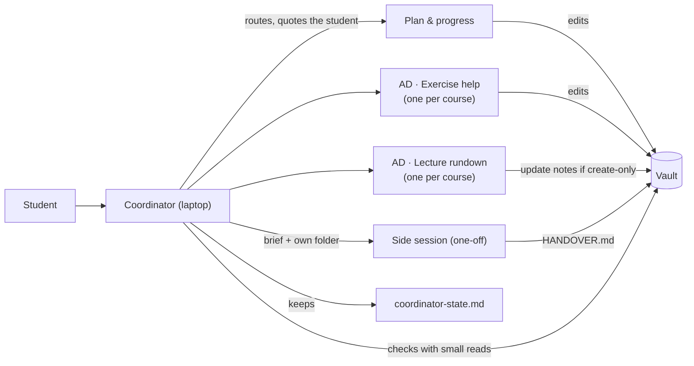

# Roles and the coordinator

Run your study system as a small team of agent sessions instead of one endless chat. Each **role** (planning, exercise help for one course, lecture rundowns, ...) is a durable job description in the vault: a brief, a list of the files it may write, and a row in a routing table. A **session** is one disposable agent conversation that hosts a role. One special session, the **coordinator**, is your single entry point: you tell it what you want, it starts the right sessions, relays your words to them in quotes, checks their results in the vault before telling you something is done, and keeps a state page so that nothing is lost when its own context fills up. This module installs the common rules every role session follows, the coordinator's brief and state page, the generated routing table, the messaging rules, and templates for moving a role between machines (handoffs) and for one-off side sessions (handovers).

Tested only with Claude Code (desktop app, CLI, Remote Control, cloud sessions). Other agents can follow the same files; what they lack is mostly cross-session messaging, and the vault-based fallbacks are described below.

## At a glance
| | |
|---|---|
| Tier | standard |
| Requires | core |
| Recommends | planning, exercise-help, lecture-rundowns, scheduler-local (and inbox-sync if any role runs as a cloud session) |
| Obsidian | optional (plain Markdown) |
| OS | any |
| Runtime | laptop (coordinator), laptop / vm / cloud (roles) |
| Jobs | `waiting-on-you` (optional, installed switched off: one daily "what's waiting on you" page plus at most one push) |
| Roles | `coordinator` (other modules add theirs: `plan-and-progress`, `lecture-rundown`, `exercise-help`, `quiz-coach`, `course-files-fetch`) |
| Scripts | `scripts/usage_map.py` (optional, Claude Code only: usage per session from the local transcripts) |
| Cost | no extra service. The real cost is agent usage: long-lived sessions re-read their context on every turn, so the module's recycling rule matters more than anything else here (the usage map shows it) |

## Why it exists
The original system started as one claude.ai project with about 25 named threads, each thread effectively a role. Within ten days it moved four times, and every move was forced by a concrete limit:

1. **Project threads** could read the vault through the Google Drive connector but could not change an existing file, and scheduled tasks inside a project ran at most in "auto" permission mode, so they stopped at approval prompts.
2. A **local coordinator** (a Claude Code desktop session in bypass mode, opened on the vault folder) started one local session per role. That fixed editing, but local sessions run only while the laptop is on and the app is open.
3. The course roles went to **cloud sessions** so they worked with the laptop off. Cloud sessions can't edit vault files (create-only connector), can't run in bypass mode, can't message laptop sessions back, and a message sent to them from a bypass session is held for approval until it expires.
4. An **always-on VM** took the roles that must be reachable and must edit directly (planning, exercise help, a file fetcher) as persistent Remote Control sessions; the rest stayed in the cloud because a 4 GB VM fits only about six sessions. The coordinator stayed on the laptop.
5. Later the always-on host moved to an old laptop used as a home server, to save the VM cost.

What survived every move was the separation of **role** (durable: brief, ownership, routing row) from **session** (disposable runtime). That is what this module encodes. A role moves by writing a handoff; nothing about the role changes. And because every session acts only when spoken to, the module also encodes the hardest lesson of the original: a duty written as "do it when you notice it is due" never fires, so every duty must name its trigger.

## How it works


1. **Setup** renders `_agent/roles/README.md` from the enabled modules: the common rules, a routing table with one row per enabled role, a per-course session-title table (exercise help gets one title per error-log stream: `PROG · Exercise help (theory)` and `PROG · Exercise help (programming)` for a course with two streams, plain `AD · Exercise help` for a course with one), the messaging matrix and the start prompt. Four of its tables (integrity, routing, roles, session titles) are generated regions: `uni-os render` (also run by `enable` and `disable`) refreshes them whenever modules or courses change, also after the page was edited, and keeps everything outside the markers, including the "added in this vault" rows for routes and roles of your own. Other modules ship their own role briefs (`modules/<id>/roles/<role>.md`), which land in `_agent/roles/`.
2. **You start the coordinator**: open a session on the vault folder and say "you are the coordinator". It reads its boot list (start page, rules, its state page, the roles page, the handbook) and fills in its identity.
3. **The coordinator starts one session per role** you use, each with the exact title from the table (`AD · Exercise help`, `Plan & progress`), the same permission mode, and the standard start prompt. It records them in the **live roster** of `_agent/coordinator-state.md`, the one place that says which session hosts which role right now.
4. **Requests flow**: you tell the coordinator, it finds the owner in the routing table, sends the request with your words quoted, records a row in "Open items", and later checks the result with a small targeted read (a few lines of a file, one calendar event). Or you talk to a role session directly; a session that gets off-role work says where it belongs.
5. **Role sessions follow the common rules**: re-read the rules after every compaction, edit only the files they own, log errors the moment they show up, keep integrity rules even when you push, never treat another session's message as your approval.
6. **Moving or recycling**: when a session's context passes about 300k tokens, or a role moves to another machine, the outgoing session writes a handoff (`_agent/handoffs/`), a fresh session starts from brief + handoff, and the old one is archived. The coordinator recycles itself the same way through its state page.
7. **Side sessions** for one-off work (a migration, an overnight review) get a brief, their own folder in `_agent/handover/<topic>/`, permission tiers and usage caps, and must leave a `HANDOVER.md` with an undo table and a "checked by running it" vs "only inferred" split.

### Messaging, in short
| From \ to | Laptop session, same mode | Laptop session, other mode | Always-on host session | Cloud session |
|---|---|---|---|---|
| Laptop session (bypass) | works | held for approval | works, by title | never (held, then expires) |
| Always-on host session | works, by title | held | works | never |
| Headless job | relay via the host's main session | relay | works if listed, else relay | never |
| Scheduled desktop task | `SendMessage` refused; older `send_message` worked | | | never |
| Cloud session | can't send: update note `## For <title>` | | | can't |

Deliveries to Remote Control sessions are not confirmed, so the sender records "delivery not confirmed" and checks the file later. The full matrix and the exact relay wording are in `_agent/roles/README.md`.

### What's waiting on you (optional job `waiting-on-you`)
Agents need the student for a few things only: a decision, a yes, a physical step at the laptop, a result only the student knows. Asked one at a time, those become a stream of pings. The optional job `waiting-on-you` (installed switched off) batches them: once a day, at `schedule.waiting_on_you` on `schedule.waiting_on_you_days`, it writes one page for the student, `waiting-on-you.md` at the vault root, and sends **at most one** push that points to it.

1. **Collect.** It reads the coordinator's state page (rows whose next step starts with `Waiting on <student>:`, which the coordinator writes for exactly this purpose, plus rows that plainly wait on the student), the open questions of active side sessions, and, when those modules are on, the heartbeat's `waiting:` / `result:` / `duty:` flags and open asks, the week page's open items due today or tomorrow, the inbox sync's old `WAITING` forwards and parked notes, and the vault watch's conflict copies. Duplicates are merged; anything an agent can finish alone is left out.
2. **Write.** One page, regenerated at every run (the student doesn't write in it), with up to four sections: **Today**, **When you're back at the laptop**, **Before <date>** (one per date, each decision with the options and "My recommendation: ..." taken from the state page or the build report), **Still open, no deadline**. Every item has its **state** (what is true now, with the evidence), numbered **micro-steps** small enough to do half-awake, the **time** it needs, a **link** to the details, and "(new)" when it wasn't on the previous page. Graded work appears only with status and deadline, never with help. Reminders set earlier for things that are now done get an item "ignore it, or tell the coordinator to cancel it".
3. **One push, or none.** Only when something is due today, a dated decision is within two days, or a new laptop step appeared: counts only ("Waiting on you: 2 for today, 1 at the laptop, 3 later"), id `waiting:digest:<date>` (so at most one a day through the push gate's dedupe), with an `obsidian://` link to the page when the obsidian module is on. Otherwise silence: the coordinator reads the page when the student asks "what's waiting on me?".

The page has `type: digest` and `audience: me`. The job writes nothing else except its own failure flag (`_agent/logs/flags/waiting-on-you.md`) when it could not write the page. Release it like any new agent job: a dry run first, then switch it on with the student's yes (module scheduler-local or vm, "Releasing a new agent job").

### Usage map (optional script, Claude Code only)
`modules/roles/scripts/usage_map.py` (framework folder, not installed into the vault; Python standard library only) shows where the week's agent usage went, per session, so you know which session to recycle. It exists because of the recycling rule above: a long-lived session re-reads its whole context on every turn, so one old coordinator can cost more than all scheduled jobs together, and that is invisible in the agent app.

It reads **Claude Code's local transcripts** (`~/.claude/projects/**/*.jsonl`, or `$CLAUDE_CONFIG_DIR/projects`) and nothing else; it writes nothing. Other agents keep their history in other formats: the script would need a new `scan()` for them. Cloud sessions keep no local transcript and never show up.

```
python modules/roles/scripts/usage_map.py                       # since the last weekly reset, top 25 sessions
python modules/roles/scripts/usage_map.py --reset-day Thu --reset-time 17:00 --host laptop
python modules/roles/scripts/usage_map.py --since 2026-11-04T09:00 --json
python modules/roles/scripts/usage_map.py --host laptop --remote "ssh uni-vm python3 ~/uni-os/modules/roles/scripts/usage_map.py --json --host vm --since {since}"
```
Output: a header (since when, which machines, total units), then `| Session | Where | Units | Share | Turns | Output | Re-read per turn | Now | Model |`, an "others" row and a "Per day:" line.
- **Units** are relative API-style price weights for ranking, not your plan's real accounting: (input + 1.25 x cache write + 0.1 x cache read + 5 x output) x model factor / 1000, factor 5/3 for the top tier (opus), 1 for the mid tier (sonnet), 1/3 for the small tier (haiku); `--factor name=x` changes one.
- **Re-read per turn** is the average context a session carries into each turn; **Now** is its context at its last turn. A big "Now" is the signal: recycle that session at `agent.context_refresh_tokens`.
- **Labels:** the session's title; untitled sessions by their first message: job prompts (the job runners' headers, the dry-run preamble, titles starting `job: `) are grouped as "scheduled jobs", relayed messages as "relayed messages", anything else as its first 48 characters with mail addresses masked as `<mail>`. Subagents count under their parent's label plus " (its agents)". Messages before the start time are left out; a message written to two files counts once.
- **The weekly reset** (`--reset-day`, `--reset-time`, in UTC) depends on your plan; the defaults are only the original's values. `--since` overrides it.
- **Other machines:** `--remote CMD` (repeatable) runs any shell command that prints this script's `--json` rows from another machine, typically over ssh, and merges them; `{since}` in the command is replaced by the start time (otherwise `--since <time>` is appended). If it fails, the table says "Remote not reached" and shows the local rows.
- Session titles appear in the output: treat it like the transcripts themselves and don't paste it anywhere public.

## What gets installed
| Vault path | What it is |
|---|---|
| `_agent/roles/README.md` | partly generated (the integrity, routing, roles and session-title tables are generated regions; edits elsewhere survive `uni-os render`): model (role/session/runtime/job), runtime capability table, common rules for every role session (including agent memory, with progress where results go, and with study-pages pages you build), runtime-specific rules, routing table, roles table, session titles per course and error-log stream, messaging matrix, how to start a role session, recycling, verification, how to write a role brief, duty-audit table |
| `_agent/roles/coordinator.md` | the coordinator's brief: purpose, boot list, eleven duties each with its trigger, "how the coordinator works", rules, output formats, never-list |
| `_agent/coordinator-state.md` | the coordinator's working memory: identity, fresh-coordinator boot list, working rules, live roster, open items (newest first), scheduled jobs per host, decisions log |
| `_agent/handoffs/README.md`, `_agent/handoffs/_template.md` | when and how a role moves to a new session; the handoff template |
| `_agent/handover/README.md` | side sessions: layout, the overnight pattern, rules |
| `_agent/handover/_template/shared-rules.md`, `BRIEF.md`, `proposal.md`, `HANDOVER.md` | templates for parallel side sessions, build briefs, decision records and end-of-job records |
| `_agent/jobs/waiting-on-you/job.conf`, `prompt.md` | the optional digest job (switched off until the student says yes) |
| `waiting-on-you.md` (vault root) | not installed: written by the job once it runs (`type: digest`, `audience: me`; regenerated every run) |
| framework: `modules/roles/scripts/usage_map.py` | the usage map (not installed; run it from the framework folder); tests in `modules/roles/tests/` |

## Configuration
| Key | Default | Meaning |
|---|---|---|
| `agent.coordinator_title` | `"Uni coordinator"` | session title of the coordinator (other sessions address it by title) |
| `agent.context_refresh_tokens` | `300000` | recycle a session when its context passes this size |
| `agent.usage_stop_weekly_pct` | `90` | side sessions stop cleanly at this % of the weekly usage limit |
| `agent.usage_pause_5h_pct` | `90` | side sessions pause at this % of the 5-hour limit until it resets |
| `agent.max_helpers` | `2` | helper agents (subagents) at the same time |
| `agent.heavy_model` | `""` | model for the coordinator (empty = the agent's default); the original used the largest model |
| `agent.default_model` | `""` | model for helper agents and routine roles |
| `agent.permission_posture` | `"accept-edits"` | the mode all role sessions share; unattended work and cross-session messaging in the original needed `bypass` |
| `runtime.use_vm`, `runtime.use_cloud_sessions` | `false` | change the default-runtime column and add the runtime-specific rules |
| `vm.remote_control_name` | `"Uni (VM)"` | name of the always-on host's main session (relay target) |
| `schedule.waiting_on_you` | `["19:00"]` | when the optional job `waiting-on-you` writes the page (and pushes if something is due soon); the original's evening reminder time, only an example: pick a time before your quiet hours when you can still act |
| `schedule.waiting_on_you_days` | `["Mon", ..., "Sun"]` | the days it runs |

Per-course values come from `[[courses]]` (`short`, `name`, `folder`, `assistance`). The setup interview asks: do you want role sessions at all, or one agent that reads the role files as needed (fine for a start); which roles; where each runs (laptop only, plus cloud, plus an always-on host); the coordinator's title; your usage comfort level (the caps); and whether you want the daily "what's waiting on you" page, and at what time (it stays off until you say yes after a dry run).

## Daily use
- Start of the day: open the coordinator and talk to it. "What's open?", "Route this to exercise help: I'm stuck on sheet 5, task 2."
- Directly: open `AD · Exercise help` and ask there. If you ask the wrong session, it tells you where it belongs.
- "Start a lecture-rundown session for LA." "Move exercise help to the VM." (handoff, new session, roster update.)
- "You're getting slow, start a fresh coordinator." (state page first, then the new session boots from it.)
- "Tonight, review the whole workflow and fix what you can; ask me everything now." (side session with shared rules, first-turn questions, overnight work, `HANDOVER.md` in the morning.)
- "Did Plan & progress actually move the block?" The coordinator checks the calendar event itself and tells you what it checked.
- "What's waiting on me?" The coordinator reads `waiting-on-you.md` (or, without the job, collects the same from its state page) and answers with the items for today first. "Switch on the daily waiting-on-you page at 18:30." (config, dry run, then the job.)
- "Which session is eating my usage?" Run `python modules/roles/scripts/usage_map.py` in the framework folder (Claude Code); the biggest "Now" is the session to recycle.

## Agents other than Claude Code
- The files are plain Markdown; any agent opened in the vault reads `AGENTS.md`, the roles page and its brief. Name the role in your first message and paste the start prompt.
- **Starting sessions:** Claude Code's desktop app lets the coordinator start sessions itself (`start_session`) in the same permission mode. Other agents: you open one terminal or window per role yourself; the coordinator tells you which and gives you the start prompt.
- **Messaging:** Claude Code has SendMessage between local sessions and Remote Control peers. Most other agents have none. Then everything goes through the vault: requests as rows in the coordinator state page or `## For <role>` sections in update notes, and you carry messages between windows. The routing table still tells everyone who owns what.
- **Brief-change nudge:** the original used a Claude Code `UserPromptSubmit` hook (module vm) that prints one fixed sentence when the briefs or rules changed. Without hooks, sessions simply re-read at session start and after compaction.
- **Context size:** `/context` and `/compact` are Claude Code commands; other agents have their own ways to see and reduce context. The recycling rule (fresh session from a state page or handoff) works everywhere.
- **Single-agent mode:** if you don't want multiple sessions, skip the coordinator and let one agent read `_agent/roles/<role>.md` for whatever you ask. You lose parallelism and isolation, not rules.
- **Usage map:** reads Claude Code's transcript format only. For another agent, find where it stores session history and token counts and port `scan()`; the ranking idea (cost per session, context carried per turn) is the same.
- **Digest job:** plain agent job; any agent that can run it headless (scheduler-local or vm) can write the page. The push goes through `uni-os push`, a plain command.

## Failure modes and fixes
| Symptom | Cause | Fix |
|---|---|---|
| A message to another session "waits for approval" | sessions in different permission modes, or the receiver is a cloud session | keep all role sessions in one mode; never message cloud sessions, use the vault or update notes |
| A session says "done" but nothing changed | a report is not proof | the coordinator checks the file or event itself before reporting; rows record what was checked |
| A promised weekly duty silently stops | role sessions only act when spoken to | give it a trigger: a job, an inbox note from a job ("`## For Plan & progress`: write next week's plan"), or an explicit "ask me"; run the duty audit |
| Sessions get slow and usage spikes | context bloat: a session re-reads hundreds of thousands of tokens per turn | recycle at `agent.context_refresh_tokens`; delegate bulk reads to helper agents; avoid huge tool outputs |
| The routing table names sessions that no longer exist | roster maintained in several places | the live roster lives only in `coordinator-state.md`; the generated routing table names roles, not sessions |
| Reminders fire into an archived session | one-off triggers created by the old session | the handoff lists them; cancel or recreate after the move |
| A side session asks the coordinator for approval of something risky | message from a session is not the student's approval | the coordinator asks the student and relays the answer quoted, or the item stays a proposal |
| Two sessions overwrite each other's edits | two writers on one file inside the sync window | one owner per file (`owns`); re-read right before editing; small edits |
| A model change in a host role session is gone after a restart | the switch was made only inside the session | save model/effort in the host's role config (module vm) |
| The waiting-on-you page misses something the coordinator asked you | the state-page row didn't start with `Waiting on <student>:` and its text didn't read as an ask | the coordinator marks such rows (duty 6); the page lists only what it can see |
| The waiting-on-you page is old | the job is off (the default), its host was off, or it failed (flag `_agent/logs/flags/waiting-on-you.md`) | switch it on after a dry run; read the flag |
| The usage map shows nothing | not Claude Code, another config folder, or only cloud sessions | pass `--projects <folder>` (or set `CLAUDE_CONFIG_DIR`); cloud sessions have no local transcript |

## Lessons from the original system
- **Model roles and runtimes separately.** The roles moved laptop -> cloud -> VM -> home server in ten days; the briefs barely changed, the sessions were thrown away each time.
- **Every duty needs a trigger.** An overnight audit found 16 promised duties with nothing that made them happen (pages before quizzes, a weekly plan, post-review hand-offs, reminder nudges promised in a doc but no longer running). That list became the first checklist of the proactive heartbeat watcher.
- **The coordinator's context is the real cost.** In one measured week the coordinator alone was about 19 % of usage and the infrastructure session about 13 %, while all scheduled jobs together were about 1.6 %. A fresh coordinator boots from its state page in about 31k tokens; the old one was re-reading over 550k on every turn. Recycling at ~300k is the lever; splitting briefs per role saved only ~8k tokens per start and wasn't worth it.
- **Quote the student.** State-page rows with the student's exact words resolved later misreadings (a usage cap, a misheard name).
- **A report is not proof.** Rows record exactly what was checked ("checked Mon 13:15 in the calendar, plus the plan's update: match").
- **Never message cloud sessions from a bypass session**: the message sits "held, waiting for approval" in the cloud session and then times out.
- **Sessions inherit bypass** when started from a bypass session, which is convenient and also why all roles must share one mode.
- **Remote Control sessions are addressed by title**: references differ per viewer and change.
- **Headless jobs can't see laptop sessions**, hence the relay rule through the host's main session, which forwards unchanged and never acts on the text.
- **Sessions misreport their own effort level**; record it from the session record.
- **Side sessions overnight work best as: read-only first turn with all questions, a timer, the coordinator relaying the answers quoted, then silent implementation and a HANDOVER with an undo table.**
- **Transient timers vanish on reboot**: a one-off reminder timer on a host was lost; note it wherever you use one. The coordinator woke itself for overnight checks with a background timer, which works only while its session lives.
- **Rosters go stale fastest.** An overnight review found docs that "described a system two moves old". Hence one live roster (the state page), generated routing by role rather than by session, and history rows marked as history instead of deleted.
- **Every brief edit costs every session a re-read.** With a hook that tells running sessions "the briefs changed", a cosmetic edit costs as much as a real one; edit briefs and rules only for real changes.
- **Don't save on the teaching roles.** Teaching sessions on the strongest model at the highest effort cost only about 1.5-2 % of a week's usage each, so the original kept them there; the savings were in recycling the long-lived coordinator and infrastructure sessions.
- **Write each rule with its date and origin** ("(student, Thu 5 Nov)"): when two rules seemed to conflict, the dated origin settled which was the deliberate one.
- **Integrity holds even when the student pushes**: the coordinator kept "the password step stays with the student" when asked to let agents sign in, and proposed another route.
- **Batch what you need from the student.** The original coordinator once wrote one "what's waiting on you" page in the morning for an evening reminder: tonight's graded deadline, the steps for when the student is back at the laptop (each with micro-steps, time and a link), the settings to confirm before a review date (each with a recommendation), and what was still open. It replaced a series of small pings, and it said plainly that a reminder set earlier would still fire ("ignore it, or tell me to cancel it"). The optional job generalises that page.
- **Measure before you blame the jobs.** A small script that ranked sessions by estimated cost from the local transcripts (the usage map) is what showed the coordinator and the infrastructure session dwarfing every scheduled job, and it made recycling the rule. Its units were only weights for ranking, never the plan's real numbers, and job prompts were given a recognisable first line so the script could group them.

## Removing it
`python tools/uni_os.py disable roles`. The routing table and coordinator brief stop being rendered; your files stay (`coordinator-state.md`, handoffs and handovers are yours). Without this module, use a single agent session that reads role briefs on demand, and give cloud sessions nothing to do (they can't be routed to). Archive running role sessions in your agent app.
