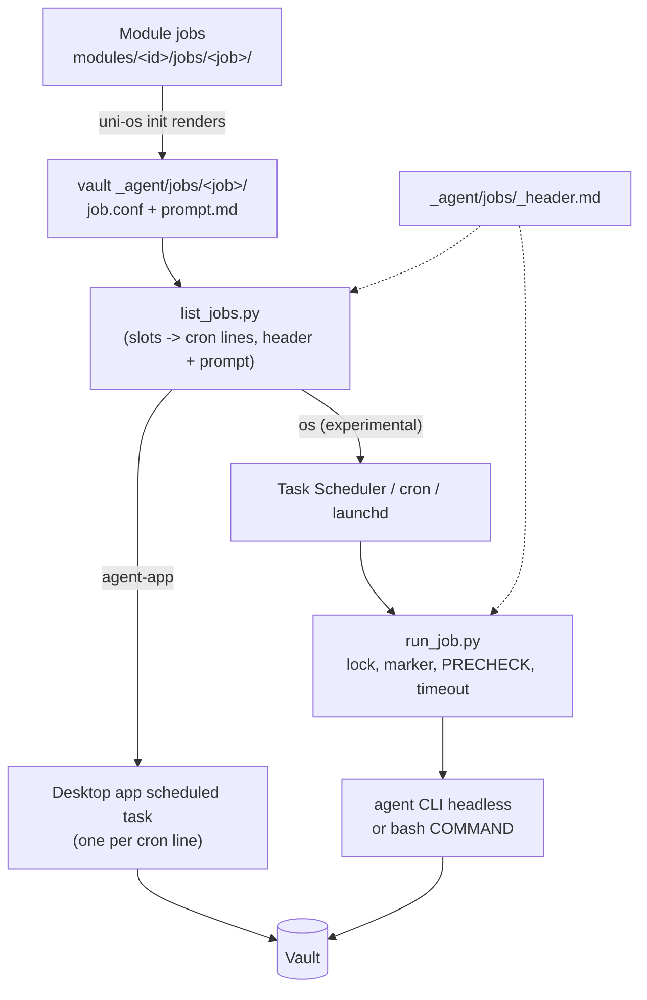

# Laptop scheduler

How the vault's jobs (daily prep, check-in, week page, inbox sync, heartbeat, ...) run on your laptop. Every module that has scheduled work ships it as a **job**: a folder in `_agent/jobs/<job-id>/` with a `job.conf` (when, how, limits) and, for agent jobs, a complete unattended `prompt.md`. This module turns those jobs into laptop schedules. The default is the agent's desktop app: in Claude Code, the setup agent creates one desktop **scheduled task** per job from the job's prompt and time slots. The alternative (experimental) is an OS scheduler (Windows Task Scheduler by default) that runs a small Python runner, which starts the agent CLI headless. The module also defines the shared rules every job prompt follows: the unattended-prompt anatomy, a portable host header, slot computation and catch-up, failover markers for when an always-on host exists too, and log conventions.

Tested only with Claude Code (desktop app scheduled tasks; the headless CLI on an always-on host). The OS-scheduler path is experimental.

## At a glance
| | |
|---|---|
| Tier | standard |
| Requires | core |
| Recommends | notifications (failure pushes) |
| Obsidian | irrelevant |
| OS | any for app tasks; the OS-scheduler example is Windows Task Scheduler (experimental), cron/launchd as porting notes |
| Runtime | laptop |
| Jobs | none of its own; it runs the other modules' jobs |
| Roles | none |
| Cost | agent usage of the jobs themselves (scheduled jobs were under 2 % of a week's usage in the original); `PRECHECK`s make most runs free |

## Why it exists
In the original system the recurring work first ran as scheduled tasks of a claude.ai project, which run at most in "auto" permission mode and therefore stopped at approval prompts. They moved to **Claude desktop scheduled tasks** created from a bypass-mode session, which run unattended. That worked, with three lasting quirks: tasks run only while the app is open, they start a few minutes late (up to ~12 minutes was seen), and missed slots are caught up when the laptop wakes. Every prompt therefore had to compute which slot it belongs to and check whether that slot was already done. When an always-on VM arrived, the same prompts were reused there verbatim behind a short "translate as you go" header, and the laptop tasks were paused, kept for rollback. The lessons were: write prompts once and host-neutral, keep schedules in one place, guard every run with a slot check, and never let two machines run the same job.

## How it works

### Path 1: the agent's desktop app (default, `runtime.laptop_scheduler = "agent-app"`)
1. The setup agent runs `python modules/scheduler-local/scripts/list_jobs.py --vault "<vault>" --laptop` to see the jobs meant for a laptop (`RUNTIME` `any` or `laptop`), and `... cron <job>` for each one's cron lines (local time, grouped by minute).
2. For each agent job it prints the prompt with `... prompt <job> --session app`: the vault's `_agent/jobs/_header.md` (with the host values filled in) followed by the job's `prompt.md`.
3. It creates one scheduled task per cron line. **In Claude Code:** the desktop app's scheduled-task tool (`create_scheduled_task`: `taskId` = the job id, `title`, `description`, `prompt` = the assembled text, `cronExpression` = the cron line, in local time; `notifyOnCompletion: false` unless the creating session should hear about every run). The app stores the prompt as `~/.claude/scheduled-tasks/<task-id>/SKILL.md` (frontmatter `name`, `description`; the schedule, folder, permission mode and model are kept by the app outside the file). Create the tasks from a session in the permission mode the jobs need: tasks created from a bypass-mode session are saved in bypass mode and run unattended; the app's "auto" mode blocked writes to the synced vault.
4. One-off jobs (`DATES` with single dates) become one-time tasks (`fireAt`). A job with slots at different minutes (07:50 and 13:05) needs one task per cron line, because one cron expression can't mix minute values.
5. Command jobs (`KIND="command"`, e.g. the inbox poll every 10 minutes) are not app tasks: an app task runs a prompt, and wrapping a frequent command in an agent run wastes usage. They run on the always-on host, or through path 2.
6. The setup agent records which jobs run where in the coordinator state page ("Scheduled jobs"), if the roles module is enabled.

### Path 2: an OS scheduler (experimental, `runtime.laptop_scheduler = "os"`)
`scripts/run_job.py --vault "<vault>" --job <id>` is a small laptop runner with the always-on host runner's semantics:
1. reads `job.conf` (and `agent.*` from the generated `_agent/uni-os.json`, which has the module defaults merged in; else `_agent/uni-os.toml`);
2. per-job lock: already running -> exit 0;
3. `NEEDS_VAULT=yes`: the vault and its `_agent/` must be readable, else "skipped" and exit 3 (a synced drive not mounted yet after a wake);
4. failover marker: if `_agent/vm/ran/<task>.md` names this run's nominal slot, exit 0;
5. agent lock: `exclusive` waits until no other agent job of this runner runs (skips after `LOCK_WAIT_MIN`), `shared` waits only for an exclusive holder, then runs anyway;
6. `PRECHECK` with Git Bash from the vault root: non-zero = "skipped (precheck)";
7. runs the job: a command with `bash -c` (on a dry run with `DRY_OK=yes` it appends `--dry-run`; otherwise it only prints the command), or the agent CLI headless with the assembled prompt on stdin. Built-in for Claude Code: `claude -p --permission-mode <mode> --output-format text --name "job: <title> · <Ddd HH:MM>" [--model M] [--effort E]`; API-key variables are removed from the environment so the CLI uses the plan login, never API billing. Other agents: set `agent.headless_command`;
8. hard timeout `TIMEOUT_MIN`, killing the whole process tree (exit 124); an agent CLI that can't be started (not on the scheduled task's `PATH`, a wrong `agent.cli` or `agent.headless_command`) ends as exit 127, a config with no usable headless command (another agent without `agent.headless_command`) as exit 2, both with a log and a `jobs.log` line like any other failure;
9. logs on the laptop, never in the vault: `<state>/jobs/<job>/<YYYY-MM-DD_HHMMSS>[-dry].log` ending `# exit N after Ss`, one line in `<state>/jobs.log` (`YYYY-MM-DD HH:MM | <job> | exit N | Ss | <log>`), 40 logs kept per job; the record is written before the job's output is echoed, and the console is switched to UTF-8 (a scheduler's pipe on Windows is cp1252), so output the console can't show never loses it; `<state>` = `%LOCALAPPDATA%\uni-os` on Windows, `~/.local/state/uni-os` elsewhere, or `UNI_STATE_DIR`;
10. with `--push-failures`, one direct push when a job fails (exit not 0 or 3), through the push gate of module notifications: `uni-os push --direct --id job-failed:<job>` (direct = outside the daily budget and quiet hours, still held in quiet windows; the same rule as the host runner's failure push).

`list_jobs.py windows <job>` prints the PowerShell that registers the task for the current user (no admin rights): one trigger per slot (`-Daily` or `-Weekly -DaysOfWeek ...`), a repeating trigger for `EVERY_MIN`, `-StartWhenAvailable` (a missed slot runs when the laptop wakes, so prompts must be idempotent), `-MultipleInstances IgnoreNew`, an execution limit of `TIMEOUT_MIN` + 10 minutes, battery flags, and `pythonw.exe` as the program so no console window flashes (the runner also starts children without a window). It only prints; you or the setup agent run it after reading it.

### Porting path 2 to cron, launchd or systemd
The Windows path is the documented example; an AI can port it with this spec (the runner itself is plain Python and runs anywhere):

| Windows (here) | macOS | Linux |
|---|---|---|
| Task Scheduler trigger per slot, `-Weekly -DaysOfWeek` | launchd LaunchAgent plist, `StartCalendarInterval` array (one dict per slot and weekday; `Weekday` 1 = Monday ... 6 = Saturday, 0 or 7 = Sunday) | systemd user timer `OnCalendar=Mon..Fri *-*-* 07:50:00` (one line per slot), or cron `50 7 * * 1-5` |
| repeating trigger for `EVERY_MIN` | `StartInterval` in seconds | `OnCalendar=*:00/10`, or cron `*/10 * * * *` |
| `-StartWhenAvailable` (catch up a missed run) | calendar intervals missed during sleep run on wake | `Persistent=true` (systemd); cron does not catch up (use anacron) |
| `-MultipleInstances IgnoreNew` | `run_job.py`'s own per-job lock | the same lock, or `flock -n` |
| `pythonw.exe`, `CREATE_NO_WINDOW` (no console flash) | not needed | not needed |
| Git Bash for `PRECHECK`/`COMMAND` | `/bin/bash` | `/bin/bash` |
| `%LOCALAPPDATA%\uni-os` state | `~/.local/state/uni-os` (or `~/Library/Application Support/uni-os`) | `~/.local/state/uni-os` |

The machine's clock must be in the vault's timezone (`term.timezone`), because app tasks and OS schedulers use local time.

### The portable host header (`_agent/jobs/_header.md`)
Job prompts are written host-neutral: paths relative to the vault root, "get the date with a command", no Windows-only commands. On the laptop, `run_job.py` and `list_jobs.py prompt` put this header in front of the prompt and fill its run-time placeholders (the always-on host of module vm puts its own header with the same rules in front, `modules/vm/host/agent/job-header.md`): the job's title, id and slots, the host's name and kind, the vault path on that host, the date command, the Python command and the session type. The header says: where the vault is, how to get the time, how this run may talk to the student (`print` = ask nothing; `rc` = ask once and wait; `app` = ask only at an explicit ask step), that tools missing on this host mean "skip that step and say so in the log line", how to load connectors, the relay rule for messages to sessions a headless run can't see, and (with an always-on host) the failover check. It generalises the original's VM header, which let the laptop's prompts run on the VM verbatim.

### Slots, catch-up and idempotency
- A run's **nominal slot** is the latest scheduled time at or before now, ignoring the scheduler's offset (`jobconf.nominal_slot`). Late runs and wake-up catch-up runs belong to the slot they replace.
- Every prompt starts with an **"already done?" guard** for its slot (a marker, a state file, a target file that exists, a line already present) and stops with one line if so.
- Multi-slot jobs **branch by slot** (first slot = full work, later slots = change check) and carry a **catch-up rule** (if an earlier slot's work is missing, do it too).

### Failover markers (only with an always-on host)
With module vm, a job runs on the host in mode `always` (the host only; the laptop task is paused) or `failover` (the laptop runs it; the host runs a copy only when the laptop missed the slot, after `FAILOVER_DELAY_MIN`). After a failover run the host writes `_agent/vm/ran/<job>.md` (`slot:`, `ran_on_host:`, `exit:`), and the laptop run's failover check (in the header; also done in code by `run_job.py`) skips that slot. The original's host learned whether the laptop ran a slot from a laptop heartbeat that read the desktop app's internal task file: brittle, and the system ended up running every recurring job in mode `always`. Recommended: one host per job.

### The unattended-prompt anatomy
Every job prompt follows the 13-point anatomy in `_agent/jobs/README.md`: idempotency guard first; identity and scope in one paragraph; read the contract files instead of inlining rules; get the real time with a command; branch by slot with a catch-up rule; tool constraints spelled out; write rules for shared files; integrity rules repeated; privacy rules; interactive jobs in two turns (ask once, push once, end the turn; then apply); delegation with a fallback; notification discipline (never "all good"); a fixed output contract.

### Releasing a new agent job (staged rollout)
A new recurring agent job, whether you wrote it or a module ships it switched off (`DEFAULT_MODE="off"`: the heartbeat, the quiz-prep, lecture-skim and deadline-audit jobs, the waiting-on-you page), goes live in four steps. The original released its biggest job, the heartbeat watcher, exactly like this, and the step that caught the real problems was the dry run, not the review.

1. **Build report.** Whoever built or adapted the job writes a short report next to its brief (e.g. `_agent/handover/<job>/build-report-YYYY-MM-DD.md`): the files, how it works in five lines, capability probes on this laptop ("calendar connector in a headless run: yes"), tests run, open questions each with a proposed default, and the changes it needs in files it doesn't own (listed, not made).
2. **Staged.** The job folder is in the vault, but no task exists yet: no desktop-app task (path 1) and no OS task (path 2). Nothing can fire.
3. **Dry runs, evaluated.** At least one at a representative time when there is something to do, and one when there isn't (a simulated time is fine if the prompt honours `UNI_OS_NOW`).
   - Path 1: `python modules/scheduler-local/scripts/list_jobs.py --vault "<vault>" prompt <job> --session app --dry-run` prints the prompt with the dry-run preamble ("DRY RUN ... do NOT create, edit, move or delete ... list exactly what you WOULD have changed"); run it once as a one-time task or paste it into a fresh session in the jobs' permission mode.
   - Path 2: `run_job.py --vault "<vault>" --job <job> --dry-run`: an agent job gets the same preamble and `UNI_DRY_RUN=1` in its environment (honoured by `uni-os push`, `uni-os heartbeat` and the inbox poll); a command job gets ` --dry-run` appended only with `DRY_OK="yes"` (set it only for commands that honour it), otherwise the runner just prints the command.
   - Evaluate the output against fixed checks, not by eye: the run ended with exit 0 (`# exit 0 after Ns` in its log), no traceback, what it **would** have written or pushed is right and in the right files, the push gate refused nothing ("would not send (exit 13)" means the job's wording is wrong), state files it writes parse, and it stayed inside `TIMEOUT_MIN`. A dry run is an instruction, not a sandbox: it reads for real and costs plan usage. Fix the prompt and repeat.
4. **Switch on** with the student's yes, right after a slot rather than just before one: create the task (path 1: the app's scheduled-task tool; path 2: run the PowerShell from `list_jobs.py windows <job>`), and note it in the coordinator's "Scheduled jobs" table. Rollback = delete or disable the task; the job's own state stays for the next attempt. Never run the same job on the laptop and on an always-on host in mode `always`.

The always-on host's version of the same practice (timers, a guard dry run, a one-off switch-on timer) is in the vm module ("Releasing a new agent job" and MAINTENANCE.md).

## What gets installed
| Path | What it is |
|---|---|
| `_agent/jobs/README.md` | what a job is, `job.conf` keys, how this laptop runs jobs and the app quirks, the prompt anatomy, failover markers, logs and outcome checks |
| `_agent/jobs/_header.md` | the portable host header (run-time placeholders) |
| `_agent/logs/README.md` | rules and line shape for agent-written logs |
| framework: `modules/scheduler-local/scripts/list_jobs.py` | list jobs; cron lines; assembled prompts; Windows task registration snippet |
| framework: `modules/scheduler-local/scripts/run_job.py` | the experimental headless runner |
| framework: `modules/scheduler-local/scripts/jobconf.py` | shared parser and schedule helpers; tests in `modules/scheduler-local/tests/` |

## Configuration
| Key | Default | Meaning |
|---|---|---|
| `runtime.laptop_scheduler` | `"agent-app"` | `agent-app` (desktop app tasks), `os` (OS scheduler + `run_job.py`, experimental), `none` |
| `runtime.laptop_os` | `"windows"` | which OS notes and snippets apply |
| `agent.primary` | `"claude-code"` | only Claude Code has a built-in headless command |
| `agent.cli` | `"claude"` | the agent CLI for headless runs |
| `agent.headless_command` | `""` | headless command template for other agents; placeholders `{model}` `{effort}` `{permission}` `{title}` `{prompt_file}` (without `{prompt_file}` the prompt goes to stdin) |
| `agent.permission_posture` | `"accept-edits"` | unattended jobs need `bypass`: a run that stops at an approval prompt does nothing |
| `vm.remote_control_name` | `"Uni (VM)"` | relay target named in the header |

Each job's own times are config keys of its module (`schedule.*`), with the original's times as defaults; change them there. The setup interview asks: which scheduler (app tasks are the easy default; the OS path is for people who keep the app closed); whether the laptop or an always-on host runs the recurring jobs; and confirms the permission mode for unattended runs.

## Daily use
- "Which jobs run on my laptop, and when?" -> an agent runs `list_jobs.py --vault "<vault>"` and reads the app's task list.
- "Move the daily prep to 18:00" -> change `schedule.daily_prep` in `_agent/uni-os.toml`, re-render the module, then update the app task (the agent does all three).
- "Run the inbox sync now" -> in the desktop app, run the task by hand; or `python run_job.py --vault "<vault>" --job inbox-sync --force`.
- "Test the week-page job without changing anything" -> `run_job.py ... --dry-run` (an agent dry run is an instruction, not a sandbox: it still uses plan usage and relies on the agent obeying it).
- Keep the desktop app open (or let it start with the computer) if you use path 1; a closed app means jobs run late, at the next launch.

## Agents other than Claude Code
- Desktop "scheduled tasks" are a Claude Code desktop feature. Other agents rarely have one: use path 2 with `agent.headless_command` set to the agent's non-interactive mode (for example a CLI's "exec" or "-p" mode that reads the prompt from stdin or a file). The runner's semantics (lock, marker, precheck, timeout, logs) are the same; only the command differs. Untested.
- The header's "In Claude Code" notes (tool search for connectors, SendMessage) are skipped by other agents; the rest is generic.
- A headless run that needs a decision from you can't wait: such jobs either ask nothing, or (on the always-on host) open an interactive remote session and push its link.

## Failure modes and fixes
| Symptom | Cause | Fix |
|---|---|---|
| A job ran an hour or more late | the app was closed or the laptop asleep; the run is a catch-up | expected; the slot guard makes it safe. For punctual jobs use an always-on host |
| A job ran twice for one slot | laptop and host both active in mode `always`, or a catch-up without a guard | one host per job; switch back to back, never around a scheduled time; every prompt checks "already done?" |
| A scheduled run waits at an approval prompt and does nothing | the task was saved in a lower permission mode | recreate it from a session in the needed mode (In Claude Code: bypass) |
| A run started at 13:08 thinks it is the 13:15 slot, or none | slot computed from the start time | compute the nominal slot: the latest scheduled time at or before now |
| A push from a task never arrived | delivery held back while the student was active at the computer | test pushes while away; rely on the log, push only for problems |
| The Task Scheduler task flashes a console | started with `python.exe` | use `pythonw.exe` (the snippet does) |
| `PRECHECK` ran inside WSL or failed on Windows | `bash` resolved to the WSL launcher | `run_job.py` looks for Git Bash; set `UNI_BASH` to override |
| A job's schedule silently changed back | the schedule was hand-edited in two places | schedules live only in the config; re-render, then update the task |
| An agent dry run sent a real message | a dry run is an instruction, not a sandbox; a command that ignores `--dry-run` acts for real | only set `DRY_OK=yes` for commands that honour `--dry-run`; of the shipped tools, `uni-os push`, `uni-os heartbeat` and the inbox poll check `UNI_DRY_RUN=1`, everything else an agent does in a dry run is held back only by the preamble |
| Exit 0 but no result | the job ended without doing its work | outcome checks look for results and push only on problems |

## Lessons from the original system
- **Desktop tasks are unreliable in time**: only while the app is open, a fixed offset of a few minutes, late starts of ~12 minutes, catch-up of missed slots on wake (a 19:30 slot ran at 20:01). Hence slot logic and idempotency in every prompt, and later the move of recurring jobs to an always-on box.
- **Bypass for unattended tasks**: tasks created from a bypass-mode session ran unattended; project tasks limited to "auto" stopped at approval prompts; the desktop app's auto mode blocked writes to the synced vault.
- **Write prompts once, host-neutral, and keep a per-host header.** The laptop prompts ran verbatim on the VM behind a "translate as you go" header (path mapping, `date` instead of PowerShell, `python3`, laptop-only tools skipped and logged, a relay rule for messages).
- **Keep schedules in one place.** A hand edit in one copy of a schedule was silently reverted by a later prompt sync from another copy.
- **Deterministic work is not an agent task.** A file fetcher wrapped in an agent task became a plain command; shell `PRECHECK`s skip the agent when there is nothing to do.
- **Rollback order matters between two schedulers**: re-enable the laptop tasks and switch the host jobs off right after each other, not around a task time, or a slot runs twice.
- **Reading an app's internal task file while the app writes it can fail**: the laptop heartbeat skipped a beat rather than send wrong data. Failover built on app internals is brittle.
- **Push delivery depends on presence**: a local task's push was held back while the student was active; the test had to be repeated while away.
- **UTF-8 without BOM** for files scripts and plugins parse (a settings backup saved with a BOM broke a JSON loader); PowerShell 5.1 writes ANSI by default.
- **Every new remote session notifies the phone**, so jobs that ask nothing run headless.

## Removing it
`python tools/uni_os.py disable scheduler-local`. Then delete or pause the laptop's scheduled tasks: in Claude Code's desktop app pause them in the task list (or with the scheduled-task tool, `enabled: false`), and remove any Task Scheduler tasks with `Unregister-ScheduledTask -TaskName 'Uni OS - <job>'`. Pausing first and deleting later keeps a rollback. Jobs keep existing in `_agent/jobs/` for an always-on host to run.
