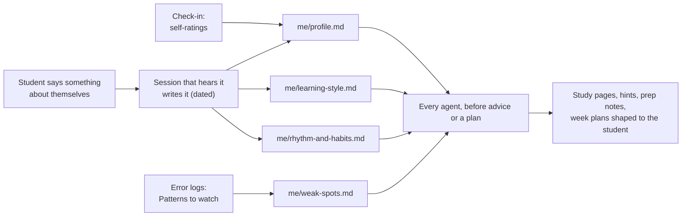

# Student model

Four short pages in `me/` that tell every agent who the student is: a profile (identity, courses, self-rated understanding, goals, tools, shorthand), a learning style (what works, per course), a daily rhythm (energy curve, focus span, week shape, hard constraints) and a weak-spots page (the recurring mistake patterns distilled from the error logs). Every agent reads them before it gives study advice or makes a plan, so that a hint, a study page or a week plan fits this student instead of an average one. The pages ship as structured templates with guidance comments and example prompts; they start empty and fill up over the first weeks. Uni OS was only tested with Claude Code; the pages are plain Markdown and work with any agent.

## At a glance
| | |
|---|---|
| Tier | core (installed by every preset) |
| Requires | `core` |
| Recommends | `error-logs` (feeds weak spots), `planning` (reads rhythm), `check-in` (re-asks self-ratings) |
| Obsidian | optional (the Home dashboard shows them as four tiles) |
| OS | any |
| Runtime | any: laptop, cloud sessions, always-on host |
| Jobs | none |
| Roles | none (written by whichever session hears a change) |
| Cost | none |

## Why it exists
In the original system, agents were good at the material and bad at the person. A planner placed a deep proof block in the student's worst hour of the day; a study session recommended reading the script first to someone who had already said that was too slow and passive for them; exercise help gave hints in too many small pieces when one clear sentence would have unblocked them. Each correction was given once, in one chat, and lost.

The student model is the fix: a small, persistent user model that lives in the vault, not in any agent's memory. Every agent reads the same pages, every correction is written down with its date, and the old value stays visible ("Before: ... (date)"), so the history explains why things changed. Self-ratings and error-log patterns turn it into a feedback loop: planning gives freed time to the lowest-rated course, and cheat sheets and prep notes include the student's own recurring traps.

## How it works

1. **Read first.** `_agent/agent-start.md` tells every agent: before you give study advice or make any plan, read `me/`. Planners validate every plan against `rhythm-and-habits.md`. Course sessions read `learning-style.md` and `weak-spots.md` before building material.
2. **Written by whoever hears it.** There is no owner role: the session that hears "I'm useless after lunch" or "videos work better for me than the script for this course" writes it into the right page, in the same turn, with the date and, where it helps, the student's own words. The routing rows are in `_agent/CONVENTIONS.md` section 3.
3. **History inline, never overwritten.** Ratings keep their earlier values in the Note cell ("Before: 65 % (Tue 20 Oct, provisional). Earlier: 75 % (Wed 7 Oct)"). Retired advice is struck through, not deleted. Statements the student made win over anything an agent inferred; inferred observations are marked "(observed)" until confirmed.
4. **Self-ratings.** The periodic check-in (check-in module) asks "how well do you understand each course right now?"; the answers go into `profile.md`, the status page and the tracker log. Mid-week ratings are labelled "provisional". The planner's rebalance rule gives freed time to the lowest-rated course first.
5. **Weak spots from the error logs.** Each course's error log keeps the dated rows and its own "Patterns to watch" section, where a numbered pattern appears at the second error of the same family (error-logs module). Every such pattern is mirrored as one line on `weak-spots.md` under its course, and a pattern seen in two courses also goes under "Across courses": `**<pattern>**: <what goes wrong>. Fix: <technique or page>. Source: <error log rows>`. Consumers: cheat sheets ("my traps"), quiz prep (drills named after patterns), study-page "common traps" boxes, prep notes, and hints ("this is pattern 2 again").
6. **Rejected advice is recorded twice:** in `learning-style.md` (with the reason) and in `_agent/rules.md` ("Things <handle> did NOT want"), so no agent proposes it again.

## What gets installed
| Vault path | Sections |
|---|---|
| `me/profile.md` | Basics (prefilled from the config: name, programme, term, courses), Self-rated understanding (one row per course), Goals, Tools I use (prefilled), Shorthand I use (prefilled with course short names), Groups and course contacts (optional), See also |
| `me/learning-style.md` | Core, When I'm stuck, Per course: how lectures work for me (one row per course), Videos and outside material, Things I noticed about myself, Study page preferences (formats from the config), Advice I rejected |
| `me/rhythm-and-habits.md` | Day (time table and a one-line "So:" summary), Focus span, Week, Places, Hard constraints, Advice already given |
| `me/weak-spots.md` | Across courses, then one section per course pointing at its error log(s) |

All four have `type: me`, `audience: me`, `tags: [uni/me]`. Guidance sits in HTML comments, which are invisible in Obsidian's reading view and in rendered Markdown. The habit-experiment log `me/habits-experiments.md` belongs to the separate `experiments` module.

## Configuration
The module has no settings of its own. It reads `student.name`, `student.handle`, `university.name`, `university.programme`, `university.lms`, `term.label`, `term.exam_session_start`/`end`, `storage.provider`, `obsidian.enabled`, `agent.primary`, `study.formats`, the course list (`short`, `name`, `folder`, `slug`, and the derived `error_log_files` for the weak-spots links) and, only when the planning module is enabled, the calendar names (`calendar.courses`, `.study_blocks`, `.events`, `.busy`) and the planner's day settings (`schedule.day_start`, `.weekday_stop`, `.study_cutoff`, `.focus_minutes`, `.break_minutes`; defaults in the planning module), which the rhythm page shows next to the student's own words so the two can be kept in line. During setup the agent may offer a short interview (ten minutes, one question at a time) to fill the profile and rhythm; the student can also skip it and let the pages fill up over time.

## Daily use
Things to say to your agent:
- "Interview me for my profile, one question at a time."
- "I can't focus after lunch at all; put that in my rhythm file."
- "For LA, the lecture is fine but the exercises only click with videos. Note that."
- "Update my self-ratings: AD 70 %, DM 55 %." (also lands in the status page and the log if progress is installed)
- "What do you know about how I learn?" (the agent summarises `me/` and asks what's outdated)
- "Don't suggest reading the script first again." (rejected advice, recorded twice)
- "What are my weak spots in DM?" (the agent reads the page and the error log's patterns)

## Agents other than Claude Code
Nothing here depends on Claude Code. One difference matters: Claude Code (and some other agents) has its own memory feature. Facts about the student must still go into `me/`, not only into agent memory, because other sessions, other machines and other agents can't see that memory. If an agent's memory and `me/` disagree, `me/` wins (it is newer or it was confirmed by the student).

## Failure modes and fixes
| Symptom | Cause | Fix |
|---|---|---|
| A plan puts hard work in the student's low | The planner didn't read the rhythm file, or it is empty | Fill the Day table; the planning role must check every plan against it |
| Contradictory statements on one page | Edited without keeping history | Keep the newest, move the older one into a "Before: ..." note with its date |
| Agent advice ignores a known preference | The preference was only said in a chat | Write it into `learning-style.md` (and `rules.md` if it is a "don't") |
| Weak spots page empty although logs are full | Nobody promoted repeating rows to patterns | Ask "update my weak spots from the error logs"; exercise-help sessions do it when a pattern repeats |
| Too personal | Health, family or private details written down | Keep only what planning needs; the vault syncs to the cloud and every agent reads it |
| Pages stale after a month | No trigger re-asks | The check-in job re-asks self-ratings; ask "what in me/ is outdated?" at the start of each month |

## Lessons from the original system
- **User statements win over derived data.** The tracker's header said so, and it settled several disagreements between what an agent inferred and what the student said.
- **Keep history inline.** Ratings with "Before: ..., Earlier: ..." showed the trend (one course sliding week after week), which drove the rebalance of study time.
- **Validate plans against the rhythm file.** A trial week layout placed a deep proof block in the student's biggest low; the fix was a rule, not a better template.
- **Places matter.** "I lose time finding a room" turned into "every block has a fixed place in the event's location field".
- **Strike through, don't delete.** Retired advice stayed visible, so nobody re-proposed it and the student could see what had been tried.
- **Weak spots are a view, not a copy.** Dated rows stay in the error logs; the weak-spots page only names the patterns and links to the rows, so the two never drift apart.
- **Some features don't work for some people.** Spaced retests of old error-log rows were dropped after a week because they didn't work for this student. The model records such decisions so agents stop suggesting them.

## Removing it
`uni-os disable student-model` stops rendering the pages; it deletes nothing. The `me/` files stay yours. Agents then plan and advise without a user model. `disable` renders right away (no separate `render` needed): the files that mention `me/` (the start page `_agent/agent-start.md`, Home, `_agent/CONVENTIONS.md`) are re-rendered whole if nobody edited them since install, and then no longer mention it. In a file you edited, only its generated regions are refreshed and the rest is kept: the routing table in `CONVENTIONS.md` is such a region and follows on its own, while an edited start page or Home keeps its `me/` lines until you remove them. A file whose region markers are broken is skipped and reported (`_agent/CONVENTIONS.md`, "Generated regions").
