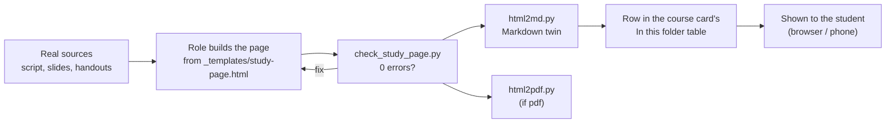

# Study pages

Study pages are the study engine's main output: one self-contained HTML file per topic, built on a single template, with KaTeX maths, a sticky navigation bar, interactive demos, a short quiz after every section whose answers are checked by code, a cheat sheet, a final self-test, dark mode and a layout that works at phone width. Next to each HTML page sits an automatically converted Markdown twin, so the same content reads (and is searchable) inside Obsidian, or as plain Markdown in any viewer when you don't use Obsidian. If you don't want two files, the module also supports Markdown only, HTML only, and PDF. This module ships the template, the converter (`html2md.py`), a quality checker, a PDF exporter and the agent skill that ties them together.

## At a glance

| | |
|---|---|
| Tier | standard |
| Requires | `core`, `courses` |
| Recommends | `obsidian`, `error-logs`, `lecture-rundowns` |
| Obsidian | recommended (for the Markdown twins); the HTML pages open in any browser |
| OS | any (Python 3.11+ standard library; PDF export needs Chrome, Edge or Chromium) |
| Runtime | laptop, cloud, VM (anything that can run Python; create-only cloud agents can write the HTML and leave the twin to the next session) |
| Jobs | none |
| Roles | none (the pages are built by the `lecture-rundown`, `exercise-help` and `quiz-coach` roles) |
| Skill | `study-page` (the build pipeline) |
| Cost | no money; agent usage per page. In the original, building one full teaching page on the strongest model at high effort cost about 1.5-2 % of a week's usage, and was judged worth it |

## Why it exists

The original system started with Markdown notes and chat answers. Two things went wrong. First, maths in plain text was unreadable, so the rule became "maths goes out as HTML with KaTeX, never as plain text". Second, every page looked different, and some were too thin to learn from. One page, a data-structures teaching page with demos and quizzes, worked so well that it became **the model for every course**: a standing rule said every study page follows it (navigation, demos and visuals, mid-way quizzes, cheat sheet, a big final quiz, dark mode, phone width, answers checked by code), split into chunks of about 700-800 words with 2-4 subsections, one demo and one quiz each. Later a page for another course was judged "too small", so the size guidance was raised rather than lowered.

HTML has one drawback: Obsidian does not render it as a note. The fix was a small converter that writes a Markdown twin of every page (same base name, `.md`), with the maths and the static content, and a line pointing to the HTML for the interactive parts. That pair, interactive original plus readable twin, is the default here.

## How it works

### The template (`_templates/study-page.html`)
A generic rebuild of the original model page's engine, with a short neutral sample topic (Big-O notation) so it renders out of the box. A real page replaces every section. Anatomy:

- **Head**: viewport meta, KaTeX 0.16.9 (CSS, `katex.min.js`, `auto-render`) from cdnjs, and `<meta name="uni-os:kind|course|sources|created">` tags that the converter copies into the twin's properties.
- **Theme**: colour tokens on `:root` (background, text, muted, line, card, accent, warning, bad, ok, five series colours, diagram state colours), redefined under `prefers-color-scheme: dark`. The accent is meant to be the course colour from the config.
- **Navigation**: a sticky top bar with one link per section; scroll-spy highlights the section you are in.
- **Start section**: title, the exact source line and how to use the page ("read a block, play with the demo, then take the quiz"), a card "What this page covers (and what it does not)" (Covered / Borrowed / Not in this version / Notation, with inferences marked), quiz progress chips with a reset button, and a note on the two quiz modes.
- **Sections**: `<h2>` with a number, `<h3>` subsections each carrying a **source chip** (`script §2.1, p. 14`), cards (`card key` for definitions, `card trap` for pitfalls, `card proc` for procedures), one demo block and one mid-quiz mount per section.
- **Cheat sheet**: tables, "Mistakes this topic invites" (fed from the course's error log), "Procedure to practise".
- **Final self-test**: answered in one go and submitted once, with an optional countdown clock, then a per-topic breakdown and "retry only the questions you missed". It is called the final self-test on purpose: it tests the page's own material, built from the course's real sources.
- **Footer**: every source with version and printed page numbers, and the build date.
- **Script**, in four marked blocks:
  - `//<CORE>`: the topic's real algorithms or formulas. Demos draw with them **and quiz answers are computed with them**. In the sample, a growth-signature comparison decides whether $f \in O(g)$ and writes the explanation for each wrong option; the loop questions run the actual loops to get the counts; a small safe formula reader checks a typed closed form against the real counts for n = 1..10 and reports the first n where it fails.
  - `//<UI>`: helpers (`mathify` re-renders KaTeX after dynamic content, `store` wraps every localStorage call in try/catch, a seeded RNG, SVG and line-chart helpers), the demos, navigation, progress chips, and an **in-page check** that shows a red banner when a formula failed to render or KaTeX did not load.
  - `//<QDATA>`: question builders and banks. `TF`, `SC` (single choice), `MC` (select all), `NUM` (typed number with tolerance, comma, fractions like `7/2`, Unicode minus), `EXPR` (typed formula in n), `SELF` (written on paper, self-marked against a rubric at 0 / half / full). `ORIG(q, 'official: Sheet 3, Ex 2')` labels a question's origin; unlabelled questions show "invented".
  - `//<ENGINE>`: rendering and grading. Mid quizzes give feedback after every question, with a reason per option (✓/✗). Select-all scores `points × max(0, hits − misses) / correct options`, never below 0. Options are shuffled (true/false stays fixed). The best score per quiz is kept in the browser (key prefix per page).
- **Print**: navigation and buttons are hidden; `?print=1` or the browser's print dialog opens every `
` block.

### The Markdown twin (`_agent/tools/html2md.py`)
`python _agent/tools/html2md.py <page.html>` writes `<page>.md` next to it. It keeps headings, paragraphs, bold and italics, inline code, code blocks (with language), links, lists (including `type="i"` / `type="a"`), tables (escaping `|`), `
` as collapsible callouts, and turns cards into callouts by their class (trap/warning → `[!warning]`, tip/hint → `[!tip]`, definition/key/card/note → `[!note]`, example → `[!example]`, quiz/question → `[!question]`). `\(..\)` and `\[..\]` become `$..$` and `$$..$$`. Interactive parts (scripts, SVG, canvases, inputs, buttons, quiz mounts) are dropped, and each heading section that had one gets the line *"Interactive part (quiz, demo or animation): only in the HTML page."* A pre-pass escapes every `<` that does not start a real tag, so `1<x` in maths survives. The twin's properties follow the canonical schema below; the banner says when it was converted.

Callouts are Obsidian syntax: other Markdown viewers show them as quotes with a literal `[!note]` and never fold them. So the converter has two modes:

| Mode | Flag | Cards | `
` (self-check answers, hints) | Banner |
|---|---|---|---|---|
| Obsidian (the original output) | `--obsidian` | `> [!note]` / `> [!warning]` ... callouts | collapsible `> [!info]-` / `> [!tip]-` callouts | `> [!abstract]` callout |
| Plain Markdown | `--plain` | quotes led by the card's own bold title or heading, else a bold label (`> **Note.** ...`) | `

Answer
 ... 
` blocks, with blank lines inside so Markdown and maths still render; they stay folded in VS Code, GitHub and most viewers | a plain quote |

The study-page skill passes the flag that matches `obsidian.enabled`. Without a flag the converter reads `obsidian.enabled` from the vault config (`_agent/uni-os.json`, else `_agent/uni-os.toml`, searched upwards from the page): only an explicit `false` gives plain Markdown, so jobs and prompts that call it without a flag get the right mode too.

Differences from the original converter (all deliberate, all covered by tests): no hard-coded course list (any id, slug, short name or folder is mapped to the course id through the vault config; without a config `a&d` still becomes `ad`); properties from the page's meta tags; source chips render as ` *(script p. 12)*` instead of running into the heading text; elements marked `aria-hidden="true"` or `data-md="skip"` are dropped silently; empty quiz mounts and `data-widget` elements count as interactive; code-block languages from `language-*` classes; indentation inside code blocks is kept (the original stripped two-space indents); an empty, script-filled `<pre>` is left out; a self-closing `<input/>` no longer ends a skipped region early; the plain-Markdown mode is new. On the original model page the Obsidian output is otherwise line-for-line identical.

### The checker (`_agent/tools/check_study_page.py`)
Static checks, standard library only: a literal `<` before a letter inside maths, both in the page text and in JavaScript strings that the page inserts as HTML (`--fix` rewrites them to `\lt`); viewport meta; nav links without a target; quiz mounts without a quiz definition and the other way round; KaTeX missing or not pinned; no dark mode; localStorage without the try/catch wrapper; missing meta tags, footer sources or build date; wording to avoid ("exam-style": the quiz at the end is the final self-test). `--katex` additionally renders every formula with KaTeX under Node.js (`throwOnError`) if Node and the katex package are available, and otherwise says it skipped the check. Run on the original system's model page, it found five formulas with a swallowed `<` that nobody had noticed (for example `$s_1<s_2$`, where `<s` was read as a strikethrough tag).

### PDF (`_agent/tools/html2pdf.py`)
`python _agent/tools/html2pdf.py <page.html>` opens the page in headless Chrome, Edge or Chromium with a throw-away profile (your running browser and its logins are untouched), waits for KaTeX and the scripts, and prints with the page's print CSS. It counts as success only if the PDF exists and is not empty. KaTeX loads from the CDN, so the machine needs internet.

### Formats (`study.formats`)

| Setting | What you get | Best for |
|---|---|---|
| `["html", "md"]` (default) | interactive HTML original + Markdown twin (Obsidian callouts with Obsidian; plain Markdown with `
` answers without it) | Obsidian users who also open pages in the browser or on the phone (the original setup) |
| `["md"]` | Markdown only, maths as `$...$`; self-check answers folded: in collapsible callouts with Obsidian, in `
` blocks without it (`obsidian.enabled = false`, so they stay folded in VS Code, GitHub and most viewers); no code-checked quizzes, no demos | students who never want a browser page for studying; pick `html` for checked quizzes |
| `["html"]` | HTML only, no twin | no Obsidian; pages live in a synced folder and open in the browser |
| add `"pdf"` | a printed PDF next to the HTML | printing, tablets, annotation apps |

The setup interview recommends `html + md` if you use Obsidian, `html` if you don't, and `md` only if you say you will never open a browser page for studying.

### Canonical properties
The original vault had two schemas sharing `type: study-page` (a hand template with `created`/`sources` and the converter's `title`/`source_html`/`converted`). This module merges them into one: `title`, `type: study-page`, `kind`, `course`, `sources`, `created`, `updated`, `audience`, `tags: [uni/<course id>, study-page]`, plus `source_html` and `converted` on twins. `course` is the course **id** from the config, the same value the course card and every other note carries (file names use the slug); html2md maps any spelling (id, slug, short name, folder) to it. `kind` is one of teaching-page, skim, rundown, recap, summary, cheat-sheet, walkthrough, definitions-deck, hint-page, mistake-map, quiz, quiz-prep, mock-quiz, recall-key, transcript, other. The Obsidian "Study pages" view (module `obsidian`) lists the pages per course folder; `type` and `kind` let you build your own filters.

### The study-page family
The template is the full **teaching page**. The same engine (or a Markdown note) is used, lighter, for the other kinds the original system built: lecture skims before a lecture and rundowns after it, multi-week recaps aimed at a sheet or quiz, topic summaries and cheat sheets ("every definition and theorem with its page, your own traps, no task solutions"), method walkthroughs, definitions decks (exact wording quoted from the script, "5 minutes a day: cover, say it with every quantifier, compare word by word"), hint pages and mistake maps (module `exercise-help`), quiz-prep sheets and mock quizzes (module `quiz-coaching`), and language bridges ("the comparison column is my own, not part of the course"). The `study-page` skill lists names and folders.

## What gets installed

| Vault path | What |
|---|---|
| `_templates/study-page.html` | the template (copied verbatim) |
| `_agent/tools/html2md.py` | HTML to Markdown twin converter |
| `_agent/tools/check_study_page.py` | quality checker |
| `_agent/tools/html2pdf.py` | PDF export via a headless Chromium browser |
| `_agent/skills/study-page/SKILL.md` | the build pipeline for agents (copied into your agent's skills folder, `agent.skills_dir`, by the setup, and again after every render) |

Pages themselves are created later in `<course folder>/notes/` (and `quiz-prep/`). The canonical copies of the three scripts live in `modules/study-pages/scripts/`; a test keeps the vault copies identical.

## Configuration

| Key | Default | Meaning |
|---|---|---|
| `study.formats` | `["html", "md"]` | which files a page produces (subset of `html`, `md`, `pdf`) |
| `study.math` | `"katex"` | maths renderer (the template pins KaTeX 0.16.9) |
| `study.chunk_words` | `750` | target words per section (2-4 subsections, 1 demo, 1 mid quiz) |
| `study.intuition_first` | `true` | lead with intuition and pictures, then the precise definitions |
| `study.pdf_browser` | `"auto"` | browser for `html2pdf.py`: auto, chrome, edge, chromium or a path |

The base key `obsidian.enabled` (core, default `true`) decides how Markdown is written: Obsidian callouts when `true`; bold labels and `
` answers when `false`, both in Markdown-only pages and in the twins (`html2md.py --plain`).

The interview asks: do you use Obsidian; do you want to open pages in a browser or on your phone; do you want PDFs; do you prefer intuition-first explanations or definitions first; roughly how long should one section be. Course colours (`courses[].colour`) become the page accent.

## Daily use
- "Make me a study page on today's lecture (heaps and priority queues)." The course's lecture-rundown role builds a teaching page from the script and slides, runs the checker, writes the twin, files it and shows it.
- "Turn sections 3.1-3.3 of the script into a study page, but keep it shorter." / "Add a demo for the 2-3 tree delete." / "The final self-test is too easy; add three harder questions on insertion."
- "Make a cheat sheet for chapter 4" / "A recap of weeks 3-4 for sheet 6."
- "Export the heap page as PDF."
- Open `<course folder>/notes/` in Obsidian to read the twins; open the `.html` in a browser for the quizzes. Your quiz scores stay in that browser.

## Agents other than Claude Code
Everything is plain files plus three Python scripts, so any agent that can read and write files and run Python can build pages. Differences:
- **Showing the page**: in Claude Code the roles send the HTML with `SendUserFile` (`display: "render"`), which opens it right away, also on the phone. Other agents give the vault path; open it yourself.
- **Skill**: the pipeline is an Agent Skills file (`_agent/skills/study-page/SKILL.md`). Claude Code loads it from its skills folder automatically; other agents should be told to read it (the role briefs point to it).
- **Create-only agents** (some cloud agents can create files but not run scripts or edit existing ones): they write the HTML and say that the twin is pending; the next session that can run Python makes it.

This module was only tested with Claude Code.

## Failure modes and fixes

| Symptom | Cause | Fix |
|---|---|---|
| Part of a formula disappears in the HTML | a `<` before a letter inside maths was read as a tag | `check_study_page.py --fix`, or write `\lt` |
| Formulas show as raw `$...$` | KaTeX could not load (offline, blocked CDN) | go online once; the page's red banner says so |
| Red banner "N formulas failed to render" | a LaTeX error | hover the formula for KaTeX's message, or run the checker with `--katex` |
| Twin missing or stale | the agent could not run Python, or the HTML changed later | rerun `html2md.py <page.html>` (it overwrites the twin, never the HTML) |
| The twin shows `[!note]` as text and answers are not folded | an Obsidian-mode twin opened outside Obsidian | set `obsidian.enabled = false` (then `uni-os render`) if you don't use Obsidian, and rerun `html2md.py <page.html> --plain` |
| Quiz scores gone | the browser's site data was cleared, or a private window | scores are per browser by design; nothing else depends on them |
| A quiz question marks a right answer wrong | the answer was typed by hand instead of computed | compute it in `//<CORE>`; the checker cannot catch content errors |
| PDF is empty or missing | no Chromium browser, no internet for KaTeX, or a timeout | install Chrome/Edge/Chromium, raise `--wait-ms`, or print from the browser |
| Page too wide on the phone | a wide table or SVG outside `.tw` / `.vis` | wrap tables in `
`, drawings in `
` |

## Lessons from the original system
- **One model page beats a style guide.** A single page that worked became the template for every course; consistency made pages faster to build and to use.
- **Size matters in both directions.** Sections of about 700-800 words with one demo and one quiz each kept attention; a page that was too small was not worth opening.
- **Answers checked by code.** Wrong-option explanations computed from the real algorithm (for example "not a valid 2-3 tree: leaves on different levels") were both more reliable and more useful than typed ones. Mock quizzes for linear algebra checked typed matrices by multiplying them out and accepted any valid basis.
- **Real sources or nothing.** A rundown built from a predicted weekly plan cited wrong pages and invented items; the rule "open the source, cite the page, say so if you can't" came from that.
- **`<` in maths** silently broke formulas on several pages before the `\lt` rule and the converter's pre-pass existed.
- **Label provenance.** Questions are marked invented, adapted or official, so the student knows what a score means.
- **Twins need a fallback writer.** Cloud agents that could only create files could not run the converter; the twin was made by the next sync. Plan for "made later".
- **Show the page immediately.** Pages sent straight to the phone got used; pages only mentioned by path often did not.

## Removing it
`python tools/uni_os.py disable study-pages` stops the roles from building pages and removes the skill from routing. Nothing you made is deleted: existing pages, twins and the `_agent/tools/` scripts stay in the vault. Delete `_templates/study-page.html` and the three scripts by hand if you want them gone. Without this module, `lecture-rundowns`, `exercise-help` and `quiz-coaching` cannot be enabled (they require it).
