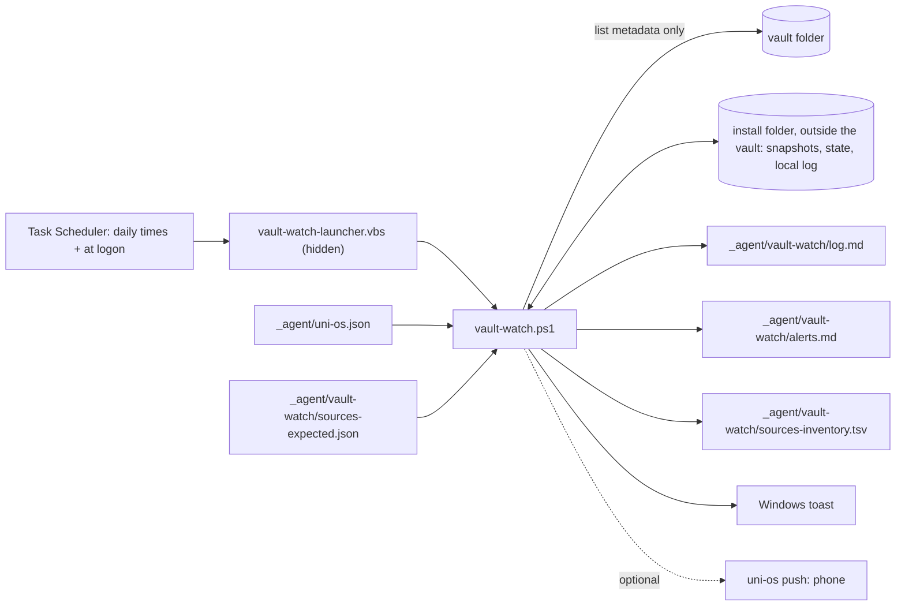

# Vault watch

A small, experimental, Windows-only script that looks at your vault a few times a day without opening a single file. It compares every note's and every official course file's size and modified time with the last run, writes one line per run into `_agent/vault-watch/log.md` so your agents can see what changed, and raises a Windows toast (optionally a phone push) only for the handful of things someone has to act on: an inbox note nobody applied, an unsorted drop in the inbox, a sync conflict copy, a deleted agent file, a missing daily prep note, a new, deleted or overdue official course file. No agent, no network, no tokens.

**At a glance**

| | |
|---|---|
| Tier | advanced |
| Requires | `core`, `courses` |
| Recommends | `notifications` (phone push), `daily-prep` (prep watchdog), `inbox-sync` (stale update notes), `course-files-fetch` (acts on "not in the vault yet") |
| Obsidian | irrelevant (plain files) |
| OS | **Windows 10/11 only, experimental** (PowerShell 5.1, Task Scheduler, VBS launcher, WinRT toasts). macOS/Linux: port it with the spec below |
| Runtime | laptop (the machine where the vault folder is synced) |
| Jobs | none: an OS scheduled task, not an agent job |
| Roles | none; any agent reads its log and alerts |
| Cost | free: no agent run, no API calls, no network; a run takes seconds |

> Uni OS has only been tested with Claude Code (desktop app, CLI, Remote Control). This module needs no agent at all at run time; agents only read its output.

## Why it exists
In the original system the vault was a Google Drive folder with many writers: the student, a coordinator session on the laptop, role sessions on an always-on VM, cloud agents that could only *create* files (they leave "update notes" in the inbox for a sync job to apply), and an Obsidian plugin. Things went wrong silently:

- a cloud agent's update note sat in the inbox for a day because the sync job had not run, so a status page stayed wrong;
- Drive created conflict copies (`name (1).md`) when two machines wrote the same file;
- a file under `_agent/` disappeared after an agent "cleaned up";
- the daily study-prep note for tomorrow was missing because the laptop was off at the prep job's time;
- an expected exercise sheet never made it into the course folder, and nobody noticed until the study block that needed it.

The first answer was two claude.ai cloud routines: a "vault watch" that listed the Drive folder through the Drive connector four times a day, and a "Drive watch" for official course files with an expected-files table and phone pushes. Both worked, but the connector was the weak point: multi-parent searches silently returned nothing, date-filtered searches lagged a day behind, listings came back in pages of 3 to 5 items, and a full crawl cost about 70 calls. Since the laptop has the synced folder on disk anyway, both routines were replaced on one morning by this local script, which does the same job from file metadata in seconds and costs nothing. One thing was lost in the move: the phone push (toasts only show on the laptop). Uni OS adds it back as an option through the push gate.

## How it works



The vault is split into two **scopes** that never overlap, each with its own snapshot:

- **notes**: everything you and the agents write (root `.md` files, `me/`, `progress/`, `semester/`, `resources/`, `views/`, `inbox/`, `_agent/`, `_templates/`, and in each course folder only its top-level notes plus `notes/`, `reference/`, `quiz-prep/`);
- **sources**: the official material (everything else in a course folder: official subfolders, the handwritten folder, handouts), plus configured extra source, app-export and archive folders.

Each run diffs both scopes against their snapshots, logs the differences, and checks a short list of alert rules. Every alert has a key and fires once. The first run of each scope only takes a baseline and is silent.

### Behaviour specification
This section is the contract. It is precise enough to re-implement the script on another OS (see "Porting" below) and to test the port against the same cases. "rel" means a vault-relative path with forward slashes, e.g. `DM/assignments/sheet01.pdf`.

**1. Inputs**
| # | Input | Notes |
|---|---|---|
| I1 | Vault root | `-Root "<vault>"`, else `vault` in `vault-watch.local.json` next to the script (written by `register-task.ps1`). None: exit 2. |
| I2 | `<vault>/_agent/uni-os.json` | The effective config, read on every run (so course or scope changes need no re-install). Keys: `modules.enabled`, `paths.inbox`, `paths.never_open`, `paths.handwriting_app_data`, `schedule.daily_prep`, every `vault_watch.*`, and per course `folder`, `short`, `id`, `handwritten_folder`, `watch_note_subfolders`. A missing key uses the default listed under "Configuration". Missing file or invalid JSON: write one `ERROR` line to `log.md`, skip the run. |
| I3 | `<vault>/_agent/vault-watch/sources-expected.json` | Optional expected-files table (format in point 8). Unreadable: local log line, the missing-file check is skipped, everything else runs. |
| I4 | File-system metadata | Per file: rel, size in bytes, last-write time (UTC). Directory names. The creation time of inbox update notes only. **Never file contents.** |
| I5 | Local time | `-Now` overrides it for tests. Dates in alerts and keys are local dates. |

**2. Triggers**
- Daily at each time in `schedule.vault_watch` (default 08:17, 13:17, 18:17, 22:17), plus at logon after `vault_watch.logon_delay_min` (5) minutes if `vault_watch.at_logon`.
- A slot missed while the machine slept runs when it wakes ("start when available").
- Never two runs at once: the scheduler ignores a new start while one runs, and the script holds the named mutex `UniOS-VaultWatch` (held by another run: exit 0, local log line).
- Time limit 10 minutes; runs only while the user is logged on; allowed on battery.

**3. Outputs**
| # | Output | Format |
|---|---|---|
| O1 | `<vault>/_agent/vault-watch/log.md` | Append-only. Created with a frontmatter header (`type: agent`, `audience: agent`, `tags: [uni/agent, vault-watch]`) if missing. One line per run and scope (formats in point 7). |
| O2 | `<vault>/_agent/vault-watch/alerts.md` | Append-only, header as above with `audience: both`. One line per alert: `- YYYY-MM-DD HH:MM - <text>`. Notes alerts first, then sources alerts, in rule order. |
| O3 | `<vault>/_agent/vault-watch/sources-inventory.tsv` | Rewritten (only when the sources scope changed, on its baseline, or when the file is missing; if `write_inventory`). Header `path<TAB>size_bytes<TAB>modified_utc<TAB>area`, rows sorted by path, `modified_utc` as `YYYY-MM-DDTHH:MM:SSZ`, `area` = normal / quiet / frozen. |
| O4 | Toasts | One per alert; if a run has more than `toast_summary_over` (3) alerts, one toast "`<N> vault alerts, see _agent/vault-watch/alerts.md`" instead. Title `toast_title`. |
| O5 | Push (optional) | If `vault_watch.push` and the run has at least one new alert that no other module pushes: exactly one push "`Vault watch: <N> new alert(s), see _agent/vault-watch/alerts.md`". `stale:` and `prep-` alerts are not counted: a stuck inbox note and a missing prep note already reach the phone from their one sender, the outcome checks (module notifications, or the always-on host), so they stay local here (alerts.md and a toast). **No file names in pushes** (they can contain personal names). Default command `python "<framework>/tools/uni_os.py" push --vault "<vault>" --source vault-watch --id vault-watch "<message>"`, so the push gate's budget, quiet hours and dedupe apply (one id: at most one vault-watch push per dedupe window, like the original's one push per day); gate exit codes 10-13 (held, budget, dedupe, refused) are not failures; `push_command` overrides it. |
| O6 | State files | In the state folder (point 4). |
| O7 | `local-log.txt` | In the state folder. Errors and skips only, `YYYY-MM-DD HH:MM <text>`. Trimmed to the last 500 lines when it passes 200 KB. |

Text files are UTF-8 without BOM. The Windows script writes CRLF line ends in `.md` files and LF in the TSV; a port may use LF everywhere.

**4. State files** (the state folder = the install folder; it must be outside the vault, otherwise exit 2, because state written into a synced folder changes the vault on every run)
| File | Content |
|---|---|
| `snapshot.json`, `snapshot-sources.json` | `{"<rel>": {"s": "<size>", "t": "<mtime>"}, ...}`, both values strings. `t` is the last-write time in .NET ticks (100 ns units since 0001-01-01 UTC). Only equality matters: a port may store `st_mtime_ns` instead, but then must start from a fresh baseline. |
| `state.json` | `{"alerted": {"<key>": "<ISO time first alerted>"}, "inboxSeen": {"<rel>": "<ISO time first seen>"}, "day": "YYYY-MM-DD"}` |
| `state-sources.json` | `{"alerted": {...}, "topDirs": ["<top-level folder names at the last complete run>"], "day": "YYYY-MM-DD"}` |

Every JSON write is atomic: write `<file>.tmp`, then rename over the old file. Per scope the order is state first, then snapshot.

**5. Algorithm (one run)**
1. Resolve the vault root; refuse a state folder inside the vault (exit 2); take the mutex.
2. Vault folder not reachable (drive not mounted): local log "vault not reachable", exit 0.
3. Read the config (I2); missing or invalid: `log.md` ERROR line, exit 0.
4. **Notes scope** (if `notes` is in `vault_watch.scopes`): enumerate (point 6). **Half-mount guard:** if a snapshot exists with at least `half_mount_min_files` (50) entries and the current scope has fewer than `half_mount_ratio` (20 %) of that count, the drive is only half there (typical right after wake or logon): local log line, exit 0, nothing written to the vault or the state.
5. Diff current vs snapshot: new (not in snapshot), changed (size or mtime differ), deleted (in snapshot, not current); each list sorted by rel. No snapshot: baseline, all lists empty.
6. Append the notes log line, then evaluate the notes alert rules (point 7).
7. **Sources scope** (if `sources` is in `scopes`), inside its own error boundary: read I3; enumerate; half-mount guard for this scope only (on a skip: log line `sources: skipped, only N files vs M in the snapshot (vault not ready)`, the notes scope still finishes); diff; pair moves (point 7); evaluate the sources rules; append the sources log line; write the inventory. An exception here appends `sources: ERROR: <message>` and never blocks the notes scope.
8. Deliver: append all new alerts to `alerts.md`, show toasts, send at most one push (counting only the alerts other than `stale:` and `prep-`, see O5).
9. Save notes state and snapshot (prune `alerted` keys older than `alert_prune_days`, 120). Save sources state and snapshot **only after a complete sources pass** (keys starting `missing:`, `remind:`, `small:` are never pruned).
10. Any other exception: local log + `log.md` line `ERROR: <message>`. Exit 0.

**6. Scope rules**
- *Skipped names* (files and folders, everywhere): names starting with `.` (`.obsidian`, `.trash`), `node_modules`, `~$*`, `*.tmp`, `desktop.ini`, `Thumbs.db`. Reparse points (links) are not followed.
- *Never listed* = `never_list` (default `private`, `*/private`) + the shared privacy key `paths.never_open` (default `**/private/**`) + the note app's own data folder `paths.handwriting_app_data` (handwritten-notes module; the original never enumerated its tablet app's data folder, only the app's PDF export folder). Checked on a folder's rel **before** it is opened, so not even file names inside are read. Applies to both scopes.
- *Churn* (`churn`): rels the notes scope ignores because machines rewrite them constantly (job logs, applied inbox notes, the watcher's own files, the pick-up queue, the heartbeat's state and flags, the always-on host's status pages, its `snapshot.json` and its failover ran-markers `_agent/vm/ran/**`, `_agent/uni-os.json`).
- *Pattern semantics:* `dir/**` matches the folder and everything below it; a leading `**/` also matches at the vault root (`**/private/**` covers `private/` and `DM/x/private/`); a pattern with `*` or `?` is a case-insensitive wildcard (`*` any characters including `/`, `?` one character); a pattern without them is compared literally, case-insensitive (folder names may contain `[`). Name patterns (`note_root_files`, `quiet_patterns`, `conflict_patterns`, `update_note_patterns`) match the leaf name only.
- **Notes scope** = root files matching `note_root_files` (`*.md`, `*.canvas`, `*.base`) + every file below each folder in `note_folders` + per course folder: its top-level files with extension `.md`, `.canvas` or `.base`, and everything below its note subfolders (`course_note_subfolders` + the course's `watch_note_subfolders`); minus churn, never-listed and skipped names.
- **Sources scope** = root files NOT matching `note_root_files` + per course folder: its top-level files that are not `.md`/`.canvas`/`.base` and everything below every subfolder that is not a note subfolder + everything below each folder in `source_top_dirs`, `quiet_dirs`, `frozen_dirs` (unless inside a course folder, which is already covered); minus never-listed and skipped names.
- **Area of a sources file:** `frozen` if below a `frozen_dirs` entry (group = that folder plus its first subfolder, or the folder itself for files directly in it); else `quiet` if below a `quiet_dirs` entry, or if its first folder inside the course folder matches `quiet_patterns` (`*handwritten*`) or equals the course's `handwritten_folder`; else `normal`. The course of a file = the course whose `folder` is a prefix of its rel. The parent = the rel's folder part, or `(vault root)`.

**7. Rules, keys and texts**
Notes rules (key: condition, text):
| Key | Condition | Text |
|---|---|---|
| `stale:<rel>` | `inbox-sync` enabled; a file directly in `<paths.inbox>/` matching `update_note_patterns` (`*-update.md`); now minus the earlier of first-seen and its creation time > `stale_update_hours` (24). First-seen entries are dropped when the file leaves the inbox. | `Vault: update note <name> unapplied ><H> h, the inbox sync did not run or parked it` |
| `unsorted:<rel>` | a file that is new this run, anywhere below the inbox, not matching the update-note patterns and not `inbox.md` | `Vault: unsorted file in the inbox: <path below the inbox>` |
| `conflict:<rel>` | a notes-scope file, or any root `.md`/`.canvas`, whose name matches `conflict_patterns` (`* (1)*`, `*conflicted copy*`, `*.sync-conflict-*`, `Copy of *`) | `Vault: sync conflict copy <rel>` |
| `deleted:<rel>:<yyyyMMddHHmm>` | a deleted file at the vault root or below `_agent/` (the run stamp in the key lets the same path alert again later) | `Vault: file deleted: <rel>` |
| `prep-<today>-morning` | `daily-prep` enabled and `prep_watchdog`; local time inside `prep_morning` (08:00-12:00); no file in `prep_folder` matching `prep_pattern` with `{date}` = today | `Study prep for today missing; the daily prep job (<first schedule.daily_prep time>) may not have run` |
| `prep-<tomorrow>-evening` | same, from `prep_evening_from` (21:00), for tomorrow's date | `Study prep for tomorrow missing; ...` |

Sources rules (evaluated in this order; "runKey" = `yyyyMMddHHmm` of the run):
| Key | Condition | Text |
|---|---|---|
| `srcfrozen:<group>:<runKey>` | any new, changed or deleted file in a frozen area (moves included); one alert per group per run | `Sources: frozen archive <group> changed (new a, changed b, deleted c; e.g. <first file name>)` |
| `srcconflict:<rel>` | a new file (not a move target, not frozen; quiet included) whose name matches `conflict_patterns` | `Sources: sync conflict copy <rel>` |
| `srcnew:<rel>:<mtime>` / `srcnew:<parent>:<runKey>` | new files in normal areas (not move targets, not conflicts), grouped by parent; more than `group_new_over` (3) in one parent become one alert | `Sources: new <course short> file <name> in <parent>` (`new file` outside courses) / `Sources: <N> new files in <parent>, e.g. a; b; c` |
| `srcdel:<rel>:<runKey>` / `srcdel:<parent>:<runKey>` | deleted files (not move sources, not frozen; quiet included), grouped the same way | `Sources: <rel> moved out of the source folders into the notes (<new note rel>)` if a file new in the notes scope has the same size and mtime, else `Sources: <rel> deleted or moved out of the source folders` / `Sources: <N> files deleted or moved out of <parent>, e.g. ...` |
| `missing:<id>` | an expected row is due (`alertFrom` <= today) and no normal-area file below the course folder has a name matching its pattern | `Sources: <course short> <label> not in the vault yet (out <ddd d MMM of release>)`, plus `; name is a guess, it may have come under another name` for `soft` rows |
| `remind:<id>` | still missing and `remindFrom` <= today | `Sources: reminder: <course short> <label> still not in the vault (out <ddd d MMM>)` |
| `small:<id>` | present, but every matching file is smaller than `minBytes` | `Sources: <course short> <label> is in the vault but looks too small (<KB> KB): <name>` |
| `srctop:<name>` | a top-level folder that was not in `topDirs` at the last complete run and is not watched (note folders, course folders, source/quiet/frozen dirs) or in `ignore_top_dirs`; the first run records the list silently | `Sources: new top-level folder in the vault: <name> (not watched)` |

*Move pairing (sources, log only):* pass 1 pairs a deleted and a new file with the same size and mtime; pass 2 pairs the remaining ones with the same lower-cased name and size. Each file pairs at most once; among several new files with the same signature the first in path order wins. Paired files are excluded from the new/deleted alerts (not from the frozen rule).

*Log lines* (a line lists at most `log_max_paths` (20) paths in total, filled category by category):
- notes: `- YYYY-MM-DD HH:MM | new N, changed M, deleted K | new: <rel>; <rel> | changed: ... | deleted: ...` (empty categories are left out); first run: `- ... | baseline taken: N files in scope (no alerts)`
- sources: `- ... | sources: new a, changed b, deleted c, moved d | new: ... | changed: ... | deleted: ... | moved: <from> -> <to>`, then if present ` | expected missing: <id>; <id>`, ` | new top-level folder: <name>`, ` | top-level folder gone: <name>`; first run: `- ... | sources: baseline taken: N files in scope (no alerts)`
- errors and skips: `- ... | ERROR: <message>`, `- ... | sources: ERROR: <message>`, `- ... | sources: skipped, only N files vs M in the snapshot (vault not ready)`
- the installer adds `- ... | installed: task '<name>', daily <times>, at logon +5 min; script folder <path>`

**8. Expected-files table** (`sources-expected.json`, maintained by the agent)
```json
{
  "about": "rule text",
  "series": [
    {"course": "dm", "label": "sheet {nn}", "first_release": "2026-09-17", "every_days": 7, "count": 13, "start": 1,
     "grace_days": 4, "remind_days": 11, "skip_dates": ["2026-10-29"], "confidence": "firm",
     "pattern": "^exercise_?0*{n}(?!\\d).*\\.pdf$", "min_bytes": 20000}
  ],
  "expected": [
    {"id": "AD slides 07", "course": "algo", "label": "lecture slides 07", "release": "2026-10-29",
     "alertFrom": "2026-10-31", "remindFrom": "", "confidence": "soft", "pattern": "^slides-?0*7(?!\\d).*\\.pdf$", "minBytes": 0}
  ],
  "note": ""
}
```
- `course` may be a course id, short name or folder. `pattern` is a case-insensitive regular expression matched against the file **name** (.NET syntax; Python's `re` with `IGNORECASE` reads the same patterns). Dates are `YYYY-MM-DD`; a row with a bad date is skipped with a local log line.
- *Series expansion:* `n = start` (default 1), `d = first_release`; repeat until `count` rows exist: if `d` is in `skip_dates`, advance `d` by `every_days` (default 7) without using a number; else emit a row with `{n}` replaced by n and `{nn}` by n with two digits in `label` and `pattern`, `id = "<course short> <label>"`, `release = d`, `alertFrom = d + grace_days` (default 2), `remindFrom = d + remind_days` (only if set), `minBytes = min_bytes`; then `n += 1`, `d += every_days`.

**9. Safety checks (all of them are deliberate)**
- Metadata only: never opens a vault file (a streaming drive downloads every file that is opened).
- Never-listed folders are checked before they are opened.
- Half-mount guard per scope; the sources snapshot is saved only after a complete pass; an error in the sources scope never blocks the notes scope.
- State outside the vault; atomic JSON writes; state before snapshot.
- Once-only alert keys; a summary toast instead of a toast storm; pushes carry no file names.
- Single instance (scheduler + mutex); links not followed; config missing = skip, not "everything deleted".

**10. Exit codes**
`0` for every run, including skips (vault unreachable, half mounted, already running, config missing) and caught errors, so Task Scheduler never shows a failure for a normal condition; look at `log.md` and `local-log.txt` instead. `2` only for an installation error: no vault path configured, or the state folder is inside the vault.

**11. Switches** (`vault-watch.ps1`): `-Root "<vault>"`, `-StateDir "<folder>"`, `-DryRun` (prints log lines, alerts, toasts and a per-folder scope summary; writes no file, no state, no toast, no push), `-Now '<date time>'` (simulate a run time; use with `-DryRun`), `-NoToast`, `-NoPush`, `-TestToast` (one toast, nothing else).

### Porting it to macOS or Linux
The Windows script is the reference implementation; `tests/test-vault-watch.ps1` is the acceptance test (39 checks against a fake vault). To port, ask your agent: "Port modules/vault-watch to <macOS|Linux> following the behaviour specification in its README; keep every file format and alert text; port the test cases too." Recommended shape: one Python 3 standard-library script (`os.scandir`, `json`, `re`, `fcntl` for the lock) plus a per-OS scheduler file and `notify()` helper.

| Windows piece | macOS | Linux |
|---|---|---|
| Task Scheduler, daily triggers + at logon (+5 min), "start when available", "ignore new instance", 10 min limit | a LaunchAgent plist in `~/Library/LaunchAgents/` with a `StartCalendarInterval` array (one `{Hour, Minute}` per time) and `RunAtLoad` (at login); launchd runs a missed calendar slot once after wake | a systemd **user** timer: one `OnCalendar=*-*-* 08:17:00` line per time, `Persistent=true` (runs a missed slot at the next start), `OnStartupSec=5min`; the service `Type=oneshot`, `TimeoutStartSec=10min`. Or cron + anacron |
| `vault-watch-launcher.vbs` (no console window) | not needed | not needed |
| named mutex `UniOS-VaultWatch` | `fcntl.flock` on a lock file in the state folder | same, or `flock -n` in the unit |
| WinRT toast | `osascript -e 'display notification "<text>" with title "<title>"'` (or `terminal-notifier`) | `notify-send "<title>" "<text>"` (libnotify; needs the user's D-Bus session, which a systemd user unit has) |
| `LastWriteTimeUtc.Ticks` | `st_mtime_ns` | `st_mtime_ns` |
| `GetCreationTime` (stale inbox notes) | `st_birthtime` | `st_ctime` is not creation time; use first-seen only |
| `%USERPROFILE%\Documents\uni-os\vault-watch` | `~/Library/Application Support/uni-os/vault-watch` | `~/.local/state/uni-os/vault-watch` |
| Drive for desktop `G:\My Drive\...` | `~/Library/CloudStorage/GoogleDrive-<account>/My Drive/...` | no official client: an rclone mount (keep the half-mount guard!) or `rclone bisync` |

Port notes: take a fresh baseline after porting (delete the snapshots; the first run is silent). Conflict names depend on the sync tool: Google Drive ` (1)`, Dropbox `conflicted copy`, Syncthing `.sync-conflict-`, OneDrive appends the computer name (add a pattern for yours). Keep `log.md`/`alerts.md` formats identical: other modules and agents read them.

### Without a local copy of the vault: the agent-job variant (not shipped)
The original's first two watchers were cloud agent routines that read the synced folder through a storage connector, with no local files at all. If you cannot run a local script (no machine with the synced folder on disk), the same rules can run as a scheduled agent job written in the jobs format (`job.conf` + `prompt.md`). Expect it to be slower, more expensive and less reliable. What the original learned with it:
- **Read-only on the synced folder.** A cloud write while the laptop syncs creates conflict copies. Keep the job's inventory and state in files only the job writes.
- **Several attempts per day plus a per-day marker.** A day counts as done once an attempt saw and handled at least one change, or once the last attempt (from about 21:00) found the folder with no changes. A run that finds nothing does not prove nothing happened, because the cloud copy only changes while the laptop syncs. The prep watchdog ran on the first and the last attempt either way.
- **Connector listings are flaky** (the Google Drive connector, autumn 2026): queries over more than 5 or 6 parent folders silently returned nothing (use at most 5 parents per query, or one per call). Date-filtered queries lagged a day or more behind: query from the last run minus 36 h, diff against your own inventory, never trust an empty result on a day files are expected, and cross-check with a name search. Single-folder listings came back in pages of 3 to 5 items with long page tokens (copy them exactly; page 2 could be empty). A full crawl cost about 70 calls, so inventory folders rather than files, and do a full crawl only weekly, to catch deletions and moves. Searches without a parent filter blew up while another agent was bulk-writing files.
- **Classify new files** against each course's known naming patterns: recognised, unrecognised, or recognised but in the wrong course folder. Alert only on the last two and on missing expected files.
- **Stay quiet unless something is off.** Send at most one push per run that lists everything (the old vault watch sent at most one per day). Never push twice about the same item, and never send an "all good" message. On a failure, retry once; if it fails again, push once and do not advance the "last run" time.
- The cloud version also sent one reminder the day before the related exercise session or deadline, and flagged suspiciously small files (under 20 KB) and duplicates. The local script's `remindFrom` and `minBytes` port the first two.

## What gets installed
In the vault (by `uni-os init` / `enable vault-watch`):
| Path | What |
|---|---|
| `_agent/vault-watch/RUNBOOK.md` | for agents: what runs, scopes, every alert and what to do about it, log formats, test switches |
| `_agent/vault-watch/log.md`, `alerts.md` | empty logs with their headers (the script appends) |
| `_agent/vault-watch/sources-expected.json` | the expected-files table, empty (`series` and `expected`), with the rule text |
| `_agent/vault-watch/sources-inventory.tsv` | written by the script after its first sources run |

On the laptop (by `scripts/register-task.ps1`), in the install folder (default `%USERPROFILE%\Documents\uni-os\vault-watch\`): `vault-watch.ps1`, `vault-watch-launcher.vbs`, `vault-watch.local.json`, later the state files; and the Task Scheduler task (default "Uni OS vault watch").

Install (Windows PowerShell; the agent may be blocked from registering tasks, then it gives you this line):
```
powershell -NoProfile -ExecutionPolicy Bypass -File "<framework>\modules\vault-watch\scripts\register-task.ps1" -Vault "<vault>"
```
Then check it: `powershell -NoProfile -ExecutionPolicy Bypass -File "%USERPROFILE%\Documents\uni-os\vault-watch\vault-watch.ps1" -DryRun`.

## Configuration
All keys have defaults (the original's values) in `module.toml`; set only what you want to change, in `_agent/uni-os.toml`, then run `python tools/uni_os.py render`. The script picks up changes on its next run; only `schedule.vault_watch`, `task_name`, `install_dir`, `at_logon` and `logon_delay_min` need a re-run of `register-task.ps1`.

| Key | Default | Meaning |
|---|---|---|
| `schedule.vault_watch` | `["08:17","13:17","18:17","22:17"]` | daily run times (local) |
| `vault_watch.task_name` | `"Uni OS vault watch"` | Task Scheduler task name |
| `vault_watch.install_dir` | `"%USERPROFILE%\\Documents\\uni-os\\vault-watch"` | scripts and state, outside the vault |
| `vault_watch.at_logon`, `logon_delay_min` | `true`, `5` | also run at logon, after N minutes |
| `vault_watch.scopes` | `["notes","sources"]` | which scopes run |
| `vault_watch.toast_title`, `toast_summary_over` | `"Uni OS vault watch"`, `3` | toast title; more alerts than this = one summary toast |
| `vault_watch.push`, `push_command` | `false`, `[]` | one generic phone push per run with alerts that nothing else pushes (needs `notifications`; stale inbox notes and missing prep notes stay local); custom command with `{message}` |
| `vault_watch.note_root_files` | `["*.md","*.canvas","*.base"]` | root files in the notes scope |
| `vault_watch.note_folders` | `["me","progress","semester","resources","views","inbox","_agent","_templates"]` | note folders (recursive) |
| `vault_watch.course_note_subfolders` | `["notes","reference","quiz-prep"]` | note subfolders in every course folder |
| `course.watch_note_subfolders` | `[]` | extra note subfolders for one course, e.g. `["code"]` |
| `vault_watch.churn` | job logs, applied inbox notes, own files, pick-up queue, heartbeat state and flags, the host's status pages, `snapshot.json` and `ran/**` markers, `uni-os.json` | ignored by the notes scope |
| `vault_watch.never_list` | `["private","*/private"]` | never enumerated (privacy); `paths.never_open` and `paths.handwriting_app_data` (shared keys) are added to it |
| `vault_watch.source_top_dirs` | `[]` | extra top-level folders with official material |
| `vault_watch.quiet_dirs`, `quiet_patterns` | `[]`, `["*handwritten*"]` | app-output areas: log only (also `course.handwritten_folder`) |
| `vault_watch.frozen_dirs` | `["z_archive","archive"]` | archives (vault-relative; add course archives like `"AD/z_archive"`): any change alerts; `z_archive/` is where the courses module keeps outdated official files |
| `vault_watch.ignore_top_dirs` | `[]` | top-level folders that may exist without a "not watched" alert |
| `vault_watch.conflict_patterns` | `["* (1)*","*conflicted copy*","*.sync-conflict-*","Copy of *"]` | conflict copy names |
| `vault_watch.half_mount_ratio`, `half_mount_min_files` | `0.2`, `50` | half-mount guard |
| `vault_watch.alert_prune_days` | `120` | forget once-only keys after this |
| `vault_watch.group_new_over`, `log_max_paths` | `3`, `20` | grouping and log line length |
| `vault_watch.write_inventory` | `true` | write `sources-inventory.tsv` |
| `vault_watch.stale_update_hours`, `update_note_patterns` | `24`, `["*-update.md"]` | stale inbox notes (with `inbox-sync`): a laptop-local backstop, deliberately later than the phone alert at `notify.inbox_stale_hours` (4 h), so the toast means "the phone path failed too" |
| `vault_watch.prep_watchdog`, `prep_folder`, `prep_pattern` | `true`, `"semester/prep"`, `"prep-{date}*.md"` | prep watchdog (with `daily-prep`) |
| `vault_watch.prep_morning`, `prep_evening_from` | `"08:00-12:00"`, `"21:00"` | watchdog windows |

What the setup interview asks: whether you want it at all (Windows only, experimental; it is most useful when several agents write to a synced vault), the run times (the default is fine for most), whether alerts should also reach the phone, extra top-level folders with official material, app-export folders (tablet note apps) and archives, and folders that must never even be listed. The expected-files table is filled later, per course, once the first sheets show how files are named.

## Daily use
You mostly do nothing: toasts tell you when something needs you. Things to say to your agent:
- "What changed in the vault today?" (it reads the last lines of `_agent/vault-watch/log.md`)
- "Any vault alerts?" / "The vault watch says there is a conflict copy of the DM card: fix it." (it merges the copy and asks before deleting it)
- "Add the DM sheets to the expected files: `exercise_NN.pdf` every Thursday from 17 Sep, 13 sheets, alert after 4 days, remind the day before the exercise session."
- "The `roadmap` folder holds official plans: watch it as a source folder." / "Stop alerting about the `scratch` folder." (`source_top_dirs` / `ignore_top_dirs`)
- "Test the evening prep watchdog." (it runs `vault-watch.ps1 -DryRun -Now '<today> 21:30'`)

## Agents other than Claude Code
The script needs no agent. Any agent that can read files can use `log.md`, `alerts.md` and `sources-inventory.tsv`, and maintain `sources-expected.json`. Differences show up only at install time: some agent apps refuse to register a scheduled task (the Claude desktop app in the original flagged it as "unauthorized persistence"), so the agent runs `register-task.ps1 -NoRegister` and hands you the one-line command. In Claude Code, a session reacting to an alert typically uses its normal file tools; nothing Claude-specific is required.

## Failure modes and fixes
| Symptom | Cause | Fix |
|---|---|---|
| No new lines in `log.md` | laptop off, user not logged on, task disabled, or the vault path wrong | Task Scheduler: check the task's last run; `local-log.txt` in the install folder; run with `-DryRun` |
| `ERROR: _agent/uni-os.json not found` | the config was never rendered | `python tools/uni_os.py render` in the framework folder |
| A run is missing after wake, nothing logged | the half-mount guard skipped it (see `local-log.txt`) | nothing; the next run catches up |
| Flood of "new file" lines after moving folders | a move between scopes looks like delete + new | expected once; moves inside the sources are paired and only logged |
| Toasts never appear | Focus Assist / notifications for PowerShell off | Windows notification settings; test with `-TestToast` |
| "not in the vault yet" for a file that is there | the name differs from the pattern (soft guess) | fix the pattern in `sources-expected.json`, check with `-DryRun` |
| Push not sent | `push = false`, framework path unknown, or the push gate held it | `local-log.txt` says why; re-run `register-task.ps1` |
| Script cannot be started ("not digitally signed") | the files carry a download mark | the installer unblocks them; or `Unblock-File` on the install folder |

## Lessons from the original system
- A streaming cloud drive downloads every file a watcher opens: watch metadata only.
- Right after wake or logon the drive can be half mounted and look like "everything deleted"; the 20 % guard prevents a mass-delete alert and a corrupted snapshot.
- Machine-written files (a status snapshot rewritten every 15 minutes by the VM, sync logs, applied inbox notes) turn the log into noise: exclude churn explicitly.
- `Join-Path` throws when the drive letter is missing; build paths with `[IO.Path]::Combine` on a drive that may not be mounted.
- The deleted-file key contains the run stamp, so the same path can alert again later; every other key fires once, ever.
- Split one physical folder into two logical scopes (notes vs official sources) with separate snapshots and rules: the official files have different alert needs (new, missing, moved) than notes (conflicts, stale inbox).
- An expected-files table turns the course rhythm into "is the sheet here yet?" nudges. Alert from a date that already includes your own upload lag (0 to 2 days in the original); mark a name inferred from one file as a guess ("soft") and say so in the alert; don't track items that never become files (LMS quizzes, programming-platform tasks, git hand-ins).
- Group more than three new files in one folder into one alert, or a bulk download produces a toast storm.
- The cloud predecessor showed why "N attempts per day + an idempotent day marker" beats one run: a run that finds nothing is not proof that nothing happened, because the synced copy only changes while the laptop syncs. The local script avoids the problem by running where the files are.
- Toasts only reach you at the laptop; the original lost its phone push in the move, which Uni OS restores as an option, without file names in the push.
- Some agent apps write to a redirected AppData (MSIX packaging): files they put under `%LOCALAPPDATA%` are invisible to other processes. Install under Documents.
- `-DryRun` with `-Now` made every rule testable without waiting for 21:00.

## Removing it
1. `powershell -NoProfile -ExecutionPolicy Bypass -File "<framework>\modules\vault-watch\scripts\register-task.ps1" -Vault "<vault>" -Uninstall` removes the task.
2. Delete the install folder (`%USERPROFILE%\Documents\uni-os\vault-watch\`) if you want the state gone.
3. `python tools/uni_os.py disable vault-watch`. Your vault files (`_agent/vault-watch/`) stay; delete them by hand if you like.
