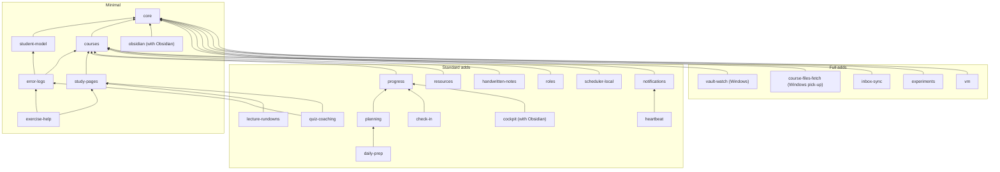

# Module presets

Uni OS is a set of 25 modules. A preset is a ready-made selection to start from: **Minimal**, **Standard** or **Full** (Full includes the always-on server, module `vm`). You can start from any preset, then add or remove single modules at any time ([changing-modules.md](changing-modules.md)). The lists on this page are the ones in [`tools/uni_os/presets.py`](../tools/uni_os/presets.py), the single definition the tools use.

```bash
python tools/uni_os.py modules --preset standard                 # the resolved list, dependencies added
python tools/uni_os.py modules --preset standard --no-obsidian   # without the Obsidian-only modules
```

The setup agent writes the chosen list, dependencies included, into `modules.enabled` in your config ([PLAYBOOK.md](PLAYBOOK.md) step 3 and 4). `uni_os.preset` in the config is used only when `modules.enabled` is empty; `uni-os init --preset <name>` installs a preset directly and writes its resolved list into the vault's copy of the config.

## The three presets at a glance

| | Minimal | Standard | Full |
|---|---|---|---|
| In one line | the study engine on a plain vault | Minimal + the organisation layer and laptop automation | Standard + the advanced and add-on modules, including the always-on server |
| Modules with Obsidian (Windows laptop) | 7 | 20 | 25 |
| Modules without Obsidian (Windows laptop) | 6 | 18 | 23 |
| Full on a macOS or Linux laptop | | | 2 fewer: no `vault-watch`, no `course-files-fetch` |
| Files created for four courses (the example config, with Obsidian) | 71 | 154 | 183 |
| Scheduled jobs | none | 13 (most installed switched off) | 18 |
| Needs | an agent, Python 3.11+ | + a calendar the agent can use, a phone with ntfy, the agent's desktop app (or an OS scheduler) | + a Windows laptop for two experimental add-ons, a browser your agent can drive, an always-on Linux machine |
| Extra cost | none beyond your agent subscription | agent usage of the scheduled jobs; optional cockpit AI panel on your own API key | + the server (the original: roughly $21 a month on Google Cloud; a home server costs electricity) |
| Recommended for | trying Uni OS; study help only | most students | students who want everything to keep running while the laptop sleeps |

## Minimal

**Modules:** `core`, `student-model`, `courses`, `error-logs`, `study-pages`, `exercise-help`, plus `obsidian` if you use Obsidian (`obsidian.enabled = true`).

**What you get:**
- A vault every agent can share: one start page, standing rules with your assistance level per course, the routing table that says which fact goes into which file, an inbox, templates, a Home page and generated maps (`core`).
- Four short pages about you (profile, learning style, rhythm, weak spots) that every agent reads before giving advice (`student-model`).
- One folder per course with a course card (facts, weekly rhythm, graded work, bonus rule, help policy, real sources), a backlog, notes and reference folders, empty folders for the official files, an overview page and the `course-facts` skill (`courses`).
- A mistake ledger per course, fed by every helping session, with patterns that update your weak spots (`error-logs`).
- Self-contained study pages: interactive HTML with quizzes checked by code and a final self-test, plus a Markdown twin, or the formats you chose (`study-pages`).
- An exercise-help role that coaches by your assistance policy: smallest hint first, never a solution for graded work, no help at all on `solo` work (`exercise-help`).
- With Obsidian: Bases views, course colours, callouts, a vault-map canvas (`obsidian`).

**Requirements:** Python 3.11+ (standard library only), an AI agent with file access (only Claude Code was tested), optionally a synced folder and Obsidian 1.9+.

**Cost:** nothing beyond your agent subscription.

**Jobs, roles, skills:** no jobs; role `exercise-help`; skills `course-facts`, `log-error`, `study-page`.

**Recommended for:** trying Uni OS in an afternoon; students who want help with studying but organise their week themselves; any operating system.

## Standard

**Modules:** Minimal + `progress`, `planning`, `check-in`, `daily-prep`, `lecture-rundowns`, `quiz-coaching`, `roles`, `scheduler-local`, `heartbeat`, `notifications`, `resources`, `handwritten-notes`, plus `cockpit` if you use Obsidian.

**What you get on top of Minimal:**
- A progress dashboard (bonus or grade standing per course, done vs. to do, the next 10 days), an append-only tracker log and one page per term week with a "Due this week" table (`progress`).
- A planner role, Plan & progress, that turns what is due into blocks in your calendar with a terse title notation, writes one plan per week with a ledger of every calendar edit, and has a frame for scheduling the exam phase (`planning`).
- A weekly rhythm that runs by itself: a job that creates next week's page, and a check-in that asks you once for the week's results and closes the week (`check-in`).
- Every evening a prep note with everything tomorrow's study blocks need, linked from the blocks in your calendar; a morning check repairs it (`daily-prep`).
- Lecture rundowns from the real sources with cited pages, quiz coaching for recurring graded quizzes (`lecture-rundowns`, `quiz-coaching`).
- A coordinator session as your single entry point, role briefs and a routing table (`roles`).
- Jobs on the laptop through the agent's desktop app, or experimentally through an OS scheduler (`scheduler-local`).
- A proactive watcher that stays silent unless something matters, and phone pushes through one gate with a daily budget, quiet hours and no "all good" messages (`heartbeat`, `notifications`).
- Method pages for sources and checking course facts, and folders for handwritten-note PDFs (`resources`, `handwritten-notes`).
- With Obsidian: the cockpit plugin, a calm dashboard of now/next, deadlines with countdowns, bonus standing and the prep card (`cockpit`).

**Requirements:**
- a calendar your agent can read and write (In Claude Code: the Google Calendar connector), or `calendar.provider = "none"`;
- a phone with the free ntfy app, or `notify.provider = "none"`;
- the agent's desktop app with scheduled tasks, kept open (In Claude Code: desktop "Scheduled" tasks), or an OS scheduler that runs the agent headless (`runtime.laptop_scheduler = "os"`, Windows Task Scheduler, experimental);
- with Obsidian: version 1.9+ for the views, 1.13.2+ for the cockpit.

**Cost:** agent usage of the scheduled jobs (in the original, all scheduled jobs together were under 2 % of a week's usage; with the default schedule the daily prep and its morning check together run three times a day; a deterministic pre-check ends most heartbeat slots before the agent work starts: free under a job runner (OS scheduler or server), a short agent run as a desktop app task). ntfy is free. The cockpit's optional AI panel runs on your own Anthropic API key, billed separately (the original's estimate: about $1-5 a month, capped by a monthly spend limit).

**Jobs** (most installed switched off; you switch on what you want in [PLAYBOOK.md](PLAYBOOK.md) step 7.8): `week-page`, `check-in`, `daily-study-prep`, `study-prep-morning-check`, `heartbeat`, `heartbeat-weekend`, `heartbeat-watch` and `heartbeat-ask` (server only), `outcome-checks`, and the optional `lecture-skim`, `quiz-prep`, `deadline-audit`, `waiting-on-you`. **Roles:** `coordinator`, `plan-and-progress`, `exercise-help`, `lecture-rundown`, `quiz-coach`. **Skills:** Minimal's plus `read-handwritten-notes`.

**Recommended for:** most students. It is the original system's daily setup without the always-on server: everything runs while the laptop is awake and the agent app is open.

## Full

**Modules:** Standard + `inbox-sync`, `experiments`, `vault-watch`, `course-files-fetch`, `vm`. On a macOS or Linux laptop the preset leaves out `vault-watch` and `course-files-fetch` (see "Adjusting a preset").

**What you get on top of Standard:**
- Update notes for writers that can only create files (cloud agent sessions, the cockpit's Done taps), applied safely by one job (`inbox-sync`).
- A method for testing changes to how you study or live, with a block log and a pre-registered review (`experiments`).
- A Windows watcher that logs every change in the vault and raises a toast only for what someone must act on: stale inbox items, sync conflict copies, missing prep notes, new official files (`vault-watch`, experimental).
- Fetching official course files through your own logged-in browser, filed by a Windows pick-up task that trusts no request (`course-files-fetch`; the pick-up is experimental).
- An always-on Linux machine that runs the jobs on time, keeps role sessions alive, lets you open sessions in the vault from your phone and repairs itself (`vm`).

**Requirements:**
- a Windows laptop for `vault-watch` and the pick-up task of `course-files-fetch` (on macOS or Linux, leave them out or let your agent port them: [docs/porting-to-other-os.md](../docs/porting-to-other-os.md));
- a browser your agent can drive for fetching (In Claude Code: Claude in Chrome); you always do the sign-in yourself;
- an always-on machine with Ubuntu 24.04 and at least 4 GB RAM: a cloud VM (Google Cloud is documented) or a spare computer at home (e.g. WSL2 on an old laptop), plus an agent subscription login on it; about an hour for the install ([modules/vm/INSTALL.md](../modules/vm/INSTALL.md)).

**Cost:** the server. The original ran an `e2-custom-small` machine with 4 GB RAM on Google Cloud at roughly $21 a month (a monthly cloud credit included in some subscriptions brought it down); a home server costs electricity only. The Windows add-ons are free.

**Jobs added:** `inbox-sync`, `inbox-poll`, `vm-health`, `vault-history`, `vm-performance-verdict`. **Role added:** `course-files-fetch`.

**Recommended for:** students who want the jobs to run on time whether or not the laptop is open, who use cloud sessions, and who are happy to maintain a small server. The trade-off between laptop, cloud sessions and a server is in [docs/runtimes.md](../docs/runtimes.md).

## Adjusting a preset

- **No Obsidian:** with `obsidian.enabled = false` every preset leaves out `obsidian` and `cockpit` by itself.
- **macOS or Linux:** a preset is resolved for the laptop's system: `runtime.laptop_os`, else the system of the computer that runs the command. On macOS or Linux, Full leaves out `vault-watch` and `course-files-fetch`, and `init` and `modules` print why. To keep one after your agent has ported its laptop scripts, add it with `--modules` or `uni-os enable <id>`; `uni-os doctor` and `uni-os enable` then warn about it while `runtime.laptop_os` is not `windows`. For `course-files-fetch` only the pick-up task needs porting; its fetch role and `request_pickup.py` run anywhere. `python tools/uni_os.py modules --preset full --os any` shows the unfiltered list.
- **Full without the server:** Full minus `vm` (write the list as a custom `modules.enabled`).
- **Standard plus the server:** start from Standard, then `python tools/uni_os.py enable vm` ([changing-modules.md](changing-modules.md)).
- **Custom:** any list works; requirements are added automatically. The fictional example student uses Standard plus `inbox-sync` and `experiments` (22 modules, [examples/alex.toml](../examples/alex.toml)).

## Dependencies

Every module needs `core`. An arrow means "needs"; arrows that follow from others are left out (`daily-prep` needs `planning`, which needs `progress`, which needs `courses`). The tools add every requirement automatically, and refuse to disable a module that another enabled module still needs.



## Every module

`requires` is the direct list from each module's `module.toml`. "Preset" is the first preset that includes the module. Full descriptions: [modules/README.md](../modules/README.md) and each module's README.

| Module | Tier | Requires | Preset | OS | Obsidian | What it is |
|---|---|---|---|---|---|---|
| [core](../modules/core/README.md) | core | (none) | Minimal | any | optional | vault skeleton, start page, rules, routing table, maps |
| [student-model](../modules/student-model/README.md) | core | core | Minimal | any | optional | profile, learning style, rhythm, weak spots |
| [courses](../modules/courses/README.md) | core | core | Minimal | any | recommended | course folders, cards, overview, `course-facts` skill |
| [error-logs](../modules/error-logs/README.md) | core | core, courses, student-model | Minimal | any | optional | mistake ledger per course and stream |
| [study-pages](../modules/study-pages/README.md) | standard | core, courses | Minimal | any | recommended | HTML study pages, Markdown twins, PDF, checks |
| [exercise-help](../modules/exercise-help/README.md) | standard | core, courses, error-logs, study-pages | Minimal | any | optional | hints-only coaching by assistance policy |
| [obsidian](../modules/obsidian/README.md) | standard | core | Minimal (with Obsidian) | any | required | Bases views, CSS, graph colours, canvas |
| [progress](../modules/progress/README.md) | standard | core, courses | Standard | any | recommended | dashboard, tracker log, week pages |
| [planning](../modules/planning/README.md) | standard | core, courses, progress | Standard | any | optional | calendar planning, week plans, Plan & progress role |
| [check-in](../modules/check-in/README.md) | standard | core, progress | Standard | any | optional | week-page and check-in jobs |
| [daily-prep](../modules/daily-prep/README.md) | standard | core, courses, planning | Standard | any | recommended | evening prep note, morning check |
| [lecture-rundowns](../modules/lecture-rundowns/README.md) | standard | core, courses, study-pages | Standard | any | optional | rundowns from real sources, optional skim job |
| [quiz-coaching](../modules/quiz-coaching/README.md) | standard | core, courses, error-logs, study-pages | Standard | any | optional | weekly graded-quiz prep and review |
| [roles](../modules/roles/README.md) | standard | core | Standard | any | optional | coordinator, role routing, handoffs |
| [scheduler-local](../modules/scheduler-local/README.md) | standard | core | Standard | any (OS path: Windows, experimental) | irrelevant | runs jobs on the laptop |
| [notifications](../modules/notifications/README.md) | standard | core | Standard | any | irrelevant | ntfy pushes through one gate, outcome checks |
| [heartbeat](../modules/heartbeat/README.md) | standard | core, notifications | Standard | any | optional | proactive watcher |
| [resources](../modules/resources/README.md) | standard | core, courses | Standard | any | optional | sources registry, fact verification method |
| [handwritten-notes](../modules/handwritten-notes/README.md) | standard | core, courses | Standard | any | optional | folders and rules for handwritten-note PDFs |
| [cockpit](../modules/cockpit/README.md) | addon | core, courses, progress | Standard (with Obsidian) | any | required | the Obsidian dashboard plugin |
| [inbox-sync](../modules/inbox-sync/README.md) | advanced | core | Full | any | irrelevant | update notes for create-only writers |
| [experiments](../modules/experiments/README.md) | advanced | core | Full | any | optional | study and habit experiments |
| [vault-watch](../modules/vault-watch/README.md) | advanced | core, courses | Full | Windows (experimental) | irrelevant | change log and alerts for the vault |
| [course-files-fetch](../modules/course-files-fetch/README.md) | advanced | core, courses | Full | pick-up: Windows (experimental) | irrelevant | fetch official files through your browser |
| [vm](../modules/vm/README.md) | addon | core | Full | host: Ubuntu 24.04 | irrelevant | the always-on server |
